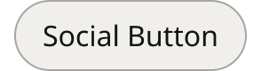

# Button Social-Login

> Social sign-in and secondary pill button (Embedded Login: Apple ID, Facebook and Google sign-in, the round icon buttons, Continue, Create Account). Icon position = None, left, right, only (round, icon only); interaction = Default, hover, pressed; inFocus adds the focus ring. Rebuilt in place 2026-11-11 so Embedded Login's instances keep their labels and icons. Renamed from Button Social 2026-11-11 (Karl).

## Figma

- File: **MNG Web Design System** (`jFHYqhZbJjvWQmDI4myCsd`), page **Buttons | 2026.09.30**
- Component set: [`Button Social-Login` · 6516:5394](https://www.figma.com/design/jFHYqhZbJjvWQmDI4myCsd/?node-id=6516-5394) · key `fd1547f6e1150e102fa02d22d6cf83d8b865a0c3`
- Documentation frame: [Button Social-Login Container](https://www.figma.com/design/jFHYqhZbJjvWQmDI4myCsd/?node-id=7558-5006) · overview: [previews/button-social-login--documentation.png](previews/button-social-login--documentation.png)

## Properties

| Property | Default | Options |
|---|---|---|
| interaction | Default | Default, hover, pressed |
| inFocus | False | False, True |
| Icon position | None | None, left, right, only |

| Other property | Type | Default |
|---|---|---|
| Label | text | Social Button |
| Icon | instance_swap | 4693:60 |

## Variants

| Variant | Size | Node | Instances | Preview |
|---|---|---|---|---|
| `Default / False / None` | 147×40 | [6516:5395](https://www.figma.com/design/jFHYqhZbJjvWQmDI4myCsd/?node-id=6516-5395) | 2 |  |
| `Default / False / left` | 171×40 | [6516:5401](https://www.figma.com/design/jFHYqhZbJjvWQmDI4myCsd/?node-id=6516-5401) | 4 |  |
| `Default / False / right` | 171×40 | [6516:5425](https://www.figma.com/design/jFHYqhZbJjvWQmDI4myCsd/?node-id=6516-5425) | 0 |  |
| `Default / False / only` | 56×40 | [7557:31815](https://www.figma.com/design/jFHYqhZbJjvWQmDI4myCsd/?node-id=7557-31815) | 4 |  |
| `Default / True / None` | 147×40 | [7557:31789](https://www.figma.com/design/jFHYqhZbJjvWQmDI4myCsd/?node-id=7557-31789) | 0 |  |
| `Default / True / left` | 171×40 | [7557:31802](https://www.figma.com/design/jFHYqhZbJjvWQmDI4myCsd/?node-id=7557-31802) | 0 |  |
| `Default / True / right` | 171×40 | [6516:5431](https://www.figma.com/design/jFHYqhZbJjvWQmDI4myCsd/?node-id=6516-5431) | 0 |  |
| `Default / True / only` | 56×40 | [7557:31851](https://www.figma.com/design/jFHYqhZbJjvWQmDI4myCsd/?node-id=7557-31851) | 1 |  |
| `hover / False / None` | 147×40 | [6516:5407](https://www.figma.com/design/jFHYqhZbJjvWQmDI4myCsd/?node-id=6516-5407) | 0 |  |
| `hover / False / left` | 171×40 | [6516:5413](https://www.figma.com/design/jFHYqhZbJjvWQmDI4myCsd/?node-id=6516-5413) | 0 |  |
| `hover / False / right` | 171×40 | [6516:5419](https://www.figma.com/design/jFHYqhZbJjvWQmDI4myCsd/?node-id=6516-5419) | 0 |  |
| `hover / False / only` | 56×40 | [7557:31827](https://www.figma.com/design/jFHYqhZbJjvWQmDI4myCsd/?node-id=7557-31827) | 0 |  |
| `pressed / False / None` | 147×40 | [7557:31771](https://www.figma.com/design/jFHYqhZbJjvWQmDI4myCsd/?node-id=7557-31771) | 0 |  |
| `pressed / False / left` | 171×40 | [7557:31777](https://www.figma.com/design/jFHYqhZbJjvWQmDI4myCsd/?node-id=7557-31777) | 0 |  |
| `pressed / False / right` | 171×40 | [7557:31783](https://www.figma.com/design/jFHYqhZbJjvWQmDI4myCsd/?node-id=7557-31783) | 0 |  |
| `pressed / False / only` | 56×40 | [7557:31839](https://www.figma.com/design/jFHYqhZbJjvWQmDI4myCsd/?node-id=7557-31839) | 0 |  |

## Anatomy

Default variant `Default / False / None` (hidden layers marked):

- **Icon position=None, interaction=Default, inFocus=False** `COMPONENT`: 147×40, vertical, gap 0, padding 0/8/0/8, hug×hug
  - **Button** `FRAME`: 131×40, horizontal, gap 0, padding 0/16/0/16, hug×fixed
    - **Content** `FRAME`: 99×22, horizontal, gap 8, padding 0/0/0/0, hug×hug
      - **Label** `TEXT`: 99×22, hug×hug, "Social Button", Noto Sans Regular 16px

## Component tokens

From `button-social-login.tokens.json`. References point at system tokens (`tokens/core/`, `tokens/themes/`); the CSS variable is `--mng-` + the token path. A literal value means the Figma layer isn't bound to a token.

| Token | Value |
|---|---|
| `button-social-login.interaction-default.button.background` | `{color.gray.600}` |
| `button-social-login.interaction-default.button.border-color` | `{color.gray.400}` |
| `button-social-login.interaction-hover.button.background` | `{color.gray.max}` |
| `button-social-login.interaction-hover.button.border-color` | `{color.gray.500}` |
| `button-social-login.interaction-pressed.button.background` | `{color.gray.max}` |
| `button-social-login.interaction-pressed.button.border-color` | `{color.gray.500}` |
| `button-social-login.base.button.border-radius` | 999px |
| `button-social-login.base.button.border-style` | solid |
| `button-social-login.base.button.border-width` | 1px |
| `button-social-login.base.button.height` | 40px |
| `button-social-login.base.button.padding-left` | `{spacing.200}` |
| `button-social-login.base.button.padding-right` | `{spacing.200}` |
| `button-social-login.base.button.content.gap` | `{spacing.100}` |
| `button-social-login.base.button.content.icon-left.height` | 16px |
| `button-social-login.base.button.content.icon-left.icon-color` | `{color.gray.min}` |
| `button-social-login.base.button.content.icon-left.width` | 16px |
| `button-social-login.base.button.content.label.color` | `{color.gray.min}` |
| `button-social-login.base.button.content.label.font-family` | `{font.family.noto-sans}` |
| `button-social-login.base.button.content.label.font-size` | `{font.size.16}` |
| `button-social-login.base.button.content.label.font-weight` | `{font.weight.regular}` |
| `button-social-login.base.root.padding-left` | `{spacing.100}` |
| `button-social-login.base.root.padding-right` | `{spacing.100}` |
| `button-social-login.icon-position-only.button.width` | 40px |
| `button-social-login.icon-position-right.button.content.icon-right.height` | 16px |
| `button-social-login.icon-position-right.button.content.icon-right.icon-color` | `{color.gray.min}` |
| `button-social-login.icon-position-right.button.content.icon-right.width` | 16px |
| `button-social-login.infocus-true.button.focus-ring.border-color` | `{color.gray.black}` |
| `button-social-login.infocus-true.button.focus-ring.border-radius` | 999px |
| `button-social-login.infocus-true.button.focus-ring.border-style` | solid |
| `button-social-login.infocus-true.button.focus-ring.border-width` | 2px |

## Behavior and breakpoints

No Breakpoint property: one size at every width.

- **Size:** 40px tall. The `Button` fills the instance's width inside the 8px margin (the variant root has a fixed width that hugs the label by default), so an instance set wider fills its column, as Embedded Login does (Karl, 2026-11-11). 16px `spacing/200` side padding; `Icon position=only` is a 40x40 circle that stays round.
- **Margin:** the variant root keeps an 8px (`spacing/100`) left and right margin, like Button Tertiary, so the visible button is 16px narrower than the instance (Karl, 2026-11-11).
- **Shape:** fully round ends at any height: the corner radius is half the height. Figma uses 999; CSS `border-radius: 9999px`. No token (Karl, 2026-11-11: the radius depends only on the height).
- **Contents:** Icon (16px, the `Icon` instance-swap property) and Label (Noto Sans Regular 16px, `color/gray/min`, the `Label` text property) with an 8px (`spacing/100`) gap. Each variant holds only the icon it shows.
- **Colors:** Default `color/gray/600` with a 1px inside `color/gray/400` border (label 16:1); hover and pressed `color/gray/max` with a 1px inside `color/gray/500` border (label 18:1), the same as Button Tertiary (Karl, 2026-11-11).
- **Focus ring:** the Default button plus a `Focus Ring` frame 1px outside it, 2px `color/gray/black`, round like the button. In CSS: `outline: 2px solid var(--mng-color-gray-black); outline-offset: 1px;`.
- **Brand icons** keep their own colors (Google's multicolor G; Facebook blue in Embedded Login).
- **Accessibility:** a button (or link) named by its label; an icon-only button needs an accessible name (e.g. `aria-label="Continue with Apple"`). Icons are decorative.
- **Borders:** faint on a white page (`color/gray/400` 2.4:1, hover `color/gray/500` 1.6:1), as on Button Tertiary; accepted (Karl, 2026-11-11).

## Accessibility

- No InFocus state in Figma.
- Text color on its background must meet WCAG AA contrast (4.5:1 for text under 18px) in every theme; theme colors change per site.
- Icons inside a labelled control are decorative (`aria-hidden`); an icon-only control needs an accessible name (`aria-label`).

## Where it is used

Scope: instances in the Figma file **MNG Web Design System** only (other files that use the library are not counted). Total: **11**.

**Built from:** Icons ×12
Icon variants: `new-tab` ×12.

## Production

Used in the Embedded Login designs; not checked against production.

## Known issues

1. **Values not bound to a token** (literal in the component tokens): `base` button border-radius = 999px; `infocus-true` button.focus-ring border-radius = 999px.

## Files

- `button-social-login.tokens.json`: component tokens (DTCG 2025.10).
- `button-social-login.html`: HTML/CSS skeleton of every variant, using the `dist/` CSS variables (open it in a browser).
- `previews/`: PNG of every variant @2x and the documentation frame.

*Generated 2026-11-11 by `scripts/component-export/export.py` (EXPORT-STANDARD.md section 7). Edit the text in `scripts/component-export/registry.json`, not here.*
