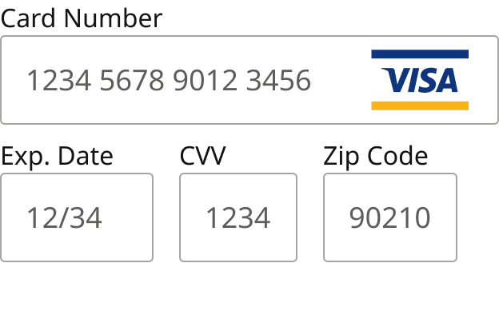
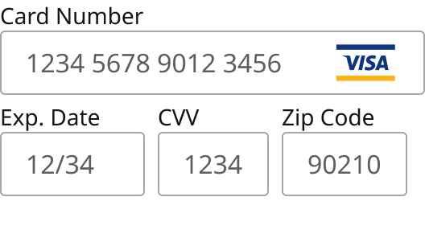

# Form Field Assembly / CC details

> Card Number (optional, Show card number), then Exp. Date / CVV / Zip Code, each sized to its content. Desktop 16px gaps; Mobile 8px gaps, 4px between rows.

## Figma

- File: **MNG Web Design System** (`jFHYqhZbJjvWQmDI4myCsd`), page **Form Fields | 2026.11.04**
- Component set: [`Form Field Assembly / CC details` · 7003:28816](https://www.figma.com/design/jFHYqhZbJjvWQmDI4myCsd/?node-id=7003-28816) · key `b8f9b47fc2388d4c04fe6194aa2180c6fabdca84`
- Documentation frame: [Assembly: CC details — Documentation](https://www.figma.com/design/jFHYqhZbJjvWQmDI4myCsd/?node-id=6965-7450) · overview: [previews/cc-details--documentation.png](previews/cc-details--documentation.png)

## Properties

| Property | Default | Options |
|---|---|---|
| Size | Desktop | Desktop, Mobile |

| Other property | Type | Default |
|---|---|---|
| Error message | text | Error message text. |
| Show error | boolean | False |
| Show card number | boolean | True |

## Variants

| Variant | Size | Node | Instances | Preview |
|---|---|---|---|---|
| `Desktop` | 312×197 | [7003:28778](https://www.figma.com/design/jFHYqhZbJjvWQmDI4myCsd/?node-id=7003-28778) | 2 |  |
| `Mobile` | 264×148 | [7003:28815](https://www.figma.com/design/jFHYqhZbJjvWQmDI4myCsd/?node-id=7003-28815) | 4 |  |

## Anatomy

Default variant `Desktop` (hidden layers marked):

- **Size=Desktop** `COMPONENT`: 312×197, vertical, gap 8, padding 0/0/0/0, hug×hug
  - **Form Field** `INSTANCE`: 312×78, vertical, gap 0, padding 0/0/0/0, fixed×hug, instance of Form Field (Size=Desktop, State=Blank)
  - **Fields** `FRAME`: 286×78, horizontal, gap 16, padding 0/0/0/0, hug×hug
    - **Form Field** `INSTANCE`: 96×78, vertical, gap 0, padding 0/0/0/0, fixed×hug, instance of Form Field (Size=Desktop, State=Blank)
    - **Form Field** `INSTANCE`: 74×78, vertical, gap 0, padding 0/0/0/0, fixed×hug, instance of Form Field (Size=Desktop, State=Blank)
    - **Form Field** `INSTANCE`: 84×78, vertical, gap 0, padding 0/0/0/0, fixed×hug, instance of Form Field (Size=Desktop, State=Blank)
  - **Error Message Container (Shared)** `FRAME`: 270×25, horizontal, gap 8, padding 0/0/0/0, fixed×fixed
    - **Error Message Text.** `TEXT`: 270×25, fixed×fixed, "Error message text.", Noto Sans Regular 18px, **hidden**

## Component tokens

From `cc-details.tokens.json`. References point at system tokens (`tokens/core/`, `tokens/themes/`); the CSS variable is `--mng-` + the token path. A literal value means the Figma layer isn't bound to a token.

| Token | Value |
|---|---|
| `cc-details.size-desktop.error-message-container-shared.height` | 25px |
| `cc-details.size-desktop.error-message-container-shared.width` | 270px |
| `cc-details.size-desktop.fields.gap` | `{spacing.200}` |
| `cc-details.size-desktop.fields.form-field.height` | 78px |
| `cc-details.size-desktop.fields.form-field.width` | 84px |
| `cc-details.size-desktop.form-field.height` | 78px |
| `cc-details.size-desktop.form-field.width` | 312px |
| `cc-details.size-desktop.root.gap` | `{spacing.100}` |
| `cc-details.size-mobile.error-message-container-shared.height` | 22px |
| `cc-details.size-mobile.error-message-container-shared.width` | 238px |
| `cc-details.size-mobile.fields.gap` | `{spacing.100}` |
| `cc-details.size-mobile.fields.form-field.height` | 59px |
| `cc-details.size-mobile.fields.form-field.width` | 78px |
| `cc-details.size-mobile.form-field.height` | 59px |
| `cc-details.size-mobile.form-field.width` | 264px |
| `cc-details.size-mobile.root.gap` | `{spacing.050}` |
| `cc-details.base.fields.form-field.icon-color` | `{color.gray.min}` |
| `cc-details.base.form-field.icon-color` | `{color.gray.min}` |

## Behavior and breakpoints

| Size value | Viewport |
|---|---|
| Desktop | Desktop, TabletH, TabletV |
| Mobile | Mobile, Fold |

*Same switch as Form Field (production breakpoint not re-checked for this export, Karl 2026-11-04).*

- Card Number (optional, Show card number), then Exp. Date / CVV / Zip Code, each sized to its content. Desktop 16px gaps; Mobile 8px gaps, 4px between rows.
- Built from Form Field instances (exposed: set each field's State, Label, Value and Placeholder on the instance). Use Show icon = off inside assemblies.
- **Errors:** the fields' own error rows are hidden and one shared error row below the group (Show error, Error message) covers every field in it; the field in error still gets the red outline. Point that field's `aria-describedby` at the shared message.

## Accessibility

- No InFocus state in Figma.
- Text color on its background must meet WCAG AA contrast (4.5:1 for text under 18px) in every theme; theme colors change per site.
- Icons inside a labelled control are decorative (`aria-hidden`); an icon-only control needs an accessible name (`aria-label`).

## Where it is used

Scope: instances in the Figma file **MNG Web Design System** only (other files that use the library are not counted). Total: **6**.

Inside components: InLineMessage ×3.
Placed on pages: In-Line Content Containers | 2026.01.02 ×3.

**Built from:** Form Field ×8

## Production

Not checked against production for this export (Karl, 2026-11-04).

## Known issues

1. Not checked against production for this export (Karl, 2026-11-04).

## Files

- `cc-details.tokens.json`: component tokens (DTCG 2025.10).
- `cc-details.html`: HTML/CSS skeleton of every variant, using the `dist/` CSS variables (open it in a browser).
- `previews/`: PNG of every variant @2x and the documentation frame.

*Generated 2026-11-04 by `scripts/component-export/export.py` (EXPORT-STANDARD.md section 7). Edit the text in `scripts/component-export/registry.json`, not here.*
