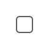
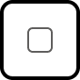
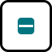

# CheckBox

> Check box: a 14x14 box inside a 40x40 touch area. status = unselected, selected, partial; interaction = Default, hover, pressed, disabled; inFocus adds the focus ring. The label, terms text and error row come from Form Field Assembly / Checkbox + Terms.

## Figma

- File: **MNG Web Design System** (`jFHYqhZbJjvWQmDI4myCsd`), page **Check Boxes | 2026.11.04**
- Component set: [`CheckBox` · 4693:690](https://www.figma.com/design/jFHYqhZbJjvWQmDI4myCsd/?node-id=4693-690) · key `e32ad97473603da98a47d63eca30342e498b2ab2`
- Documentation frame: [CheckBox Container](https://www.figma.com/design/jFHYqhZbJjvWQmDI4myCsd/?node-id=7501-27496) · overview: [previews/checkbox--documentation.png](previews/checkbox--documentation.png)

## Properties

| Property | Default | Options |
|---|---|---|
| status | unselected | unselected, selected, partial |
| interaction | Default | Default, hover, pressed, disabled |
| inFocus | False | False, True |

## Variants

| Variant | Size | Node | Instances | Preview |
|---|---|---|---|---|
| `unselected / Default / False` | 40×40 | [4693:691](https://www.figma.com/design/jFHYqhZbJjvWQmDI4myCsd/?node-id=4693-691) | 28 |  |
| `unselected / Default / True` | 40×40 | [5280:3783](https://www.figma.com/design/jFHYqhZbJjvWQmDI4myCsd/?node-id=5280-3783) | 0 |  |
| `unselected / hover / False` | 40×40 | [5280:3768](https://www.figma.com/design/jFHYqhZbJjvWQmDI4myCsd/?node-id=5280-3768) | 0 |  |
| `unselected / pressed / False` | 40×40 | [5280:3865](https://www.figma.com/design/jFHYqhZbJjvWQmDI4myCsd/?node-id=5280-3865) | 0 |  |
| `unselected / disabled / False` | 40×40 | [5280:3819](https://www.figma.com/design/jFHYqhZbJjvWQmDI4myCsd/?node-id=5280-3819) | 0 |  |
| `selected / Default / False` | 40×40 | [4693:694](https://www.figma.com/design/jFHYqhZbJjvWQmDI4myCsd/?node-id=4693-694) | 7 |  |
| `selected / Default / True` | 40×40 | [5280:3786](https://www.figma.com/design/jFHYqhZbJjvWQmDI4myCsd/?node-id=5280-3786) | 0 |  |
| `selected / hover / False` | 40×40 | [5280:3771](https://www.figma.com/design/jFHYqhZbJjvWQmDI4myCsd/?node-id=5280-3771) | 0 |  |
| `selected / pressed / False` | 40×40 | [5280:3868](https://www.figma.com/design/jFHYqhZbJjvWQmDI4myCsd/?node-id=5280-3868) | 0 |  |
| `selected / disabled / False` | 40×40 | [5280:3822](https://www.figma.com/design/jFHYqhZbJjvWQmDI4myCsd/?node-id=5280-3822) | 0 |  |
| `partial / Default / False` | 40×40 | [4693:698](https://www.figma.com/design/jFHYqhZbJjvWQmDI4myCsd/?node-id=4693-698) | 0 |  |
| `partial / Default / True` | 40×40 | [5280:3789](https://www.figma.com/design/jFHYqhZbJjvWQmDI4myCsd/?node-id=5280-3789) | 0 |  |
| `partial / hover / False` | 40×40 | [5280:3774](https://www.figma.com/design/jFHYqhZbJjvWQmDI4myCsd/?node-id=5280-3774) | 0 |  |
| `partial / pressed / False` | 40×40 | [5280:3871](https://www.figma.com/design/jFHYqhZbJjvWQmDI4myCsd/?node-id=5280-3871) | 0 |  |
| `partial / disabled / False` | 40×40 | [5280:3825](https://www.figma.com/design/jFHYqhZbJjvWQmDI4myCsd/?node-id=5280-3825) | 0 |  |

## Anatomy

Default variant `unselected / Default / False` (hidden layers marked):

- **status=unselected, inFocus=False, interaction=Default** `COMPONENT`: 40×40, horizontal, gap 8, padding 0/0/0/0, fixed×fixed
  - **Box** `GROUP`: 14×14, fixed×fixed
    - **Square** `RECTANGLE`: 14×14, fixed×fixed

## Component tokens

From `checkbox.tokens.json`. References point at system tokens (`tokens/core/`, `tokens/themes/`); the CSS variable is `--mng-` + the token path. A literal value means the Figma layer isn't bound to a token.

| Token | Value |
|---|---|
| `checkbox.interaction-default.box.background` | `{color.theme.primary}` |
| `checkbox.interaction-default.box.icon.icon-color` | `{color.gray.max}` |
| `checkbox.interaction-default.box.square.background` | `{color.gray.max}` |
| `checkbox.interaction-default.box.square.border-color` | `{color.gray.200}` |
| `checkbox.interaction-hover.box.background` | `{color.theme.primary-lighter}` |
| `checkbox.interaction-hover.box.icon.icon-color` | `{color.gray.max}` |
| `checkbox.interaction-hover.box.square.background` | `{color.gray.max}` |
| `checkbox.interaction-hover.box.square.border-color` | `{color.gray.min}` |
| `checkbox.interaction-pressed.box.background` | `{color.theme.primary-lighter}` |
| `checkbox.interaction-pressed.box.icon.icon-color` | `{color.gray.max}` |
| `checkbox.interaction-pressed.box.square.background` | `{color.gray.max}` |
| `checkbox.interaction-pressed.box.square.border-color` | `{color.gray.min}` |
| `checkbox.interaction-disabled.box.background` | `{color.gray.600}` |
| `checkbox.interaction-disabled.box.icon.icon-color` | `{color.gray.500}` |
| `checkbox.interaction-disabled.box.square.background` | `{color.gray.600}` |
| `checkbox.interaction-disabled.box.square.border-color` | `{color.gray.500}` |
| `checkbox.base.box.border-radius` | `{radius.field}` |
| `checkbox.base.box.height` | 14px |
| `checkbox.base.box.width` | 14px |
| `checkbox.base.box.icon.height` | 12px |
| `checkbox.base.box.icon.width` | 12px |
| `checkbox.base.root.border-radius` | `{radius.utility}` |
| `checkbox.base.root.height` | 40px |
| `checkbox.base.root.width` | 40px |
| `checkbox.status-unselected.box.square.border-radius` | `{radius.field}` |
| `checkbox.status-unselected.box.square.border-style` | solid |
| `checkbox.status-unselected.box.square.border-width` | 1px |
| `checkbox.status-unselected.box.square.height` | 14px |
| `checkbox.status-unselected.box.square.width` | 14px |
| `checkbox.infocus-true.root.border-color` | `{color.gray.black}` |
| `checkbox.infocus-true.root.border-style` | solid |
| `checkbox.infocus-true.root.border-width` | 2px |

## Behavior and breakpoints

No Breakpoint property: one size at every width.

- **Box:** 14x14px, `color/gray/max` fill, 1px inside `color/gray/200` border (6.5:1 on white), 3px corners (`radius/field`).
- **Touch area:** 40x40px around the box, 5px corners (`radius/utility`). Hover, pressed and focus show a 2px `color/gray/black` ring outside it; focus can apply to any state.
- **Selected / partial:** `checkmark3` / `minus`, 12x12px, `color/gray/max` (white) on a `color/theme/primary` box; on hover and pressed the box is `color/theme/primary-lighter`.
- **Disabled:** the empty box stays; selected and partial show the same icon in `color/gray/500` on a `color/gray/600` box.
- **Label** (from the assembly): Noto Sans Regular 14px, `color/gray/min`; the box and the first line of text are center-aligned, no padding between the touch area and the text. **Error message:** Noto Sans Regular 18px, `color/feedback/high-error`, directly under, no padding.
- **Pointer:** changes from an arrow to a pointing hand inside the 40x40 touch area.

## Accessibility

- No InFocus state in Figma.
- Text color on its background must meet WCAG AA contrast (4.5:1 for text under 18px) in every theme; theme colors change per site.
- Icons inside a labelled control are decorative (`aria-hidden`); an icon-only control needs an accessible name (`aria-label`).

## Where it is used

Scope: instances in the Figma file **MNG Web Design System** only (other files that use the library are not counted). Total: **35**.

Inside components: InLineMessage ×13, Form Field ×7, Form Field Assembly  ×2.
Placed on pages: In-Line Content Containers | 2026.01.02 ×3.

**Built from:** Icons ×10
Icon variants: `checkmark3` ×5, `minus` ×5.

## Production

Not checked against production for this export (Karl, 2026-11-04).

## Known issues

1. White icon on `color/theme/primary-lighter` (hover / pressed) is 1.6:1 on The Mercury News + East Bay Times and 3.0:1 on The Sonoma Index-Tribune (design-vs-production entry 37; colors frozen, Karl to decide).
2. Not checked against production for this export (Karl, 2026-11-04).

## Files

- `checkbox.tokens.json`: component tokens (DTCG 2025.10).
- `checkbox.html`: HTML/CSS skeleton of every variant, using the `dist/` CSS variables (open it in a browser).
- `previews/`: PNG of every variant @2x and the documentation frame.

*Generated 2026-11-04 by `scripts/component-export/export.py` (EXPORT-STANDARD.md section 7). Edit the text in `scripts/component-export/registry.json`, not here.*
