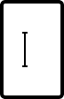
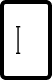

# Code Box

> Single-character cell for verification codes and PINs: 36x56 Desktop, 26x40 Mobile. Same states as Form Field (Blank, Filled, Focus, Error, Error Focus, Success, Disabled). Six of them make the Verification Code assembly.

## Figma

- File: **MNG Web Design System** (`jFHYqhZbJjvWQmDI4myCsd`), page **Form Fields | 2026.11.04**
- Component set: [`Code Box` · 6964:7032](https://www.figma.com/design/jFHYqhZbJjvWQmDI4myCsd/?node-id=6964-7032) · key `4d7a04191cf151ff9cd05b60e78c1b05c49f20b0`
- Documentation frame: [Code Box — Documentation](https://www.figma.com/design/jFHYqhZbJjvWQmDI4myCsd/?node-id=6964-7085) · overview: [previews/code-box--documentation.png](previews/code-box--documentation.png)

## Properties

| Property | Default | Options |
|---|---|---|
| State | Blank | Blank, Filled, Focus, Error, Error Focus, Success, Disabled |
| Size | Desktop | Desktop, Mobile |

| Other property | Type | Default |
|---|---|---|
| Value | text |  |

## Variants

| Variant | Size | Node | Instances | Preview |
|---|---|---|---|---|
| `Blank / Desktop` | 36×56 | [6964:6999](https://www.figma.com/design/jFHYqhZbJjvWQmDI4myCsd/?node-id=6964-6999) | 16 |  |
| `Blank / Mobile` | 26×40 | [6972:7524](https://www.figma.com/design/jFHYqhZbJjvWQmDI4myCsd/?node-id=6972-7524) | 16 |  |
| `Filled / Desktop` | 36×56 | [6964:7000](https://www.figma.com/design/jFHYqhZbJjvWQmDI4myCsd/?node-id=6964-7000) | 6 |  |
| `Filled / Mobile` | 26×40 | [6972:7532](https://www.figma.com/design/jFHYqhZbJjvWQmDI4myCsd/?node-id=6972-7532) | 6 |  |
| `Focus / Desktop` | 36×56 | [6964:7008](https://www.figma.com/design/jFHYqhZbJjvWQmDI4myCsd/?node-id=6964-7008) | 2 |  |
| `Focus / Mobile` | 26×40 | [6972:7540](https://www.figma.com/design/jFHYqhZbJjvWQmDI4myCsd/?node-id=6972-7540) | 2 |  |
| `Error / Desktop` | 36×56 | [6964:7016](https://www.figma.com/design/jFHYqhZbJjvWQmDI4myCsd/?node-id=6964-7016) | 0 |  |
| `Error / Mobile` | 26×40 | [6972:7548](https://www.figma.com/design/jFHYqhZbJjvWQmDI4myCsd/?node-id=6972-7548) | 0 |  |
| `Error Focus / Desktop` | 36×56 | [7501:27475](https://www.figma.com/design/jFHYqhZbJjvWQmDI4myCsd/?node-id=7501-27475) | 0 |  |
| `Error Focus / Mobile` | 26×40 | [7501:27483](https://www.figma.com/design/jFHYqhZbJjvWQmDI4myCsd/?node-id=7501-27483) | 0 |  |
| `Success / Desktop` | 36×56 | [7496:26690](https://www.figma.com/design/jFHYqhZbJjvWQmDI4myCsd/?node-id=7496-26690) | 6 |  |
| `Success / Mobile` | 26×40 | [7496:26698](https://www.figma.com/design/jFHYqhZbJjvWQmDI4myCsd/?node-id=7496-26698) | 0 |  |
| `Disabled / Desktop` | 36×56 | [6964:7024](https://www.figma.com/design/jFHYqhZbJjvWQmDI4myCsd/?node-id=6964-7024) | 0 |  |
| `Disabled / Mobile` | 26×40 | [6972:7556](https://www.figma.com/design/jFHYqhZbJjvWQmDI4myCsd/?node-id=6972-7556) | 0 |  |

## Anatomy

Default variant `Blank / Desktop` (hidden layers marked):

- **Size=Desktop, State=Blank** `COMPONENT`: 36×56, horizontal, gap 8, padding 8/0/8/0, fixed×fixed
  - **Text Container** `FRAME`: 0×25, horizontal, gap 8, padding 0/0/0/0, hug×hug
    - **Value** `TEXT`: 0×25, hug×hug
  - **Cursor Container** `FRAME`: 3×20, horizontal, gap 8, padding 0/0/0/0, hug×hug, absolute, **hidden**
    - **Cursor** `BOOLEAN_OPERATION`: 3×20, fixed×fixed
      - **Line 71 (Stroke)** `VECTOR`: 3×1, fixed×fixed
      - **Line 72 (Stroke)** `VECTOR`: 3×1, fixed×fixed
      - **Line 73 (Stroke)** `VECTOR`: 20×1, fixed×fixed

## Component tokens

From `code-box.tokens.json`. References point at system tokens (`tokens/core/`, `tokens/themes/`); the CSS variable is `--mng-` + the token path. A literal value means the Figma layer isn't bound to a token.

| Token | Value |
|---|---|
| `code-box.state-focus.cursor-container.cursor.background` | `{color.gray.black}` |
| `code-box.state-focus.cursor-container.cursor.line-71-stroke.background` | `{color.gray.black}` |
| `code-box.state-focus.cursor-container.cursor.line-72-stroke.background` | `{color.gray.black}` |
| `code-box.state-focus.cursor-container.cursor.line-73-stroke.background` | `{color.gray.black}` |
| `code-box.state-focus.root.background` | `{color.gray.max}` |
| `code-box.state-focus.root.border-color` | `{color.gray.black}` |
| `code-box.state-focus.root.border-width` | 2px |
| `code-box.size-desktop.cursor-container.cursor.height` | 20px |
| `code-box.size-desktop.cursor-container.cursor.width` | 3px |
| `code-box.size-desktop.cursor-container.cursor.line-71-stroke.height` | 1px |
| `code-box.size-desktop.cursor-container.cursor.line-71-stroke.width` | 3px |
| `code-box.size-desktop.cursor-container.cursor.line-72-stroke.height` | 1px |
| `code-box.size-desktop.cursor-container.cursor.line-72-stroke.width` | 3px |
| `code-box.size-desktop.cursor-container.cursor.line-73-stroke.height` | 1px |
| `code-box.size-desktop.cursor-container.cursor.line-73-stroke.width` | 20px |
| `code-box.size-desktop.root.height` | 56px |
| `code-box.size-desktop.root.width` | 36px |
| `code-box.size-mobile.cursor-container.cursor.height` | 14px |
| `code-box.size-mobile.cursor-container.cursor.width` | 2.1px |
| `code-box.size-mobile.cursor-container.cursor.line-71-stroke.height` | 0.7px |
| `code-box.size-mobile.cursor-container.cursor.line-71-stroke.width` | 2.1px |
| `code-box.size-mobile.cursor-container.cursor.line-72-stroke.height` | 0.7px |
| `code-box.size-mobile.cursor-container.cursor.line-72-stroke.width` | 2.1px |
| `code-box.size-mobile.cursor-container.cursor.line-73-stroke.height` | 0.7px |
| `code-box.size-mobile.cursor-container.cursor.line-73-stroke.width` | 14px |
| `code-box.size-mobile.root.height` | 40px |
| `code-box.size-mobile.root.width` | 26px |
| `code-box.state-blank.root.background` | `{color.gray.max}` |
| `code-box.state-blank.root.border-color` | `{color.gray.400}` |
| `code-box.state-blank.root.border-width` | 1px |
| `code-box.state-filled.root.background` | `{color.gray.max}` |
| `code-box.state-filled.root.border-color` | `{color.gray.400}` |
| `code-box.state-filled.root.border-width` | 1px |
| `code-box.state-error.root.background` | `{color.gray.max}` |
| `code-box.state-error.root.border-color` | `{color.feedback.high-error}` |
| `code-box.state-error.root.border-width` | 1px |
| `code-box.state-error-focus.root.background` | `{color.gray.max}` |
| `code-box.state-error-focus.root.border-color` | `{color.feedback.high-error}` |
| `code-box.state-error-focus.root.border-width` | 2px |
| `code-box.state-success.root.background` | `{color.gray.max}` |
| `code-box.state-success.root.border-color` | `{color.feedback.low-success}` |
| `code-box.state-success.root.border-width` | 1px |
| `code-box.state-disabled.root.background` | `{color.gray.600}` |
| `code-box.state-disabled.root.border-color` | `{color.gray.500}` |
| `code-box.state-disabled.root.border-width` | 1px |
| `code-box.base.root.border-radius` | `{radius.field}` |
| `code-box.base.root.border-style` | solid |
| `code-box.base.root.padding-bottom` | `{spacing.100}` |
| `code-box.base.root.padding-top` | `{spacing.100}` |
| `code-box.base.text-container.value.color` | `{color.gray.min}` |
| `code-box.base.text-container.value.font-family` | `{font.family.noto-sans}` |
| `code-box.base.text-container.value.font-size` | `{font.size.18}` |
| `code-box.base.text-container.value.font-weight` | `{font.weight.bold}` |

## Behavior and breakpoints

| Size value | Viewport | Behavior |
|---|---|---|
| Desktop | Desktop, TabletH, TabletV | 36x56 cell, 18px digit |
| Mobile | Mobile, Fold | 26x40 cell, 16px digit |

*The switch sits between TabletV and Mobile, matching the site CSS (production breakpoint not re-checked for this export, Karl 2026-11-04).*

- **Cell:** `color/gray/max` fill, 1px inside `color/gray/400` border, 3px corners (`radius/field`), 8px (`spacing/100`) top and bottom padding; the digit is centered, Noto Sans Bold 18 (Mobile 16), `color/gray/min`.
- **States:** Focus 2px `color/gray/black` border; Error 1px `color/feedback/high-error`; Error Focus 2px `color/feedback/high-error`; Success 1px `color/feedback/low-success`, no icon (too narrow); Disabled `color/gray/500` border on `color/gray/600`.
- **Success means complete, not correct:** turn every cell to Success once all digits are entered; only the server can confirm the code. If the server rejects it, set the cells to Error and show the message in the Verification Code's shared error row.
- The label and the error row aren't part of the cell; they come from Form Field Assembly / Verification Code.

## Accessibility

- No InFocus state in Figma.
- Text color on its background must meet WCAG AA contrast (4.5:1 for text under 18px) in every theme; theme colors change per site.
- Icons inside a labelled control are decorative (`aria-hidden`); an icon-only control needs an accessible name (`aria-label`).

## Where it is used

Scope: instances in the Figma file **MNG Web Design System** only (other files that use the library are not counted). Total: **54**.

Inside components: Form Field Assembly  ×12.
Placed on pages: Form Fields | 2026.11.04 ×6.

**Built from:** no nested components.

## Production

Not checked against production for this export (Karl, 2026-11-04).

## Known issues

1. Not checked against production for this export (Karl, 2026-11-04).

## Files

- `code-box.tokens.json`: component tokens (DTCG 2025.10).
- `code-box.html`: HTML/CSS skeleton of every variant, using the `dist/` CSS variables (open it in a browser).
- `previews/`: PNG of every variant @2x and the documentation frame.

*Generated 2026-11-04 by `scripts/component-export/export.py` (EXPORT-STANDARD.md section 7). Edit the text in `scripts/component-export/registry.json`, not here.*
