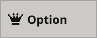
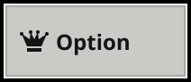
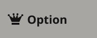
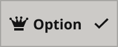
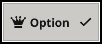
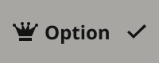

# Dropdown Menu Item

> One option row of a Dropdown Menu; stack as many as the menu needs (Karl, 2026-11-10). status = unselected, selected (a check marks the current choice); interaction = Default, hover, pressed; inFocus adds the focus ring.

## Figma

- File: **MNG Web Design System** (`jFHYqhZbJjvWQmDI4myCsd`), page **Dropdown Menus | 2026.11.11**
- Component set: [`Dropdown Menu Item` · 7543:1879](https://www.figma.com/design/jFHYqhZbJjvWQmDI4myCsd/?node-id=7543-1879) · key `64855c280414c03e2fbcae4dca6ea89db62a1075`
- Documentation frame: [Dropdown Menu Item Container](https://www.figma.com/design/jFHYqhZbJjvWQmDI4myCsd/?node-id=7545-9902) · overview: [previews/dropdown-menu-item--documentation.png](previews/dropdown-menu-item--documentation.png)

## Properties

| Property | Default | Options |
|---|---|---|
| status | unselected | unselected, selected |
| interaction | Default | Default, hover, pressed |
| inFocus | False | False, True |

| Other property | Type | Default |
|---|---|---|
| Label | text | Option |
| Show icon | boolean | True |
| Icon | instance_swap | 3555:949 |

## Variants

| Variant | Size | Node | Instances | Preview |
|---|---|---|---|---|
| `unselected / Default / False` | 100×40 | [7543:1823](https://www.figma.com/design/jFHYqhZbJjvWQmDI4myCsd/?node-id=7543-1823) | 5 |  |
| `unselected / Default / True` | 100×40 | [7543:1844](https://www.figma.com/design/jFHYqhZbJjvWQmDI4myCsd/?node-id=7543-1844) | 1 |  |
| `unselected / hover / False` | 100×40 | [7543:1830](https://www.figma.com/design/jFHYqhZbJjvWQmDI4myCsd/?node-id=7543-1830) | 1 |  |
| `unselected / pressed / False` | 100×40 | [7543:1837](https://www.figma.com/design/jFHYqhZbJjvWQmDI4myCsd/?node-id=7543-1837) | 0 |  |
| `selected / Default / False` | 100×40 | [7543:1851](https://www.figma.com/design/jFHYqhZbJjvWQmDI4myCsd/?node-id=7543-1851) | 6 |  |
| `selected / Default / True` | 100×40 | [7543:1872](https://www.figma.com/design/jFHYqhZbJjvWQmDI4myCsd/?node-id=7543-1872) | 0 |  |
| `selected / hover / False` | 100×40 | [7543:1858](https://www.figma.com/design/jFHYqhZbJjvWQmDI4myCsd/?node-id=7543-1858) | 0 |  |
| `selected / pressed / False` | 100×40 | [7543:1865](https://www.figma.com/design/jFHYqhZbJjvWQmDI4myCsd/?node-id=7543-1865) | 0 |  |

## Anatomy

Default variant `unselected / Default / False` (hidden layers marked):

- **status=unselected, interaction=Default, inFocus=False** `COMPONENT`: 100×40, horizontal, gap 4, padding 0/8/0/8, fixed×fixed
  - **Content** `FRAME`: 84×16, horizontal, gap 4, padding 0/0/0/0, fill×hug
    - **Icon Slot** `FRAME`: 16×16, horizontal, gap 0, padding 0/0/0/0, fixed×fixed
      - **Icon** `INSTANCE`: 16×16, horizontal, gap 8, padding 0/0/0/0, fixed×fixed, instance of Icons (Name=crown)
    - **Label** `TEXT`: 42×16, hug×hug, "Option", Noto Sans Bold 12px
  - **Check** `INSTANCE`: 12×12, vertical, gap 6, padding 0/0/0/0, fixed×fixed, instance of Icons (Name=checkmark3), **hidden**

## Component tokens

From `dropdown-menu-item.tokens.json`. References point at system tokens (`tokens/core/`, `tokens/themes/`); the CSS variable is `--mng-` + the token path. A literal value means the Figma layer isn't bound to a token.

| Token | Value |
|---|---|
| `dropdown-menu-item.status-selected.check.height` | 12px |
| `dropdown-menu-item.status-selected.check.icon-color` | `{color.gray.min}` |
| `dropdown-menu-item.status-selected.check.width` | 12px |
| `dropdown-menu-item.status-selected.root.gap` | `{spacing.050}` |
| `dropdown-menu-item.base.content.gap` | `{spacing.050}` |
| `dropdown-menu-item.base.content.icon-slot.height` | 16px |
| `dropdown-menu-item.base.content.icon-slot.width` | 16px |
| `dropdown-menu-item.base.content.icon-slot.icon.height` | 16px |
| `dropdown-menu-item.base.content.icon-slot.icon.icon-color` | `{color.gray.min}` |
| `dropdown-menu-item.base.content.icon-slot.icon.width` | 16px |
| `dropdown-menu-item.base.content.label.color` | `{color.gray.min}` |
| `dropdown-menu-item.base.content.label.font-family` | `{font.family.noto-sans}` |
| `dropdown-menu-item.base.content.label.font-size` | `{font.size.12}` |
| `dropdown-menu-item.base.content.label.font-weight` | `{font.weight.bold}` |
| `dropdown-menu-item.base.root.border-color` | `{color.gray.400}` |
| `dropdown-menu-item.base.root.border-style` | solid |
| `dropdown-menu-item.base.root.border-width` | 1px |
| `dropdown-menu-item.base.root.height` | 40px |
| `dropdown-menu-item.base.root.padding-left` | `{spacing.100}` |
| `dropdown-menu-item.base.root.padding-right` | `{spacing.100}` |
| `dropdown-menu-item.base.root.width` | 100px |
| `dropdown-menu-item.infocus-true.focus-ring.border-color` | `{color.gray.black}` |
| `dropdown-menu-item.infocus-true.focus-ring.border-style` | solid |
| `dropdown-menu-item.infocus-true.focus-ring.border-width` | 2px |
| `dropdown-menu-item.interaction-default.root.background` | `{color.gray.500}` |
| `dropdown-menu-item.interaction-hover.root.background` | `{color.gray.400}` |
| `dropdown-menu-item.interaction-pressed.root.background` | `{color.gray.400}` |

## Behavior and breakpoints

No Breakpoint property: one size at every width.

- **Row:** 40px tall, as wide as the menu, 8px (`spacing/100`) side padding, 4px (`spacing/050`) gaps, square corners.
- **Contents:** a 16px Icon Slot (icon or empty, so every label starts at the same place), the label in Noto Sans Bold 12px `color/gray/min`, and, when selected, a `checkmark3` 12px wide (12x9) at the right edge (Karl, 2026-11-11).
- **Default:** `color/gray/500` with a 1px inside `color/gray/400` border (label 11.3:1). **Hover and pressed:** `color/gray/400` (label 7.6:1).
- **Focus:** a 2px `color/gray/black` ring 1px outside the row, square corners like the row (Karl, 2026-11-11).
- **Accessibility:** `role="option"` with `aria-selected` on the current choice; the check is decorative.

## Accessibility

- No InFocus state in Figma.
- Text color on its background must meet WCAG AA contrast (4.5:1 for text under 18px) in every theme; theme colors change per site.
- Icons inside a labelled control are decorative (`aria-hidden`); an icon-only control needs an accessible name (`aria-label`).

## Where it is used

Scope: instances in the Figma file **MNG Web Design System** only (other files that use the library are not counted). Total: **13**.

Inside components: Dropdown Menu ×4.
Placed on pages: Dropdown Menus | 2026.11.11 ×4.

**Built from:** Icons ×12
Icon variants: `crown` ×8, `checkmark3` ×4.

## Production

Production (Reader Dashboard Subscription Access) still uses Button ActionMenu's single option row; see design-vs-production.md entry 38.2. Team: DigiScrum (not CMS); the Dropdown Menu should exist in the React component library when they get to this update (Karl, 2026-11-11).

## Known issues

1. Production still has Button ActionMenu's open menu (only the other choice, no check). design-vs-production.md entry 38.2.

## Files

- `dropdown-menu-item.tokens.json`: component tokens (DTCG 2025.10).
- `dropdown-menu-item.html`: HTML/CSS skeleton of every variant, using the `dist/` CSS variables (open it in a browser).
- `previews/`: PNG of every variant @2x and the documentation frame.

*Generated 2026-11-11 by `scripts/component-export/export.py` (EXPORT-STANDARD.md section 7). Edit the text in `scripts/component-export/registry.json`, not here.*
