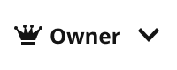
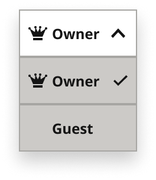
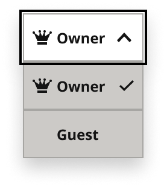
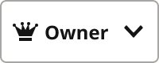
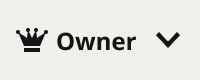
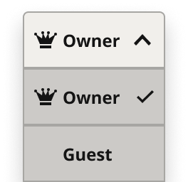
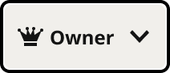
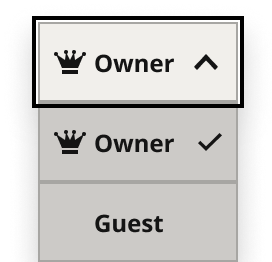
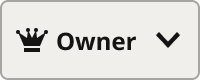

# Dropdown Menu

> Drop-down menu: a trigger that opens a list of choices (Karl, 2026-11-10: a copy of Button ActionMenu rebuilt as a drop-down; Button ActionMenu stays as it is for the designs that use it). First use: the role picker (Owner / Guest) in the Reader Dashboard Subscription Access panel. open = False, True; interaction = Default, hover, pressed; inFocus adds the focus ring (on top of the menu when open); Style = white, gray.

## Figma

- File: **MNG Web Design System** (`jFHYqhZbJjvWQmDI4myCsd`), page **Dropdown Menus | 2026.11.11**
- Component set: [`Dropdown Menu` · 7543:1880](https://www.figma.com/design/jFHYqhZbJjvWQmDI4myCsd/?node-id=7543-1880) · key `60e043d349b4c9b5a7c096d4fce89b45b5a3ef29`
- Documentation frame: [Dropdown Menu Container](https://www.figma.com/design/jFHYqhZbJjvWQmDI4myCsd/?node-id=7545-9599) · overview: [previews/dropdown-menu--documentation.png](previews/dropdown-menu--documentation.png)

## Properties

| Property | Default | Options |
|---|---|---|
| Style | white | white, gray |
| interaction | Default | Default, hover, pressed |
| inFocus | False | False, True |
| open | False | False, True |

| Other property | Type | Default |
|---|---|---|
| Label | text | Owner |
| Show icon | boolean | True |
| Show chevron | boolean | True |

## Variants

| Variant | Size | Node | Instances | Preview |
|---|---|---|---|---|
| `white / Default / False / False` | 100×40 | [7543:1881](https://www.figma.com/design/jFHYqhZbJjvWQmDI4myCsd/?node-id=7543-1881) | 3 |  |
| `white / Default / False / True` | 100×120 | [7543:1901](https://www.figma.com/design/jFHYqhZbJjvWQmDI4myCsd/?node-id=7543-1901) | 2 |  |
| `white / Default / True / False` | 100×40 | [7543:1953](https://www.figma.com/design/jFHYqhZbJjvWQmDI4myCsd/?node-id=7543-1953) | 1 |  |
| `white / Default / True / True` | 100×120 | [7545:10202](https://www.figma.com/design/jFHYqhZbJjvWQmDI4myCsd/?node-id=7545-10202) | 1 |  |
| `white / hover / False / False` | 100×40 | [7543:1891](https://www.figma.com/design/jFHYqhZbJjvWQmDI4myCsd/?node-id=7543-1891) | 0 |  |
| `white / pressed / False / False` | 100×40 | [7543:1997](https://www.figma.com/design/jFHYqhZbJjvWQmDI4myCsd/?node-id=7543-1997) | 0 |  |
| `gray / Default / False / False` | 100×40 | [7543:1917](https://www.figma.com/design/jFHYqhZbJjvWQmDI4myCsd/?node-id=7543-1917) | 1 |  |
| `gray / Default / False / True` | 100×120 | [7543:1937](https://www.figma.com/design/jFHYqhZbJjvWQmDI4myCsd/?node-id=7543-1937) | 0 |  |
| `gray / Default / True / False` | 100×40 | [7543:1975](https://www.figma.com/design/jFHYqhZbJjvWQmDI4myCsd/?node-id=7543-1975) | 0 |  |
| `gray / Default / True / True` | 100×120 | [7545:10212](https://www.figma.com/design/jFHYqhZbJjvWQmDI4myCsd/?node-id=7545-10212) | 0 |  |
| `gray / hover / False / False` | 100×40 | [7543:1927](https://www.figma.com/design/jFHYqhZbJjvWQmDI4myCsd/?node-id=7543-1927) | 0 |  |
| `gray / pressed / False / False` | 100×40 | [7543:2013](https://www.figma.com/design/jFHYqhZbJjvWQmDI4myCsd/?node-id=7543-2013) | 0 |  |

## Anatomy

Default variant `white / Default / False / False` (hidden layers marked):

- **open=False, interaction=Default, inFocus=False, Style=white** `COMPONENT`: 100×40, vertical, gap 0, padding 0/0/0/0, fixed×hug
  - **Trigger** `FRAME`: 100×40, horizontal, gap 4, padding 0/8/0/8, fill×fixed
    - **Icon Slot** `FRAME`: 16×16, horizontal, gap 0, padding 0/0/0/0, fixed×fixed
      - **Icon** `INSTANCE`: 16×16, horizontal, gap 8, padding 0/0/0/0, fixed×fixed, instance of Icons (Name=crown)
    - **Label** `TEXT`: 44×16, fill×hug, "Owner", Noto Sans Bold 12px
    - **Chevron** `INSTANCE`: 16×16, vertical, gap 8, padding 3/2/3/2, fixed×fixed, instance of Icons (Name=arrow-downSMALL)

## Component tokens

From `dropdown-menu.tokens.json`. References point at system tokens (`tokens/core/`, `tokens/themes/`); the CSS variable is `--mng-` + the token path. A literal value means the Figma layer isn't bound to a token.

| Token | Value |
|---|---|
| `dropdown-menu.open-true.menu.dropdown-menu-item.height` | 40px |
| `dropdown-menu.open-true.menu.dropdown-menu-item.width` | 100px |
| `dropdown-menu.base.root.width` | 100px |
| `dropdown-menu.base.trigger.border-color` | `{color.gray.400}` |
| `dropdown-menu.base.trigger.border-style` | solid |
| `dropdown-menu.base.trigger.border-width` | 1px |
| `dropdown-menu.base.trigger.gap` | `{spacing.050}` |
| `dropdown-menu.base.trigger.height` | 40px |
| `dropdown-menu.base.trigger.padding-left` | `{spacing.100}` |
| `dropdown-menu.base.trigger.padding-right` | `{spacing.100}` |
| `dropdown-menu.base.trigger.chevron.height` | 16px |
| `dropdown-menu.base.trigger.chevron.icon-color` | `{color.gray.min}` |
| `dropdown-menu.base.trigger.chevron.width` | 16px |
| `dropdown-menu.base.trigger.icon-slot.height` | 16px |
| `dropdown-menu.base.trigger.icon-slot.width` | 16px |
| `dropdown-menu.base.trigger.icon-slot.icon.height` | 16px |
| `dropdown-menu.base.trigger.icon-slot.icon.icon-color` | `{color.gray.min}` |
| `dropdown-menu.base.trigger.icon-slot.icon.width` | 16px |
| `dropdown-menu.base.trigger.label.color` | `{color.gray.min}` |
| `dropdown-menu.base.trigger.label.font-family` | `{font.family.noto-sans}` |
| `dropdown-menu.base.trigger.label.font-size` | `{font.size.12}` |
| `dropdown-menu.base.trigger.label.font-weight` | `{font.weight.bold}` |
| `dropdown-menu.style-white.trigger.background` | `{color.gray.max}` |
| `dropdown-menu.style-gray.trigger.background` | `{color.gray.600}` |
| `dropdown-menu.infocus-true.trigger.focus-ring.border-color` | `{color.gray.black}` |
| `dropdown-menu.infocus-true.trigger.focus-ring.border-style` | solid |
| `dropdown-menu.infocus-true.trigger.focus-ring.border-width` | 2px |

## Behavior and breakpoints

No Breakpoint property: one size at every width.

- **Trigger:** 100x40px by default (set the width to fit the longest option), 8px (`spacing/100`) side padding, 4px (`spacing/050`) gaps, square corners (radius 0, Karl, 2026-11-11).
- **Contents:** a 16px Icon Slot (an icon such as the crown, or empty, so every label starts at the same place), the label in Noto Sans Bold 12px `color/gray/min`, and the chevron (`arrow-downSMALL`; `arrow-upSmall` when open) at the right edge (Karl, 2026-11-11).
- **Style:** `white` is `color/gray/max` (label 18:1); `gray` is `color/gray/600`, for rows on gray/600 (label 16:1).
- **Hover and pressed:** a 1px inside `color/gray/400` border. Default has no border.
- **Focus:** the Default trigger plus a 2px `color/gray/black` ring 1px outside it, square corners like the trigger (Karl, 2026-11-11). Open and focused (`open=True, inFocus=True`): the ring is drawn on top of the menu, not behind it (Karl, 2026-11-11).
- **Open:** the trigger keeps the gray/400 border and the menu hangs below it: a stack of Dropdown Menu Item rows as wide as the trigger, every choice listed, a check on the current one, `shadow/lg`.
- **Read-only:** Show chevron off (the account owner's own row in Subscription Access).
- **Rows in the open menu** are exposed nested instances: each row's Label, Show icon, Icon, status, interaction and inFocus can be set on the Dropdown Menu instance, e.g. a hovered row (Karl, 2026-11-11).
- **Accessibility:** a button with `aria-haspopup="listbox"` and `aria-expanded`, named by its label; the menu is a listbox of options with `aria-selected` on the current one. Enter, Space or Down Arrow opens it; arrows move, Enter picks, Esc closes and focus returns to the trigger.
- **Button ActionMenu** (Buttons page) is the older version, kept as it is for the designs that use it (Karl, 2026-11-10).

## Accessibility

- No InFocus state in Figma.
- Text color on its background must meet WCAG AA contrast (4.5:1 for text under 18px) in every theme; theme colors change per site.
- Icons inside a labelled control are decorative (`aria-hidden`); an icon-only control needs an accessible name (`aria-label`).

## Where it is used

Scope: instances in the Figma file **MNG Web Design System** only (other files that use the library are not counted). Total: **8**.

**Built from:** Icons ×24, Dropdown Menu Item ×8
Icon variants: `crown` ×12, `arrow-downSMALL` ×8, `arrow-upSmall` ×4.

## Production

Not in production yet (Karl, 2026-11-10).

## Known issues

1. Not in production yet (Karl, 2026-11-10).

## Files

- `dropdown-menu.tokens.json`: component tokens (DTCG 2025.10).
- `dropdown-menu.html`: HTML/CSS skeleton of every variant, using the `dist/` CSS variables (open it in a browser).
- `previews/`: PNG of every variant @2x and the documentation frame.

*Generated 2026-11-11 by `scripts/component-export/export.py` (EXPORT-STANDARD.md section 7). Edit the text in `scripts/component-export/registry.json`, not here.*
