# Form Field

> Text input for every form: label, an input (56px Desktop / 40px Mobile) with an optional left icon frame, an optional right status or action icon, an optional card badge, and a reserved error row. State = Blank, Filled, Focus, Error, Error Focus, Success, Disabled.

## Figma

- File: **MNG Web Design System** (`jFHYqhZbJjvWQmDI4myCsd`), page **Form Fields | 2026.11.04**
- Component set: [`Form Field` · 6963:6863](https://www.figma.com/design/jFHYqhZbJjvWQmDI4myCsd/?node-id=6963-6863) · key `65f91c028cc42238d00387a53f812f839bf58969`
- Documentation frame: [Frame 12921](https://www.figma.com/design/jFHYqhZbJjvWQmDI4myCsd/?node-id=6977-25931) · overview: [previews/form-field--documentation.png](previews/form-field--documentation.png)

## Properties

| Property | Default | Options |
|---|---|---|
| State | Blank | Blank, Filled, Focus, Error, Error Focus, Success, Disabled |
| Size | Desktop | Desktop, Mobile |

| Other property | Type | Default |
|---|---|---|
| Label | text | Field Label |
| Value | text | Text entered by the user |
| Error message | text | Error message text. |
| Show icon | boolean | True |
| Show label icon | boolean | False |
| Icon | instance_swap | 2880:1506 |
| Show right icon | boolean | False |
| Right icon | instance_swap | 2880:1506 |
| Show card badge | boolean | False |
| Card badge | instance_swap | 4693:131 |
| Show value | boolean | True |
| Show placeholder | boolean | False |
| Placeholder | text | Placeholder text |

## Variants

| Variant | Size | Node | Instances | Preview |
|---|---|---|---|---|
| `Blank / Desktop` | 480×103 | [6962:6663](https://www.figma.com/design/jFHYqhZbJjvWQmDI4myCsd/?node-id=6962-6663) | 50 | 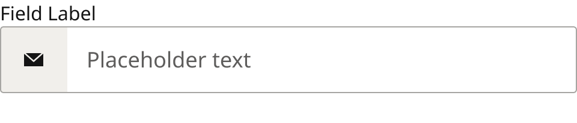 |
| `Blank / Mobile` | 328×81 | [6962:6683](https://www.figma.com/design/jFHYqhZbJjvWQmDI4myCsd/?node-id=6962-6683) | 74 | 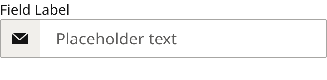 |
| `Filled / Desktop` | 480×103 | [6962:6703](https://www.figma.com/design/jFHYqhZbJjvWQmDI4myCsd/?node-id=6962-6703) | 2 | 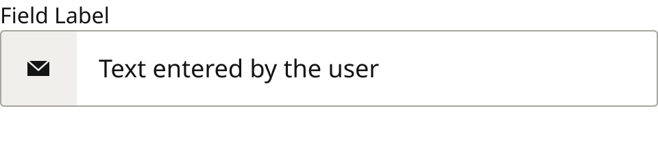 |
| `Filled / Mobile` | 328×81 | [6962:6783](https://www.figma.com/design/jFHYqhZbJjvWQmDI4myCsd/?node-id=6962-6783) | 0 | 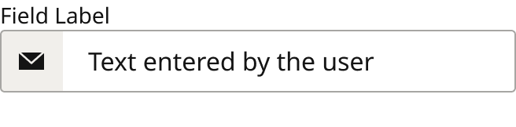 |
| `Focus / Desktop` | 480×103 | [6962:6723](https://www.figma.com/design/jFHYqhZbJjvWQmDI4myCsd/?node-id=6962-6723) | 1 | 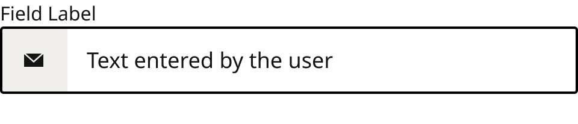 |
| `Focus / Mobile` | 328×81 | [6962:6803](https://www.figma.com/design/jFHYqhZbJjvWQmDI4myCsd/?node-id=6962-6803) | 1 | 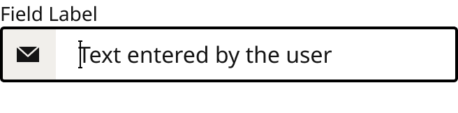 |
| `Error / Desktop` | 480×103 | [6962:6743](https://www.figma.com/design/jFHYqhZbJjvWQmDI4myCsd/?node-id=6962-6743) | 1 | 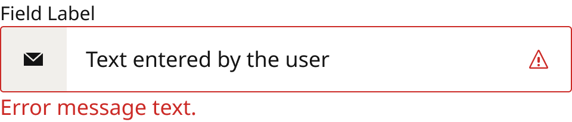 |
| `Error / Mobile` | 328×81 | [6962:6823](https://www.figma.com/design/jFHYqhZbJjvWQmDI4myCsd/?node-id=6962-6823) | 0 | 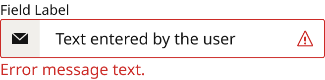 |
| `Error Focus / Desktop` | 480×103 | [7501:27409](https://www.figma.com/design/jFHYqhZbJjvWQmDI4myCsd/?node-id=7501-27409) | 0 | 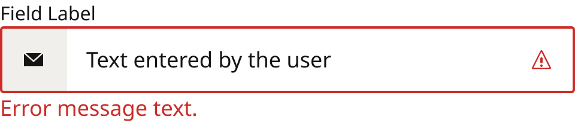 |
| `Error Focus / Mobile` | 328×81 | [7501:27442](https://www.figma.com/design/jFHYqhZbJjvWQmDI4myCsd/?node-id=7501-27442) | 0 | 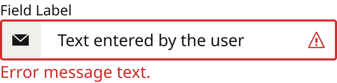 |
| `Success / Desktop` | 480×103 | [7496:26622](https://www.figma.com/design/jFHYqhZbJjvWQmDI4myCsd/?node-id=7496-26622) | 4 | 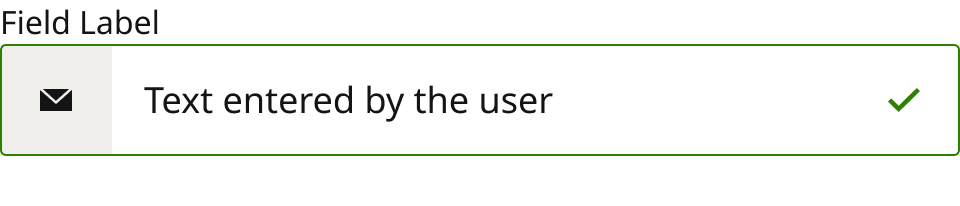 |
| `Success / Mobile` | 328×81 | [7496:26656](https://www.figma.com/design/jFHYqhZbJjvWQmDI4myCsd/?node-id=7496-26656) | 1 | 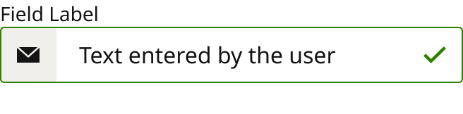 |
| `Disabled / Desktop` | 480×103 | [6962:6763](https://www.figma.com/design/jFHYqhZbJjvWQmDI4myCsd/?node-id=6962-6763) | 0 | 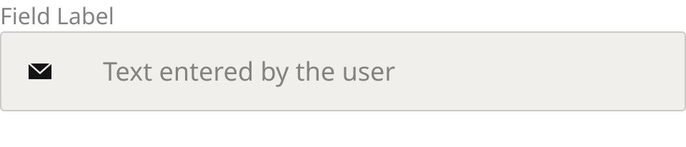 |
| `Disabled / Mobile` | 328×81 | [6962:6843](https://www.figma.com/design/jFHYqhZbJjvWQmDI4myCsd/?node-id=6962-6843) | 0 | 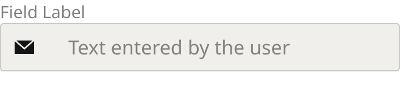 |

## Anatomy

Default variant `Blank / Desktop` (hidden layers marked):

- **Size=Desktop, State=Blank** `COMPONENT`: 480×103, vertical, gap 0, padding 0/0/0/0, fixed×hug
  - **Label Container** `FRAME`: 480×22, horizontal, gap 8, padding 0/0/0/0, fill×hug
    - **Label Icon Container** `FRAME`: 16×15, vertical, gap 8, padding 0/0/0/0, hug×hug, **hidden**
      - **Label Icon** `VECTOR`: 16×11, fixed×fixed
    - **Label Text Container** `FRAME`: 480×22, horizontal, gap 8, padding 0/0/0/0, fill×hug
      - **Label** `TEXT`: 480×22, fill×hug, "Field Label", Noto Sans Regular 16px
  - **Input Field Container** `FRAME`: 480×56, horizontal, gap 0, padding 0/0/0/0, fill×fixed
    - **icon frame** `FRAME`: 56×56, vertical, gap 8, padding 20/20/20/20, hug×fixed
      - **Icons** `INSTANCE`: 16×16, horizontal, gap 8, padding 0/0/0/0, fixed×fixed, instance of Icons (Name=email)
    - **Input Field** `FRAME`: 424×56, horizontal, gap 8, padding 8/16/8/16, fill×fixed
      - **Text Container** `FRAME`: 392×25, horizontal, gap 8, padding 0/0/0/0, fill×hug
        - **Value** `TEXT`: 205×25, fixed×fixed, "Text entered by the user", Noto Sans Regular 18px, **hidden**
        - **Placeholder** `TEXT`: 137×25, hug×hug, "Placeholder text", Noto Sans Regular 18px
      - **Cursor Container** `FRAME`: 3×20, horizontal, gap 8, padding 0/0/0/0, hug×hug, absolute, **hidden**
        - **Cursor** `BOOLEAN_OPERATION`: 3×20, fixed×fixed
          - **Line 71 (Stroke)** `VECTOR`: 3×1, fixed×fixed
          - **Line 72 (Stroke)** `VECTOR`: 3×1, fixed×fixed
          - **Line 73 (Stroke)** `VECTOR`: 20×1, fixed×fixed
      - **card badge** `INSTANCE`: 66.89×44, horizontal, gap 8, padding 2/2/2/2, hug×hug, instance of Icons (Name=Visa), **hidden**
    - **icon frame right** `FRAME`: 56×56, vertical, gap 8, padding 20/20/20/20, hug×fixed, **hidden**
      - **Icons** `INSTANCE`: 16×16, horizontal, gap 8, padding 0/0/0/0, fixed×fixed, instance of Icons (Name=email)
  - **Error Message Container** `FRAME`: 480×25, horizontal, gap 8, padding 0/0/0/0, fill×hug
    - **Error Message Text.** `TEXT`: 480×25, fill×hug, "Error message text.", Noto Sans Regular 18px

## Component tokens

From `form-field.tokens.json`. References point at system tokens (`tokens/core/`, `tokens/themes/`); the CSS variable is `--mng-` + the token path. A literal value means the Figma layer isn't bound to a token.

| Token | Value |
|---|---|
| `form-field.base.error-message-container.error-message-text.color` | `{color.feedback.high-error}` |
| `form-field.base.error-message-container.error-message-text.font-family` | `{font.family.noto-sans}` |
| `form-field.base.error-message-container.error-message-text.font-weight` | `{font.weight.regular}` |
| `form-field.base.input-field-container.border-radius` | `{radius.field}` |
| `form-field.base.input-field-container.border-style` | solid |
| `form-field.base.input-field-container.icon-frame.background` | `{color.gray.600}` |
| `form-field.base.input-field-container.icon-frame.icons.height` | 16px |
| `form-field.base.input-field-container.icon-frame.icons.icon-color` | `{color.gray.min}` |
| `form-field.base.input-field-container.icon-frame.icons.width` | 16px |
| `form-field.base.input-field-container.icon-frame-right.width` | 40px |
| `form-field.base.input-field-container.icon-frame-right.icons.height` | 16px |
| `form-field.base.input-field-container.icon-frame-right.icons.width` | 16px |
| `form-field.base.input-field-container.input-field.padding-left` | `{spacing.200}` |
| `form-field.base.input-field-container.input-field.padding-right` | `{spacing.200}` |
| `form-field.base.input-field-container.input-field.cursor-container.cursor.background` | `{color.gray.black}` |
| `form-field.base.input-field-container.input-field.cursor-container.cursor.height` | 20px |
| `form-field.base.input-field-container.input-field.cursor-container.cursor.width` | 3px |
| `form-field.base.input-field-container.input-field.cursor-container.cursor.line-71-stroke.background` | `{color.gray.black}` |
| `form-field.base.input-field-container.input-field.cursor-container.cursor.line-71-stroke.height` | 1px |
| `form-field.base.input-field-container.input-field.cursor-container.cursor.line-71-stroke.width` | 3px |
| `form-field.base.input-field-container.input-field.cursor-container.cursor.line-72-stroke.background` | `{color.gray.black}` |
| `form-field.base.input-field-container.input-field.cursor-container.cursor.line-72-stroke.height` | 1px |
| `form-field.base.input-field-container.input-field.cursor-container.cursor.line-72-stroke.width` | 3px |
| `form-field.base.input-field-container.input-field.cursor-container.cursor.line-73-stroke.background` | `{color.gray.black}` |
| `form-field.base.input-field-container.input-field.cursor-container.cursor.line-73-stroke.height` | 1px |
| `form-field.base.input-field-container.input-field.cursor-container.cursor.line-73-stroke.width` | 20px |
| `form-field.base.input-field-container.input-field.text-container.value.font-family` | `{font.family.noto-sans}` |
| `form-field.base.input-field-container.input-field.text-container.value.font-weight` | `{font.weight.regular}` |
| `form-field.base.label-container.label-text-container.label.font-family` | `{font.family.noto-sans}` |
| `form-field.base.label-container.label-text-container.label.font-weight` | `{font.weight.regular}` |
| `form-field.size-desktop.error-message-container.error-message-text.font-size` | `{font.size.18}` |
| `form-field.size-desktop.input-field-container.height` | 56px |
| `form-field.size-desktop.input-field-container.icon-frame.height` | 56px |
| `form-field.size-desktop.input-field-container.icon-frame.padding-bottom` | `{spacing.250}` |
| `form-field.size-desktop.input-field-container.icon-frame.padding-left` | `{spacing.250}` |
| `form-field.size-desktop.input-field-container.icon-frame.padding-right` | `{spacing.250}` |
| `form-field.size-desktop.input-field-container.icon-frame.padding-top` | `{spacing.250}` |
| `form-field.size-desktop.input-field-container.icon-frame-right.height` | 56px |
| `form-field.size-desktop.input-field-container.icon-frame-right.padding-bottom` | `{spacing.250}` |
| `form-field.size-desktop.input-field-container.icon-frame-right.padding-left` | `{spacing.250}` |
| `form-field.size-desktop.input-field-container.icon-frame-right.padding-right` | `{spacing.250}` |
| `form-field.size-desktop.input-field-container.icon-frame-right.padding-top` | `{spacing.250}` |
| `form-field.size-desktop.input-field-container.input-field.height` | 56px |
| `form-field.size-desktop.input-field-container.input-field.padding-bottom` | `{spacing.100}` |
| `form-field.size-desktop.input-field-container.input-field.padding-top` | `{spacing.100}` |
| `form-field.size-desktop.input-field-container.input-field.text-container.placeholder.font-size` | `{font.size.18}` |
| `form-field.size-desktop.input-field-container.input-field.text-container.value.font-size` | `{font.size.18}` |
| `form-field.size-desktop.label-container.label-text-container.label.font-size` | `{font.size.16}` |
| `form-field.size-desktop.root.width` | 480px |
| `form-field.size-mobile.error-message-container.error-message-text.font-size` | `{font.size.16}` |
| `form-field.size-mobile.input-field-container.height` | 40px |
| `form-field.size-mobile.input-field-container.icon-frame.height` | 40px |
| `form-field.size-mobile.input-field-container.icon-frame.padding-bottom` | `{spacing.150}` |
| `form-field.size-mobile.input-field-container.icon-frame.padding-left` | `{spacing.150}` |
| `form-field.size-mobile.input-field-container.icon-frame.padding-right` | `{spacing.150}` |
| `form-field.size-mobile.input-field-container.icon-frame.padding-top` | `{spacing.150}` |
| `form-field.size-mobile.input-field-container.icon-frame.width` | 40px |
| `form-field.size-mobile.input-field-container.icon-frame-right.height` | 40px |
| `form-field.size-mobile.input-field-container.icon-frame-right.padding-bottom` | `{spacing.150}` |
| `form-field.size-mobile.input-field-container.icon-frame-right.padding-left` | `{spacing.150}` |
| `form-field.size-mobile.input-field-container.icon-frame-right.padding-right` | `{spacing.150}` |
| `form-field.size-mobile.input-field-container.icon-frame-right.padding-top` | `{spacing.150}` |
| `form-field.size-mobile.input-field-container.input-field.height` | 40px |
| `form-field.size-mobile.input-field-container.input-field.text-container.placeholder.font-size` | `{font.size.16}` |
| `form-field.size-mobile.input-field-container.input-field.text-container.value.font-size` | `{font.size.16}` |
| `form-field.size-mobile.label-container.label-text-container.label.font-size` | `{font.size.14}` |
| `form-field.size-mobile.root.width` | 328px |
| `form-field.state-blank.input-field-container.background` | `{color.gray.max}` |
| `form-field.state-blank.input-field-container.border-color` | `{color.gray.400}` |
| `form-field.state-blank.input-field-container.border-width` | 1px |
| `form-field.state-blank.input-field-container.input-field.text-container.placeholder.color` | `{color.gray.200}` |
| `form-field.state-blank.input-field-container.input-field.text-container.placeholder.font-family` | `{font.family.noto-sans}` |
| `form-field.state-blank.input-field-container.input-field.text-container.placeholder.font-weight` | `{font.weight.regular}` |
| `form-field.state-blank.label-container.label-text-container.label.color` | `{color.gray.min}` |
| `form-field.state-filled.input-field-container.background` | `{color.gray.max}` |
| `form-field.state-filled.input-field-container.border-color` | `{color.gray.400}` |
| `form-field.state-filled.input-field-container.border-width` | 1px |
| `form-field.state-filled.input-field-container.input-field.text-container.value.color` | `{color.gray.min}` |
| `form-field.state-filled.label-container.label-text-container.label.color` | `{color.gray.min}` |
| `form-field.state-focus.input-field-container.background` | `{color.gray.max}` |
| `form-field.state-focus.input-field-container.border-color` | `{color.gray.black}` |
| `form-field.state-focus.input-field-container.border-width` | 2px |
| `form-field.state-focus.input-field-container.input-field.text-container.value.color` | `{color.gray.min}` |
| `form-field.state-focus.label-container.label-text-container.label.color` | `{color.gray.min}` |
| `form-field.state-error.input-field-container.background` | `{color.gray.max}` |
| `form-field.state-error.input-field-container.border-color` | `{color.feedback.high-error}` |
| `form-field.state-error.input-field-container.border-width` | 1px |
| `form-field.state-error.input-field-container.icon-frame-right.icons.icon-color` | `{color.feedback.high-error}` |
| `form-field.state-error.input-field-container.input-field.text-container.value.color` | `{color.gray.min}` |
| `form-field.state-error.label-container.label-text-container.label.color` | `{color.gray.min}` |
| `form-field.state-error-focus.input-field-container.background` | `{color.gray.max}` |
| `form-field.state-error-focus.input-field-container.border-color` | `{color.feedback.high-error}` |
| `form-field.state-error-focus.input-field-container.border-width` | 2px |
| `form-field.state-error-focus.input-field-container.icon-frame-right.icons.icon-color` | `{color.feedback.high-error}` |
| `form-field.state-error-focus.input-field-container.input-field.text-container.value.color` | `{color.gray.min}` |
| `form-field.state-error-focus.label-container.label-text-container.label.color` | `{color.gray.min}` |
| `form-field.state-success.input-field-container.background` | `{color.gray.max}` |
| `form-field.state-success.input-field-container.border-color` | `{color.feedback.low-success}` |
| `form-field.state-success.input-field-container.border-width` | 1px |
| `form-field.state-success.input-field-container.icon-frame-right.icons.icon-color` | `{color.feedback.low-success}` |
| `form-field.state-success.input-field-container.input-field.text-container.value.color` | `{color.gray.min}` |
| `form-field.state-success.label-container.label-text-container.label.color` | `{color.gray.min}` |
| `form-field.state-disabled.input-field-container.background` | `{color.gray.600}` |
| `form-field.state-disabled.input-field-container.border-color` | `{color.gray.500}` |
| `form-field.state-disabled.input-field-container.border-width` | 1px |
| `form-field.state-disabled.input-field-container.input-field.text-container.value.color` | `{color.gray.300}` |
| `form-field.state-disabled.label-container.label-text-container.label.color` | `{color.gray.300}` |

## Behavior and breakpoints

| Size value | Viewport | Behavior |
|---|---|---|
| Desktop | Desktop, TabletH, TabletV | 56px-tall input, 16px label, 18px value and error text |
| Mobile | Mobile, Fold | 40px-tall input, 14px label, 16px value and error text |

*The switch sits between TabletV and Mobile, matching the site CSS (production breakpoint not re-checked for this export, Karl 2026-11-04). The field fills its container's width at every size.*

- **Input:** `color/gray/max` fill, 1px inside `color/gray/400` border, 3px corners (`radius/field`); width fills the container. Text padding 16px (`spacing/200`) left and right, text vertically centered.
- **Text:** label Noto Sans Regular 16 (Mobile 14), `color/gray/min`. Typed value Noto Sans Regular 18 (Mobile 16), `color/gray/min`. Placeholder the same size in `color/gray/200` (6.5:1 on white). Error message Noto Sans Regular 18 (Mobile 16), `color/feedback/high-error` (5.3:1).
- **Value and placeholder:** two text layers. Show value (on by default) shows the typed text (Value); Show placeholder (off) shows the gray hint (Placeholder). Blank always shows the placeholder (a blank field has no typed value); Focus can show either; the other states default to the typed value and can switch to the placeholder for an empty field.
- **Left icon frame** (Show icon, Icon): 56x56 (Mobile 40x40), `color/gray/600`, a 16px icon centered, padding 20px (`spacing/250`, Mobile 12px `spacing/150`), outer corners `radius/field`. On when a field stands alone; off when several fields appear together. Show label icon adds a 16px icon before the label (8px gap).
- **Right icon frame** (Show right icon, Right icon) and **card badge** (Show card badge, Card badge: the credit card brand badges). In Error and Error Focus the right frame always shows `warning` in `color/feedback/high-error`; in Success it always shows `checkmark3` in `color/feedback/low-success`; there it ignores Show right icon / Right icon.
- **Error row:** always reserved (25px Desktop, 22px Mobile) so the field never changes height; the message is visible only in Error and Error Focus.
- **States:** Focus: 2px inside `color/gray/black` border. Error: 1px `color/feedback/high-error` border, warning icon, message. Error Focus: the user is back in a field that's in error and hasn't typed yet; same as Error with a 2px border; as soon as they type it goes to Focus. Success: 1px `color/feedback/low-success` border (5.0:1) and the checkmark; same layout as Filled. Disabled: `color/gray/500` border, `color/gray/600` fill, label and value `color/gray/300`; not focusable.
- **When to show Success and Error** (Karl, 2026-11-04): Success only after the value has been checked in the browser, on blur (a valid email format, a new password that meets the rules, a re-entered password that matches); never on a sign-in password or any value only the server can confirm. Field-level Error: an empty required field, a bad format, passwords that don't match; it clears as soon as the user types. Form-level errors (wrong email or password, account already exists, server or network failure, social login failure) are not shown on fields: one InLineMessage (Priority=High, PanelType=Alert) banner above the form fields, below any social login buttons. After a failed submit: keep the email, clear the password, mark the affected fields Error, remove any success checks.
- **Focus and keyboard:** if the fix means typing, move focus to the first field in error (the on-screen keyboard stays open); for larger errors, move focus to the banner (the keyboard closes).
- **Accessibility:** `aria-invalid="true"` on fields in error; each field's message (error or helper text) linked with `aria-describedby`; the form-level banner has `role="alert"`. Status is never shown by color alone: Error and Success each have an icon, and errors have a message.

## Accessibility

- No InFocus state in Figma.
- Text color on its background must meet WCAG AA contrast (4.5:1 for text under 18px) in every theme; theme colors change per site.
- Icons inside a labelled control are decorative (`aria-hidden`); an icon-only control needs an accessible name (`aria-label`).

## Where it is used

Scope: instances in the Figma file **MNG Web Design System** only (other files that use the library are not counted). Total: **134**.

Inside components: InLineMessage ×33, Form Field Assembly  ×32, ModalsCenter ×6, Modals ×1.
Placed on pages: In-Line Content Containers | 2026.01.02 ×27, Modal Panels | 2026.11.04 ×15, Form Fields | 2026.11.04 ×9, Buttons | 2026.09.30 ×3.
8 instances are nested inside other instances.

**Built from:** Icons ×20
Icon variants: `email` ×14, `warning` ×4, `checkmark3` ×2.

## Production

Not checked against production for this export (Karl, 2026-11-04).

## Known issues

1. The older Form Field set (`2832:766`, Device x Flavor) is still used by Embedded Login; it isn't exported and wasn't changed. Embedded Login is moving to this set.
2. Not checked against production for this export (Karl, 2026-11-04).

## Files

- `form-field.tokens.json`: component tokens (DTCG 2025.10).
- `form-field.html`: HTML/CSS skeleton of every variant, using the `dist/` CSS variables (open it in a browser).
- `previews/`: PNG of every variant @2x and the documentation frame.

*Generated 2026-11-04 by `scripts/component-export/export.py` (EXPORT-STANDARD.md section 7). Edit the text in `scripts/component-export/registry.json`, not here.*
