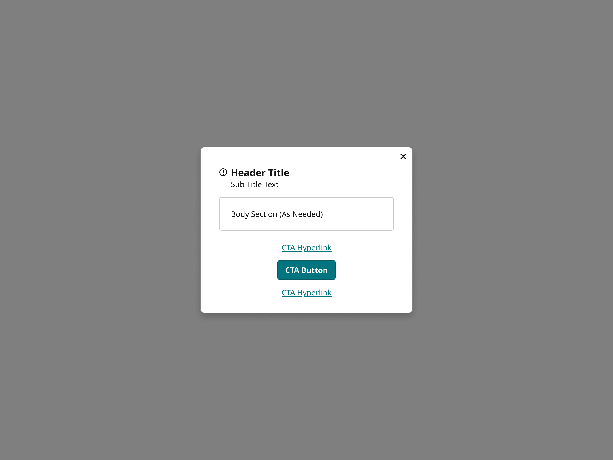
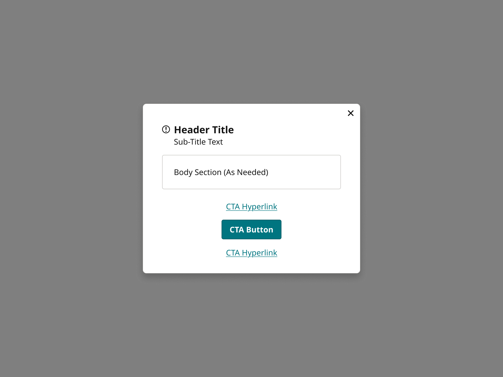
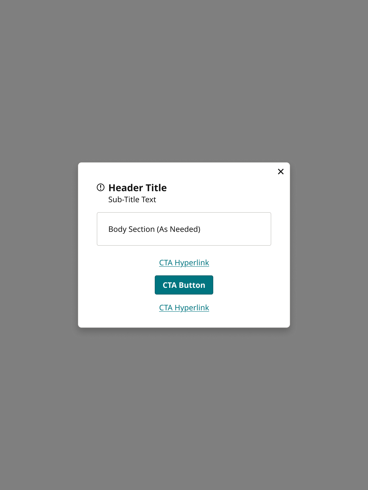
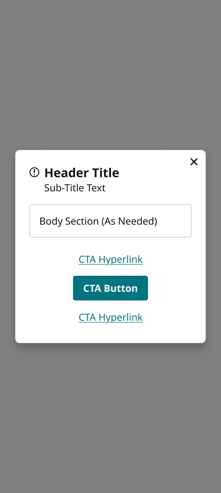
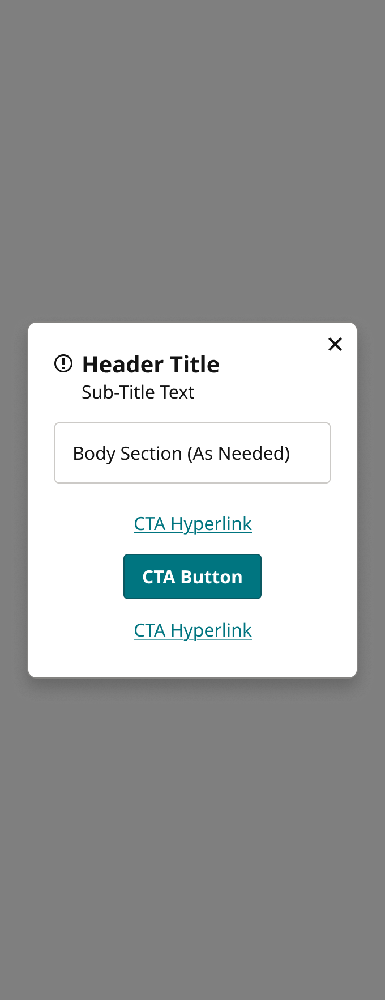
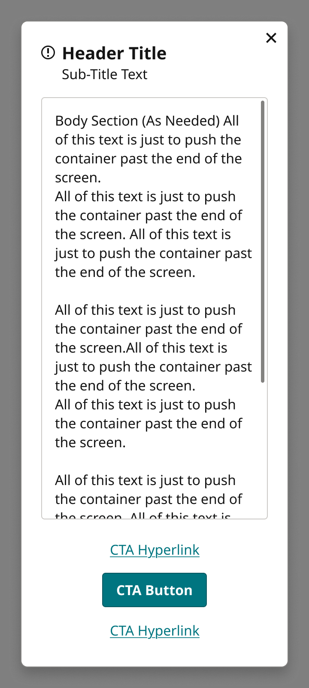

# ModalsCenter

> Centered pop-up modal (Reader Dashboard and every pop-up across the footprint). Device = Desktop, TabletH, TabletV, Mobile, MobileScroll, FOLD; each variant is the whole screen with the page overlay, so the card is shown in place.

## Figma

- File: **MNG Web Design System** (`jFHYqhZbJjvWQmDI4myCsd`), page **Modal Panels | 2026.11.10**
- Component set: [`ModalsCenter` · 3040:2262](https://www.figma.com/design/jFHYqhZbJjvWQmDI4myCsd/?node-id=3040-2262) · key `ee63f90bb43e86ecf93d65870821a8291c205a01`
- Documentation frame: [ModalsCenter Container](https://www.figma.com/design/jFHYqhZbJjvWQmDI4myCsd/?node-id=7418-3457) · overview: [previews/modals-center--documentation.png](previews/modals-center--documentation.png)

## Properties

| Property | Default | Options |
|---|---|---|
| Device | Desktop | Desktop, TabletH, TabletV, Mobile, FOLD, MobileScroll |

## Variants

| Variant | Size | Node | Instances | Preview |
|---|---|---|---|---|
| `Desktop` | 1280×960 | [3040:2263](https://www.figma.com/design/jFHYqhZbJjvWQmDI4myCsd/?node-id=3040-2263) | 3 |  |
| `TabletH` | 1024×768 | [3040:2289](https://www.figma.com/design/jFHYqhZbJjvWQmDI4myCsd/?node-id=3040-2289) | 0 |  |
| `TabletV` | 768×1024 | [3040:2315](https://www.figma.com/design/jFHYqhZbJjvWQmDI4myCsd/?node-id=3040-2315) | 1 |  |
| `Mobile` | 360×800 | [3040:2341](https://www.figma.com/design/jFHYqhZbJjvWQmDI4myCsd/?node-id=3040-2341) | 3 |  |
| `FOLD` | 340×882 | [3040:2367](https://www.figma.com/design/jFHYqhZbJjvWQmDI4myCsd/?node-id=3040-2367) | 4 |  |
| `MobileScroll` | 360×800 | [3693:1351](https://www.figma.com/design/jFHYqhZbJjvWQmDI4myCsd/?node-id=3693-1351) | 1 |  |

## Anatomy

Default variant `Desktop` (hidden layers marked):

- **Device=Desktop** `COMPONENT`: 1280×960, vertical, gap 0, padding 40/40/40/40, fixed×fixed
  - **Desktop** `FRAME`: 444×347, vertical, gap 0, padding 0/0/0/0, fixed×hug
    - **Modal Container** `FRAME`: 444×347, vertical, gap 0, padding 0/0/0/0, fill×hug
      - **Content Frame** `FRAME`: 444×347, vertical, gap 16, padding 40/40/24/40, fill×hug
        - **Header** `FRAME`: 364×49, horizontal, gap 8, padding 0/0/0/0, fill×hug
          - **Icon Container** `FRAME`: 16×16, horizontal, gap 8, padding 0/0/0/0, hug×hug
            - **Icons** `INSTANCE`: 16×16, horizontal, gap 8, padding 0/0/0/0, fixed×fixed, instance of Icons (Name=notification)
          - **Text Container** `FRAME`: 340×49, vertical, gap 0, padding 0/0/0/0, fill×hug
            - **Title** `FRAME`: 340×27, horizontal, gap 8, padding 0/0/0/0, fill×hug
            - **Subtitle** `FRAME`: 340×22, horizontal, gap 8, padding 0/0/0/0, fill×hug
        - **Body Container** `FRAME`: 364×70, vertical, gap 16, padding 24/24/24/24, fill×hug
          - **Body Content** `FRAME`: 316×22, vertical, gap 16, padding 0/0/0/0, fill×hug
            - **Body Content** `TEXT`: 316×22, fill×hug, "Body Section (As Needed)", Noto Sans Regular 16px
            - **Form Field** `INSTANCE`: 316×78, vertical, gap 0, padding 0/0/0/0, fixed×hug, instance of Form Field (Size=Desktop, State=Blank), **hidden**
        - **InLineMessage** `INSTANCE`: 364×104, vertical, gap 16, padding 0/0/0/0, fixed×hug, instance of InLineMessage (Device=Desktop, Priority=High, Location=ModalError, PanelType=Alert), **hidden**
        - **CTA** `FRAME`: 364×132, vertical, gap 8, padding 0/0/0/0, fill×hug
          - **Button Linkstyle** `INSTANCE`: 121×38, horizontal, gap 8, padding 8/8/8/8, hug×hug, instance of Button Linkstyle (Icon=None, Style=1 Row, State=Default)
          - **Button Primary** `INSTANCE`: 138×40, vertical, gap 8, padding 0/8/0/8, fixed×hug, instance of Button Primary (Icon=None, State=Default, Breakpoint=Desktop)
          - **Button Linkstyle** `INSTANCE`: 121×38, horizontal, gap 8, padding 8/8/8/8, hug×hug, instance of Button Linkstyle (Icon=None, Style=1 Row, State=Default)
        - **Button In-Line Close** `INSTANCE`: 40×40, horizontal, gap 8, padding 0/0/0/0, hug×hug, absolute, instance of Button In-Line Close (State=Default)

## Component tokens

From `modals-center.tokens.json`. References point at system tokens (`tokens/core/`, `tokens/themes/`); the CSS variable is `--mng-` + the token path. A literal value means the Figma layer isn't bound to a token.

| Token | Value |
|---|---|
| `modals-center.base.desktop.width` | 444px |
| `modals-center.base.desktop.modal-container.content-frame.background` | `{color.gray.max}` |
| `modals-center.base.desktop.modal-container.content-frame.border-color` | `{color.gray.300}` |
| `modals-center.base.desktop.modal-container.content-frame.border-radius` | `{radius.lg}` |
| `modals-center.base.desktop.modal-container.content-frame.border-style` | solid |
| `modals-center.base.desktop.modal-container.content-frame.border-width` | 1px |
| `modals-center.base.desktop.modal-container.content-frame.gap` | `{spacing.200}` |
| `modals-center.base.desktop.modal-container.content-frame.padding-bottom` | `{spacing.300}` |
| `modals-center.base.desktop.modal-container.content-frame.body-container.border-color` | `{color.gray.500}` |
| `modals-center.base.desktop.modal-container.content-frame.body-container.border-radius` | `{radius.sm}` |
| `modals-center.base.desktop.modal-container.content-frame.body-container.border-style` | solid |
| `modals-center.base.desktop.modal-container.content-frame.body-container.border-width` | 1px |
| `modals-center.base.desktop.modal-container.content-frame.body-container.body-content.body-content.color` | `{color.gray.min}` |
| `modals-center.base.desktop.modal-container.content-frame.body-container.body-content.body-content.font-family` | `{font.family.noto-sans}` |
| `modals-center.base.desktop.modal-container.content-frame.body-container.body-content.body-content.font-size` | `{font.size.16}` |
| `modals-center.base.desktop.modal-container.content-frame.body-container.body-content.body-content.font-weight` | `{font.weight.regular}` |
| `modals-center.base.desktop.modal-container.content-frame.button-in-line-close.height` | 40px |
| `modals-center.base.desktop.modal-container.content-frame.button-in-line-close.width` | 40px |
| `modals-center.base.desktop.modal-container.content-frame.cta.gap` | `{spacing.100}` |
| `modals-center.base.desktop.modal-container.content-frame.cta.button-linkstyle.height` | 38px |
| `modals-center.base.desktop.modal-container.content-frame.cta.button-linkstyle.width` | 121px |
| `modals-center.base.desktop.modal-container.content-frame.cta.button-primary.height` | 40px |
| `modals-center.base.desktop.modal-container.content-frame.cta.button-primary.width` | 138px |
| `modals-center.base.desktop.modal-container.content-frame.header.gap` | `{spacing.100}` |
| `modals-center.base.desktop.modal-container.content-frame.header.icon-container.icons.height` | 16px |
| `modals-center.base.desktop.modal-container.content-frame.header.icon-container.icons.icon-color` | `{color.gray.min}` |
| `modals-center.base.desktop.modal-container.content-frame.header.icon-container.icons.width` | 16px |
| `modals-center.base.desktop.modal-container.content-frame.header.text-container.subtitle.subtitle.color` | `{color.gray.min}` |
| `modals-center.base.desktop.modal-container.content-frame.header.text-container.subtitle.subtitle.font-family` | `{font.family.noto-sans}` |
| `modals-center.base.desktop.modal-container.content-frame.header.text-container.subtitle.subtitle.font-size` | `{font.size.16}` |
| `modals-center.base.desktop.modal-container.content-frame.header.text-container.subtitle.subtitle.font-weight` | `{font.weight.regular}` |
| `modals-center.base.desktop.modal-container.content-frame.header.text-container.title.title.color` | `{color.gray.min}` |
| `modals-center.base.desktop.modal-container.content-frame.header.text-container.title.title.font-family` | `{font.family.noto-sans}` |
| `modals-center.base.desktop.modal-container.content-frame.header.text-container.title.title.font-size` | `{font.size.20}` |
| `modals-center.base.desktop.modal-container.content-frame.header.text-container.title.title.font-weight` | `{font.weight.bold}` |
| `modals-center.base.root.background` | #000000 @ 0.5 |
| `modals-center.device-desktop.desktop.modal-container.content-frame.padding-left` | `{spacing.500}` |
| `modals-center.device-desktop.desktop.modal-container.content-frame.padding-right` | `{spacing.500}` |
| `modals-center.device-desktop.desktop.modal-container.content-frame.padding-top` | `{spacing.500}` |
| `modals-center.device-desktop.desktop.modal-container.content-frame.body-container.padding-bottom` | `{spacing.300}` |
| `modals-center.device-desktop.desktop.modal-container.content-frame.body-container.padding-left` | `{spacing.300}` |
| `modals-center.device-desktop.desktop.modal-container.content-frame.body-container.padding-right` | `{spacing.300}` |
| `modals-center.device-desktop.desktop.modal-container.content-frame.body-container.padding-top` | `{spacing.300}` |
| `modals-center.device-desktop.root.height` | 960px |
| `modals-center.device-desktop.root.padding-bottom` | `{spacing.500}` |
| `modals-center.device-desktop.root.padding-left` | `{spacing.500}` |
| `modals-center.device-desktop.root.padding-right` | `{spacing.500}` |
| `modals-center.device-desktop.root.padding-top` | `{spacing.500}` |
| `modals-center.device-desktop.root.width` | 1280px |
| `modals-center.device-tableth.desktop.modal-container.content-frame.padding-left` | `{spacing.500}` |
| `modals-center.device-tableth.desktop.modal-container.content-frame.padding-right` | `{spacing.500}` |
| `modals-center.device-tableth.desktop.modal-container.content-frame.padding-top` | `{spacing.500}` |
| `modals-center.device-tableth.desktop.modal-container.content-frame.body-container.padding-bottom` | `{spacing.300}` |
| `modals-center.device-tableth.desktop.modal-container.content-frame.body-container.padding-left` | `{spacing.300}` |
| `modals-center.device-tableth.desktop.modal-container.content-frame.body-container.padding-right` | `{spacing.300}` |
| `modals-center.device-tableth.desktop.modal-container.content-frame.body-container.padding-top` | `{spacing.300}` |
| `modals-center.device-tableth.root.height` | 768px |
| `modals-center.device-tableth.root.padding-bottom` | `{spacing.500}` |
| `modals-center.device-tableth.root.padding-left` | `{spacing.500}` |
| `modals-center.device-tableth.root.padding-right` | `{spacing.500}` |
| `modals-center.device-tableth.root.padding-top` | `{spacing.500}` |
| `modals-center.device-tableth.root.width` | 1024px |
| `modals-center.device-tabletv.desktop.modal-container.content-frame.padding-left` | `{spacing.500}` |
| `modals-center.device-tabletv.desktop.modal-container.content-frame.padding-right` | `{spacing.500}` |
| `modals-center.device-tabletv.desktop.modal-container.content-frame.padding-top` | `{spacing.500}` |
| `modals-center.device-tabletv.desktop.modal-container.content-frame.body-container.padding-bottom` | `{spacing.300}` |
| `modals-center.device-tabletv.desktop.modal-container.content-frame.body-container.padding-left` | `{spacing.300}` |
| `modals-center.device-tabletv.desktop.modal-container.content-frame.body-container.padding-right` | `{spacing.300}` |
| `modals-center.device-tabletv.desktop.modal-container.content-frame.body-container.padding-top` | `{spacing.300}` |
| `modals-center.device-tabletv.root.height` | 1024px |
| `modals-center.device-tabletv.root.padding-bottom` | `{spacing.500}` |
| `modals-center.device-tabletv.root.padding-left` | `{spacing.500}` |
| `modals-center.device-tabletv.root.padding-right` | `{spacing.500}` |
| `modals-center.device-tabletv.root.padding-top` | `{spacing.500}` |
| `modals-center.device-tabletv.root.width` | 768px |
| `modals-center.device-mobile.desktop.modal-container.content-frame.padding-left` | `{spacing.300}` |
| `modals-center.device-mobile.desktop.modal-container.content-frame.padding-right` | `{spacing.300}` |
| `modals-center.device-mobile.desktop.modal-container.content-frame.padding-top` | `{spacing.300}` |
| `modals-center.device-mobile.desktop.modal-container.content-frame.body-container.padding-bottom` | `{spacing.200}` |
| `modals-center.device-mobile.desktop.modal-container.content-frame.body-container.padding-left` | `{spacing.200}` |
| `modals-center.device-mobile.desktop.modal-container.content-frame.body-container.padding-right` | `{spacing.200}` |
| `modals-center.device-mobile.desktop.modal-container.content-frame.body-container.padding-top` | `{spacing.200}` |
| `modals-center.device-mobile.desktop.modal-container.content-frame.header.padding-right` | `{spacing.200}` |
| `modals-center.device-mobile.root.height` | 800px |
| `modals-center.device-mobile.root.padding-bottom` | `{spacing.300}` |
| `modals-center.device-mobile.root.padding-left` | `{spacing.300}` |
| `modals-center.device-mobile.root.padding-right` | `{spacing.300}` |
| `modals-center.device-mobile.root.padding-top` | `{spacing.300}` |
| `modals-center.device-mobile.root.width` | 360px |
| `modals-center.device-fold.fold-modal.modal-container.content-frame.background` | `{color.gray.max}` |
| `modals-center.device-fold.fold-modal.modal-container.content-frame.border-color` | `{color.gray.300}` |
| `modals-center.device-fold.fold-modal.modal-container.content-frame.border-radius` | `{radius.lg}` |
| `modals-center.device-fold.fold-modal.modal-container.content-frame.border-style` | solid |
| `modals-center.device-fold.fold-modal.modal-container.content-frame.border-width` | 1px |
| `modals-center.device-fold.fold-modal.modal-container.content-frame.gap` | `{spacing.200}` |
| `modals-center.device-fold.fold-modal.modal-container.content-frame.padding-bottom` | `{spacing.300}` |
| `modals-center.device-fold.fold-modal.modal-container.content-frame.padding-left` | `{spacing.300}` |
| `modals-center.device-fold.fold-modal.modal-container.content-frame.padding-right` | `{spacing.300}` |
| `modals-center.device-fold.fold-modal.modal-container.content-frame.padding-top` | `{spacing.300}` |
| `modals-center.device-fold.fold-modal.modal-container.content-frame.body-container.border-color` | `{color.gray.500}` |
| `modals-center.device-fold.fold-modal.modal-container.content-frame.body-container.border-radius` | `{radius.sm}` |
| `modals-center.device-fold.fold-modal.modal-container.content-frame.body-container.border-style` | solid |
| `modals-center.device-fold.fold-modal.modal-container.content-frame.body-container.border-width` | 1px |
| `modals-center.device-fold.fold-modal.modal-container.content-frame.body-container.padding-bottom` | `{spacing.200}` |
| `modals-center.device-fold.fold-modal.modal-container.content-frame.body-container.padding-left` | `{spacing.200}` |
| `modals-center.device-fold.fold-modal.modal-container.content-frame.body-container.padding-right` | `{spacing.200}` |
| `modals-center.device-fold.fold-modal.modal-container.content-frame.body-container.padding-top` | `{spacing.200}` |
| `modals-center.device-fold.fold-modal.modal-container.content-frame.body-container.body-content.body-content.color` | `{color.gray.min}` |
| `modals-center.device-fold.fold-modal.modal-container.content-frame.body-container.body-content.body-content.font-family` | `{font.family.noto-sans}` |
| `modals-center.device-fold.fold-modal.modal-container.content-frame.body-container.body-content.body-content.font-size` | `{font.size.16}` |
| `modals-center.device-fold.fold-modal.modal-container.content-frame.body-container.body-content.body-content.font-weight` | `{font.weight.regular}` |
| `modals-center.device-fold.fold-modal.modal-container.content-frame.button-in-line-close.height` | 40px |
| `modals-center.device-fold.fold-modal.modal-container.content-frame.button-in-line-close.width` | 40px |
| `modals-center.device-fold.fold-modal.modal-container.content-frame.cta.gap` | `{spacing.100}` |
| `modals-center.device-fold.fold-modal.modal-container.content-frame.cta.button-linkstyle.height` | 38px |
| `modals-center.device-fold.fold-modal.modal-container.content-frame.cta.button-linkstyle.width` | 121px |
| `modals-center.device-fold.fold-modal.modal-container.content-frame.cta.button-primary.height` | 40px |
| `modals-center.device-fold.fold-modal.modal-container.content-frame.cta.button-primary.width` | 138px |
| `modals-center.device-fold.fold-modal.modal-container.content-frame.header.gap` | `{spacing.100}` |
| `modals-center.device-fold.fold-modal.modal-container.content-frame.header.padding-right` | `{spacing.200}` |
| `modals-center.device-fold.fold-modal.modal-container.content-frame.header.icon-container.icons.height` | 16px |
| `modals-center.device-fold.fold-modal.modal-container.content-frame.header.icon-container.icons.icon-color` | `{color.gray.min}` |
| `modals-center.device-fold.fold-modal.modal-container.content-frame.header.icon-container.icons.width` | 16px |
| `modals-center.device-fold.fold-modal.modal-container.content-frame.header.text-container.subtitle.subtitle.color` | `{color.gray.min}` |
| `modals-center.device-fold.fold-modal.modal-container.content-frame.header.text-container.subtitle.subtitle.font-family` | `{font.family.noto-sans}` |
| `modals-center.device-fold.fold-modal.modal-container.content-frame.header.text-container.subtitle.subtitle.font-size` | `{font.size.16}` |
| `modals-center.device-fold.fold-modal.modal-container.content-frame.header.text-container.subtitle.subtitle.font-weight` | `{font.weight.regular}` |
| `modals-center.device-fold.fold-modal.modal-container.content-frame.header.text-container.title.title.color` | `{color.gray.min}` |
| `modals-center.device-fold.fold-modal.modal-container.content-frame.header.text-container.title.title.font-family` | `{font.family.noto-sans}` |
| `modals-center.device-fold.fold-modal.modal-container.content-frame.header.text-container.title.title.font-size` | `{font.size.20}` |
| `modals-center.device-fold.fold-modal.modal-container.content-frame.header.text-container.title.title.font-weight` | `{font.weight.bold}` |
| `modals-center.device-fold.root.height` | 882px |
| `modals-center.device-fold.root.padding-bottom` | `{spacing.300}` |
| `modals-center.device-fold.root.padding-left` | `{spacing.300}` |
| `modals-center.device-fold.root.padding-right` | `{spacing.300}` |
| `modals-center.device-fold.root.padding-top` | `{spacing.300}` |
| `modals-center.device-fold.root.width` | 340px |
| `modals-center.device-mobilescroll.mobile.modal-container.content-frame.background` | `{color.gray.max}` |
| `modals-center.device-mobilescroll.mobile.modal-container.content-frame.border-color` | `{color.gray.300}` |
| `modals-center.device-mobilescroll.mobile.modal-container.content-frame.border-radius` | `{radius.lg}` |
| `modals-center.device-mobilescroll.mobile.modal-container.content-frame.border-style` | solid |
| `modals-center.device-mobilescroll.mobile.modal-container.content-frame.border-width` | 1px |
| `modals-center.device-mobilescroll.mobile.modal-container.content-frame.gap` | `{spacing.200}` |
| `modals-center.device-mobilescroll.mobile.modal-container.content-frame.padding-bottom` | `{spacing.300}` |
| `modals-center.device-mobilescroll.mobile.modal-container.content-frame.padding-left` | `{spacing.300}` |
| `modals-center.device-mobilescroll.mobile.modal-container.content-frame.padding-right` | `{spacing.300}` |
| `modals-center.device-mobilescroll.mobile.modal-container.content-frame.padding-top` | `{spacing.300}` |
| `modals-center.device-mobilescroll.mobile.modal-container.content-frame.body-container.border-color` | `{color.gray.500}` |
| `modals-center.device-mobilescroll.mobile.modal-container.content-frame.body-container.border-radius` | `{radius.sm}` |
| `modals-center.device-mobilescroll.mobile.modal-container.content-frame.body-container.border-style` | solid |
| `modals-center.device-mobilescroll.mobile.modal-container.content-frame.body-container.border-width` | 1px |
| `modals-center.device-mobilescroll.mobile.modal-container.content-frame.body-container.gap` | `{spacing.200}` |
| `modals-center.device-mobilescroll.mobile.modal-container.content-frame.body-container.padding-bottom` | `{spacing.200}` |
| `modals-center.device-mobilescroll.mobile.modal-container.content-frame.body-container.padding-left` | `{spacing.200}` |
| `modals-center.device-mobilescroll.mobile.modal-container.content-frame.body-container.padding-right` | `{spacing.200}` |
| `modals-center.device-mobilescroll.mobile.modal-container.content-frame.body-container.padding-top` | `{spacing.200}` |
| `modals-center.device-mobilescroll.mobile.modal-container.content-frame.body-container.body-content.body-content.color` | `{color.gray.min}` |
| `modals-center.device-mobilescroll.mobile.modal-container.content-frame.body-container.body-content.body-content.font-family` | `{font.family.noto-sans}` |
| `modals-center.device-mobilescroll.mobile.modal-container.content-frame.body-container.body-content.body-content.font-size` | `{font.size.16}` |
| `modals-center.device-mobilescroll.mobile.modal-container.content-frame.body-container.body-content.body-content.font-weight` | `{font.weight.regular}` |
| `modals-center.device-mobilescroll.mobile.modal-container.content-frame.body-container.form-field.height` | 81px |
| `modals-center.device-mobilescroll.mobile.modal-container.content-frame.body-container.form-field.icon-color` | `{color.gray.min}` |
| `modals-center.device-mobilescroll.mobile.modal-container.content-frame.body-container.form-field.width` | 232px |
| `modals-center.device-mobilescroll.mobile.modal-container.content-frame.body-container.scroll-indicator.background` | `{color.gray.300}` |
| `modals-center.device-mobilescroll.mobile.modal-container.content-frame.body-container.scroll-indicator.border-radius` | `{radius.sm}` |
| `modals-center.device-mobilescroll.mobile.modal-container.content-frame.button-in-line-close.height` | 40px |
| `modals-center.device-mobilescroll.mobile.modal-container.content-frame.button-in-line-close.width` | 40px |
| `modals-center.device-mobilescroll.mobile.modal-container.content-frame.cta.gap` | `{spacing.100}` |
| `modals-center.device-mobilescroll.mobile.modal-container.content-frame.cta.button-linkstyle.height` | 38px |
| `modals-center.device-mobilescroll.mobile.modal-container.content-frame.cta.button-linkstyle.width` | 121px |
| `modals-center.device-mobilescroll.mobile.modal-container.content-frame.cta.button-primary.height` | 40px |
| `modals-center.device-mobilescroll.mobile.modal-container.content-frame.cta.button-primary.width` | 138px |
| `modals-center.device-mobilescroll.mobile.modal-container.content-frame.header.gap` | `{spacing.100}` |
| `modals-center.device-mobilescroll.mobile.modal-container.content-frame.header.padding-right` | `{spacing.200}` |
| `modals-center.device-mobilescroll.mobile.modal-container.content-frame.header.icon-container.icons.height` | 16px |
| `modals-center.device-mobilescroll.mobile.modal-container.content-frame.header.icon-container.icons.icon-color` | `{color.gray.min}` |
| `modals-center.device-mobilescroll.mobile.modal-container.content-frame.header.icon-container.icons.width` | 16px |
| `modals-center.device-mobilescroll.mobile.modal-container.content-frame.header.text-container.subtitle.subtitle.color` | `{color.gray.min}` |
| `modals-center.device-mobilescroll.mobile.modal-container.content-frame.header.text-container.subtitle.subtitle.font-family` | `{font.family.noto-sans}` |
| `modals-center.device-mobilescroll.mobile.modal-container.content-frame.header.text-container.subtitle.subtitle.font-size` | `{font.size.16}` |
| `modals-center.device-mobilescroll.mobile.modal-container.content-frame.header.text-container.subtitle.subtitle.font-weight` | `{font.weight.regular}` |
| `modals-center.device-mobilescroll.mobile.modal-container.content-frame.header.text-container.title.title.color` | `{color.gray.min}` |
| `modals-center.device-mobilescroll.mobile.modal-container.content-frame.header.text-container.title.title.font-family` | `{font.family.noto-sans}` |
| `modals-center.device-mobilescroll.mobile.modal-container.content-frame.header.text-container.title.title.font-size` | `{font.size.20}` |
| `modals-center.device-mobilescroll.mobile.modal-container.content-frame.header.text-container.title.title.font-weight` | `{font.weight.bold}` |
| `modals-center.device-mobilescroll.root.height` | 800px |
| `modals-center.device-mobilescroll.root.padding-bottom` | `{spacing.300}` |
| `modals-center.device-mobilescroll.root.padding-left` | `{spacing.300}` |
| `modals-center.device-mobilescroll.root.padding-right` | `{spacing.300}` |
| `modals-center.device-mobilescroll.root.padding-top` | `{spacing.300}` |
| `modals-center.device-mobilescroll.root.width` | 360px |

## Behavior and breakpoints

| Device | Screen | Card |
|---|---|---|
| Desktop, TabletH, TabletV | 1280, 1024, 768 | 444px, centered; padding 40/40/24/40 |
| Mobile, Fold | 360, 340 | screen width minus 24px each side; padding 24 |

- **Card:** `color/gray/max`, 1px `color/gray/300` border, `radius/lg` (8px), `shadow/lg`. Desktop and tablets: 444px wide, centered. Mobile and Fold: the screen width minus 24px each side (312 at 360, 292 at 340).
- **Card padding:** Desktop and tablets 40px (`spacing/500`) top, left and right, 24px (`spacing/300`) bottom. Mobile and Fold 24px (`spacing/300`) all round.
- **Spacing:** 16px (`spacing/200`) between the header, Body Container, InLineMessage and CTA stack; 8px (`spacing/100`) between CTAs and between the header icon and title; the optional header icon sits in its own container (so the subtitle lines up under the title) and is aligned to the title's first line by baseline alignment (`align-items: baseline`), no padding.
- **Body Container:** 1px `color/gray/500` border, `radius/sm`; padding 24px (`spacing/300`), 16px (`spacing/200`) on Mobile and Fold.
- **Text:** title Noto Sans Bold 20, subtitle and body Noto Sans Regular 16, all `color/gray/min`. CTAs: Button Linkstyle (`color/theme/primary`) and Button Primary, stacked and centered.
- **Close** (Karl, 2026-11-10): Button In-Line Close (`in-line-close`: 40×40 target, 28px box, 12px icon) inside the card's top-right corner, flush with its top and right edges, on every Device and in every modal (it was Button Modal Close centered on the corner). On Mobile and Fold the header keeps 16px (`spacing/200`) clear on its right so the title and subtitle wrap before the button; on Desktop and tablets the 40px card padding already clears it. At least 24px (`spacing/300`) between the card and the screen edge.
- **Overlay:** black at 50% over the page below the masthead (no token yet). The masthead stays visible above it in most cases.
- **Closing:** the close button, an inline text link, or a click anywhere outside the card.
- **Where scroll is needed** (MobileScroll, 2026-11-04, from the Embedded Login keyboard spec): only the body scrolls. The header and CTA stack are fixed, the Body Container scrolls (`overflow-y: auto`), and the page behind the modal is scroll-locked. The card keeps the 24px (`spacing/300`) margin and fills the screen height when its content is taller.
- **Scroll indicator:** shown whenever the body overflows; 4px wide, `color/gray/300` (3.84:1 on white, passes the 3:1 non-text check), `radius/sm`, 4px (`spacing/050`) inside the Body Container's top-right edge.
- **On-screen keyboard:** the modal lives inside the visible area (screen minus keyboard and browser bars), measured with `window.visualViewport` (`height` + `offsetTop`) and re-measured on every `visualViewport` `resize` and `scroll` event (the keyboard changes height while typing; browser bars hide and show). A centered modal stays centered in the visible area, or fills it with 8px (`spacing/100`) gaps top and bottom when taller. The 8px gap applies only while the keyboard is open; otherwise the 24px margin applies. Left and right margins stay 24px. While the keyboard is open the overlay and card cover the masthead (feasibility being checked with DigiScrum and CMS, 2026-11-04).
- **Compact mode** (visible area under 560px: every phone, tablet landscape): the header shrinks to the icon and title, and the subtitle moves to the top of the body; card padding top and bottom 16px (`spacing/200`; approved by Karl 2026-11-05). Only Button Primary stays pinned; the Button Linkstyle links move to the end of the body until the keyboard closes.
- **Focus:** when a field gets focus, scroll the body (never the page; focus with `preventScroll`) so the field's label sits at least 24px (`spacing/300`) below the top of the Body Container and its hint or error is fully above the CTA area. Next / Tab re-runs the rule; closing the keyboard returns the card to its normal placement.
- **Errors:** placement depends on the content: an InLineMessage fixed between the body and the CTAs, an InLineMessage at the top of the scrolling body, or a field-level error under its field. Whichever is used must be fully visible when it appears.
- **Not a modal:** inline content such as the Regiwall in an article scrolls the page instead (no scroll lock), so the field and its button sit 16px (`spacing/200`) above the keyboard.
- **Named exception:** the Embedded Login panel keeps its fixed 324px width instead of 444px / screen width minus 48px.

## Accessibility

- No InFocus state in Figma.
- Text color on its background must meet WCAG AA contrast (4.5:1 for text under 18px) in every theme; theme colors change per site.
- Icons inside a labelled control are decorative (`aria-hidden`); an icon-only control needs an accessible name (`aria-label`).
- **Screen readers** (2026-11-05): the card is `role="dialog"` with `aria-modal="true"`, named by its title (`aria-labelledby`) and described by the subtitle when there is one (`aria-describedby`). The title is a heading (`h2`). Use `role="alertdialog"` only for a short message that needs an answer (confirm / cancel).
- **Behind the modal:** everything outside the card (masthead, page, ads) is `inert`, so neither Tab nor a screen reader's reading cursor can reach it, and the page is scroll-locked. Render the modal outside that content (a direct child of `body`) so it isn't made inert with it.
- **Opening:** focus moves into the card, to the title (`tabindex="-1"`), so the screen reader announces it and reads on, and a phone doesn't open the on-screen keyboard before the reader has seen the modal.
- **Keyboard:** Tab and Shift+Tab move through the card in reading order (title area, body and its fields, InLineMessage links, CTAs, then the close button) and wrap from last to first, never leaving the card. Esc closes, the same as the close button. Enter in a field submits the form; Enter or Space activates buttons.
- **Close button:** a real `button` named "Close" (`aria-label`), icon `aria-hidden`; its 40×40 target passes WCAG 2.5.8 (24px minimum). Clicking the overlay is an extra for pointers only: not in the Tab order, not announced.
- **Closing:** focus goes back to the control that opened the modal. If that control is gone (after signing in, Sign In becomes the account menu), focus goes to its replacement, or to the start of the main content.
- **Visible focus:** every control shows its focus state (Form Field Focus, the buttons' InFocus), and the focused control is never hidden behind the fixed CTA area, the masthead or the on-screen keyboard (WCAG 2.4.11; the Focus rule in Behavior scrolls it into view).
- **Scrolling body:** if the Body Container scrolls and holds nothing focusable, it gets `tabindex="0"` and the title as its name, so keyboard users can scroll it with the arrow keys.
- **Errors and steps:** fields follow the Form Field validation rules (`aria-invalid`, `aria-describedby`, the form-level InLineMessage with `role="alert"`). When the modal moves to a new step (for example "Enter the code"), the title changes and focus moves to it, so the step is announced.
- **Motion and zoom:** at most a short fade, none with `prefers-reduced-motion`. At 400% zoom (320px wide) compact mode applies and the body scrolls; nothing is cut off.

## Where it is used

Scope: instances in the Figma file **MNG Web Design System** only (other files that use the library are not counted). Total: **12**.

Placed on pages: Modal Panels | 2026.11.10 ×6, Buttons | 2026.09.30 ×1.

**Built from:** Button Linkstyle ×12, Icons ×6, Button Primary ×6, Button In-Line Close ×6, Form Field ×1
Icon variants: `notification` ×6.

## Production

Reader Dashboard modal (`react-modal`, `.ReactModal__Content`).

## Known issues

1. Open question for DigiScrum and CMS (2026-11-04): can the overlay and card cover the (sticky) masthead while the keyboard is open? (The other 2026-11-04 question, the close button with an 8px gap, is settled: since 2026-11-10 the close button sits inside the card.)
2. Production (Reader Dashboard) differences: design-vs-production entry 31.
3. **Values not bound to a token** (literal in the component tokens): `base` root background = #000000 @ 0.5.

## Files

- `modals-center.tokens.json`: component tokens (DTCG 2025.10).
- `modals-center.html`: HTML/CSS skeleton of every variant, using the `dist/` CSS variables (open it in a browser).
- `previews/`: PNG of every variant @2x and the documentation frame.

*Generated 2026-11-10 by `scripts/component-export/export.py` (EXPORT-STANDARD.md section 7). Edit the text in `scripts/component-export/registry.json`, not here.*
