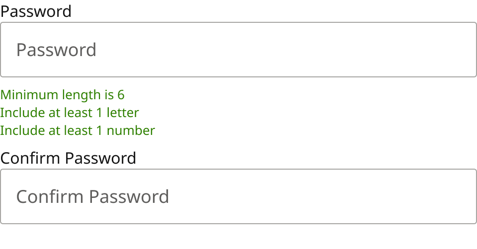
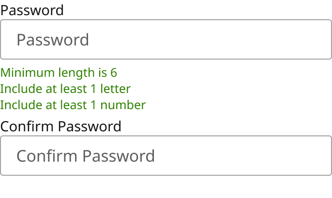

# Form Field Assembly / Password

> Password, the requirements hint, then Confirm Password.

## Figma

- File: **MNG Web Design System** (`jFHYqhZbJjvWQmDI4myCsd`), page **Form Fields | 2026.11.04**
- Component set: [`Form Field Assembly / Password` · 7003:28940](https://www.figma.com/design/jFHYqhZbJjvWQmDI4myCsd/?node-id=7003-28940) · key `718d7b5dad76274badeee4d3bb8ac0566a18c547`
- Documentation frame: [Assembly: Password — Documentation](https://www.figma.com/design/jFHYqhZbJjvWQmDI4myCsd/?node-id=6965-7501) · overview: [previews/password--documentation.png](previews/password--documentation.png)

## Properties

| Property | Default | Options |
|---|---|---|
| Size | Desktop | Desktop, Mobile |

| Other property | Type | Default |
|---|---|---|
| Hint | text | Minimum length is 6
Include at least 1 letter
Include at least 1 number |
| Show hint | boolean | True |

## Variants

| Variant | Size | Node | Instances | Preview |
|---|---|---|---|---|
| `Desktop` | 480×251 | [7003:28878](https://www.figma.com/design/jFHYqhZbJjvWQmDI4myCsd/?node-id=7003-28878) | 1 |  |
| `Mobile` | 328×196 | [7003:28939](https://www.figma.com/design/jFHYqhZbJjvWQmDI4myCsd/?node-id=7003-28939) | 0 |  |

## Anatomy

Default variant `Desktop` (hidden layers marked):

- **Size=Desktop** `COMPONENT`: 480×251, vertical, gap 8, padding 0/0/0/0, fixed×hug
  - **Form Field** `INSTANCE`: 480×78, vertical, gap 0, padding 0/0/0/0, fill×hug, instance of Form Field (Size=Desktop, State=Blank)
  - **Minimum length is 6 Include at least 1 letter Include at least 1 number** `TEXT`: 157×54, hug×hug, "Minimum length is 6
Include at least 1 l", Noto Sans Regular 13px
  - **Form Field** `INSTANCE`: 480×103, vertical, gap 0, padding 0/0/0/0, fill×hug, instance of Form Field (Size=Desktop, State=Blank)

## Component tokens

From `password.tokens.json`. References point at system tokens (`tokens/core/`, `tokens/themes/`); the CSS variable is `--mng-` + the token path. A literal value means the Figma layer isn't bound to a token.

| Token | Value |
|---|---|
| `password.size-desktop.form-field.height` | 103px |
| `password.size-desktop.form-field.width` | 480px |
| `password.size-desktop.minimum-length-is-6-include-at-least-1-letter-include-at-least-1-number.font-size` | `{font.size.13}` |
| `password.size-desktop.root.gap` | `{spacing.100}` |
| `password.size-desktop.root.width` | 480px |
| `password.size-mobile.form-field.height` | 81px |
| `password.size-mobile.form-field.width` | 328px |
| `password.size-mobile.minimum-length-is-6-include-at-least-1-letter-include-at-least-1-number.font-size` | `{font.size.12}` |
| `password.size-mobile.root.gap` | `{spacing.050}` |
| `password.size-mobile.root.width` | 328px |
| `password.base.form-field.icon-color` | `{color.gray.min}` |
| `password.base.minimum-length-is-6-include-at-least-1-letter-include-at-least-1-number.color` | `{color.feedback.low-success}` |
| `password.base.minimum-length-is-6-include-at-least-1-letter-include-at-least-1-number.font-family` | `{font.family.noto-sans}` |
| `password.base.minimum-length-is-6-include-at-least-1-letter-include-at-least-1-number.font-weight` | `{font.weight.regular}` |

## Behavior and breakpoints

| Size value | Viewport |
|---|---|
| Desktop | Desktop, TabletH, TabletV |
| Mobile | Mobile, Fold |

*Same switch as Form Field (production breakpoint not re-checked for this export, Karl 2026-11-04).*

- **Order:** Password (no error row: its Error Message Container is hidden), the requirements hint directly under it, then Confirm Password with the only error row (Karl, 2026-11-04).
- Built from Form Field instances (exposed: set each field's State, Label, Value and Placeholder on the instance). Use Show icon = off inside assemblies.
- **Hint:** Minimum length is 6 / Include at least 1 letter / Include at least 1 number, Noto Sans Regular 13 (Mobile 12), always shown, `color/feedback/low-success` (Karl kept it green, 2026-11-04).
- **Errors:** an error for either field (empty, rules not met, passwords don't match) shows in the one row under Confirm Password, and the field in error gets the red outline; this is the one exception to "message under the field". Point the field in error's `aria-describedby` at that message, and the Password field's at the hint too.
- **Success:** on a new password, Password goes to Success on blur once all three rules are met, and Confirm Password once it matches. Never on a sign-in password.
- Desktop 8px between parts (`spacing/100`); Mobile 4px (`spacing/050`).

## Accessibility

- No InFocus state in Figma.
- Text color on its background must meet WCAG AA contrast (4.5:1 for text under 18px) in every theme; theme colors change per site.
- Icons inside a labelled control are decorative (`aria-hidden`); an icon-only control needs an accessible name (`aria-label`).

## Where it is used

Scope: instances in the Figma file **MNG Web Design System** only (other files that use the library are not counted). Total: **1**.

Placed on pages: Form Fields | 2026.11.04 ×1.

**Built from:** Form Field ×4

## Production

Not checked against production for this export (Karl, 2026-11-04).

## Known issues

1. Not checked against production for this export (Karl, 2026-11-04).

## Files

- `password.tokens.json`: component tokens (DTCG 2025.10).
- `password.html`: HTML/CSS skeleton of every variant, using the `dist/` CSS variables (open it in a browser).
- `previews/`: PNG of every variant @2x and the documentation frame.

*Generated 2026-11-04 by `scripts/component-export/export.py` (EXPORT-STANDARD.md section 7). Edit the text in `scripts/component-export/registry.json`, not here.*
