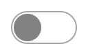
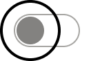
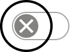
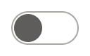
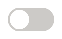

# Toggle Switch

> Toggle switch (on / off), built like CheckBox (Karl, 2026-11-10): a 48x24 slider inside a 64x40 touch area. status = unselected (off), selected (on); interaction = Default, hover, pressed, disabled; inFocus adds the focus ring around the handle; icon = False, True (close / checkmark3 in the handle). The label isn't part of the atom.

## Figma

- File: **MNG Web Design System** (`jFHYqhZbJjvWQmDI4myCsd`), page **Toggle Switches | 2026.11.10**
- Component set: [`Toggle Switch` · 5216:61](https://www.figma.com/design/jFHYqhZbJjvWQmDI4myCsd/?node-id=5216-61) · key `8dcff697f38c730e4b1fc9c5a834be7a9f96208a`
- Documentation frame: [Toggle Switch Container](https://www.figma.com/design/jFHYqhZbJjvWQmDI4myCsd/?node-id=7543-1536) · overview: [previews/toggle-switch--documentation.png](previews/toggle-switch--documentation.png)

## Properties

| Property | Default | Options |
|---|---|---|
| status | unselected | unselected, selected |
| interaction | Default | Default, hover, pressed, disabled |
| inFocus | False | False, True |
| icon | False | False, True |

## Variants

| Variant | Size | Node | Instances | Preview |
|---|---|---|---|---|
| `unselected / Default / False / False` | 64×40 | [5222:242](https://www.figma.com/design/jFHYqhZbJjvWQmDI4myCsd/?node-id=5222-242) | 8 |  |
| `unselected / Default / False / True` | 64×40 | [5218:264](https://www.figma.com/design/jFHYqhZbJjvWQmDI4myCsd/?node-id=5218-264) | 2 |  |
| `unselected / Default / True / False` | 64×40 | [5222:227](https://www.figma.com/design/jFHYqhZbJjvWQmDI4myCsd/?node-id=5222-227) | 1 |  |
| `unselected / Default / True / True` | 64×40 | [5222:207](https://www.figma.com/design/jFHYqhZbJjvWQmDI4myCsd/?node-id=5222-207) | 1 |  |
| `unselected / hover / False / False` | 64×40 | [5222:237](https://www.figma.com/design/jFHYqhZbJjvWQmDI4myCsd/?node-id=5222-237) | 1 |  |
| `unselected / hover / False / True` | 64×40 | [5222:199](https://www.figma.com/design/jFHYqhZbJjvWQmDI4myCsd/?node-id=5222-199) | 0 |  |
| `unselected / pressed / False / False` | 64×40 | [5222:232](https://www.figma.com/design/jFHYqhZbJjvWQmDI4myCsd/?node-id=5222-232) | 0 |  |
| `unselected / pressed / False / True` | 64×40 | [5222:203](https://www.figma.com/design/jFHYqhZbJjvWQmDI4myCsd/?node-id=5222-203) | 0 |  |
| `unselected / disabled / False / False` | 64×40 | [5222:222](https://www.figma.com/design/jFHYqhZbJjvWQmDI4myCsd/?node-id=5222-222) | 0 |  |
| `unselected / disabled / False / True` | 64×40 | [5218:269](https://www.figma.com/design/jFHYqhZbJjvWQmDI4myCsd/?node-id=5218-269) | 0 |  |
| `selected / Default / False / False` | 64×40 | [5219:102](https://www.figma.com/design/jFHYqhZbJjvWQmDI4myCsd/?node-id=5219-102) | 3 |  |
| `selected / Default / False / True` | 64×40 | [5216:65](https://www.figma.com/design/jFHYqhZbJjvWQmDI4myCsd/?node-id=5216-65) | 15 |  |
| `selected / Default / True / False` | 64×40 | [5219:171](https://www.figma.com/design/jFHYqhZbJjvWQmDI4myCsd/?node-id=5219-171) | 2 |  |
| `selected / Default / True / True` | 64×40 | [5220:189](https://www.figma.com/design/jFHYqhZbJjvWQmDI4myCsd/?node-id=5220-189) | 1 |  |
| `selected / hover / False / False` | 64×40 | [5219:107](https://www.figma.com/design/jFHYqhZbJjvWQmDI4myCsd/?node-id=5219-107) | 0 |  |
| `selected / hover / False / True` | 64×40 | [5220:179](https://www.figma.com/design/jFHYqhZbJjvWQmDI4myCsd/?node-id=5220-179) | 0 |  |
| `selected / pressed / False / False` | 64×40 | [5219:167](https://www.figma.com/design/jFHYqhZbJjvWQmDI4myCsd/?node-id=5219-167) | 0 |  |
| `selected / pressed / False / True` | 64×40 | [5220:184](https://www.figma.com/design/jFHYqhZbJjvWQmDI4myCsd/?node-id=5220-184) | 0 |  |
| `selected / disabled / False / False` | 64×40 | [5219:98](https://www.figma.com/design/jFHYqhZbJjvWQmDI4myCsd/?node-id=5219-98) | 0 |  |
| `selected / disabled / False / True` | 64×40 | [5220:194](https://www.figma.com/design/jFHYqhZbJjvWQmDI4myCsd/?node-id=5220-194) | 1 |  |

## Anatomy

Default variant `unselected / Default / False / False` (hidden layers marked):

- **status=unselected, inFocus=False, interaction=Default, icon=False** `COMPONENT`: 64×40, horizontal, gap 0, padding 8/8/8/8, fixed×fixed
  - **Slider** `FRAME`: 48×24, horizontal, gap 0, padding 2/2/2/2, fixed×fixed
    - **Handle** `FRAME`: 20×20, horizontal, gap 8, padding 0/0/0/0, fixed×fixed
      - **Icon** `INSTANCE`: 12×12, horizontal, gap 8, padding 0/0/0/0, fixed×fixed, instance of Icons (Name=close), **hidden**

## Component tokens

From `toggle-switch.tokens.json`. References point at system tokens (`tokens/core/`, `tokens/themes/`); the CSS variable is `--mng-` + the token path. A literal value means the Figma layer isn't bound to a token.

| Token | Value |
|---|---|
| `toggle-switch.infocus-true.focus-ring.border-color` | `{color.gray.black}` |
| `toggle-switch.infocus-true.focus-ring.border-style` | solid |
| `toggle-switch.infocus-true.focus-ring.border-width` | 2px |
| `toggle-switch.base.root.border-radius` | `{radius.utility}` |
| `toggle-switch.base.root.height` | 40px |
| `toggle-switch.base.root.padding-bottom` | `{spacing.100}` |
| `toggle-switch.base.root.padding-left` | `{spacing.100}` |
| `toggle-switch.base.root.padding-right` | `{spacing.100}` |
| `toggle-switch.base.root.padding-top` | `{spacing.100}` |
| `toggle-switch.base.root.width` | 64px |
| `toggle-switch.base.slider.border-color` | `{color.gray.400}` |
| `toggle-switch.base.slider.border-radius` | 12px |
| `toggle-switch.base.slider.border-style` | solid |
| `toggle-switch.base.slider.border-width` | 1px |
| `toggle-switch.base.slider.height` | 24px |
| `toggle-switch.base.slider.padding-bottom` | 2px |
| `toggle-switch.base.slider.padding-left` | 2px |
| `toggle-switch.base.slider.padding-right` | 2px |
| `toggle-switch.base.slider.padding-top` | 2px |
| `toggle-switch.base.slider.width` | 48px |
| `toggle-switch.base.slider.handle.border-radius` | 10px |
| `toggle-switch.base.slider.handle.height` | 20px |
| `toggle-switch.base.slider.handle.width` | 20px |
| `toggle-switch.status-unselected.interaction-default.slider.background` | `{color.gray.max}` |
| `toggle-switch.status-unselected.interaction-default.slider.handle.background` | `{color.gray.300}` |
| `toggle-switch.status-unselected.interaction-hover.slider.background` | `{color.gray.max}` |
| `toggle-switch.status-unselected.interaction-hover.slider.handle.background` | `{color.gray.200}` |
| `toggle-switch.status-unselected.interaction-pressed.slider.background` | `{color.gray.max}` |
| `toggle-switch.status-unselected.interaction-pressed.slider.handle.background` | `{color.gray.200}` |
| `toggle-switch.status-unselected.interaction-disabled.slider.background` | `{color.gray.500}` |
| `toggle-switch.status-unselected.interaction-disabled.slider.handle.background` | `{color.gray.max}` |
| `toggle-switch.status-selected.interaction-default.slider.background` | `{color.gray.500}` |
| `toggle-switch.status-selected.interaction-default.slider.handle.background` | `{color.theme.primary}` |
| `toggle-switch.status-selected.interaction-hover.slider.background` | `{color.gray.500}` |
| `toggle-switch.status-selected.interaction-hover.slider.handle.background` | `{color.theme.primary-darker}` |
| `toggle-switch.status-selected.interaction-pressed.slider.background` | `{color.gray.500}` |
| `toggle-switch.status-selected.interaction-pressed.slider.handle.background` | `{color.theme.primary-darker}` |
| `toggle-switch.status-selected.interaction-disabled.slider.background` | `{color.gray.500}` |
| `toggle-switch.status-selected.interaction-disabled.slider.handle.background` | `{color.gray.max}` |
| `toggle-switch.icon-true.slider.handle.icon.height` | 12px |
| `toggle-switch.icon-true.slider.handle.icon.width` | 12px |
| `toggle-switch.interaction-default.slider.handle.icon.icon-color` | `{color.gray.max}` |
| `toggle-switch.interaction-hover.slider.handle.icon.icon-color` | `{color.gray.max}` |
| `toggle-switch.interaction-pressed.slider.handle.icon.icon-color` | `{color.gray.max}` |
| `toggle-switch.interaction-disabled.slider.handle.icon.icon-color` | `{color.gray.400}` |

## Behavior and breakpoints

No Breakpoint property: one size at every width.

- **Touch area:** 64x40px (the whole switch), 5px corners (`radius/utility`), 8px (`spacing/100`) around the slider; it includes the 40x40 area around the handle.
- **Focus:** a 2px `color/gray/black` ring outside the 40x40 circle around the handle, not the whole switch (Karl, 2026-11-10). It moves with the handle and can apply to any state. No ring on hover or pressed.
- **Slider:** 48x24px, fully round (12px corners), 2px around the 20x20 handle.
- **Off** (`status=unselected`): `color/gray/max` slider with a 1px inside `color/gray/400` border; `color/gray/300` handle at the left (3.8:1 on white).
- **On** (`status=selected`): `color/gray/500` slider; `color/theme/primary` handle at the right (3:1 or better on gray/500 in every theme except Orlando Sentinel, 2.9:1).
- **Icon** (`icon=True`): `close` (off) or `checkmark3` (on), 12x12px, `color/gray/max` on the handle.
- **Hover and pressed:** the handle turns `color/theme/primary-darker` (on; 4.0:1 or better on gray/500) or `color/gray/200` (off; 6.4:1 on white) (Karl, 2026-11-10; it was site-primary-lighter and gray-400, both under 3:1).
- **Disabled:** `color/gray/500` slider, `color/gray/max` handle, icon `color/gray/400`.
- **Label** (not part of the atom): Noto Sans Regular 14px, `color/gray/min`; the switch and the first line of text are center-aligned, no padding between the touch area and the text.
- **Pointer:** changes from an arrow to a pointing hand inside the touch area.
- **Accessibility:** a real checkbox input with `role="switch"` (or a `button` with `role="switch"`), `aria-checked` true / false, named by its label. Space toggles it; the label never changes with the state. Disabled uses `disabled` (or `aria-disabled`).
- **Documentation stage:** the samples sit on `color/gray/600`, not the usual `gray/500`, because the On slider is gray/500 (Karl, 2026-11-10).

## Accessibility

- No InFocus state in Figma.
- Text color on its background must meet WCAG AA contrast (4.5:1 for text under 18px) in every theme; theme colors change per site.
- Icons inside a labelled control are decorative (`aria-hidden`); an icon-only control needs an accessible name (`aria-label`).

## Where it is used

Scope: instances in the Figma file **MNG Web Design System** only (other files that use the library are not counted). Total: **35**.

Inside components: InLineMessage ×10, Title-Bar Container ×3.
Placed on pages: Toggle Switches | 2026.11.10 ×11.

**Built from:** Icons ×10
Icon variants: `close` ×5, `checkmark3` ×5.

## Production

Not in production yet (Karl, 2026-11-10).

## Known issues

1. Orlando Sentinel: the On handle (`color/theme/primary` #1776C4) is 2.9:1 on the `color/gray/500` slider, just under 3:1.
2. The On slider (`color/gray/500`) is 1.6:1 on a white page; the handle carries the state (3:1 or better except Orlando Sentinel).
3. Not in production yet (Karl, 2026-11-10).
4. **Values not bound to a token** (literal in the component tokens): `base` slider border-radius = 12px; `base` slider padding-bottom = 2px; `base` slider padding-left = 2px; `base` slider padding-right = 2px; `base` slider padding-top = 2px; `base` slider.handle border-radius = 10px.

## Files

- `toggle-switch.tokens.json`: component tokens (DTCG 2025.10).
- `toggle-switch.html`: HTML/CSS skeleton of every variant, using the `dist/` CSS variables (open it in a browser).
- `previews/`: PNG of every variant @2x and the documentation frame.

*Generated 2026-11-11 by `scripts/component-export/export.py` (EXPORT-STANDARD.md section 7). Edit the text in `scripts/component-export/registry.json`, not here.*
