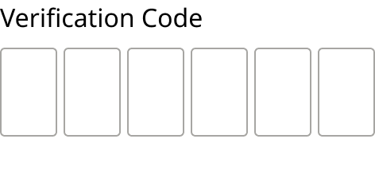
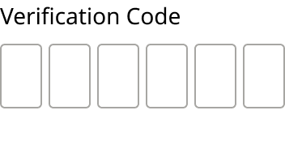

# Form Field Assembly / Verification Code

> A label, six Code Box cells in a row (4px gap, `spacing/050`) and one shared error row under all six. 8px (`spacing/100`) between label, row and error row.

## Figma

- File: **MNG Web Design System** (`jFHYqhZbJjvWQmDI4myCsd`), page **Form Fields | 2026.11.04**
- Component set: [`Form Field Assembly / Verification Code` · 7003:29223](https://www.figma.com/design/jFHYqhZbJjvWQmDI4myCsd/?node-id=7003-29223) · key `7c0d7e73c63480ff2ecd5a4d2d360a7d470aaa3c`
- Documentation frame: [Assembly: Verification Code — Documentation](https://www.figma.com/design/jFHYqhZbJjvWQmDI4myCsd/?node-id=6973-24891) · overview: [previews/verification-code--documentation.png](previews/verification-code--documentation.png)

## Properties

| Property | Default | Options |
|---|---|---|
| Size | Desktop | Desktop, Mobile |

| Other property | Type | Default |
|---|---|---|
| Error message | text | Error message text. |
| Show error | boolean | False |
| Label | text | Verification Code |

## Variants

| Variant | Size | Node | Instances | Preview |
|---|---|---|---|---|
| `Desktop` | 236×119 | [7003:29120](https://www.figma.com/design/jFHYqhZbJjvWQmDI4myCsd/?node-id=7003-29120) | 2 |  |
| `Mobile` | 176×97 | [7003:29222](https://www.figma.com/design/jFHYqhZbJjvWQmDI4myCsd/?node-id=7003-29222) | 1 |  |

## Anatomy

Default variant `Desktop` (hidden layers marked):

- **Size=Desktop** `COMPONENT`: 236×119, vertical, gap 8, padding 0/0/0/0, hug×hug
  - **Label** `TEXT`: 128×22, hug×hug, "Verification Code", Noto Sans Regular 16px
  - **Code Box Row** `FRAME`: 236×56, horizontal, gap 4, padding 0/0/0/0, hug×hug
    - **Code Box** `INSTANCE`: 36×56, horizontal, gap 8, padding 8/0/8/0, fixed×fixed, instance of Code Box (Size=Desktop, State=Blank)
    - **Code Box** `INSTANCE`: 36×56, horizontal, gap 8, padding 8/0/8/0, fixed×fixed, instance of Code Box (Size=Desktop, State=Blank)
    - **Code Box** `INSTANCE`: 36×56, horizontal, gap 8, padding 8/0/8/0, fixed×fixed, instance of Code Box (Size=Desktop, State=Blank)
    - **Code Box** `INSTANCE`: 36×56, horizontal, gap 8, padding 8/0/8/0, fixed×fixed, instance of Code Box (Size=Desktop, State=Blank)
    - **Code Box** `INSTANCE`: 36×56, horizontal, gap 8, padding 8/0/8/0, fixed×fixed, instance of Code Box (Size=Desktop, State=Blank)
    - **Code Box** `INSTANCE`: 36×56, horizontal, gap 8, padding 8/0/8/0, fixed×fixed, instance of Code Box (Size=Desktop, State=Blank)
  - **Error Message Container (Shared)** `FRAME`: 236×25, horizontal, gap 0, padding 0/0/0/0, fill×fixed
    - **Error message text.** `TEXT`: 165×25, fixed×fixed, "Error message text.", Noto Sans Regular 18px, **hidden**

## Component tokens

From `verification-code.tokens.json`. References point at system tokens (`tokens/core/`, `tokens/themes/`); the CSS variable is `--mng-` + the token path. A literal value means the Figma layer isn't bound to a token.

| Token | Value |
|---|---|
| `verification-code.base.code-box-row.gap` | `{spacing.050}` |
| `verification-code.base.code-box-row.code-box.icon-color` | `{color.gray.min}` |
| `verification-code.base.label.color` | `{color.gray.black}` |
| `verification-code.base.label.font-family` | `{font.family.noto-sans}` |
| `verification-code.base.label.font-weight` | `{font.weight.regular}` |
| `verification-code.base.root.gap` | `{spacing.100}` |
| `verification-code.size-desktop.code-box-row.code-box.height` | 56px |
| `verification-code.size-desktop.code-box-row.code-box.width` | 36px |
| `verification-code.size-desktop.error-message-container-shared.height` | 25px |
| `verification-code.size-desktop.label.font-size` | `{font.size.16}` |
| `verification-code.size-mobile.code-box-row.code-box.height` | 40px |
| `verification-code.size-mobile.code-box-row.code-box.width` | 26px |
| `verification-code.size-mobile.error-message-container-shared.height` | 22px |
| `verification-code.size-mobile.label.font-size` | `{font.size.14}` |

## Behavior and breakpoints

| Size value | Viewport |
|---|---|
| Desktop | Desktop, TabletH, TabletV |
| Mobile | Mobile, Fold |

*Same switch as Form Field (production breakpoint not re-checked for this export, Karl 2026-11-04).*

- A label, six Code Box cells in a row (4px gap, `spacing/050`) and one shared error row under all six. 8px (`spacing/100`) between label, row and error row.
- **Success:** once every digit is entered, set all six cells to Code Box Success (green outline, no checkmark): the code is complete, not confirmed. If the server rejects it, set the cells to Error and show the message in the shared row.
- Mobile: 14px label, 26x40 cells, 22px error row with 16px text.

## Accessibility

- No InFocus state in Figma.
- Text color on its background must meet WCAG AA contrast (4.5:1 for text under 18px) in every theme; theme colors change per site.
- Icons inside a labelled control are decorative (`aria-hidden`); an icon-only control needs an accessible name (`aria-label`).

## Where it is used

Scope: instances in the Figma file **MNG Web Design System** only (other files that use the library are not counted). Total: **3**.

Placed on pages: Form Fields | 2026.11.04 ×3.

**Built from:** Code Box ×12

## Production

Not checked against production for this export (Karl, 2026-11-04).

## Known issues

1. Not checked against production for this export (Karl, 2026-11-04).

## Files

- `verification-code.tokens.json`: component tokens (DTCG 2025.10).
- `verification-code.html`: HTML/CSS skeleton of every variant, using the `dist/` CSS variables (open it in a browser).
- `previews/`: PNG of every variant @2x and the documentation frame.

*Generated 2026-11-04 by `scripts/component-export/export.py` (EXPORT-STANDARD.md section 7). Edit the text in `scripts/component-export/registry.json`, not here.*
