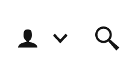
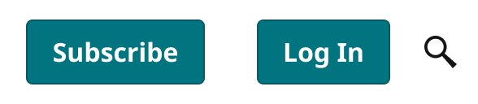
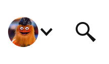
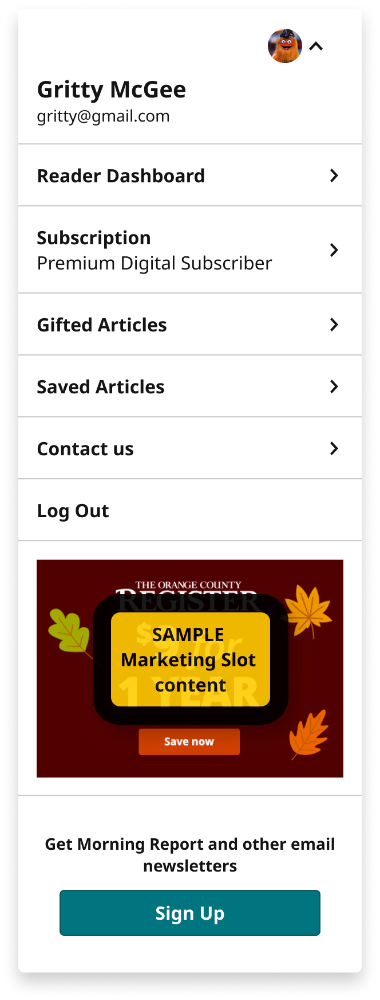
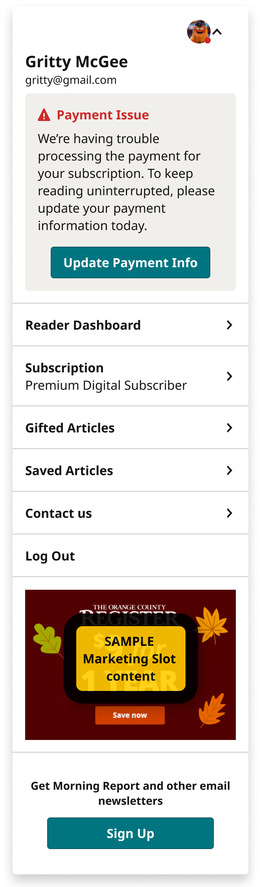

# AccountMenu

> The account control at the right of the masthead (Closed) and the menu it opens (Open). Status = loggedOut, loggedIn, alert; View = Closed, Open; Device = (up to 1039px), (1040px and up) for logged out, (all widths) for logged in; UserType = loggedOut, loggedIn (Closed), nonSub, subscriber. Text properties: User name, User email, Subscription type. Cut from 21 to 7 variants on 2026-11-16 (Karl); matches production (digisubs, all 6 review sites, 2026-11-13) on the 4 / 8 grid.

## Figma

- File: **WordPress Elements** (`b1iZxkFwtAYq9rElmnCAzd`), page **Menus and Parts**
- Component set: [`AccountMenu` · 910:16425](https://www.figma.com/design/b1iZxkFwtAYq9rElmnCAzd/?node-id=910-16425) · key `21db80b6ccdb88eb2a61326e46bce299f7aa1693`
- Documentation frame: [AccountMenu Container](https://www.figma.com/design/b1iZxkFwtAYq9rElmnCAzd/?node-id=910-15618) · overview: [previews/account-menu--documentation.png](previews/account-menu--documentation.png)

## Properties

| Property | Default | Options |
|---|---|---|
| Device | (up to 1039px) | (up to 1039px), (1040px and up), (all widths) |
| Status | loggedOut | loggedIn, loggedOut, alert |
| UserType | loggedOut | loggedIn, nonSub, loggedOut, subscriber |
| View | Closed | Open, Closed |

| Other property | Type | Default |
|---|---|---|
| Search | slot | None |
| Search | slot | None |
| Search | slot | None |
| User name | text | Gritty McGee |
| User email | text | gritty@gmail.com |
| Subscription type | text | Premium Digital Subscriber |

## Variants

| Variant | Size | Node | Instances | Preview |
|---|---|---|---|---|
| `(up to 1039px) / loggedOut / loggedOut / Open` | 300×650 | [910:16443](https://www.figma.com/design/b1iZxkFwtAYq9rElmnCAzd/?node-id=910-16443) | 4 |  |
| `(up to 1039px) / loggedOut / loggedOut / Closed` | 112×64 | [910:16436](https://www.figma.com/design/b1iZxkFwtAYq9rElmnCAzd/?node-id=910-16436) | 66 |  |
| `(1040px and up) / loggedOut / loggedOut / Closed` | 294×64 | [910:16426](https://www.figma.com/design/b1iZxkFwtAYq9rElmnCAzd/?node-id=910-16426) | 25 |  |
| `(all widths) / loggedIn / loggedIn / Closed` | 112×64 | [910:16508](https://www.figma.com/design/b1iZxkFwtAYq9rElmnCAzd/?node-id=910-16508) | 121 |  |
| `(all widths) / loggedIn / nonSub / Open` | 300×954 | [910:16526](https://www.figma.com/design/b1iZxkFwtAYq9rElmnCAzd/?node-id=910-16526) | 7 |  |
| `(all widths) / loggedIn / subscriber / Open` | 300×840 | [910:16763](https://www.figma.com/design/b1iZxkFwtAYq9rElmnCAzd/?node-id=910-16763) | 26 |  |
| `(all widths) / alert / subscriber / Open` | 300×1098 | [910:17087](https://www.figma.com/design/b1iZxkFwtAYq9rElmnCAzd/?node-id=910-17087) | 4 |  |

## Anatomy

Default variant `(up to 1039px) / loggedOut / loggedOut / Open` (hidden layers marked):

- **Status=loggedOut, View=Open, Device=(up to 1039px), UserType=loggedOut** `COMPONENT`: 300×650, vertical, gap 0, padding 0/0/0/0, fixed×hug
  - **Menu Main** `FRAME`: 300×650, vertical, gap 0, padding 0/0/0/0, fill×hug
    - **Header** `FRAME`: 300×64, horizontal, gap 0, padding 0/0/0/0, fill×hug
      - **AccountMenu** `INSTANCE`: 112×64, horizontal, gap 16, padding 0/8/0/8, hug×fixed, instance of AccountMenu (Status=loggedOut, View=Closed, Device=(up to 1039px), UserType=loggedOut)
    - **Body** `FRAME`: 300×432, vertical, gap 8, padding 0/16/48/16, fill×fixed
      - **Signin** `FRAME`: 268×152, vertical, gap 24, padding 24/12/24/12, fill×hug
        - **Button Primary** `INSTANCE`: 244×40, vertical, gap 8, padding 0/8/0/8, fill×hug, instance of Button Primary (Icon=None, State=Default, Breakpoint=Desktop)
        - **Button Primary** `INSTANCE`: 244×40, vertical, gap 8, padding 0/8/0/8, fill×hug, instance of Button Primary (Icon=None, State=Default, Breakpoint=Desktop)
    - **Divider** `LINE`: 300×0, fill×fixed
    - **Menu Footer** `FRAME`: 300×154, vertical, gap 0, padding 0/0/0/0, fill×hug
      - **Item** `FRAME`: 300×154, vertical, gap 0, padding 32/16/32/16, fill×hug
        - **Newsletter Container** `FRAME`: 268×38, horizontal, gap 8, padding 0/0/0/0, fill×hug
          - **Newsletter Text** `TEXT`: 268×38, fill×hug, "Get Morning Report and other email newsl", Noto Sans Bold 14px
        - **Signup Container** `FRAME`: 268×52, horizontal, gap 0, padding 12/12/0/12, fill×hug
          - **Button Primary** `INSTANCE`: 244×40, vertical, gap 8, padding 0/8/0/8, fill×hug, instance of Button Primary (Icon=None, State=Default, Breakpoint=Desktop)

## Component tokens

From `account-menu.tokens.json`. References point at system tokens (`tokens/core/`, `tokens/themes/`); the CSS variable is `--mng-` + the token path. A literal value means the Figma layer isn't bound to a token.

| Token | Value |
|---|---|
| `account-menu.usertype-subscriber.container.background` | `{color.gray.max}` |
| `account-menu.usertype-subscriber.container.container.padding-bottom` | `{spacing.200}` |
| `account-menu.usertype-subscriber.container.container.padding-left` | `{spacing.200}` |
| `account-menu.usertype-subscriber.container.container.padding-right` | `{spacing.200}` |
| `account-menu.usertype-subscriber.container.container.padding-top` | `{spacing.200}` |
| `account-menu.usertype-subscriber.container.container.container.height` | 190px |
| `account-menu.usertype-subscriber.container.container.container.ad-sample-1.height` | 196px |
| `account-menu.usertype-subscriber.container.container.container.ad-sample-1.width` | 285px |
| `account-menu.usertype-subscriber.container.container.container.container.background` | #ffcc00 |
| `account-menu.usertype-subscriber.container.container.container.container.border-color` | `{color.gray.black}` |
| `account-menu.usertype-subscriber.container.container.container.container.border-radius` | `{radius.lg}` |
| `account-menu.usertype-subscriber.container.container.container.container.border-style` | solid |
| `account-menu.usertype-subscriber.container.container.container.container.border-width` | 16px |
| `account-menu.usertype-subscriber.container.container.container.container.opacity` | 0.9 |
| `account-menu.usertype-subscriber.container.container.container.container.padding-bottom` | `{spacing.100}` |
| `account-menu.usertype-subscriber.container.container.container.container.padding-left` | `{spacing.100}` |
| `account-menu.usertype-subscriber.container.container.container.container.padding-right` | `{spacing.100}` |
| `account-menu.usertype-subscriber.container.container.container.container.padding-top` | `{spacing.100}` |
| `account-menu.usertype-subscriber.container.container.container.container.ad-text.color` | `{color.gray.black}` |
| `account-menu.usertype-subscriber.container.container.container.container.ad-text.font-family` | `{font.family.noto-sans}` |
| `account-menu.usertype-subscriber.container.container.container.container.ad-text.font-size` | `{font.size.16}` |
| `account-menu.usertype-subscriber.container.container.container.container.ad-text.font-weight` | `{font.weight.bold}` |
| `account-menu.usertype-subscriber.container.divider.border-color` | `{color.gray.500}` |
| `account-menu.usertype-subscriber.container.divider.border-style` | solid |
| `account-menu.usertype-subscriber.container.divider.border-width` | 1px |
| `account-menu.usertype-subscriber.container.divider.height` | 0px |
| `account-menu.usertype-subscriber.section-item.container.container.contact-us.color` | `{color.gray.min}` |
| `account-menu.usertype-subscriber.section-item.container.container.contact-us.font-family` | `{font.family.noto-sans}` |
| `account-menu.usertype-subscriber.section-item.container.container.contact-us.font-size` | `{font.size.16}` |
| `account-menu.usertype-subscriber.section-item.container.container.contact-us.font-weight` | `{font.weight.bold}` |
| `account-menu.usertype-subscriber.section-item.container.container.container.subscription-type.color` | `{color.gray.min}` |
| `account-menu.usertype-subscriber.section-item.container.container.container.subscription-type.font-family` | `{font.family.noto-sans}` |
| `account-menu.usertype-subscriber.section-item.container.container.container.subscription-type.font-size` | `{font.size.16}` |
| `account-menu.usertype-subscriber.section-item.container.container.container.subscription-type.font-weight` | `{font.weight.regular}` |
| `account-menu.usertype-subscriber.section-item.container.container.gifted-articles.color` | `{color.gray.min}` |
| `account-menu.usertype-subscriber.section-item.container.container.gifted-articles.font-family` | `{font.family.noto-sans}` |
| `account-menu.usertype-subscriber.section-item.container.container.gifted-articles.font-size` | `{font.size.16}` |
| `account-menu.usertype-subscriber.section-item.container.container.gifted-articles.font-weight` | `{font.weight.bold}` |
| `account-menu.usertype-subscriber.section-item.container.container.log-out.color` | `{color.gray.min}` |
| `account-menu.usertype-subscriber.section-item.container.container.log-out.font-family` | `{font.family.noto-sans}` |
| `account-menu.usertype-subscriber.section-item.container.container.log-out.font-size` | `{font.size.16}` |
| `account-menu.usertype-subscriber.section-item.container.container.log-out.font-weight` | `{font.weight.bold}` |
| `account-menu.usertype-subscriber.section-item.container.container.reader-dashboard.color` | `{color.gray.min}` |
| `account-menu.usertype-subscriber.section-item.container.container.reader-dashboard.font-family` | `{font.family.noto-sans}` |
| `account-menu.usertype-subscriber.section-item.container.container.reader-dashboard.font-size` | `{font.size.16}` |
| `account-menu.usertype-subscriber.section-item.container.container.reader-dashboard.font-weight` | `{font.weight.bold}` |
| `account-menu.usertype-subscriber.section-item.container.container.saved-articles.color` | `{color.gray.min}` |
| `account-menu.usertype-subscriber.section-item.container.container.saved-articles.font-family` | `{font.family.noto-sans}` |
| `account-menu.usertype-subscriber.section-item.container.container.saved-articles.font-size` | `{font.size.16}` |
| `account-menu.usertype-subscriber.section-item.container.container.saved-articles.font-weight` | `{font.weight.bold}` |
| `account-menu.usertype-subscriber.section-item.container.container.subscription.color` | `{color.gray.min}` |
| `account-menu.usertype-subscriber.section-item.container.container.subscription.font-family` | `{font.family.noto-sans}` |
| `account-menu.usertype-subscriber.section-item.container.container.subscription.font-size` | `{font.size.16}` |
| `account-menu.usertype-subscriber.section-item.container.container.subscription.font-weight` | `{font.weight.bold}` |
| `account-menu.usertype-loggedin.container.gap` | `{spacing.050}` |
| `account-menu.usertype-loggedin.container.icon.icons.height` | 16px |
| `account-menu.usertype-loggedin.container.icon.icons.icon-color` | `{color.gray.min}` |
| `account-menu.usertype-loggedin.container.icon.icons.width` | 16px |
| `account-menu.usertype-loggedin.container.userstatus.height` | 30px |
| `account-menu.usertype-loggedin.container.userstatus.width` | 30px |
| `account-menu.base.item.padding-bottom` | `{spacing.400}` |
| `account-menu.base.item.padding-left` | `{spacing.200}` |
| `account-menu.base.item.padding-right` | `{spacing.200}` |
| `account-menu.base.item.padding-top` | `{spacing.400}` |
| `account-menu.base.item.container.padding-left` | `{spacing.150}` |
| `account-menu.base.item.container.padding-right` | `{spacing.150}` |
| `account-menu.base.item.container.padding-top` | `{spacing.150}` |
| `account-menu.base.item.container.button-primary.height` | 40px |
| `account-menu.base.item.container.button-primary.width` | 244px |
| `account-menu.base.item.container.newsletter-prompt.color` | `{color.gray.min}` |
| `account-menu.base.item.container.newsletter-prompt.font-family` | `{font.family.noto-sans}` |
| `account-menu.base.item.container.newsletter-prompt.font-size` | `{font.size.14}` |
| `account-menu.base.item.container.newsletter-prompt.font-weight` | `{font.weight.bold}` |
| `account-menu.base.menu-main.background` | `{color.gray.max}` |
| `account-menu.base.menu-main.body.border-color` | `{color.gray.min}` |
| `account-menu.base.menu-main.body.border-style` | solid |
| `account-menu.base.menu-main.body.border-top-width` | 1px |
| `account-menu.base.menu-main.body.height` | 432px |
| `account-menu.base.menu-main.body.padding-bottom` | `{spacing.600}` |
| `account-menu.base.menu-main.body.padding-left` | `{spacing.200}` |
| `account-menu.base.menu-main.body.padding-right` | `{spacing.200}` |
| `account-menu.base.menu-main.body.signin.gap` | `{spacing.300}` |
| `account-menu.base.menu-main.body.signin.padding-bottom` | `{spacing.300}` |
| `account-menu.base.menu-main.body.signin.padding-left` | `{spacing.150}` |
| `account-menu.base.menu-main.body.signin.padding-right` | `{spacing.150}` |
| `account-menu.base.menu-main.body.signin.padding-top` | `{spacing.300}` |
| `account-menu.base.menu-main.body.signin.button-primary.height` | 40px |
| `account-menu.base.menu-main.body.signin.button-primary.width` | 244px |
| `account-menu.base.menu-main.divider.border-color` | `{color.gray.min}` |
| `account-menu.base.menu-main.divider.border-style` | solid |
| `account-menu.base.menu-main.divider.border-width` | 1px |
| `account-menu.base.menu-main.divider.height` | 0px |
| `account-menu.base.menu-main.header.accountmenu.height` | 64px |
| `account-menu.base.menu-main.header.accountmenu.icon-color` | `{color.gray.max}` |
| `account-menu.base.menu-main.header.accountmenu.width` | 112px |
| `account-menu.base.menu-main.menu-footer.background` | `{color.gray.max}` |
| `account-menu.base.menu-main.menu-footer.item.padding-bottom` | `{spacing.400}` |
| `account-menu.base.menu-main.menu-footer.item.padding-left` | `{spacing.200}` |
| `account-menu.base.menu-main.menu-footer.item.padding-right` | `{spacing.200}` |
| `account-menu.base.menu-main.menu-footer.item.padding-top` | `{spacing.400}` |
| `account-menu.base.menu-main.menu-footer.item.newsletter-container.newsletter-text.color` | `{color.gray.min}` |
| `account-menu.base.menu-main.menu-footer.item.newsletter-container.newsletter-text.font-family` | `{font.family.noto-sans}` |
| `account-menu.base.menu-main.menu-footer.item.newsletter-container.newsletter-text.font-size` | `{font.size.14}` |
| `account-menu.base.menu-main.menu-footer.item.newsletter-container.newsletter-text.font-weight` | `{font.weight.bold}` |
| `account-menu.base.menu-main.menu-footer.item.signup-container.padding-left` | `{spacing.150}` |
| `account-menu.base.menu-main.menu-footer.item.signup-container.padding-right` | `{spacing.150}` |
| `account-menu.base.menu-main.menu-footer.item.signup-container.padding-top` | `{spacing.150}` |
| `account-menu.base.menu-main.menu-footer.item.signup-container.button-primary.height` | 40px |
| `account-menu.base.menu-main.menu-footer.item.signup-container.button-primary.width` | 244px |
| `account-menu.base.root.background` | `{color.gray.max}` |
| `account-menu.base.section-item.background` | `{color.gray.max}` |
| `account-menu.base.section-item.container.gap` | `{spacing.200}` |
| `account-menu.base.section-item.container.padding-bottom` | `{spacing.200}` |
| `account-menu.base.section-item.container.padding-left` | `{spacing.200}` |
| `account-menu.base.section-item.container.padding-right` | `{spacing.200}` |
| `account-menu.base.section-item.container.padding-top` | `{spacing.200}` |
| `account-menu.base.section-item.container.container.padding-left` | `{spacing.200}` |
| `account-menu.base.section-item.container.container.padding-right` | `{spacing.200}` |
| `account-menu.base.section-item.container.icons.height` | 16px |
| `account-menu.base.section-item.container.icons.icon-color` | `{color.gray.min}` |
| `account-menu.base.section-item.container.icons.width` | 16px |
| `account-menu.base.section-item.divider.border-color` | `{color.gray.500}` |
| `account-menu.base.section-item.divider.border-style` | solid |
| `account-menu.base.section-item.divider.border-width` | 1px |
| `account-menu.base.section-item.divider.height` | 0px |
| `account-menu.base.section-item.section-item.padding-bottom` | `{spacing.200}` |
| `account-menu.base.section-item.section-item.container.padding-left` | `{spacing.200}` |
| `account-menu.base.section-item.section-item.container.padding-right` | `{spacing.200}` |
| `account-menu.base.section-item.section-item.container.padding-top` | `{spacing.100}` |
| `account-menu.base.section-item.section-item.container.container.gap` | `{spacing.200}` |
| `account-menu.base.section-item.section-item.container.container.height` | 48px |
| `account-menu.base.section-item.section-item.container.container.padding-right` | `{spacing.100}` |
| `account-menu.base.section-item.section-item.container.container.accountmenu-desktop.background` | `{color.gray.max}` |
| `account-menu.base.section-item.section-item.container.container.accountmenu-desktop.gap` | `{spacing.050}` |
| `account-menu.base.section-item.section-item.container.container.accountmenu-desktop.padding-top` | `{spacing.200}` |
| `account-menu.base.section-item.section-item.container.container.accountmenu-desktop.icons.height` | 16px |
| `account-menu.base.section-item.section-item.container.container.accountmenu-desktop.icons.icon-color` | `{color.gray.min}` |
| `account-menu.base.section-item.section-item.container.container.accountmenu-desktop.icons.width` | 16px |
| `account-menu.base.section-item.section-item.container.container.accountmenu-desktop.userstatus.height` | 30px |
| `account-menu.base.section-item.section-item.container.container.accountmenu-desktop.userstatus.width` | 30px |
| `account-menu.base.section-item.section-item.container.container.searchbar.height` | 48px |
| `account-menu.base.section-item.section-item.container.container.searchbar.width` | 30px |
| `account-menu.base.section-item.section-item.container.user-email.color` | `{color.gray.min}` |
| `account-menu.base.section-item.section-item.container.user-email.font-family` | `{font.family.noto-sans}` |
| `account-menu.base.section-item.section-item.container.user-email.font-size` | `{font.size.14}` |
| `account-menu.base.section-item.section-item.container.user-email.font-weight` | `{font.weight.regular}` |
| `account-menu.base.section-item.section-item.container.user-name.color` | `{color.gray.min}` |
| `account-menu.base.section-item.section-item.container.user-name.font-family` | `{font.family.noto-sans}` |
| `account-menu.base.section-item.section-item.container.user-name.font-size` | `{font.size.20}` |
| `account-menu.base.section-item.section-item.container.user-name.font-weight` | `{font.weight.bold}` |
| `account-menu.base.userstatus.gap` | `{spacing.050}` |
| `account-menu.base.userstatus.arrowdown.icons.height` | 16px |
| `account-menu.base.userstatus.arrowdown.icons.icon-color` | `{color.gray.min}` |
| `account-menu.base.userstatus.arrowdown.icons.width` | 16px |
| `account-menu.base.userstatus.userstatus.height` | 30px |
| `account-menu.base.userstatus.userstatus.icon-color` | `{color.gray.max}` |
| `account-menu.base.userstatus.userstatus.width` | 30px |
| `account-menu.status-alert.item.container.newsletter-info.color` | `{color.gray.min}` |
| `account-menu.status-alert.item.container.newsletter-info.font-family` | `{font.family.noto-sans}` |
| `account-menu.status-alert.item.container.newsletter-info.font-size` | `{font.size.14}` |
| `account-menu.status-alert.item.container.newsletter-info.font-weight` | `{font.weight.bold}` |
| `account-menu.status-alert.section-item.container.container.padding-top` | `{spacing.100}` |
| `account-menu.status-alert.section-item.container.container.container.gap` | `{spacing.200}` |
| `account-menu.status-alert.section-item.container.container.container.height` | 48px |
| `account-menu.status-alert.section-item.container.container.container.padding-right` | `{spacing.100}` |
| `account-menu.status-alert.section-item.container.container.container.padding-top` | `{spacing.100}` |
| `account-menu.status-alert.section-item.container.container.container.accountmenu-desktop.background` | `{color.gray.max}` |
| `account-menu.status-alert.section-item.container.container.container.accountmenu-desktop.gap` | `{spacing.050}` |
| `account-menu.status-alert.section-item.container.container.container.accountmenu-desktop.padding-top` | `{spacing.200}` |
| `account-menu.status-alert.section-item.container.container.container.accountmenu-desktop.icons.height` | 16px |
| `account-menu.status-alert.section-item.container.container.container.accountmenu-desktop.icons.icon-color` | `{color.gray.min}` |
| `account-menu.status-alert.section-item.container.container.container.accountmenu-desktop.icons.width` | 16px |
| `account-menu.status-alert.section-item.container.container.container.accountmenu-desktop.userstatus.height` | 30px |
| `account-menu.status-alert.section-item.container.container.container.accountmenu-desktop.userstatus.width` | 30px |
| `account-menu.status-alert.section-item.container.container.container.inlinemessage.height` | 250px |
| `account-menu.status-alert.section-item.container.container.container.inlinemessage.width` | 268px |
| `account-menu.status-alert.section-item.container.container.container.searchbar.height` | 48px |
| `account-menu.status-alert.section-item.container.container.container.searchbar.width` | 30px |
| `account-menu.status-alert.section-item.container.container.email.color` | `{color.gray.min}` |
| `account-menu.status-alert.section-item.container.container.email.font-family` | `{font.family.noto-sans}` |
| `account-menu.status-alert.section-item.container.container.email.font-size` | `{font.size.14}` |
| `account-menu.status-alert.section-item.container.container.email.font-weight` | `{font.weight.regular}` |
| `account-menu.status-alert.section-item.container.container.name.color` | `{color.gray.min}` |
| `account-menu.status-alert.section-item.container.container.name.font-family` | `{font.family.noto-sans}` |
| `account-menu.status-alert.section-item.container.container.name.font-size` | `{font.size.20}` |
| `account-menu.status-alert.section-item.container.container.name.font-weight` | `{font.weight.bold}` |
| `account-menu.usertype-nonsub.item.container.section-title.color` | `{color.gray.min}` |
| `account-menu.usertype-nonsub.item.container.section-title.font-family` | `{font.family.noto-sans}` |
| `account-menu.usertype-nonsub.item.container.section-title.font-size` | `{font.size.14}` |
| `account-menu.usertype-nonsub.item.container.section-title.font-weight` | `{font.weight.bold}` |
| `account-menu.usertype-nonsub.section-item.container.background` | `{color.gray.max}` |
| `account-menu.usertype-nonsub.section-item.container.container.padding-bottom` | `{spacing.200}` |
| `account-menu.usertype-nonsub.section-item.container.container.container.ad-sample-1.height` | 196px |
| `account-menu.usertype-nonsub.section-item.container.container.container.ad-sample-1.width` | 285px |
| `account-menu.usertype-nonsub.section-item.container.container.container.container.background` | #ffcc00 |
| `account-menu.usertype-nonsub.section-item.container.container.container.container.border-color` | `{color.gray.black}` |
| `account-menu.usertype-nonsub.section-item.container.container.container.container.border-radius` | `{radius.lg}` |
| `account-menu.usertype-nonsub.section-item.container.container.container.container.border-style` | solid |
| `account-menu.usertype-nonsub.section-item.container.container.container.container.border-width` | 16px |
| `account-menu.usertype-nonsub.section-item.container.container.container.container.opacity` | 0.9 |
| `account-menu.usertype-nonsub.section-item.container.container.container.container.padding-bottom` | `{spacing.100}` |
| `account-menu.usertype-nonsub.section-item.container.container.container.container.padding-left` | `{spacing.100}` |
| `account-menu.usertype-nonsub.section-item.container.container.container.container.padding-right` | `{spacing.100}` |
| `account-menu.usertype-nonsub.section-item.container.container.container.container.padding-top` | `{spacing.100}` |
| `account-menu.usertype-nonsub.section-item.container.container.container.container.ad-text.color` | `{color.gray.black}` |
| `account-menu.usertype-nonsub.section-item.container.container.container.container.ad-text.font-family` | `{font.family.noto-sans}` |
| `account-menu.usertype-nonsub.section-item.container.container.container.container.ad-text.font-size` | `{font.size.16}` |
| `account-menu.usertype-nonsub.section-item.container.container.container.container.ad-text.font-weight` | `{font.weight.bold}` |
| `account-menu.usertype-nonsub.section-item.container.container.container.section-subtitle.color` | `{color.gray.min}` |
| `account-menu.usertype-nonsub.section-item.container.container.container.section-subtitle.font-family` | `{font.family.noto-sans}` |
| `account-menu.usertype-nonsub.section-item.container.container.container.section-subtitle.font-size` | `{font.size.16}` |
| `account-menu.usertype-nonsub.section-item.container.container.container.section-subtitle.font-weight` | `{font.weight.regular}` |
| `account-menu.usertype-nonsub.section-item.container.container.section-subtitle.color` | `{color.theme.primary}` |
| `account-menu.usertype-nonsub.section-item.container.container.section-subtitle.font-family` | `{font.family.noto-sans}` |
| `account-menu.usertype-nonsub.section-item.container.container.section-subtitle.font-size` | `{font.size.16}` |
| `account-menu.usertype-nonsub.section-item.container.container.section-subtitle.font-weight` | `{font.weight.regular}` |
| `account-menu.usertype-nonsub.section-item.container.container.section-title.color` | `{color.gray.min}` |
| `account-menu.usertype-nonsub.section-item.container.container.section-title.font-family` | `{font.family.noto-sans}` |
| `account-menu.usertype-nonsub.section-item.container.container.section-title.font-size` | `{font.size.16}` |
| `account-menu.usertype-nonsub.section-item.container.container.section-title.font-weight` | `{font.weight.bold}` |
| `account-menu.usertype-nonsub.section-item.container.divider.border-color` | `{color.gray.500}` |
| `account-menu.usertype-nonsub.section-item.container.divider.border-style` | solid |
| `account-menu.usertype-nonsub.section-item.container.divider.border-width` | 1px |
| `account-menu.usertype-nonsub.section-item.container.divider.height` | 0px |
| `account-menu.usertype-nonsub.section-item.section-item.gap` | `{spacing.200}` |
| `account-menu.usertype-nonsub.section-item.section-item.padding-left` | `{spacing.200}` |
| `account-menu.usertype-nonsub.section-item.section-item.padding-right` | `{spacing.200}` |
| `account-menu.usertype-nonsub.section-item.section-item.padding-top` | `{spacing.200}` |
| `account-menu.usertype-nonsub.section-item.section-item.container.button.padding-top` | `{spacing.100}` |
| `account-menu.usertype-nonsub.section-item.section-item.container.button.button-primary.height` | 40px |
| `account-menu.usertype-nonsub.section-item.section-item.container.button.button-primary.width` | 268px |
| `account-menu.usertype-nonsub.section-item.section-item.container.section-title.color` | `{color.gray.min}` |
| `account-menu.usertype-nonsub.section-item.section-item.container.section-title.font-family` | `{font.family.noto-sans}` |
| `account-menu.usertype-nonsub.section-item.section-item.container.section-title.font-size` | `{font.size.16}` |
| `account-menu.usertype-nonsub.section-item.section-item.container.section-title.font-weight` | `{font.weight.bold}` |
| `account-menu.usertype-nonsub.section-item.section-item.icons.height` | 16px |
| `account-menu.usertype-nonsub.section-item.section-item.icons.icon-color` | `{color.gray.min}` |
| `account-menu.usertype-nonsub.section-item.section-item.icons.width` | 16px |
| `account-menu.device-up-to-1039px.root.gap` | `{spacing.200}` |
| `account-menu.device-1040px-and-up.root.gap` | `{spacing.100}` |
| `account-menu.device-1040px-and-up.userstatus.height` | 40px |
| `account-menu.device-1040px-and-up.userstatus.width` | 240px |
| `account-menu.device-all-widths.root.gap` | `{spacing.200}` |
| `account-menu.view-closed.root.height` | 64px |
| `account-menu.view-closed.root.padding-left` | `{spacing.100}` |
| `account-menu.view-closed.root.padding-right` | `{spacing.100}` |
| `account-menu.view-closed.search.background` | `{color.gray.max}` |
| `account-menu.view-closed.search.width` | 30px |
| `account-menu.view-closed.search.searchbar.height` | 64px |
| `account-menu.view-closed.search.searchbar.width` | 30px |
| `account-menu.view-open.root.width` | 300px |
| `account-menu.status-loggedin.section-item.container.container.padding-top` | `{spacing.200}` |
| `account-menu.status-loggedin.section-item.container.container.container.height` | 190px |

## Behavior and breakpoints

| Device | Viewport | Built at |
|---|---|---|
| (up to 1039px) | logged out, below 1040px: user icon and slide-in panel | 300px panel |
| (1040px and up) | logged out: Subscribe and Log In buttons, no menu | 294px |
| (all widths) | logged in: the same menu at every width; full width at 340px and below | 300px panel |

Production's logged-out switch is 1040px (`max-width: 64.9375em`); the logged-in menu's position changes at 1024, 820, 770 and 450px (design-vs-production 11.6). Future MNG Device breakpoint for the 1040px switch: 1024 (not adopted yet).

- **Closed, logged in (all widths):** UserPic Small (30px, production's size) and the 16px chevron (`arrow-downSMALL`) 4px (`spacing/050`) apart (Karl, 2026-11-17; production's caret has 5px of padding: design-vs-production 11.11); the masthead search icon follows 16px (`spacing/200`) to the right, centered on the avatar.
- **Closed, logged out:** below 1040px the user icon and chevron (opens the slide-in panel); from 1040px up the Subscribe and Log In buttons (UserStatus; design-vs-production 10.10) and no menu.
- **Open, logged in:** a 300px panel; at 340px and below it spans the full width of the screen (Karl, 2026-11-16). Its right edge is the closed menu's right edge: the search icon's space (16px `spacing/200`, 30px, 8px `spacing/100`) stays, empty, so the avatar and chevron don't move when it opens (Karl, 2026-11-17). The avatar and up chevron show at its top, 17px down; the search icon is hidden while it's open (production). `color/gray/max`, bottom corners `radius/utility` (5px), `shadow/lg`, a 40% black scrim behind.
- **Header:** User name Noto Sans Bold 20 (`font/size/20`) and User email Regular 14 (`font/size/14`), `color/gray/min` (18.4:1), one line each with an ellipsis; 8px (`spacing/100`) above, 16px (`spacing/200`) at the sides and below; a 1px `color/gray/500` line.
- **Rows:** Reader Dashboard, Subscription (with the Subscription type, Regular 16), Gifted Articles, Saved Articles, Contact us, Log Out. 16px (`spacing/200`) padding, label Bold 16 `color/gray/min`, 16px chevron (`arrow-rightSMALL`; none on Log Out), 1px `color/gray/500` line. Saved Articles always shows (Karl, 2026-11-16). The whole row is the link.
- **Row states:** hover `color/gray/600` (16.0:1); pressed `color/gray/500` with a `color/gray/400` line (11.3:1); keyboard focus a 2px `color/gray/black` line inside the row.
- **UserType = nonSub:** Button Primary "Subscribe Now" under the email, as wide as the column (its edges 24px from the panel's sides, as production), 8px (`spacing/100`) above; Gifted and Saved Articles add a `color/theme/primary` link, Regular 16 underlined (4.7:1 or better on white on every site).
- **Status = alert:** InLineMessage (Priority High, Location AcctMenu, HeaderAlert) under the email: Payment Issue with Update Payment Info.
- **Group and anonymous readers** (were the groupSub and GroupAnon variants): Subscription type is the partner text, e.g. "Ad-Free Partner Access sitewide provided by Colorado State University at Denver"; anonymous: User name "Anonymous User", User email the account ID, UserImage Graphic = unknown.
- **Marketing slot** (in production's code, always hidden): 16px padding, at most 268px wide, about 190px tall, flexes to its content.
- **Newsletter:** prompt Bold 14 (`font/size/14`) centered, Button Primary Sign Up 12px (`spacing/150`) below it, its edges 36px from the panel's sides (`spacing/200` + `spacing/150` + Button Primary's 8px margin), 32px (`spacing/400`) above and below.
- **Open, logged out (up to 1039px):** slides in from the right under the masthead (250ms ease-in-out), 300px wide, full height, `color/gray/max`, a 1px `color/gray/min` line at the top, 50% black scrim. Subscribe and Log In are Button Primary, 24px (`spacing/300`) above and between, their edges 36px from the panel's sides (`spacing/200` + `spacing/150` + Button Primary's 8px margin; production 35px); 48px (`spacing/600`) or more below; a 1px `color/gray/min` line; then the newsletter block.
- **Long menus** scroll inside the panel; the header stays and gets a line below it once scrolling starts.

## Accessibility

- No InFocus state in Figma.
- Text color on its background must meet WCAG AA contrast (4.5:1 for text under 18px) in every theme; theme colors change per site.
- Icons inside a labelled control are decorative (`aria-hidden`); an icon-only control needs an accessible name (`aria-label`).
- **Trigger:** a button named "Account menu" with `aria-haspopup="true"` and `aria-expanded`. Keyboard focus: a 2px `color/gray/black` ring 2px outside (design-vs-production 10.9).
- **Keyboard:** Enter or Space opens the menu and moves focus to the first link; Tab and Shift+Tab move through the links; Esc, tabbing past the last link or a click outside closes it, and focus returns to the trigger. Every row is a real link, Log Out included (production's isn't: 11.3).
- **Scrim:** takes the click that closes the menu; it doesn't pass the click to the page (production does: 11.4).
- **Logged-out panel:** keeps focus inside while open (as production) and closes on Esc, returning focus to the user icon.

## Where it is used

Scope: instances in the Figma file **WordPress Elements** only (other files that use the library are not counted). Total: **253**.

Inside components: Masthead ×110, ObitMastHead ×28, AccountMenu ×1.
Placed on pages: Menus and Parts ×95, Homepage ×6, Article Page ×4, Section Front ×2.

**Built from:** Icons ×20, Button Primary ×7, UserStatus ×6, SearchBar ×6, AccountMenu ×1, InLineMessage ×1
Icon variants: `arrow-rightSMALL` ×15, `arrow-upSmall` ×3, `arrow-downSMALL` ×2.

## Production

digisubs plugin: `#anchorProfileDropDown` and `#account-content` (logged in), `#digisubs-toggle` and `.wrapper-nav-subs` (logged out, below 1040px). Checked on all 6 review sites at 340, 360, 768, 1024 and 1175px logged in and at 1024px logged out, 2026-11-13. Differences: design-vs-production 11.

## Known issues

1. Production differs in 11 places (design-vs-production 11.1–11.11): shadow spread, Esc and focus handling, Log Out without href, clicks through the scrim, the 340px full-width rule, the menu's position, no newsletter when logged in, the Subscribe Now button, the logged-out panel's buttons and spacing, Saved Articles on 3 of 6 sites, the caret's 5px padding.
2. Not checked in production: the payment alert (no test account had one), group and anonymous accounts, the logged-out panel at widths other than 1024px.
3. The marketing slot's sample art and its yellow (#ffcc00) label are placeholder content, not tokens.
4. **Values not bound to a token** (literal in the component tokens): `usertype-subscriber` container.container.container.container background = #ffcc00; `usertype-nonsub` section-item.container.container.container.container background = #ffcc00.

## Files

- `account-menu.tokens.json`: component tokens (DTCG 2025.10).
- `account-menu.html`: HTML/CSS skeleton of every variant, using the `dist/` CSS variables (open it in a browser).
- `previews/`: PNG of every variant @2x and the documentation frame.

*Generated 2026-11-25 by `scripts/component-export/export.py` (EXPORT-STANDARD.md section 7). Edit the text in `scripts/component-export/registry.json`, not here.*
