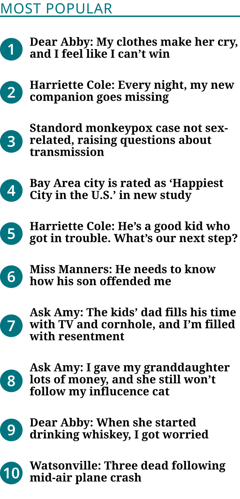
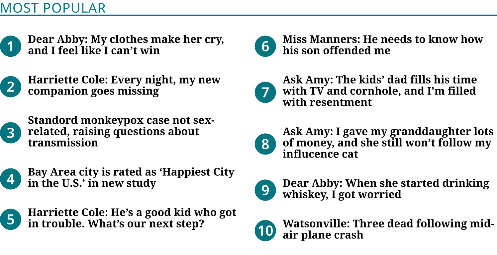
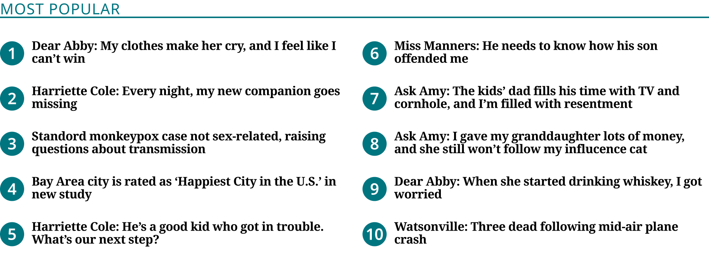

# Blueconic Block

> The Blueconic Block (homepage Zone 2; production `.dfm-most-popular-flex-container`): the theme eyebrow title, a primary rule and 10 numbered Blueconic List Items in one column below 640px and two from 640px. Was "Blueconic Block (Most Popular)" (renamed 2026-11-02, Karl). Device values are production's breakpoints.

## Figma

- File: **WordPress Elements** (`b1iZxkFwtAYq9rElmnCAzd`), page **Homepage**
- Component set: [`Blueconic Block` · 3352:20526](https://www.figma.com/design/b1iZxkFwtAYq9rElmnCAzd/?node-id=3352-20526) · key `82f5635bacf305c14f58abc48d2f3eadf4a3258f`
- Documentation frame: [Blueconic Block Container](https://www.figma.com/design/b1iZxkFwtAYq9rElmnCAzd/?node-id=3484-67652) · overview: [previews/blueconic-block--documentation.png](previews/blueconic-block--documentation.png)

## Properties

| Property | Default | Options |
|---|---|---|
| Device | XS (≤639px) | XS (≤639px), (640–1039px), (≥1040px) |

## Variants

| Variant | Size | Node | Instances | Preview |
|---|---|---|---|---|
| `XS (≤639px)` | 340×706.44 | [3352:20525](https://www.figma.com/design/b1iZxkFwtAYq9rElmnCAzd/?node-id=3352-20525) | 2 |  |
| `(640–1039px)` | 748×384.44 | [3383:46926](https://www.figma.com/design/b1iZxkFwtAYq9rElmnCAzd/?node-id=3383-46926) | 2 |  |
| `(≥1040px)` | 940×348.56 | [3552:31762](https://www.figma.com/design/b1iZxkFwtAYq9rElmnCAzd/?node-id=3552-31762) | 2 |  |

## Anatomy

Default variant `XS (≤639px)` (hidden layers marked):

- **Device=XS (≤639px)** `COMPONENT`: 340×706.44, vertical, gap 16, padding 0/0/0/0, fixed×hug
  - **Content Container** `FRAME`: 340×706.44, vertical, gap 0, padding 0/0/0/0, fill×hug
    - **Header** `FRAME`: 340×22, vertical, gap 0, padding 0/0/0/0, fill×hug
      - **Title** `TEXT`: 340×22, fill×hug, "Most Popular", Noto Sans Regular 20px
    - **List** `FRAME`: 340×684.44, horizontal, gap 0, padding 11.72/0/11.72/0, fill×hug
      - **1st Column** `FRAME`: 340×661, vertical, gap 0, padding 0/0/0/0, fill×hug
        - **Blueconic List Item** `INSTANCE`: 340×61, horizontal, gap 10, padding 16/0/5/0, fill×hug, instance of Blueconic List Item (Device=(≤1039px))
        - **Blueconic List Item** `INSTANCE`: 340×61, horizontal, gap 10, padding 16/0/5/0, fill×hug, instance of Blueconic List Item (Device=(≤1039px))
        - **Blueconic List Item** `INSTANCE`: 340×78, horizontal, gap 10, padding 16/0/5/0, fill×hug, instance of Blueconic List Item (Device=(≤1039px))
        - **Blueconic List Item** `INSTANCE`: 340×61, horizontal, gap 10, padding 16/0/5/0, fill×hug, instance of Blueconic List Item (Device=(≤1039px))
        - **Blueconic List Item** `INSTANCE`: 340×61, horizontal, gap 10, padding 16/0/5/0, fill×hug, instance of Blueconic List Item (Device=(≤1039px))
        - **Blueconic List Item** `INSTANCE`: 340×61, horizontal, gap 10, padding 16/0/5/0, fill×hug, instance of Blueconic List Item (Device=(≤1039px))
        - **Blueconic List Item** `INSTANCE`: 340×78, horizontal, gap 10, padding 16/0/5/0, fill×hug, instance of Blueconic List Item (Device=(≤1039px))
        - **Blueconic List Item** `INSTANCE`: 340×78, horizontal, gap 10, padding 16/0/5/0, fill×hug, instance of Blueconic List Item (Device=(≤1039px))
        - **Blueconic List Item** `INSTANCE`: 340×61, horizontal, gap 10, padding 16/0/5/0, fill×hug, instance of Blueconic List Item (Device=(≤1039px))
        - **Blueconic List Item** `INSTANCE`: 340×61, horizontal, gap 10, padding 16/0/5/0, fill×hug, instance of Blueconic List Item (Device=(≤1039px))

## Component tokens

From `blueconic-block.tokens.json`. References point at system tokens (`tokens/core/`, `tokens/themes/`); the CSS variable is `--mng-` + the token path. A literal value means the Figma layer isn't bound to a token.

| Token | Value |
|---|---|
| `blueconic-block.base.content-container.background` | `{color.gray.max}` |
| `blueconic-block.base.content-container.header.background` | `{color.gray.max}` |
| `blueconic-block.base.content-container.header.title.color` | `{color.theme.primary}` |
| `blueconic-block.base.content-container.header.title.font-family` | `{font.theme.eyebrow-family}` |
| `blueconic-block.base.content-container.header.title.font-size` | `{font.theme.eyebrow-size}` |
| `blueconic-block.base.content-container.header.title.font-weight` | `{font.theme.eyebrow-weight}` |
| `blueconic-block.base.content-container.header.title.letter-spacing` | 0.7px |
| `blueconic-block.base.content-container.header.title.line-height` | 1.1 |
| `blueconic-block.base.content-container.list.background` | `{color.gray.max}` |
| `blueconic-block.base.content-container.list.border-color` | `{color.theme.primary}` |
| `blueconic-block.base.content-container.list.border-style` | solid |
| `blueconic-block.base.content-container.list.border-top-width` | 2px |
| `blueconic-block.base.content-container.list.1st-column.blueconic-list-item.icon-color` | `{color.gray.max}` |
| `blueconic-block.base.content-container.list.2nd-column.blueconic-list-item.icon-color` | `{color.gray.max}` |
| `blueconic-block.base.root.background` | `{color.gray.max}` |
| `blueconic-block.device-640-1039px.content-container.list.gap` | 18.75px |
| `blueconic-block.device-640-1039px.content-container.list.padding-bottom` | 11.72px |
| `blueconic-block.device-640-1039px.content-container.list.padding-top` | 11.72px |
| `blueconic-block.device-640-1039px.content-container.list.1st-column.blueconic-list-item.height` | 61px |
| `blueconic-block.device-640-1039px.content-container.list.1st-column.blueconic-list-item.width` | 364.63px |
| `blueconic-block.device-640-1039px.content-container.list.2nd-column.blueconic-list-item.height` | 61px |
| `blueconic-block.device-640-1039px.content-container.list.2nd-column.blueconic-list-item.width` | 364.63px |
| `blueconic-block.device-640-1039px.root.width` | 748px |
| `blueconic-block.device-1040px.content-container.list.gap` | 21.25px |
| `blueconic-block.device-1040px.content-container.list.padding-bottom` | 13.28px |
| `blueconic-block.device-1040px.content-container.list.padding-top` | 13.28px |
| `blueconic-block.device-1040px.content-container.list.1st-column.blueconic-list-item.height` | 60px |
| `blueconic-block.device-1040px.content-container.list.1st-column.blueconic-list-item.width` | 459.38px |
| `blueconic-block.device-1040px.content-container.list.2nd-column.blueconic-list-item.height` | 60px |
| `blueconic-block.device-1040px.content-container.list.2nd-column.blueconic-list-item.width` | 459.38px |
| `blueconic-block.device-1040px.root.width` | 940px |
| `blueconic-block.device-xs-639px.content-container.list.padding-bottom` | 11.72px |
| `blueconic-block.device-xs-639px.content-container.list.padding-top` | 11.72px |
| `blueconic-block.device-xs-639px.content-container.list.1st-column.blueconic-list-item.height` | 61px |
| `blueconic-block.device-xs-639px.content-container.list.1st-column.blueconic-list-item.width` | 340px |
| `blueconic-block.device-xs-639px.root.width` | 340px |

## Behavior and breakpoints

| Device (production range) | Grid token | Production layout | Built at | Future MNG Device breakpoint (not adopted yet) |
|---|---|---|---|---|
| XS (≤639px) | `wordpress-grid.xs` | One column, full width | 340px | Mobile (below 768) |
| (640–1039px) | `wordpress-grid.s`, `.m` | Two CSS columns, 18.75px apart; list padding 11.72px | 748px | Mobile / Tablet |
| (≥1040px) | `wordpress-grid.l`, `.xl` | Two columns, 21.25px apart; list padding 13.28px; items 16.94px, −0.32px | 940px | Tablet landscape, Desktop |

- **Built raw, as production renders it** (Karl, 2026-11-02): this block is built in Blueconic, a third-party platform we don't control like our WordPress themes, so its values stay as production has them (not rounded to the 4 / 8 grid), with tokens only where a value matches one exactly.
- **Breakpoints are production's:** `XS (≤639px)` one column (built 340; full width, 340 at a 360px window), `(640–1039px)` two CSS columns (built 748), `(≥1040px)` two columns with the larger list metrics (built 940; 459 + 21.25 + 459 at 1280px). The 1024, 1100 and unused Desktop variants were removed and their template instances moved to the range variants (Karl, 2026-11-02). The block fills its column.
- **Title:** the theme eyebrow (`font/theme/eyebrow-family`, `-size`, `-weight`: Noto Sans 20 / 400 Bold Coastal, Noto Sans 17 / 700 Measured Vibrant, Noto Serif 21 / 400 Modern Earthy, as production), uppercase, 3.5% letter spacing, 110% line height, `color/theme/primary` (5.5:1 / 6.9:1 / 5.2:1 on `color/gray/max`). Blueconic sets the text ("Most Popular", "Recommended For You").
- **List:** 2px `color/theme/primary` rule on top (production `border-top`; none on Measured Vibrant). Padding above and below 11.72px below 1040px and 13.28px from 1040px; columns 18.75px / 21.25px apart. These are Bold Coastal's values: production sets them in em of the list's font size (`0.625em` padding, `1em` column gap), which follows the theme's eyebrow size.
- **Items:** 10 Blueconic List Items, 5 per column from 640px, with no gap between them. From 1040px the items are `Device=(≥1040px)`.
- **Outer space:** production gives the block a top margin of the eyebrow size (20 / 17 / 21px) and, on Bold Coastal, 15px below; the block that holds it sets that space, so it isn't drawn.

## Accessibility

- No InFocus state in Figma.
- Text color on its background must meet WCAG AA contrast (4.5:1 for text under 18px) in every theme; theme colors change per site.
- Icons inside a labelled control are decorative (`aria-hidden`); an icon-only control needs an accessible name (`aria-label`).

## Where it is used

Scope: instances in the Figma file **WordPress Elements** only (other files that use the library are not counted). Total: **6**.

Placed on pages: Homepage ×6.

**Built from:** Blueconic List Item ×30

## Production

Production Blueconic list (`.landing-three-one .dfm-most-popular-flex-container`), homepage Zone 2. Measured on all 6 review sites at 900px, canoncitydailyrecord at 360px, ocregister and canoncitydailyrecord at 1280px (Karl resized the window), 2026-11-02.

## Known issues

1. Per theme in production: no rule on Measured Vibrant; list padding and column gap scale with the eyebrow size (Measured Vibrant 9.96 / 15.94px, Modern Earthy 12.30 / 19.69px below 1040px). Figma draws Bold Coastal.
2. CSS columns balance by height in production, so the split isn't always 5 / 5; Figma draws 5 / 5.
3. Blueconic serves a second template on some sites (orlandosentinel and mcall on 2026-11-02: 14 items in 300×136 cards). It isn't in Figma yet (to-do, Karl).
4. **Values not bound to a token** (literal in the component tokens): `device-640-1039px` content-container.list gap = 18.75px; `device-1040px` content-container.list gap = 21.25px; `device-xs-639px` content-container.list padding-bottom = 11.72px; `device-640-1039px` content-container.list padding-bottom = 11.72px; `device-1040px` content-container.list padding-bottom = 13.28px; `device-xs-639px` content-container.list padding-top = 11.72px; `device-640-1039px` content-container.list padding-top = 11.72px; `device-1040px` content-container.list padding-top = 13.28px.

## Files

- `blueconic-block.tokens.json`: component tokens (DTCG 2025.10).
- `blueconic-block.html`: HTML/CSS skeleton of every variant, using the `dist/` CSS variables (open it in a browser).
- `previews/`: PNG of every variant @2x and the documentation frame.

*Generated 2026-11-02 by `scripts/component-export/export.py` (EXPORT-STANDARD.md section 7). Edit the text in `scripts/component-export/registry.json`, not here.*
