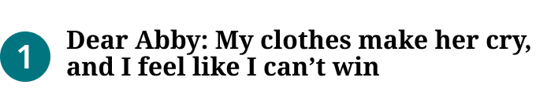
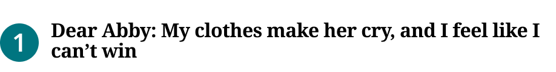

# Blueconic List Item

> One numbered headline in the Blueconic Block (homepage Zone 2; production `.dfm-most-popular-flex-container li a`). Was "Most Popular List Item" (renamed 2026-11-02, Karl). Device = production's own breakpoint for the item's font metrics.

## Figma

- File: **WordPress Elements** (`b1iZxkFwtAYq9rElmnCAzd`), page **Homepage**
- Component set: [`Blueconic List Item` · 3704:40676](https://www.figma.com/design/b1iZxkFwtAYq9rElmnCAzd/?node-id=3704-40676) · key `cacae1ac5989962a718f1950312d985fba767ec1`
- Documentation frame: [Blueconic List Item Container](https://www.figma.com/design/b1iZxkFwtAYq9rElmnCAzd/?node-id=3484-67661) · overview: [previews/blueconic-list-item--documentation.png](previews/blueconic-list-item--documentation.png)

## Properties

| Property | Default | Options |
|---|---|---|
| Device | (≤1039px) | (≤1039px), (≥1040px) |

## Variants

| Variant | Size | Node | Instances | Preview |
|---|---|---|---|---|
| `(≤1039px)` | 340×61 | [3352:24171](https://www.figma.com/design/b1iZxkFwtAYq9rElmnCAzd/?node-id=3352-24171) | 90 |  |
| `(≥1040px)` | 459×60 | [3704:40671](https://www.figma.com/design/b1iZxkFwtAYq9rElmnCAzd/?node-id=3704-40671) | 20 |  |

## Anatomy

Default variant `(≤1039px)` (hidden layers marked):

- **Device=(≤1039px)** `COMPONENT`: 340×61, horizontal, gap 10, padding 16/0/5/0, fixed×hug
  - **Bullet Number** `FRAME`: 32×32, vertical, gap 8, padding 0/0/0/0, fixed×fixed
    - **Number** `TEXT`: 13×15, hug×hug, "1", Noto Sans SemiBold 21px
  - **Headline Container** `FRAME`: 298×40, horizontal, gap 8, padding 0/0/5/0, fill×hug
    - **Headline** `TEXT`: 298×35, fill×hug, "Dear Abby: My clothes make her cry, and ", Noto Serif Bold 16px

## Component tokens

From `blueconic-list-item.tokens.json`. References point at system tokens (`tokens/core/`, `tokens/themes/`); the CSS variable is `--mng-` + the token path. A literal value means the Figma layer isn't bound to a token.

| Token | Value |
|---|---|
| `blueconic-list-item.base.bullet-number.background` | `{color.theme.primary}` |
| `blueconic-list-item.base.bullet-number.border-radius` | 16px |
| `blueconic-list-item.base.bullet-number.height` | 32px |
| `blueconic-list-item.base.bullet-number.width` | 32px |
| `blueconic-list-item.base.bullet-number.number.color` | `{color.gray.max}` |
| `blueconic-list-item.base.bullet-number.number.font-family` | `{font.theme.small-headline-family}` |
| `blueconic-list-item.base.bullet-number.number.font-size` | `{font.size.21}` |
| `blueconic-list-item.base.bullet-number.number.font-weight` | `{font.weight.semibold}` |
| `blueconic-list-item.base.bullet-number.number.line-height` | 32px |
| `blueconic-list-item.base.headline-container.padding-bottom` | 5px |
| `blueconic-list-item.base.headline-container.headline.color` | `{color.gray.black}` |
| `blueconic-list-item.base.headline-container.headline.font-family` | `{font.theme.heading-family}` |
| `blueconic-list-item.base.headline-container.headline.font-size` | `{font.size.16}` |
| `blueconic-list-item.base.headline-container.headline.font-weight` | `{font.weight.bold}` |
| `blueconic-list-item.base.root.background` | `{color.gray.max}` |
| `blueconic-list-item.base.root.gap` | 10px |
| `blueconic-list-item.base.root.padding-bottom` | 5px |
| `blueconic-list-item.base.root.padding-top` | 16px |
| `blueconic-list-item.device-1040px.bullet-number.number.letter-spacing` | -0.32px |
| `blueconic-list-item.device-1040px.headline-container.headline.letter-spacing` | -0.32px |
| `blueconic-list-item.device-1040px.headline-container.headline.line-height` | 16.94px |
| `blueconic-list-item.device-1040px.root.width` | 459px |
| `blueconic-list-item.device-1039px.headline-container.headline.line-height` | 17.07px |
| `blueconic-list-item.device-1039px.root.width` | 340px |

## Behavior and breakpoints

| Device (production range) | Grid token | Production | Built at | Future MNG Device breakpoint (not adopted yet) |
|---|---|---|---|---|
| (≤1039px) | `wordpress-grid.xs`–`m` | Headline 16 / 17.07px | 340px | Mobile, Tablet |
| (≥1040px) | `wordpress-grid.l`, `.xl` | Headline 16 / 16.94px, −0.32px | 459px | Tablet landscape, Desktop |

- **Built raw, as production renders it** (Karl, 2026-11-02): this block is built in Blueconic, a third-party platform we don't control like our WordPress themes, so its values stay as production has them (not rounded to the 4 / 8 grid), with tokens only where a value matches one exactly.
- **Breakpoint is production's:** `(≤1039px)` (built 340) and `(≥1040px)` (built 459). From 1040px the list's font is `600 1.0625em / 1.05882` with `-0.015em` letter spacing, below it `600 0.9375em / 1.06667`; the items reset the size to 16px, so only the line height and letter spacing change. The item fills its column.
- **Layout:** 16px top padding (the link's `padding-top: 1em`) and 5px bottom padding (`0.3125em`, Bold Coastal), the number circle then the headline, 10px apart (`margin-right: 0.625rem`), centered vertically. Items stack with no gap in the block. One-line rows are 53px and two-line rows 60px on Bold Coastal, as measured.
- **Number:** 32×32 circle (`border-radius: 50%`), `color/theme/primary`, white SemiBold 21 / 32 in `font/theme/small-headline-family` (Noto Sans in Bold Coastal and Modern Earthy, Noto Serif in Measured Vibrant: exactly production's). White on the primary: 5.5:1 Bold Coastal, 6.9:1 Measured Vibrant, 5.2:1 Modern Earthy.
- **Headline:** `Editorial/Titles/BlueconicItem`: `font/theme/heading-family` Bold 16 (`font/size/16`), `color/gray/black` (#000000, production) on `color/gray/max`, 21:1, with 5px below it (the span's `padding-bottom`, Bold Coastal). Line height 17.07px below 1040px; from 1040px 16.94px with −0.32px letter spacing (set on that variant's layers). Production's CSS weight is 600, but the sites load only the 400 and 700 faces, so it renders Bold; Figma has no Noto Serif SemiBold either.
- **Markup:** `li > a > span`; the number is the link's `::before` (`content: counter(section)`), so it isn't separate text for screen readers.

## Accessibility

- No InFocus state in Figma.
- Text color on its background must meet WCAG AA contrast (4.5:1 for text under 18px) in every theme; theme colors change per site.
- Icons inside a labelled control are decorative (`aria-hidden`); an icon-only control needs an accessible name (`aria-label`).

## Where it is used

Scope: instances in the Figma file **WordPress Elements** only (other files that use the library are not counted). Total: **110**.

Inside components: Blueconic Block ×60.
Placed on pages: Homepage ×50.

**Built from:** no nested components.

## Production

Production Blueconic "Most Popular" / "Recommended For You" list (`.landing-three-one .dfm-most-popular-flex-container`), homepage Zone 2. Measured on all 6 review sites at 900px, canoncitydailyrecord at 360px, ocregister and canoncitydailyrecord at 1280px (Karl resized the window), 2026-11-02.

## Known issues

1. Per theme in production: the 5px bottom padding and the 5px under the headline are Bold Coastal only (0 on Measured Vibrant and Modern Earthy). Figma draws Bold Coastal.
2. The −0.32px letter spacing is −0.015em of the list's font size on Bold Coastal (21.25px); it is −0.30px on Measured Vibrant and −0.33px on Modern Earthy.
3. The headline is Bold in Figma; production's CSS says 600 (rendered Bold).
4. **Values not bound to a token** (literal in the component tokens): `base` bullet-number border-radius = 16px; `base` headline-container padding-bottom = 5px; `base` root gap = 10px; `base` root padding-bottom = 5px; `base` root padding-top = 16px.

## Files

- `blueconic-list-item.tokens.json`: component tokens (DTCG 2025.10).
- `blueconic-list-item.html`: HTML/CSS skeleton of every variant, using the `dist/` CSS variables (open it in a browser).
- `previews/`: PNG of every variant @2x and the documentation frame.

*Generated 2026-11-02 by `scripts/component-export/export.py` (EXPORT-STANDARD.md section 7). Edit the text in `scripts/component-export/registry.json`, not here.*
