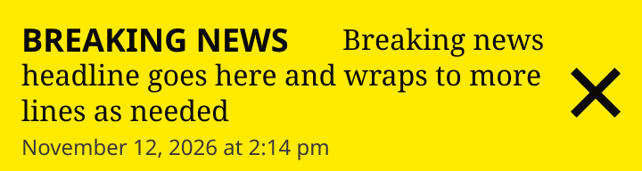

# Breaking News Banner

> The bar at the top of the page for a breaking story (production `.breaking-bar`): a "BREAKING NEWS" title, the headline (a link to the story), the time it was published and a close button. Built to match production on the 4 / 8 grid (Karl, 2026-11-12). Device values are production's own breakpoints for this bar (640 / 800px, the same on the three themes).

## Figma

- File: **WordPress Elements** (`b1iZxkFwtAYq9rElmnCAzd`), page **Menus and Parts**
- Component set: [`Breaking News Banner` · 506:5632](https://www.figma.com/design/b1iZxkFwtAYq9rElmnCAzd/?node-id=506-5632) · key `fac66df253d4a1f179dbe7a4229be9f3dadd7a46`
- Documentation frame: [Breaking News Banner Container](https://www.figma.com/design/b1iZxkFwtAYq9rElmnCAzd/?node-id=3803-49898) · overview: [previews/breaking-news-banner--documentation.png](previews/breaking-news-banner--documentation.png)

## Properties

| Property | Default | Options |
|---|---|---|
| Device | XS (≤639px) | XS (≤639px), S (640–799px), (≥800px) |

## Variants

| Variant | Size | Node | Instances | Preview |
|---|---|---|---|---|
| `XS (≤639px)` | 360×96 | [538:5932](https://www.figma.com/design/b1iZxkFwtAYq9rElmnCAzd/?node-id=538-5932) | 4 |  |
| `S (640–799px)` | 640×56 | [3477:63041](https://www.figma.com/design/b1iZxkFwtAYq9rElmnCAzd/?node-id=3477-63041) | 1 |  |
| `(≥800px)` | 1280×36 | [506:5623](https://www.figma.com/design/b1iZxkFwtAYq9rElmnCAzd/?node-id=506-5623) | 10 |  |

## Anatomy

Default variant `XS (≤639px)` (hidden layers marked):

- **Device=XS (≤639px)** `COMPONENT`: 360×96, horizontal, gap 12, padding 12/12/4/12, fixed×hug
  - **Content** `FRAME`: 296×80, vertical, gap 0, padding 0/0/0/0, fill×hug
    - **Headline and Date** `TEXT`: 296×80, fill×hug, "Breaking news headline goes here and wra", Noto Serif Regular 16px
    - **Title** `TEXT`: 160×18, fixed×fixed, absolute, "Breaking News", Noto Sans Bold 18px
  - **Close** `INSTANCE`: 28×28, horizontal, gap 8, padding 0/0/0/0, fixed×fixed, instance of Icons (Name=close)

## Component tokens

From `breaking-news-banner.tokens.json`. References point at system tokens (`tokens/core/`, `tokens/themes/`); the CSS variable is `--mng-` + the token path. A literal value means the Figma layer isn't bound to a token.

| Token | Value |
|---|---|
| `breaking-news-banner.base.close.height` | 28px |
| `breaking-news-banner.base.close.icon-color` | `{color.theme.near-black}` |
| `breaking-news-banner.base.close.width` | 28px |
| `breaking-news-banner.base.content.headline-and-date.color` | `{color.theme.near-black}` |
| `breaking-news-banner.base.content.headline-and-date.font-family` | `{font.theme.heading-family}` |
| `breaking-news-banner.base.content.headline-and-date.font-size` | `{font.size.16}` |
| `breaking-news-banner.base.content.headline-and-date.font-weight` | `{font.weight.regular}` |
| `breaking-news-banner.base.content.headline-and-date.line-height` | 20px |
| `breaking-news-banner.base.content.title.color` | `{color.theme.near-black}` |
| `breaking-news-banner.base.content.title.font-family` | `{font.theme.small-headline-family}` |
| `breaking-news-banner.base.content.title.font-size` | `{font.size.18}` |
| `breaking-news-banner.base.content.title.font-weight` | `{font.weight.bold}` |
| `breaking-news-banner.base.content.title.line-height` | 18px |
| `breaking-news-banner.base.root.background` | `{color.theme.secondary}` |
| `breaking-news-banner.base.root.padding-bottom` | `{spacing.050}` |
| `breaking-news-banner.base.root.padding-left` | `{spacing.150}` |
| `breaking-news-banner.base.root.padding-right` | `{spacing.150}` |
| `breaking-news-banner.base.root.padding-top` | `{spacing.150}` |
| `breaking-news-banner.device-800px.content.gap` | `{spacing.150}` |
| `breaking-news-banner.device-800px.content.headline-group.gap` | `{spacing.200}` |
| `breaking-news-banner.device-800px.content.headline-group.date.color` | `{color.gray.100}` |
| `breaking-news-banner.device-800px.content.headline-group.date.font-family` | `{font.family.noto-sans}` |
| `breaking-news-banner.device-800px.content.headline-group.date.font-size` | `{font.size.12}` |
| `breaking-news-banner.device-800px.content.headline-group.date.font-weight` | `{font.weight.regular}` |
| `breaking-news-banner.device-800px.content.headline-group.date.line-height` | 18.75px |
| `breaking-news-banner.device-800px.content.headline-group.headline.color` | `{color.theme.near-black}` |
| `breaking-news-banner.device-800px.content.headline-group.headline.font-family` | `{font.theme.heading-family}` |
| `breaking-news-banner.device-800px.content.headline-group.headline.font-size` | `{font.size.16}` |
| `breaking-news-banner.device-800px.content.headline-group.headline.font-weight` | `{font.weight.regular}` |
| `breaking-news-banner.device-800px.content.headline-group.headline.line-height` | 20px |
| `breaking-news-banner.device-800px.root.gap` | `{spacing.200}` |
| `breaking-news-banner.device-800px.root.min-height` | 36px |
| `breaking-news-banner.device-800px.root.width` | 1280px |
| `breaking-news-banner.device-xs-639px.root.gap` | `{spacing.150}` |
| `breaking-news-banner.device-xs-639px.root.width` | 360px |
| `breaking-news-banner.device-s-640-799px.root.gap` | `{spacing.150}` |
| `breaking-news-banner.device-s-640-799px.root.width` | 640px |

## Behavior and breakpoints

| Device (production range) | Grid token | Production layout | Built at | Future MNG Device breakpoint (not adopted yet) |
|---|---|---|---|---|
| XS (≤639px) | `wordpress-grid.xs` | Inline paragraph; headline 21.25px after the title; padding 10 / 10 / 5 | 360px | Mobile (below 768) |
| S (640–799px) | `wordpress-grid.s` | Inline paragraph; headline 11.25px after the title; padding 10 / 10 / 5 | 640px | Mobile / Tablet (decide when standardizing) |
| (≥800px) | `wordpress-grid.m` and up | One row, min-height 35, padding 0 / 10 | 1280px | Tablet, Tablet landscape, Desktop |

- **Matches production** (Karl, 2026-11-12: components match production, rounded to the nearest multiple of 4 / 8 and its token; the 10px ties went to 12). Checked on all 6 review sites 2026-11-12 (CSS, a test bar from each site's markup, live bars on Cañon City, Denver Post and Morning Call), plus the bar color on all 97 sites (`components/breaking-news-banner.md`).
- **Bar:** `color/theme/secondary`, spanning the content column, with 16px (`spacing/200`) below it.
- **(≥800px)** (drawn at 1280): one row at least 36px tall (production 35), 12px (`spacing/150`) left and right, no top or bottom padding, everything centered vertically. Title to headline 12px (`spacing/150`), headline to date 16px (`spacing/200`), at least 16px (`spacing/200`) before the close button (production reserves none, so the date can run under it near 800px).
- **XS (≤639px)** (drawn at 360) and **S (640–799px)** (drawn at 640): the title, headline and date flow as one paragraph: the headline starts on the title's line (12px after it on S, 20px on XS) and wraps under it, and the date follows the headline. Padding 12px (`spacing/150`) top, left and right, 4px (`spacing/050`) bottom; the close button sits 12px (`spacing/150`) after the text, centered. In Figma the headline and date are one text layer with a first-line indent of 172 / 180px; the title sits on its first line.
- **Title:** "BREAKING NEWS", uppercase, `font/theme/small-headline-family` Bold (`font/style/bold`) 18 (`font/size/18`), 18px line height, 160px wide, `color/theme/near-black`: Noto Sans on Bold Coastal and Modern Earthy, Noto Serif on Measured Vibrant.
- **Headline:** `font/theme/heading-family` Regular 16 (`font/size/16`), 20px line height, `color/theme/near-black`; links to the story.
- **Date:** Noto Sans (`font/family/noto-sans`) Regular 12 (`font/size/12`), 18.75px line height, `color/gray/100` (Karl, 2026-11-12; production #5D5B5A); never breaks across lines.
- **Close button:** the close icon, 28 × 28, `color/theme/near-black`, 12px from the right. Give it an accessible name ("Close breaking news").
- **Contrast:** near-black on secondary 7.4:1 or more and the date 4.9:1 or more on every theme except Denver Post (navy secondary, 1.4:1) and The Baltimore Sun (4.48:1); both sites override the bar to red, so these colors never show there.

## Accessibility

- No InFocus state in Figma.
- Text color on its background must meet WCAG AA contrast (4.5:1 for text under 18px) in every theme; theme colors change per site.
- Icons inside a labelled control are decorative (`aria-hidden`); an icon-only control needs an accessible name (`aria-label`).

## Where it is used

Scope: instances in the Figma file **WordPress Elements** only (other files that use the library are not counted). Total: **15**.

Placed on pages: Homepage ×6, Article Page ×5, Section Front ×4.

**Built from:** Icons ×3
Icon variants: `close` ×3.

## Production

Production `.breaking-bar > .breaking-bar-inner` (h2.widget-title, article.headline-only > .breaking-header > h3.entry-title a + time, a.icon-close) on the homepage, all 6 review sites, measured 2026-11-12 at 1728px and at 360 / 640 / 800 / 1040px on Cañon City's live bar.

## Known issues

1. Eight sites override the bar to red and keep it (Karl, 2026-11-12): Denver Post, Morning Call, Orlando Sentinel, South Florida Sun Sentinel, The Virginian-Pilot, Daily Press, Capital Gazette and The Baltimore Sun. Their date and close icon fail contrast on most of them, and Daily Press's white text is 4.2:1 (ADA, design-vs-production 13.1).
2. Production sizes are off the grid (35px, 10px, 11.25px, 5px) and reserve no space for the close button from 800px (design-vs-production 13.2).
3. Production's #5D5B5A date fails on The Mercury News and the Michigan #9DAABD sites; the design uses `color/gray/100` (design-vs-production 13.3).
4. One variant, `(≥800px)`, covers the M, L and XL ranges; only the width changes.
5. Figma can't wrap one text layer around another, so below 800px the title is placed on the headline's first line with a first-line indent; with a very short headline the date can sit closer to the title than in production.
6. Below 800px the component tokens carry the headline's values for the "Headline and Date" text layer (the exporter reads its first text run); the date's values (Noto Sans Regular 12 / 18.75px, `color/gray/100`) are in the rules above.

## Files

- `breaking-news-banner.tokens.json`: component tokens (DTCG 2025.10).
- `breaking-news-banner.html`: HTML/CSS skeleton of every variant, using the `dist/` CSS variables (open it in a browser).
- `previews/`: PNG of every variant @2x and the documentation frame.

*Generated 2026-11-12 by `scripts/component-export/export.py` (EXPORT-STANDARD.md section 7). Edit the text in `scripts/component-export/registry.json`, not here.*
