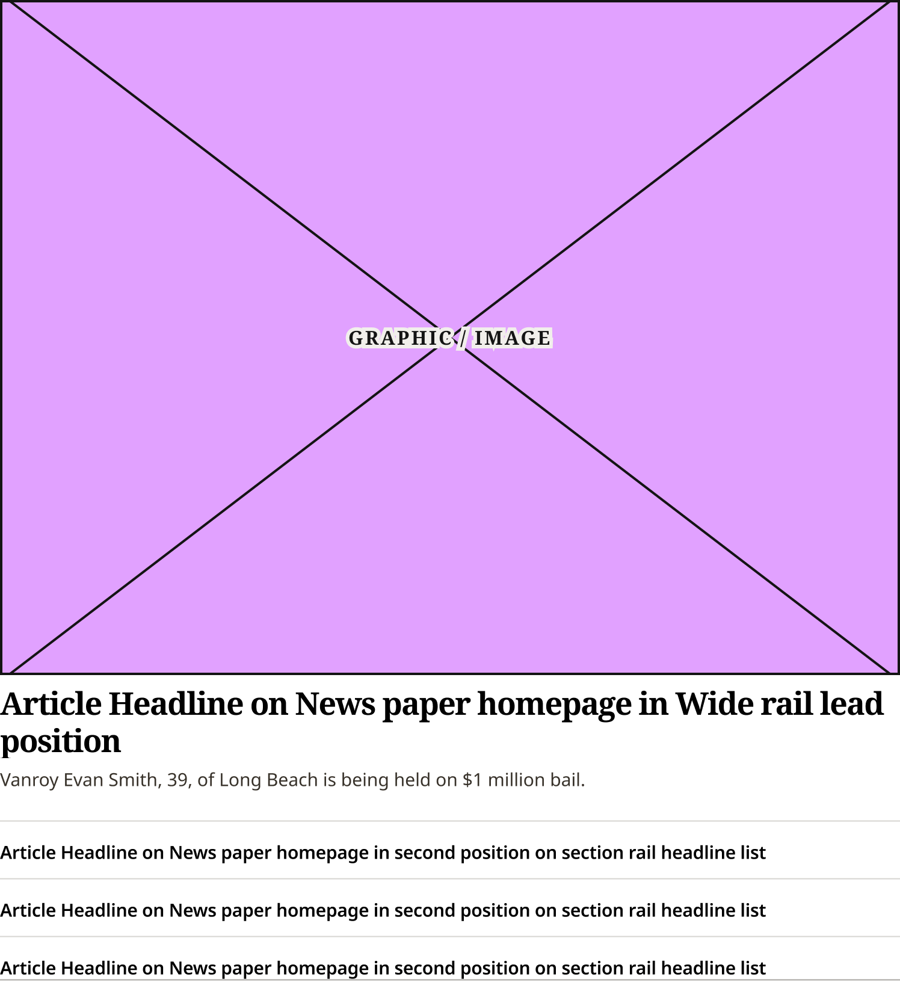
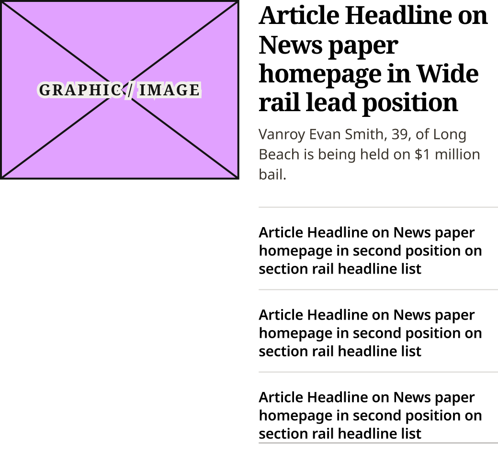
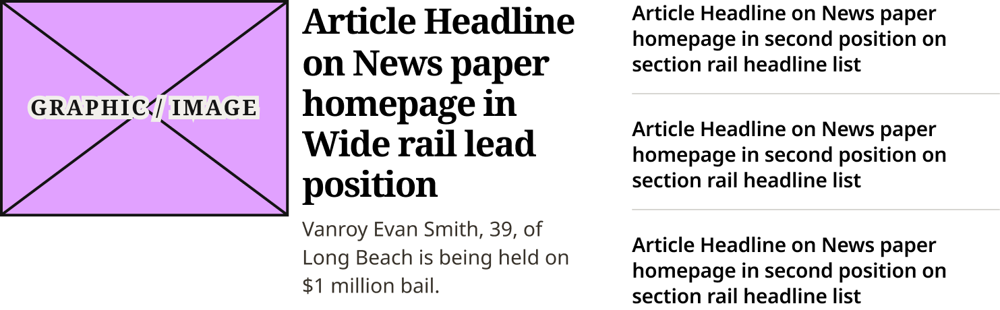
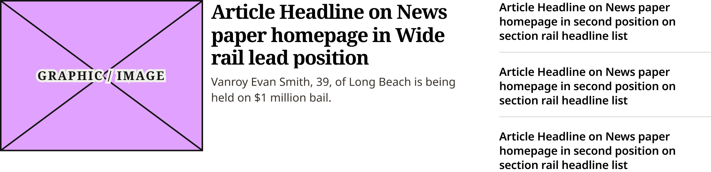

# Feature + List Content Block

> The content of a wide section rail: Horizontal Feature Card and three Headline List Items. Device values are production's breakpoints. Was Size = Default / Narrow until 2026-11-02 (Karl).

## Figma

- File: **WordPress Elements** (`b1iZxkFwtAYq9rElmnCAzd`), page **Homepage**
- Component set: [`Feature + List Content Block` · 3484:66933](https://www.figma.com/design/b1iZxkFwtAYq9rElmnCAzd/?node-id=3484-66933) · key `b49909a16526e6df948efc84d6bfbd5b8ebc3c96`
- Documentation frame: [Feature + List Content Block Container](https://www.figma.com/design/b1iZxkFwtAYq9rElmnCAzd/?node-id=3484-67681) · overview: [previews/feature-list-content-block--documentation.png](previews/feature-list-content-block--documentation.png)

## Properties

| Property | Default | Options |
|---|---|---|
| Device | (≤799px) | (≤799px), M (800–1039px), L (1040–1279px), XL (≥1280px) |

## Variants

| Variant | Size | Node | Instances | Preview |
|---|---|---|---|---|
| `(≤799px)` | 748×830.75 | [3709:41201](https://www.figma.com/design/b1iZxkFwtAYq9rElmnCAzd/?node-id=3709-41201) | 7 |  |
| `M (800–1039px)` | 520×478.75 | [3484:66879](https://www.figma.com/design/b1iZxkFwtAYq9rElmnCAzd/?node-id=3484-66879) | 7 |  |
| `L (1040–1279px)` | 741.4×229.75 | [3709:41159](https://www.figma.com/design/b1iZxkFwtAYq9rElmnCAzd/?node-id=3709-41159) | 7 |  |
| `XL (≥1280px)` | 940×229 | [3478:63611](https://www.figma.com/design/b1iZxkFwtAYq9rElmnCAzd/?node-id=3478-63611) | 7 |  |

## Anatomy

Default variant `(≤799px)` (hidden layers marked):

- **Device=(≤799px)** `COMPONENT`: 748×830.75, vertical, gap 16, padding 0/0/0/0, fixed×hug
  - **Feature** `FRAME`: 748×682.75, vertical, gap 0, padding 0/0/16/0, fill×hug
    - **Horizontal Feature Card** `INSTANCE`: 748×665.75, vertical, gap 0, padding 0/0/0/0, fill×hug, instance of Horizontal Feature Card (Device=(≤799px))
  - **Headline List** `FRAME`: 748×132, vertical, gap 16, padding 0/0/16/0, fill×hug
    - **Headline List Item** `INSTANCE`: 748×32, vertical, gap 0, padding 0/0/12/0, fill×hug, instance of Headline List Item (Rule=Default)
    - **Headline List Item** `INSTANCE`: 748×32, vertical, gap 0, padding 0/0/12/0, fill×hug, instance of Headline List Item (Rule=Default)
    - **Headline List Item** `INSTANCE`: 748×20, vertical, gap 0, padding 0/0/0/0, fill×hug, instance of Headline List Item (Rule=Dark)

## Component tokens

From `feature-list-content-block.tokens.json`. References point at system tokens (`tokens/core/`, `tokens/themes/`); the CSS variable is `--mng-` + the token path. A literal value means the Figma layer isn't bound to a token.

| Token | Value |
|---|---|
| `feature-list-content-block.device-799px.feature.border-bottom-width` | 1px |
| `feature-list-content-block.device-799px.feature.border-color` | #d7d6d2 |
| `feature-list-content-block.device-799px.feature.border-style` | solid |
| `feature-list-content-block.device-799px.feature.padding-bottom` | `{spacing.200}` |
| `feature-list-content-block.device-799px.feature.horizontal-feature-card.height` | 665.75px |
| `feature-list-content-block.device-799px.feature.horizontal-feature-card.icon-color` | #e1a1ff |
| `feature-list-content-block.device-799px.feature.horizontal-feature-card.width` | 748px |
| `feature-list-content-block.device-799px.headline-list.padding-bottom` | `{spacing.200}` |
| `feature-list-content-block.device-799px.headline-list.headline-list-item.height` | 20px |
| `feature-list-content-block.device-799px.headline-list.headline-list-item.width` | 748px |
| `feature-list-content-block.device-799px.root.gap` | `{spacing.200}` |
| `feature-list-content-block.device-799px.root.width` | 748px |
| `feature-list-content-block.base.headline-list.gap` | `{spacing.200}` |
| `feature-list-content-block.base.headline-list.headline-list-item.icon-color` | `{color.gray.black}` |
| `feature-list-content-block.base.horizontal-feature-card.icon-color` | #e1a1ff |
| `feature-list-content-block.device-l-1040-1279px.headline-list.headline-list-item.height` | 57px |
| `feature-list-content-block.device-l-1040-1279px.headline-list.headline-list-item.width` | 272.8px |
| `feature-list-content-block.device-l-1040-1279px.horizontal-feature-card.height` | 229.75px |
| `feature-list-content-block.device-l-1040-1279px.horizontal-feature-card.width` | 448.4px |
| `feature-list-content-block.device-l-1040-1279px.root.gap` | 20.2px |
| `feature-list-content-block.device-l-1040-1279px.root.width` | 741.4px |
| `feature-list-content-block.device-xl-1280px.headline-list.headline-list-item.height` | 57px |
| `feature-list-content-block.device-xl-1280px.headline-list.headline-list-item.width` | 280.04px |
| `feature-list-content-block.device-xl-1280px.horizontal-feature-card.height` | 209.4px |
| `feature-list-content-block.device-xl-1280px.horizontal-feature-card.width` | 639.76px |
| `feature-list-content-block.device-xl-1280px.root.gap` | 20.2px |
| `feature-list-content-block.device-xl-1280px.root.width` | 940px |
| `feature-list-content-block.device-m-800-1039px.horizontal-feature-card.height` | 215.75px |
| `feature-list-content-block.device-m-800-1039px.horizontal-feature-card.width` | 520px |
| `feature-list-content-block.device-m-800-1039px.list-column.padding-left` | 270.1px |
| `feature-list-content-block.device-m-800-1039px.list-column.headline-list.border-color` | #d7d6d2 |
| `feature-list-content-block.device-m-800-1039px.list-column.headline-list.border-style` | solid |
| `feature-list-content-block.device-m-800-1039px.list-column.headline-list.border-top-width` | 1px |
| `feature-list-content-block.device-m-800-1039px.list-column.headline-list.gap` | `{spacing.200}` |
| `feature-list-content-block.device-m-800-1039px.list-column.headline-list.padding-bottom` | `{spacing.200}` |
| `feature-list-content-block.device-m-800-1039px.list-column.headline-list.padding-top` | `{spacing.200}` |
| `feature-list-content-block.device-m-800-1039px.list-column.headline-list.headline-list-item.height` | 58px |
| `feature-list-content-block.device-m-800-1039px.list-column.headline-list.headline-list-item.icon-color` | `{color.gray.black}` |
| `feature-list-content-block.device-m-800-1039px.list-column.headline-list.headline-list-item.width` | 249.9px |
| `feature-list-content-block.device-m-800-1039px.root.width` | 520px |

## Behavior and breakpoints

| Device (production range) | Grid token | Production layout | Built at | Future MNG Device breakpoint (not adopted yet) |
|---|---|---|---|---|
| (≤799px) | `wordpress-grid.xs`, `.s` | Stacked, rules above the list and under the last item | 748px | Mobile |
| M (800–1039px) | `wordpress-grid.m` | Feature, then the list under the text column | 520px | Tablet |
| L (1040–1279px) | `wordpress-grid.l` | Feature and list side by side, 20.2px apart | 741.4px | Tablet landscape |
| XL (≥1280px) | `wordpress-grid.xl` | Feature and list side by side, 20.2px apart | 940px | Desktop |

- **Built raw, as production renders it** (Karl, 2026-11-02, for the Section Rail Cards and Horizontal Feature Card only): the Figma values match production (CSS `.section-highlight`, identical on all 6 review sites; measured on ocregister.com at 1280, 1100, 900 and 700px, fonts checked on chicagotribune.com and mcall.com). Where no token matches a production value, the value stays raw (not rounded to the 4 / 8 grid).
- **Breakpoints are production's:** `(≤799px)` (built 748), `M (800–1039px)` (built 520), `L (1040–1279px)` (built 741.4), `XL (≥1280px)` (built 940). The block fills its column.
- **(≤799px):** stacked. The feature has 16px below it and a 1px #D7D6D2 rule, then 16px to the list; the last item has Rule = Dark and 16px below it.
- **M:** the feature (image floated left), then the list under the text in the right half: 270.1px from the left (image + 20), a 1px #D7D6D2 rule on top and 16px above the first item; the last item Rule = Dark with 16px below.
- **L:** feature 448.4, 20.2px, list 272.8; no rules above or below the list. **XL:** feature 639.8, 20.2px, list 279.9. The 20.2px gap is production's percentage of the row (raw).
- **List:** Headline List Items 16px (`spacing/200`) apart (production `li` margin-bottom 16px); from 1040px the last has Rule = None.

## Accessibility

- No InFocus state in Figma.
- Text color on its background must meet WCAG AA contrast (4.5:1 for text under 18px) in every theme; theme colors change per site.
- Icons inside a labelled control are decorative (`aria-hidden`); an icon-only control needs an accessible name (`aria-label`).

## Where it is used

Scope: instances in the Figma file **WordPress Elements** only (other files that use the library are not counted). Total: **28**.

Inside components: Section Rail Card Wide ×4.
24 instances are nested inside other instances.

**Built from:** Headline List Item ×12, Horizontal Feature Card ×4

## Production

Production `.landing-three-one .section-highlight` content (`.feature-medium` + `ul.headline-list`). Measured live on ocregister.com at 1280, 1100, 900 and 700px (Karl resized the window) and the CSS checked on all 6 review sites, 2026-11-02.

## Known issues

1. Per theme in production: the rules are #D7D6D2 / #AAA7A4 on Bold Coastal, other grays on Measured Vibrant and Modern Earthy (design-vs-production 16.7). Figma draws Bold Coastal.
2. Raw values: the #D7D6D2 and #AAA7A4 rules, the 20.2px column gap and the 270.1px list offset at M.
3. **Values not bound to a token** (literal in the component tokens): `device-799px` feature border-color = #d7d6d2; `device-799px` feature.horizontal-feature-card icon-color = #e1a1ff; `base` horizontal-feature-card icon-color = #e1a1ff; `device-m-800-1039px` list-column padding-left = 270.1px; `device-m-800-1039px` list-column.headline-list border-color = #d7d6d2; `device-l-1040-1279px` root gap = 20.2px; `device-xl-1280px` root gap = 20.2px.

## Files

- `feature-list-content-block.tokens.json`: component tokens (DTCG 2025.10).
- `feature-list-content-block.html`: HTML/CSS skeleton of every variant, using the `dist/` CSS variables (open it in a browser).
- `previews/`: PNG of every variant @2x and the documentation frame.

*Generated 2026-11-02 by `scripts/component-export/export.py` (EXPORT-STANDARD.md section 7). Edit the text in `scripts/component-export/registry.json`, not here.*
