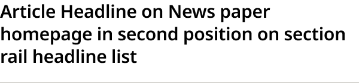
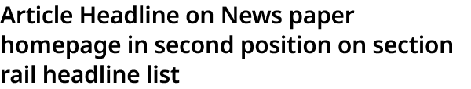
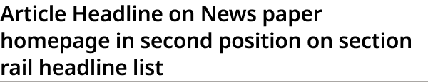

# Headline List Item

> One headline in a section rail's headline list (production `.section-highlight ul.headline-list article.headline-only`). Rule = Default (rule below), None (no rule) or Dark (darker rule right under the text). New 2026-11-02 (Karl); used by Section Rail Card Narrow and Feature + List Content Block.

## Figma

- File: **WordPress Elements** (`b1iZxkFwtAYq9rElmnCAzd`), page **Homepage**
- Component set: [`Headline List Item` · 3709:40904](https://www.figma.com/design/b1iZxkFwtAYq9rElmnCAzd/?node-id=3709-40904) · key `57b688027f08b9ff40d6d9687bc1bf4c842851aa`
- Documentation frame: [Headline List Item Container](https://www.figma.com/design/b1iZxkFwtAYq9rElmnCAzd/?node-id=3709-40892) · overview: [previews/headline-list-item--documentation.png](previews/headline-list-item--documentation.png)

## Properties

| Property | Default | Options |
|---|---|---|
| Rule | Default | Default, None, Dark |

## Variants

| Variant | Size | Node | Instances | Preview |
|---|---|---|---|---|
| `Default` | 300×70 | [3709:40898](https://www.figma.com/design/b1iZxkFwtAYq9rElmnCAzd/?node-id=3709-40898) | 128 |  |
| `None` | 300×57 | [3709:40900](https://www.figma.com/design/b1iZxkFwtAYq9rElmnCAzd/?node-id=3709-40900) | 48 |  |
| `Dark` | 300×58 | [3709:40902](https://www.figma.com/design/b1iZxkFwtAYq9rElmnCAzd/?node-id=3709-40902) | 16 |  |

## Anatomy

Default variant `Default` (hidden layers marked):

- **Rule=Default** `COMPONENT`: 300×70, vertical, gap 0, padding 0/0/12/0, fixed×hug
  - **Headline** `TEXT`: 300×57, fill×hug, "Article Headline on News paper homepage ", Noto Sans SemiBold 15px

## Component tokens

From `headline-list-item.tokens.json`. References point at system tokens (`tokens/core/`, `tokens/themes/`); the CSS variable is `--mng-` + the token path. A literal value means the Figma layer isn't bound to a token.

| Token | Value |
|---|---|
| `headline-list-item.base.headline.color` | `{color.gray.black}` |
| `headline-list-item.base.headline.font-family` | `{font.theme.small-headline-family}` |
| `headline-list-item.base.headline.font-size` | `{font.size.15}` |
| `headline-list-item.base.headline.font-weight` | `{font.weight.semibold}` |
| `headline-list-item.base.headline.letter-spacing` | -0.15px |
| `headline-list-item.base.headline.line-height` | 19px |
| `headline-list-item.base.root.background` | `{color.gray.max}` |
| `headline-list-item.base.root.border-bottom-width` | 1px |
| `headline-list-item.base.root.border-style` | solid |
| `headline-list-item.base.root.width` | 300px |
| `headline-list-item.rule-default.root.border-color` | #d7d6d2 |
| `headline-list-item.rule-default.root.padding-bottom` | `{spacing.150}` |
| `headline-list-item.rule-dark.root.border-color` | #aaa7a4 |

## Behavior and breakpoints

No Breakpoint property: one size at every width.

- **Built raw, as production renders it** (Karl, 2026-11-02, for the Section Rail Cards and Horizontal Feature Card only): the Figma values match production (CSS `.section-highlight`, identical on all 6 review sites; measured on ocregister.com at 1280, 1100, 900 and 700px, fonts checked on chicagotribune.com and mcall.com). Where no token matches a production value, the value stays raw (not rounded to the 4 / 8 grid).
- **Headline:** `Editorial/Titles/HeadlineList`: `font/theme/small-headline-family` SemiBold 15 / 19, −0.15px, `color/gray/black` on `color/gray/max` (21:1). Noto Sans in Bold Coastal and Modern Earthy, Noto Serif in Measured Vibrant, as production. Production's CSS weight is 600; the sites load only the 400 and 700 faces, so it renders Bold.
- **Rule = Default:** 12px (`spacing/150`) below the text, then a 1px #D7D6D2 rule (Bold Coastal's production rule; no token matches, raw).
- **Rule = None:** no rule: the last item in a list from 1040px, and the last item of Section Rail Card Narrow.
- **Rule = Dark:** a 1px #AAA7A4 rule right under the text (raw): the last item below 1040px in wide rails.
- **Spacing between items** is the list's: 16px (`spacing/200`, production `li` margin-bottom).
- **Markup:** `li > article > h3 > a`; the headline is the link.

## Accessibility

- No InFocus state in Figma.
- Text color on its background must meet WCAG AA contrast (4.5:1 for text under 18px) in every theme; theme colors change per site.
- Icons inside a labelled control are decorative (`aria-hidden`); an icon-only control needs an accessible name (`aria-label`).

## Where it is used

Scope: instances in the Figma file **WordPress Elements** only (other files that use the library are not counted). Total: **192**.

Inside components: Section Rail Card Wide ×12, Feature + List Content Block ×12, Section Rail Card Narrow ×6.
Placed on pages: Homepage ×162.

**Built from:** no nested components.

## Production

Production section rail headline list (`.section-highlight ul.headline-list li article.headline-only`). Measured live on ocregister.com at 1280, 1100, 900 and 700px (Karl resized the window) and the CSS checked on all 6 review sites, 2026-11-02.

## Known issues

1. Per theme in production: the rule is #D7D6D2 on Bold Coastal, #C8C4C0 on Measured Vibrant and #DDD8D5 on Modern Earthy; Figma draws Bold Coastal (design-vs-production 16.7).
2. The rule colors are raw: no gray token matches them.
3. **Values not bound to a token** (literal in the component tokens): `rule-default` root border-color = #d7d6d2; `rule-dark` root border-color = #aaa7a4.

## Files

- `headline-list-item.tokens.json`: component tokens (DTCG 2025.10).
- `headline-list-item.html`: HTML/CSS skeleton of every variant, using the `dist/` CSS variables (open it in a browser).
- `previews/`: PNG of every variant @2x and the documentation frame.

*Generated 2026-11-02 by `scripts/component-export/export.py` (EXPORT-STANDARD.md section 7). Edit the text in `scripts/component-export/registry.json`, not here.*
