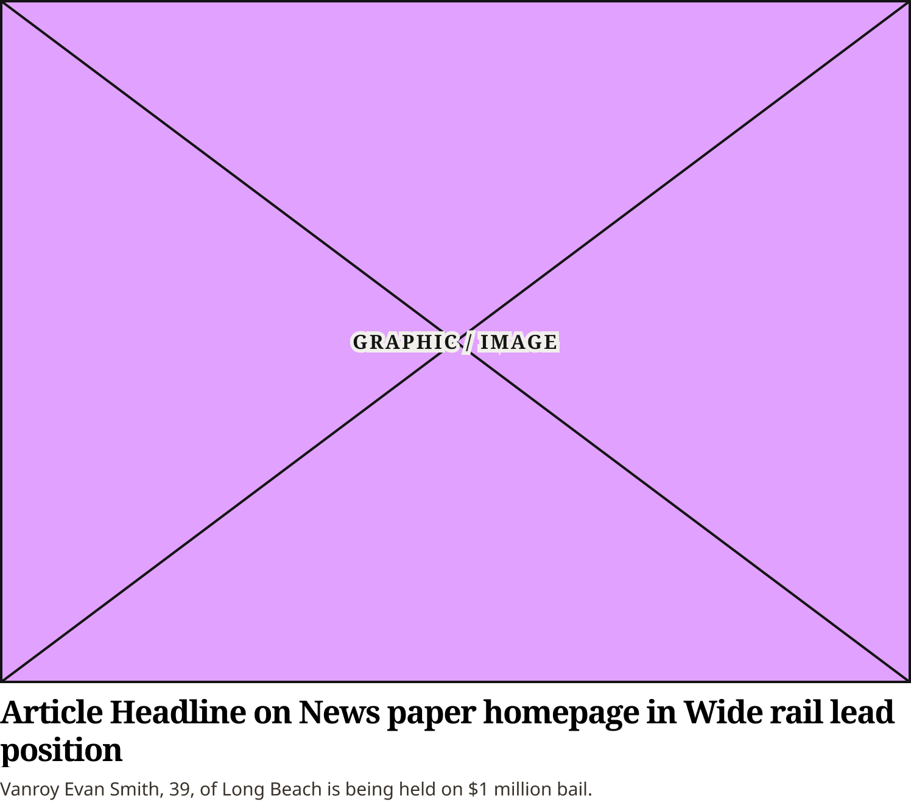
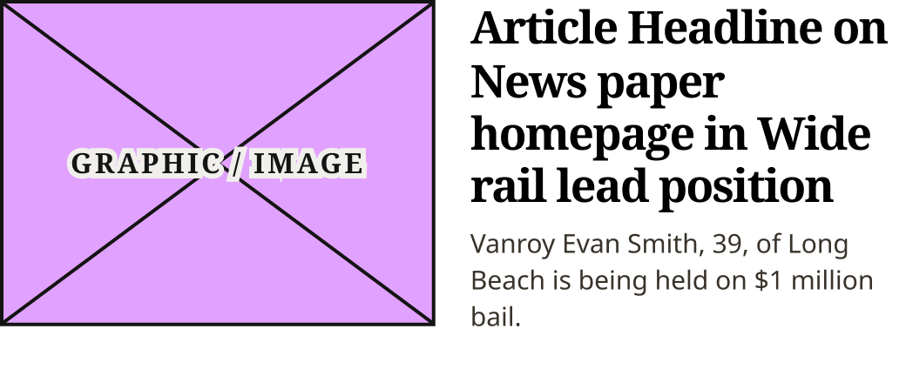
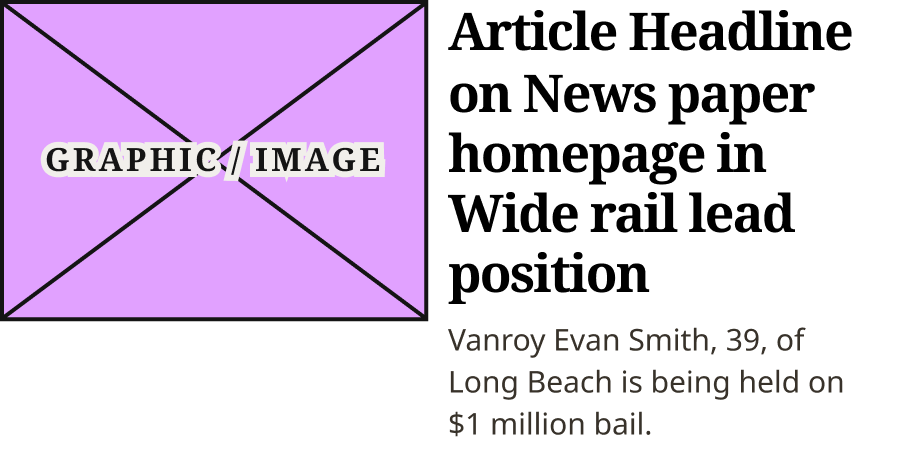
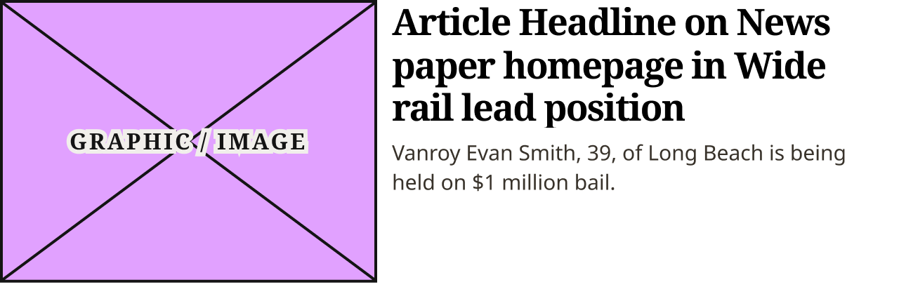

# Horizontal Feature Card

> The lead story of a wide section rail (production `.landing-three-one .section-highlight .feature-medium`): a 4:3 image and the CardSecondary headline with the excerpt, stacked below 800px and side by side from 800px. Device values are production's breakpoints.

## Figma

- File: **WordPress Elements** (`b1iZxkFwtAYq9rElmnCAzd`), page **Homepage**
- Component set: [`Horizontal Feature Card` · 3709:41113](https://www.figma.com/design/b1iZxkFwtAYq9rElmnCAzd/?node-id=3709-41113) · key `191b307650a6e2dba4034c1d87cb56da3cf4b027`
- Documentation frame: [Horizontal Feature Card Container](https://www.figma.com/design/b1iZxkFwtAYq9rElmnCAzd/?node-id=3484-67689) · overview: [previews/horizontal-feature-card--documentation.png](previews/horizontal-feature-card--documentation.png)

## Properties

| Property | Default | Options |
|---|---|---|
| Device | (≤799px) | (≤799px), M (800–1039px), L (1040–1279px), XL (≥1280px) |

## Variants

| Variant | Size | Node | Instances | Preview |
|---|---|---|---|---|
| `(≤799px)` | 748×665.75 | [3709:41098](https://www.figma.com/design/b1iZxkFwtAYq9rElmnCAzd/?node-id=3709-41098) | 8 |  |
| `M (800–1039px)` | 520×215.75 | [3709:41083](https://www.figma.com/design/b1iZxkFwtAYq9rElmnCAzd/?node-id=3709-41083) | 8 |  |
| `L (1040–1279px)` | 448.4×229.75 | [3709:41068](https://www.figma.com/design/b1iZxkFwtAYq9rElmnCAzd/?node-id=3709-41068) | 8 |  |
| `XL (≥1280px)` | 639.76×209.4 | [3362:3022](https://www.figma.com/design/b1iZxkFwtAYq9rElmnCAzd/?node-id=3362-3022) | 8 |  |

## Anatomy

Default variant `(≤799px)` (hidden layers marked):

- **Device=(≤799px)** `COMPONENT`: 748×665.75, vertical, gap 0, padding 0/0/0/0, fixed×hug
  - **Content** `FRAME`: 748×665.75, vertical, gap 0, padding 0/0/0/0, fill×hug
    - **Figure** `FRAME`: 748×569, vertical, gap 0, padding 0/0/8/0, fill×hug
      - **Article Graphic** `INSTANCE`: 748×561, vertical, gap 8, padding 0/0/0/0, fill×fixed, instance of Article Image Placeholder ()
    - **Text Column** `FRAME`: 748×96.75, vertical, gap 7.25, padding 0/0/7.5/0, fill×hug
      - **Headline Container** `FRAME`: 748×61, vertical, gap 0, padding 0/0/0/0, fill×hug
        - **Headline** `TEXT`: 748×61, fill×hug, "Article Headline on News paper homepage ", Noto Serif Bold 26px
      - **Excerpt Container** `FRAME`: 748×21, vertical, gap 0, padding 0/0/0/0, fill×hug
        - **Excerpt** `TEXT`: 748×21, fill×hug, "Vanroy Evan Smith, 39, of Long Beach is ", Noto Sans Regular 15px
  - **Bottom Border Line** `LINE`: 632×0, fixed×fixed, **hidden**

## Component tokens

From `horizontal-feature-card.tokens.json`. References point at system tokens (`tokens/core/`, `tokens/themes/`); the CSS variable is `--mng-` + the token path. A literal value means the Figma layer isn't bound to a token.

| Token | Value |
|---|---|
| `horizontal-feature-card.device-m-800-1039px.content.gap` | `{spacing.250}` |
| `horizontal-feature-card.device-m-800-1039px.content.figure.article-graphic.height` | 187.4px |
| `horizontal-feature-card.device-m-800-1039px.content.figure.article-graphic.width` | 249.9px |
| `horizontal-feature-card.device-m-800-1039px.content.text-column.padding-bottom` | 23.5px |
| `horizontal-feature-card.device-m-800-1039px.content.text-column.width` | 249.9px |
| `horizontal-feature-card.device-m-800-1039px.root.width` | 520px |
| `horizontal-feature-card.device-l-1040-1279px.content.gap` | 9.9px |
| `horizontal-feature-card.device-l-1040-1279px.content.figure.article-graphic.height` | 160.6px |
| `horizontal-feature-card.device-l-1040-1279px.content.figure.article-graphic.width` | 214.1px |
| `horizontal-feature-card.device-l-1040-1279px.content.text-column.padding-bottom` | 7.5px |
| `horizontal-feature-card.device-l-1040-1279px.content.text-column.width` | 214.1px |
| `horizontal-feature-card.device-l-1040-1279px.root.width` | 448.4px |
| `horizontal-feature-card.device-xl-1280px.content.gap` | 10.53px |
| `horizontal-feature-card.device-xl-1280px.content.figure.article-graphic.height` | 201.4px |
| `horizontal-feature-card.device-xl-1280px.content.figure.article-graphic.width` | 268.53px |
| `horizontal-feature-card.device-xl-1280px.content.text-column.padding-bottom` | 7.5px |
| `horizontal-feature-card.device-xl-1280px.content.text-column.width` | 351.06px |
| `horizontal-feature-card.device-xl-1280px.root.width` | 639.76px |
| `horizontal-feature-card.base.content.figure.padding-bottom` | `{spacing.100}` |
| `horizontal-feature-card.base.content.figure.article-graphic.icon-color` | `{color.gray.min}` |
| `horizontal-feature-card.base.content.text-column.gap` | 7.25px |
| `horizontal-feature-card.base.content.text-column.excerpt-container.excerpt.color` | #38322a |
| `horizontal-feature-card.base.content.text-column.excerpt-container.excerpt.font-family` | `{font.theme.body-family}` |
| `horizontal-feature-card.base.content.text-column.excerpt-container.excerpt.font-size` | `{font.size.15}` |
| `horizontal-feature-card.base.content.text-column.excerpt-container.excerpt.font-weight` | `{font.weight.regular}` |
| `horizontal-feature-card.base.content.text-column.excerpt-container.excerpt.line-height` | 21px |
| `horizontal-feature-card.base.content.text-column.headline-container.headline.color` | `{color.gray.black}` |
| `horizontal-feature-card.base.content.text-column.headline-container.headline.font-family` | `{font.theme.heading-family}` |
| `horizontal-feature-card.base.content.text-column.headline-container.headline.font-size` | `{font.size.26}` |
| `horizontal-feature-card.base.content.text-column.headline-container.headline.font-weight` | `{font.weight.bold}` |
| `horizontal-feature-card.base.content.text-column.headline-container.headline.letter-spacing` | -0.91px |
| `horizontal-feature-card.base.content.text-column.headline-container.headline.line-height` | 30.3px |
| `horizontal-feature-card.device-799px.content.figure.article-graphic.height` | 561px |
| `horizontal-feature-card.device-799px.content.figure.article-graphic.width` | 748px |
| `horizontal-feature-card.device-799px.content.text-column.padding-bottom` | 7.5px |
| `horizontal-feature-card.device-799px.root.width` | 748px |

## Behavior and breakpoints

| Device (production range) | Grid token | Production layout | Built at | Future MNG Device breakpoint (not adopted yet) |
|---|---|---|---|---|
| (≤799px) | `wordpress-grid.xs`, `.s` | Stacked, image full width | 748px | Mobile |
| M (800–1039px) | `wordpress-grid.m` | Image floated left (50% − 10px), 20px gap | 520px | Tablet |
| L (1040–1279px) | `wordpress-grid.l` | Image and text side by side, 9.9px gap | 448.4px | Tablet landscape |
| XL (≥1280px) | `wordpress-grid.xl` | Image and text side by side, 10.5px gap | 639.8px | Desktop |

- **Built raw, as production renders it** (Karl, 2026-11-02, for the Section Rail Cards and Horizontal Feature Card only): the Figma values match production (CSS `.section-highlight`, identical on all 6 review sites; measured on ocregister.com at 1280, 1100, 900 and 700px, fonts checked on chicagotribune.com and mcall.com). Where no token matches a production value, the value stays raw (not rounded to the 4 / 8 grid).
- **Breakpoints are production's:** `(≤799px)` stacked (built 748), `M (800–1039px)` (built 520), `L (1040–1279px)` (built 448.4) and `XL (≥1280px)` (built 639.8) side by side. The card fills its column.
- **(≤799px):** image full width, 4:3, 8px (`spacing/100`) below it, then the text.
- **M:** image 249.9 × 187.4 (half the width less 10px), 20px to the text column (249.9). The text column has 23.5px below it (the excerpt's 7.5 plus the info's 16) before the list, which sits under the text.
- **L:** image 214.1 × 160.6, 9.9px to the text (214.1). **XL:** image 268.5 × 201.4, 10.5px to the text (351.1). These gaps are production's percentages of the row (raw).
- **Image:** Article Image Placeholder, 4:3 (production's 75% image wrapper), 8px below it.
- **Headline:** `Editorial/Titles/CardSecondary` (`font/theme/heading-family` Bold 26 / 30.3, −0.91px), `color/gray/black`, 21:1; 7.25px to the excerpt (production header 4px + `h3` 3.25px; raw).
- **Excerpt:** `Editorial/Body/Excerpt` (`font/theme/body-family` 15 / 21), #38322A (Bold Coastal's production color; no token matches, raw), 12.7:1; 7.5px below it (raw).
- **Bottom rule** is hidden: production draws the rule below the whole feature only below 800px, in Feature + List Content Block.

## Accessibility

- No InFocus state in Figma.
- Text color on its background must meet WCAG AA contrast (4.5:1 for text under 18px) in every theme; theme colors change per site.
- Icons inside a labelled control are decorative (`aria-hidden`); an icon-only control needs an accessible name (`aria-label`).

## Where it is used

Scope: instances in the Figma file **WordPress Elements** only (other files that use the library are not counted). Total: **32**.

Inside components: Feature + List Content Block ×4, Section Rail Card Wide ×1.
Placed on pages: Homepage ×6.
21 instances are nested inside other instances.

**Built from:** Article Image Placeholder ×4

## Production

Production `.landing-three-one .section-highlight .feature-medium`. Measured live on ocregister.com at 1280, 1100, 900 and 700px (Karl resized the window) and the CSS checked on all 6 review sites, 2026-11-02.

## Known issues

1. Per theme in production: the excerpt is #38322A on Bold Coastal; the other themes use their own body color (design-vs-production 16.7). Figma draws Bold Coastal.
2. Raw values: the 7.25px headline-to-excerpt gap, 7.5px under the excerpt, the 9.9 / 10.5 / 20px image gaps, 23.5px under the M text column and #38322A.
3. **Values not bound to a token** (literal in the component tokens): `device-l-1040-1279px` content gap = 9.9px; `device-xl-1280px` content gap = 10.53px; `base` content.text-column gap = 7.25px; `device-799px` content.text-column padding-bottom = 7.5px; `device-m-800-1039px` content.text-column padding-bottom = 23.5px; `device-l-1040-1279px` content.text-column padding-bottom = 7.5px; `device-xl-1280px` content.text-column padding-bottom = 7.5px; `base` content.text-column.excerpt-container.excerpt color = #38322a.

## Files

- `horizontal-feature-card.tokens.json`: component tokens (DTCG 2025.10).
- `horizontal-feature-card.html`: HTML/CSS skeleton of every variant, using the `dist/` CSS variables (open it in a browser).
- `previews/`: PNG of every variant @2x and the documentation frame.

*Generated 2026-11-02 by `scripts/component-export/export.py` (EXPORT-STANDARD.md section 7). Edit the text in `scripts/component-export/registry.json`, not here.*
