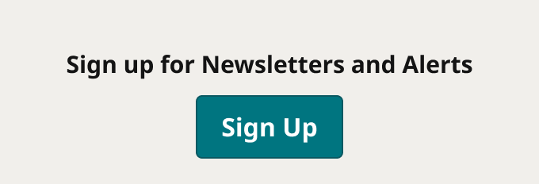

# Newsletter Signup

> The newsletter prompt and Sign Up button at the end of Latest Headlines (anonymous view; production `li.social-links .newsletter-simple .newsletter-item`). Built to match production (Karl, 2026-10-30). Device = the two widths Latest Headlines uses; production has no breakpoint for this block.

## Figma

- File: **WordPress Elements** (`b1iZxkFwtAYq9rElmnCAzd`), page **Homepage**
- Component set: [`Newsletter Signup` · 3336:44765](https://www.figma.com/design/b1iZxkFwtAYq9rElmnCAzd/?node-id=3336-44765) · key `84f47333e168c6d47184245169a01ad2d8be9958`
- Documentation frame: [Newsletter Signup Container](https://www.figma.com/design/b1iZxkFwtAYq9rElmnCAzd/?node-id=3484-67644) · overview: [previews/newsletter-signup--documentation.png](previews/newsletter-signup--documentation.png)

## Properties

| Property | Default | Options |
|---|---|---|
| Device | (≤799px) | (≤799px), (≥800px) |

## Variants

| Variant | Size | Node | Instances | Preview |
|---|---|---|---|---|
| `(≤799px)` | 340×116 | [3336:44764](https://www.figma.com/design/b1iZxkFwtAYq9rElmnCAzd/?node-id=3336-44764) | 7 |  |
| `(≥800px)` | 226×132 | [3336:44763](https://www.figma.com/design/b1iZxkFwtAYq9rElmnCAzd/?node-id=3336-44763) | 7 |  |

## Anatomy

Default variant `(≤799px)` (hidden layers marked):

- **Device=(≤799px)** `COMPONENT`: 340×116, vertical, gap 0, padding 16/0/0/0, fixed×hug
  - **Newsletter** `FRAME`: 340×100, vertical, gap 0, padding 16/16/16/16, fill×hug
    - **Item** `FRAME`: 308×68, vertical, gap 12, padding 0/0/0/0, fill×hug
      - **Prompt** `TEXT`: 308×16, fill×fill, "Sign up for Newsletters and Alerts", Noto Sans Bold 15px
      - **Button Primary** `INSTANCE`: 109×40, vertical, gap 8, padding 0/8/0/8, fixed×hug, instance of Button Primary (Icon=None, State=Default, Breakpoint=Desktop)

## Component tokens

From `newsletter-signup.tokens.json`. References point at system tokens (`tokens/core/`, `tokens/themes/`); the CSS variable is `--mng-` + the token path. A literal value means the Figma layer isn't bound to a token.

| Token | Value |
|---|---|
| `newsletter-signup.base.newsletter.padding-bottom` | `{spacing.200}` |
| `newsletter-signup.base.newsletter.padding-left` | `{spacing.200}` |
| `newsletter-signup.base.newsletter.padding-right` | `{spacing.200}` |
| `newsletter-signup.base.newsletter.padding-top` | `{spacing.200}` |
| `newsletter-signup.base.newsletter.item.gap` | `{spacing.150}` |
| `newsletter-signup.base.newsletter.item.button-primary.height` | 40px |
| `newsletter-signup.base.newsletter.item.button-primary.width` | 109px |
| `newsletter-signup.base.newsletter.item.prompt.color` | `{color.gray.min}` |
| `newsletter-signup.base.newsletter.item.prompt.font-family` | `{font.theme.small-headline-family}` |
| `newsletter-signup.base.newsletter.item.prompt.font-size` | `{font.size.15}` |
| `newsletter-signup.base.newsletter.item.prompt.font-weight` | `{font.weight.bold}` |
| `newsletter-signup.base.newsletter.item.prompt.line-height` | 16px |
| `newsletter-signup.base.root.background` | `{color.gray.600}` |
| `newsletter-signup.base.root.padding-top` | `{spacing.200}` |
| `newsletter-signup.device-799px.root.width` | 340px |
| `newsletter-signup.device-800px.root.width` | 226px |

## Behavior and breakpoints

| Device (where Latest Headlines uses it) | Grid token | Production layout | Built at | Future MNG Device breakpoint (not adopted yet) |
|---|---|---|---|---|
| (≤799px) | `wordpress-grid.xs`, `wordpress-grid.s` | Same layout, full width (680 wide at a 700px window) | 340px | Mobile, Mobile / Tablet |
| (≥800px) | `wordpress-grid.m`, `.l`, `.xl` | Same layout, side column (220 at 900px, 224 at 1728px) | 226px | Tablet, Tablet landscape, Desktop |

- **Matches production** (Karl, 2026-10-30: components match production, rounded to the nearest multiple of 4 / 8 and its token). Checked on all 6 review sites at 1728px and on ocregister.com at 900 and 700px (Karl resized the window).
- **No production breakpoint:** the layout is the same at every width. The theme CSS pads the item `1em 0` below 1040px (`max-width: 64.9375em`), but inside Latest Headlines that rule is overridden (item padding 0 measured at 900 and 700px). The two Device values are the widths Latest Headlines uses: `(≤799px)` full width (built 340) and `(≥800px)` the side column (built 226). The block fills its column.
- **Layout:** `color/gray/600` block; 16px (`spacing/200`) top padding (production's `li` padding), then the Newsletter frame with 16px on every side (production's `.newsletter-simple` padding): 32px above the prompt, 16px below the button.
- **Prompt:** Noto Bold 15 (`font/size/15`) in `font/theme/small-headline-family` (Noto Sans in Bold Coastal and Modern Earthy, Noto Serif in Measured Vibrant, as production), 16px line height, centered, `color/gray/min` on `color/gray/600`, 16.0:1. 12px (`spacing/150`) to the button (production `margin-bottom: 12px`).
- **Button:** Button Primary (Icon = None, Breakpoint = Desktop), "Sign Up", centered (Karl, 2026-10-30: Button Primary on every theme). White on `color/theme/primary`: 5.5:1 Bold Coastal, 6.9:1 Measured Vibrant, 5.2:1 Modern Earthy.
- **The 10px heading padding is gone** (Karl, 2026-10-30): it was kept raw earlier, but production has none.
- **Markup:** production puts the block in the list's last `li`; the prompt is a `p` and the button a link to the site's newsletter preferences page.

## Accessibility

- No InFocus state in Figma.
- Text color on its background must meet WCAG AA contrast (4.5:1 for text under 18px) in every theme; theme colors change per site.
- Icons inside a labelled control are decorative (`aria-hidden`); an icon-only control needs an accessible name (`aria-label`).

## Where it is used

Scope: instances in the Figma file **WordPress Elements** only (other files that use the library are not counted). Total: **14**.

Inside components: TOP ZONE Block ×5, Latest Headlines ×3.
Placed on pages: Homepage ×6.

**Built from:** Button Primary ×2

## Production

Production `.headline-list li.social-links .newsletter-simple .newsletter-item` (homepage Zone 1, all 6 review sites, measured 2026-10-30 at 1728px; ocregister.com also at 900 and 700px).

## Known issues

1. Production's button is uppercase ("SIGN UP"), Noto Sans 600 15px (13px on Measured Vibrant), 41px tall, with a 1px rgba(0,0,0,.15) border; on Modern Earthy it is outlined (transparent, 2px primary border and text). The design keeps Button Primary on every theme (Karl, 2026-10-30; design-vs-production 16.6).
2. Production block color is #F1EFEB on Bold Coastal (`color/gray/600`) but #F5F3F0 on Measured Vibrant and #ECEDE7 on Modern Earthy; the design is `color/gray/600` on every theme (design-vs-production 16.6).
3. Production prompt color is #0A0908 (Bold Coastal), #1F1E1C (Measured Vibrant), #141414 (Modern Earthy); the design is `color/gray/min` (#141414).
4. The prompt text is set per site in production ("Get the latest news delivered daily!", "Sign up for Newsletters and Alerts", "Sign up for email newsletters"); Figma shows Denver Post's.

## Files

- `newsletter-signup.tokens.json`: component tokens (DTCG 2025.10).
- `newsletter-signup.html`: HTML/CSS skeleton of every variant, using the `dist/` CSS variables (open it in a browser).
- `previews/`: PNG of every variant @2x and the documentation frame.

*Generated 2026-11-02 by `scripts/component-export/export.py` (EXPORT-STANDARD.md section 7). Edit the text in `scripts/component-export/registry.json`, not here.*
