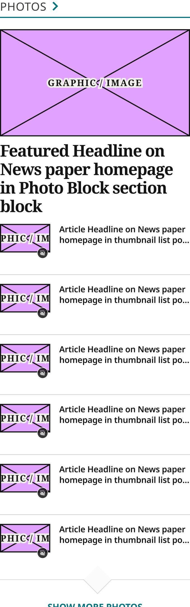
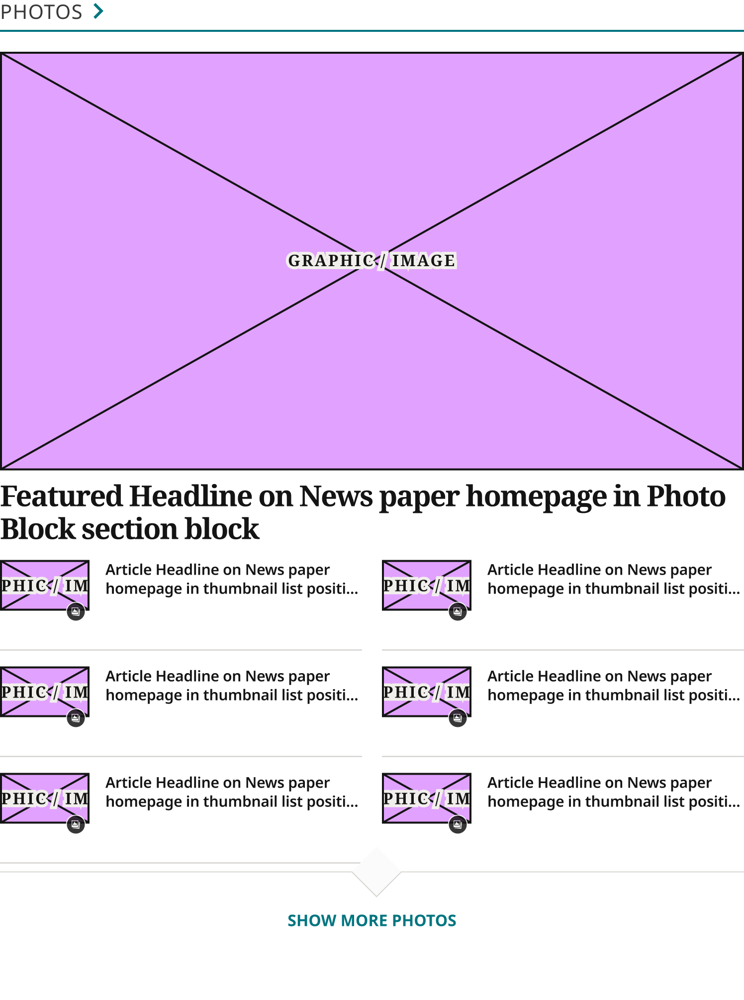
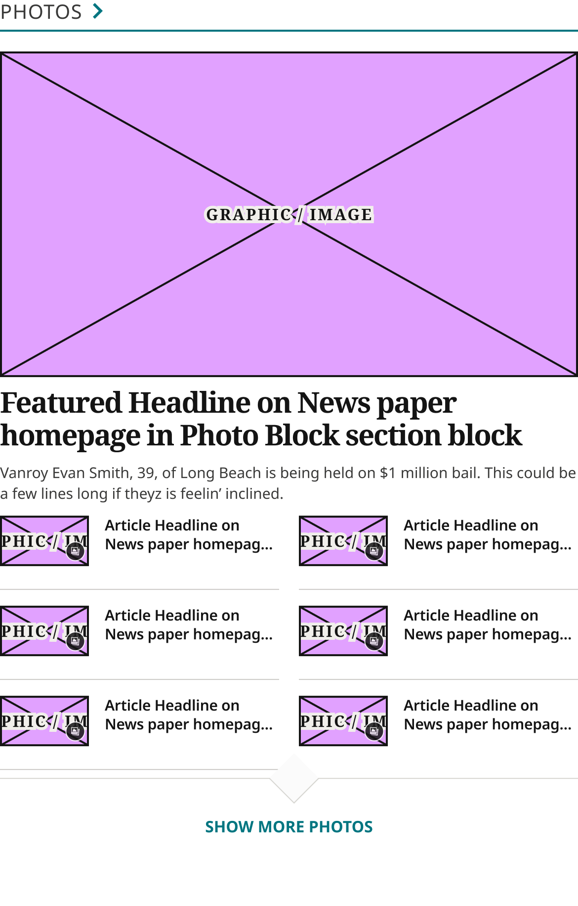
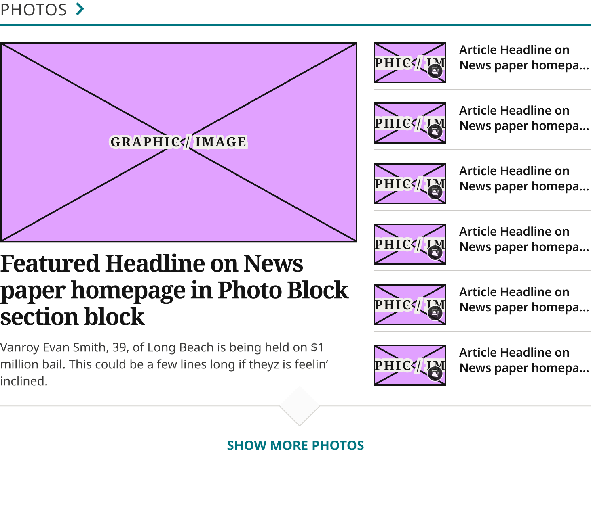
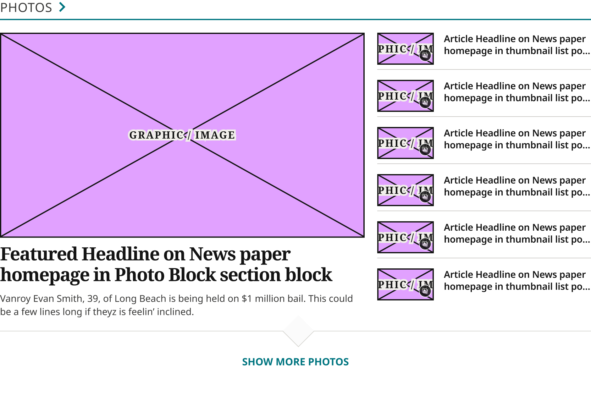

# Photos Block

> The homepage Photos block (production `.feature-media`, Zone 7, in the left column of `.landing-three-one`): Section Title / Eyebrow, a 1Col Article Card (Style = Media Lead) lead, 6 Horizontal Thumbnail Cards and the Show More Affordance. Device values are production's breakpoints.

## Figma

- File: **WordPress Elements** (`b1iZxkFwtAYq9rElmnCAzd`), page **Homepage**
- Component set: [`Photos Block` · 3352:20865](https://www.figma.com/design/b1iZxkFwtAYq9rElmnCAzd/?node-id=3352-20865) · key `e952aa813910f9c37fe311a21c266b3089bad6ab`
- Documentation frame: [Photos Block Container](https://www.figma.com/design/b1iZxkFwtAYq9rElmnCAzd/?node-id=3484-67715) · overview: [previews/photos-block--documentation.png](previews/photos-block--documentation.png)

## Properties

| Property | Default | Options |
|---|---|---|
| Device | XS (≤639px) | XS (≤639px), S (640–799px), M (800–1039px), L (1040–1279px), XL (≥1280px) |

## Variants

| Variant | Size | Node | Instances | Preview |
|---|---|---|---|---|
| `XS (≤639px)` | 340×1162.25 | [3352:20864](https://www.figma.com/design/b1iZxkFwtAYq9rElmnCAzd/?node-id=3352-20864) | 2 |  |
| `S (640–799px)` | 748×1004.75 | [3383:46539](https://www.figma.com/design/b1iZxkFwtAYq9rElmnCAzd/?node-id=3383-46539) | 1 |  |
| `M (800–1039px)` | 585×915.06 | [3553:32439](https://www.figma.com/design/b1iZxkFwtAYq9rElmnCAzd/?node-id=3553-32439) | 1 |  |
| `L (1040–1279px)` | 731×631.63 | [3552:31974](https://www.figma.com/design/b1iZxkFwtAYq9rElmnCAzd/?node-id=3552-31974) | 1 |  |
| `XL (≥1280px)` | 940×655.25 | [3552:31512](https://www.figma.com/design/b1iZxkFwtAYq9rElmnCAzd/?node-id=3552-31512) | 1 |  |

## Anatomy

Default variant `XS (≤639px)` (hidden layers marked):

- **Device=XS (≤639px)** `COMPONENT`: 340×1162.25, vertical, gap 24, padding 0/0/32/0, fixed×hug
  - **News Content** `FRAME`: 340×1130.25, vertical, gap 0, padding 0/0/0/0, fill×hug
    - **3Col Header** `FRAME`: 340×52, vertical, gap 4, padding 0/0/20/0, fill×hug
      - **Section Title / Eyebrow** `INSTANCE`: 340×32, vertical, gap 8, padding 0/0/0/0, fill×hug, instance of Section Title / Eyebrow (Style=Underline)
    - **Section Block** `FRAME`: 340×981.25, vertical, gap 0, padding 0/0/8/0, fill×hug
      - **1Col Article Card** `INSTANCE`: 340×347.25, vertical, gap 8, padding 0/0/12/0, fill×hug, instance of 1Col Article Card (Style=Media Lead)
      - **Thumbnail List** `FRAME`: 340×626, vertical, gap 16, padding 0/0/0/0, fill×hug
        - **Horizontal Thumbnail Card** `INSTANCE`: 340×91, vertical, gap 24, padding 0/0/0/0, fill×hug, instance of Horizontal Thumbnail Card (Style=Standard, Device=Mobile)
        - **Horizontal Thumbnail Card** `INSTANCE`: 340×91, vertical, gap 24, padding 0/0/0/0, fill×hug, instance of Horizontal Thumbnail Card (Style=Standard, Device=Mobile)
        - **Horizontal Thumbnail Card** `INSTANCE`: 340×91, vertical, gap 24, padding 0/0/0/0, fill×hug, instance of Horizontal Thumbnail Card (Style=Standard, Device=Mobile)
        - **Horizontal Thumbnail Card** `INSTANCE`: 340×91, vertical, gap 24, padding 0/0/0/0, fill×hug, instance of Horizontal Thumbnail Card (Style=Standard, Device=Mobile)
        - **Horizontal Thumbnail Card** `INSTANCE`: 340×91, vertical, gap 24, padding 0/0/0/0, fill×hug, instance of Horizontal Thumbnail Card (Style=Standard, Device=Mobile)
        - **Horizontal Thumbnail Card** `INSTANCE`: 340×91, vertical, gap 24, padding 0/0/24/0, fill×hug, instance of Horizontal Thumbnail Card (Style=Standard, Device=Mobile)
    - **Show More Affordance** `INSTANCE`: 340×97, fill×fixed, instance of Show More Affordance ()

## Component tokens

From `photos-block.tokens.json`. References point at system tokens (`tokens/core/`, `tokens/themes/`); the CSS variable is `--mng-` + the token path. A literal value means the Figma layer isn't bound to a token.

| Token | Value |
|---|---|
| `photos-block.base.news-content.background` | `{color.gray.max}` |
| `photos-block.base.news-content.3col-header.background` | `{color.gray.max}` |
| `photos-block.base.news-content.3col-header.padding-bottom` | `{spacing.250}` |
| `photos-block.base.news-content.3col-header.section-title-eyebrow.height` | 32px |
| `photos-block.base.news-content.3col-header.section-title-eyebrow.icon-color` | `{color.gray.100}` |
| `photos-block.base.news-content.section-block.gap` | `{spacing.250}` |
| `photos-block.base.news-content.section-block.padding-bottom` | `{spacing.100}` |
| `photos-block.base.news-content.section-block.1col-article-card.icon-color` | #e1a1ff |
| `photos-block.base.news-content.section-block.thumbnail-list.gap` | `{spacing.200}` |
| `photos-block.base.news-content.section-block.thumbnail-list.horizontal-thumbnail-card.icon-color` | #e1a1ff |
| `photos-block.base.news-content.section-block.thumbnail-list.row-1.gap` | `{spacing.250}` |
| `photos-block.base.news-content.section-block.thumbnail-list.row-1.horizontal-thumbnail-card.icon-color` | #e1a1ff |
| `photos-block.base.news-content.section-block.thumbnail-list.row-2.gap` | `{spacing.250}` |
| `photos-block.base.news-content.section-block.thumbnail-list.row-2.horizontal-thumbnail-card.icon-color` | #e1a1ff |
| `photos-block.base.news-content.section-block.thumbnail-list.row-3.gap` | `{spacing.250}` |
| `photos-block.base.news-content.section-block.thumbnail-list.row-3.horizontal-thumbnail-card.icon-color` | #e1a1ff |
| `photos-block.base.news-content.show-more-affordance.height` | 97px |
| `photos-block.base.news-content.show-more-affordance.icon-color` | #d7d6d2 |
| `photos-block.base.root.background` | `{color.gray.max}` |
| `photos-block.base.root.padding-bottom` | `{spacing.400}` |
| `photos-block.device-xs-639px.news-content.3col-header.section-title-eyebrow.width` | 340px |
| `photos-block.device-xs-639px.news-content.section-block.1col-article-card.height` | 347.25px |
| `photos-block.device-xs-639px.news-content.section-block.1col-article-card.width` | 340px |
| `photos-block.device-xs-639px.news-content.section-block.thumbnail-list.horizontal-thumbnail-card.height` | 91px |
| `photos-block.device-xs-639px.news-content.section-block.thumbnail-list.horizontal-thumbnail-card.width` | 340px |
| `photos-block.device-xs-639px.news-content.show-more-affordance.width` | 340px |
| `photos-block.device-xs-639px.root.width` | 340px |
| `photos-block.device-s-640-799px.news-content.3col-header.section-title-eyebrow.width` | 748px |
| `photos-block.device-s-640-799px.news-content.section-block.1col-article-card.height` | 510.75px |
| `photos-block.device-s-640-799px.news-content.section-block.1col-article-card.width` | 748px |
| `photos-block.device-s-640-799px.news-content.section-block.thumbnail-list.row-1.horizontal-thumbnail-card.height` | 91px |
| `photos-block.device-s-640-799px.news-content.section-block.thumbnail-list.row-1.horizontal-thumbnail-card.width` | 364px |
| `photos-block.device-s-640-799px.news-content.section-block.thumbnail-list.row-2.horizontal-thumbnail-card.height` | 91px |
| `photos-block.device-s-640-799px.news-content.section-block.thumbnail-list.row-2.horizontal-thumbnail-card.width` | 364px |
| `photos-block.device-s-640-799px.news-content.section-block.thumbnail-list.row-3.horizontal-thumbnail-card.height` | 91px |
| `photos-block.device-s-640-799px.news-content.section-block.thumbnail-list.row-3.horizontal-thumbnail-card.width` | 364px |
| `photos-block.device-s-640-799px.news-content.show-more-affordance.width` | 748px |
| `photos-block.device-s-640-799px.root.width` | 748px |
| `photos-block.device-m-800-1039px.news-content.3col-header.section-title-eyebrow.width` | 585px |
| `photos-block.device-m-800-1039px.news-content.section-block.1col-article-card.height` | 469.06px |
| `photos-block.device-m-800-1039px.news-content.section-block.1col-article-card.width` | 585px |
| `photos-block.device-m-800-1039px.news-content.section-block.thumbnail-list.row-1.horizontal-thumbnail-card.height` | 75px |
| `photos-block.device-m-800-1039px.news-content.section-block.thumbnail-list.row-1.horizontal-thumbnail-card.width` | 282.5px |
| `photos-block.device-m-800-1039px.news-content.section-block.thumbnail-list.row-2.horizontal-thumbnail-card.height` | 75px |
| `photos-block.device-m-800-1039px.news-content.section-block.thumbnail-list.row-2.horizontal-thumbnail-card.width` | 282.5px |
| `photos-block.device-m-800-1039px.news-content.section-block.thumbnail-list.row-3.horizontal-thumbnail-card.height` | 75px |
| `photos-block.device-m-800-1039px.news-content.section-block.thumbnail-list.row-3.horizontal-thumbnail-card.width` | 282.5px |
| `photos-block.device-m-800-1039px.news-content.show-more-affordance.width` | 585px |
| `photos-block.device-m-800-1039px.root.width` | 585px |
| `photos-block.device-l-1040-1279px.news-content.3col-header.section-title-eyebrow.width` | 731px |
| `photos-block.device-l-1040-1279px.news-content.section-block.1col-article-card.height` | 442.63px |
| `photos-block.device-l-1040-1279px.news-content.section-block.1col-article-card.width` | 442px |
| `photos-block.device-l-1040-1279px.news-content.section-block.thumbnail-list.width` | 269px |
| `photos-block.device-l-1040-1279px.news-content.section-block.thumbnail-list.horizontal-thumbnail-card.height` | 59px |
| `photos-block.device-l-1040-1279px.news-content.section-block.thumbnail-list.horizontal-thumbnail-card.width` | 269px |
| `photos-block.device-l-1040-1279px.news-content.show-more-affordance.width` | 731px |
| `photos-block.device-l-1040-1279px.root.width` | 731px |
| `photos-block.device-xl-1280px.news-content.3col-header.section-title-eyebrow.width` | 940px |
| `photos-block.device-xl-1280px.news-content.section-block.1col-article-card.height` | 466.25px |
| `photos-block.device-xl-1280px.news-content.section-block.1col-article-card.width` | 580px |
| `photos-block.device-xl-1280px.news-content.section-block.thumbnail-list.width` | 340px |
| `photos-block.device-xl-1280px.news-content.section-block.thumbnail-list.horizontal-thumbnail-card.height` | 59px |
| `photos-block.device-xl-1280px.news-content.section-block.thumbnail-list.horizontal-thumbnail-card.width` | 340px |
| `photos-block.device-xl-1280px.news-content.show-more-affordance.width` | 940px |
| `photos-block.device-xl-1280px.root.width` | 940px |

## Behavior and breakpoints

| Device (production range) | Grid token | Production layout | Built at | Future MNG Device breakpoint (not adopted yet) |
|---|---|---|---|---|
| XS (≤639px) | `wordpress-grid.xs` | One column, no excerpt | 340px | Mobile |
| S (640–799px) | `wordpress-grid.s` | Lead, thumbnails 2 per row, no excerpt | 748px | Mobile |
| M (800–1039px) | `wordpress-grid.m` | Lead with excerpt, thumbnails 2 per row | 585px | Tablet |
| L (1040–1279px) | `wordpress-grid.l` | Lead 61.5% beside the list | 731px | Tablet landscape |
| XL (≥1280px) | `wordpress-grid.xl` | Lead 62.5% beside the list | 940px | Desktop |

- **Matches production on the 4 / 8 grid** (CLAUDE.md, Design vs. production): CSS `.feature-media`, the same layout on all 6 review sites (only the title, rule and excerpt colors change by theme); measured 2026-11-02 at 360, 778, 900, 1100 and 1728px. Production values that aren't multiples of 4 are rounded to the nearest one and its token: 15px image-to-headline gap → 16 (`spacing/200`), 20.16px column gap → 20 (`spacing/250`), 11.25px under the excerpt → 12 (`spacing/150`).
- **Breakpoints are production's:** `XS (≤639px)` one column (built 340), `S (640–799px)` thumbnails 2 per row (built 748), `M (800–1039px)` as S with the excerpt (built 585), `L (1040–1279px)` lead 442 beside the list 269 (built 731), `XL (≥1280px)` lead 580 beside the list 340 (built 940). The block fills its column; in L and XL the lead is 61.5% / 62.5% of the row and the list the rest less the 20px gap.
- **Title:** Section Title / Eyebrow (Style = Underline, with the chevron), 20px (`spacing/250`) to the content.
- **Lead:** 1Col Article Card, Style = Media Lead, with in-block overrides (the card is shared, so it isn't changed): no bottom rule, 12px (`spacing/150`) headline to excerpt, 12px (`spacing/150`) below. No excerpt in XS and S (production hides it below 800px).
- **Thumbnails:** 6 Horizontal Thumbnail Cards (Device = Mobile: 90×51 image) with in-block overrides: no top or bottom padding, 16px (`spacing/200`) image to headline; the rule 24px (`spacing/300`) below the content in XS, S and M (production: the article's 16px margin plus the item's 8px padding), 8px (`spacing/100`) in L and XL; 16px (`spacing/200`) from the rule to the next thumbnail. The last thumbnail has no rule (it keeps the space below). In XS and S the image has 16px (`spacing/200`) below it (production `figure { margin-bottom: 1em }` below 800px). Items in a row share the row's height, so their rules line up. The gallery icon shows only on gallery articles.
- **Show More Affordance** (Label = Show More Photos) 8px (`spacing/100`) below the content; the block has 32px (`spacing/400`) below it.

## Accessibility

- No InFocus state in Figma.
- Text color on its background must meet WCAG AA contrast (4.5:1 for text under 18px) in every theme; theme colors change per site.
- Icons inside a labelled control are decorative (`aria-hidden`); an icon-only control needs an accessible name (`aria-label`).

## Where it is used

Scope: instances in the Figma file **WordPress Elements** only (other files that use the library are not counted). Total: **6**.

Placed on pages: Homepage ×6.

**Built from:** Horizontal Thumbnail Card ×30, Section Title / Eyebrow ×5, 1Col Article Card ×5, Show More Affordance ×5

## Production

Production `.feature-media` (homepage Photos block, Zone 7, in `.three-one-left`). CSS read on all 6 review sites at 1728px; layout measured on mcall.com at 360, 900 and 1100px (fixed-width same-site frames inside the page, so the window wasn't resized), ocregister.com at 778px and denverpost.com at 1728px, 2026-11-02.

## Known issues

1. Per theme in production: the title-to-content gap is 1em of the eyebrow size (20 / 17 / 21px), and the rule (#D7D6D2 / #C8C4C0 / #DDD8D5) and lead excerpt colors differ (design-vs-production 16.8, same grays as 16.5 and 16.7).
2. The parts keep their own values: the Horizontal Thumbnail Card image is 90×51 (production 90×50.6, 16:9) and the 1Col Article Card excerpt is its own gray.
3. Production's thumbnail headline is CSS weight 600, rendered Bold (only the 400 and 700 faces load); the design is SemiBold.
4. **Values not bound to a token** (literal in the component tokens): `base` news-content.section-block.1col-article-card icon-color = #e1a1ff; `base` news-content.section-block.thumbnail-list.horizontal-thumbnail-card icon-color = #e1a1ff; `base` news-content.section-block.thumbnail-list.row-1.horizontal-thumbnail-card icon-color = #e1a1ff; `base` news-content.section-block.thumbnail-list.row-2.horizontal-thumbnail-card icon-color = #e1a1ff; `base` news-content.section-block.thumbnail-list.row-3.horizontal-thumbnail-card icon-color = #e1a1ff; `base` news-content.show-more-affordance icon-color = #d7d6d2.

## Files

- `photos-block.tokens.json`: component tokens (DTCG 2025.10).
- `photos-block.html`: HTML/CSS skeleton of every variant, using the `dist/` CSS variables (open it in a browser).
- `previews/`: PNG of every variant @2x and the documentation frame.

*Generated 2026-11-02 by `scripts/component-export/export.py` (EXPORT-STANDARD.md section 7). Edit the text in `scripts/component-export/registry.json`, not here.*
