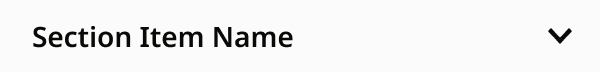
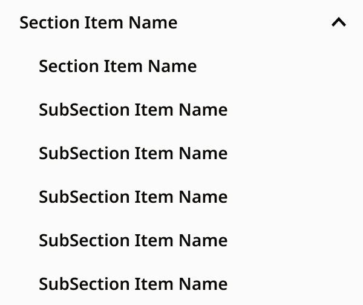

# SectionMenuGroup

> A section with subcategories in the section menu drawer: Section Row (a SectionMenuItem toggle) and Sub Items (subItem rows). View = Closed / Open.

## Figma

- File: **WordPress Elements** (`b1iZxkFwtAYq9rElmnCAzd`), page **Menus and Parts**
- Component set: [`SectionMenuGroup` · 3740:29156](https://www.figma.com/design/b1iZxkFwtAYq9rElmnCAzd/?node-id=3740-29156) · key `54e67615dff65517a8eb7b533eb66cc1d90f654f`

## Properties

| Property | Default | Options |
|---|---|---|
| View | Closed | Closed, Open |

## Variants

| Variant | Size | Node | Instances | Preview |
|---|---|---|---|---|
| `Closed` | 300×36 | [3740:29051](https://www.figma.com/design/b1iZxkFwtAYq9rElmnCAzd/?node-id=3740-29051) | 120 |  |
| `Open` | 300×252 | [3740:29103](https://www.figma.com/design/b1iZxkFwtAYq9rElmnCAzd/?node-id=3740-29103) | 15 |  |

## Anatomy

Default variant `Closed` (hidden layers marked):

- **View=Closed** `COMPONENT`: 300×36, vertical, gap 0, padding 0/0/0/0, fixed×hug
  - **Section Row** `INSTANCE`: 300×36, vertical, gap 8, padding 0/0/0/0, fill×fixed, instance of SectionMenuItem (leftIcon=no, withSubItems=yes, View=closed, kind=main, State=Default)
  - **Sub Items** `FRAME`: 300×240, vertical, gap 0, padding 0/0/0/0, fixed×hug, **hidden**
    - **Sub Item (section page)** `INSTANCE`: 300×36, horizontal, gap 8, padding 0/0/0/32, fill×fixed, instance of SectionMenuItem (leftIcon=no, withSubItems=no, View=default, kind=subItem, State=Default)
    - **Sub Item 2** `INSTANCE`: 300×36, horizontal, gap 8, padding 0/0/0/32, fill×fixed, instance of SectionMenuItem (leftIcon=no, withSubItems=no, View=default, kind=subItem, State=Default)
    - **Sub Item 3** `INSTANCE`: 300×36, horizontal, gap 8, padding 0/0/0/32, fill×fixed, instance of SectionMenuItem (leftIcon=no, withSubItems=no, View=default, kind=subItem, State=Default)
    - **Sub Item 4** `INSTANCE`: 300×36, horizontal, gap 8, padding 0/0/0/32, fill×fixed, instance of SectionMenuItem (leftIcon=no, withSubItems=no, View=default, kind=subItem, State=Default)
    - **Sub Item 5** `INSTANCE`: 300×36, horizontal, gap 8, padding 0/0/0/32, fill×fixed, instance of SectionMenuItem (leftIcon=no, withSubItems=no, View=default, kind=subItem, State=Default)
    - **Sub Item 6** `INSTANCE`: 300×36, horizontal, gap 8, padding 0/0/0/32, fill×fixed, instance of SectionMenuItem (leftIcon=no, withSubItems=no, View=default, kind=subItem, State=Default)

## Component tokens

From `section-menu-group.tokens.json`. References point at system tokens (`tokens/core/`, `tokens/themes/`); the CSS variable is `--mng-` + the token path. A literal value means the Figma layer isn't bound to a token.

| Token | Value |
|---|---|
| `section-menu-group.base.root.background` | `{color.surface.nav-panel}` |
| `section-menu-group.base.root.width` | 300px |
| `section-menu-group.base.section-row.height` | 36px |
| `section-menu-group.base.section-row.icon-color` | `{color.surface.nav-panel}` |
| `section-menu-group.base.section-row.width` | 300px |
| `section-menu-group.view-open.sub-items.sub-item-2.height` | 36px |
| `section-menu-group.view-open.sub-items.sub-item-2.icon-color` | `{color.surface.nav-panel}` |
| `section-menu-group.view-open.sub-items.sub-item-2.width` | 300px |
| `section-menu-group.view-open.sub-items.sub-item-3.height` | 36px |
| `section-menu-group.view-open.sub-items.sub-item-3.icon-color` | `{color.surface.nav-panel}` |
| `section-menu-group.view-open.sub-items.sub-item-3.width` | 300px |
| `section-menu-group.view-open.sub-items.sub-item-4.height` | 36px |
| `section-menu-group.view-open.sub-items.sub-item-4.icon-color` | `{color.surface.nav-panel}` |
| `section-menu-group.view-open.sub-items.sub-item-4.width` | 300px |
| `section-menu-group.view-open.sub-items.sub-item-5.height` | 36px |
| `section-menu-group.view-open.sub-items.sub-item-5.icon-color` | `{color.surface.nav-panel}` |
| `section-menu-group.view-open.sub-items.sub-item-5.width` | 300px |
| `section-menu-group.view-open.sub-items.sub-item-6.height` | 36px |
| `section-menu-group.view-open.sub-items.sub-item-6.icon-color` | `{color.surface.nav-panel}` |
| `section-menu-group.view-open.sub-items.sub-item-6.width` | 300px |
| `section-menu-group.view-open.sub-items.sub-item-section-page.height` | 36px |
| `section-menu-group.view-open.sub-items.sub-item-section-page.icon-color` | `{color.surface.nav-panel}` |
| `section-menu-group.view-open.sub-items.sub-item-section-page.width` | 300px |

## Behavior and breakpoints

No Breakpoint property: one size at every width.

- The Section Row is a button that opens and closes the list (aria-expanded, aria-controls); the first sub-item is always the section's own page (Karl, 2026-11-06).
- Only one group is open at a time (exclusive accordion, as in production); two levels only (no third level on any review site).
- Hide or add Sub Item rows in the instance; the sample shows 6.

## Accessibility

- No InFocus state in Figma.
- Text color on its background must meet WCAG AA contrast (4.5:1 for text under 18px) in every theme; theme colors change per site.
- Icons inside a labelled control are decorative (`aria-hidden`); an icon-only control needs an accessible name (`aria-label`).

## Where it is used

Scope: instances in the Figma file **WordPress Elements** only (other files that use the library are not counted). Total: **135**.

Inside components: SectionMenu ×135.

**Built from:** SectionMenuItem ×8

## Production

Production `li.menu-item-has-children` with `ul.sub-menu` (all 6 review sites, 2026-11-06).

## Known issues

1. No documentation container yet.
2. Production differs: section rows are links that only open their list, and some groups have no landing link (design-vs-production 10.5).

## Files

- `section-menu-group.tokens.json`: component tokens (DTCG 2025.10).
- `section-menu-group.html`: HTML/CSS skeleton of every variant, using the `dist/` CSS variables (open it in a browser).
- `previews/`: PNG of every variant @2x.

*Generated 2026-11-09 by `scripts/component-export/export.py` (EXPORT-STANDARD.md section 7). Edit the text in `scripts/component-export/registry.json`, not here.*
