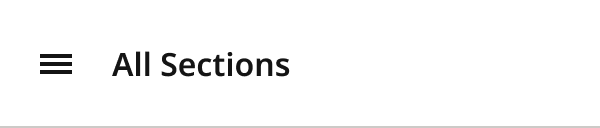
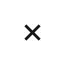
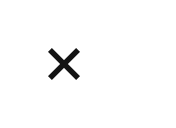

# SectionMenuHeader

> The section menu toggle: hamburger when the drawer is closed, × when it's open; the same size and place in both states. View = Closed / Open; Device = Desktop (icon + "All Sections"), TabletV, Mobile (icon only).

## Figma

- File: **WordPress Elements** (`b1iZxkFwtAYq9rElmnCAzd`), page **Menus and Parts**
- Component set: [`SectionMenuHeader` · 456:5745](https://www.figma.com/design/b1iZxkFwtAYq9rElmnCAzd/?node-id=456-5745) · key `ad45b9c389008fe7779922f2aba36ad0a34bb070`

## Properties

| Property | Default | Options |
|---|---|---|
| Device | Desktop | Desktop, Mobile, TabletV |
| View | Closed | Closed, Open |

## Variants

| Variant | Size | Node | Instances | Preview |
|---|---|---|---|---|
| `Desktop / Closed` | 300×64 | [456:5746](https://www.figma.com/design/b1iZxkFwtAYq9rElmnCAzd/?node-id=456-5746) | 87 |  |
| `Desktop / Open` | 300×64 | [456:5752](https://www.figma.com/design/b1iZxkFwtAYq9rElmnCAzd/?node-id=456-5752) | 3 |  |
| `Mobile / Closed` | 64×64 | [456:5769](https://www.figma.com/design/b1iZxkFwtAYq9rElmnCAzd/?node-id=456-5769) | 0 |  |
| `Mobile / Open` | 64×64 | [456:5774](https://www.figma.com/design/b1iZxkFwtAYq9rElmnCAzd/?node-id=456-5774) | 14 |  |
| `TabletV / Closed` | 88×64 | [456:5759](https://www.figma.com/design/b1iZxkFwtAYq9rElmnCAzd/?node-id=456-5759) | 155 |  |
| `TabletV / Open` | 88×64 | [456:5764](https://www.figma.com/design/b1iZxkFwtAYq9rElmnCAzd/?node-id=456-5764) | 0 |  |

## Anatomy

Default variant `Desktop / Closed` (hidden layers marked):

- **View=Closed, Device=Desktop** `COMPONENT`: 300×64, vertical, gap 0, padding 0/0/0/0, fixed×fixed
  - **Container** `FRAME`: 300×64, horizontal, gap 8, padding 0/8/0/8, fill×fixed
    - **Container** `FRAME`: 40×40, horizontal, gap 8, padding 0/0/0/0, fixed×fixed
      - **Icons** `INSTANCE`: 16×16, vertical, gap 8, padding 0/0/0/0, fixed×fixed, instance of Icons (Name=hamburger)
    - **Title** `TEXT`: 90×22, hug×hug, "All Sections", Noto Sans SemiBold 16px
  - **Divider** `LINE`: 300×0, fill×fixed

## Component tokens

From `section-menu-header.tokens.json`. References point at system tokens (`tokens/core/`, `tokens/themes/`); the CSS variable is `--mng-` + the token path. A literal value means the Figma layer isn't bound to a token.

| Token | Value |
|---|---|
| `section-menu-header.device-desktop.container.gap` | `{spacing.100}` |
| `section-menu-header.device-desktop.container.height` | 64px |
| `section-menu-header.device-desktop.container.padding-left` | `{spacing.100}` |
| `section-menu-header.device-desktop.container.padding-right` | `{spacing.100}` |
| `section-menu-header.device-desktop.container.title.color` | `{color.gray.min}` |
| `section-menu-header.device-desktop.container.title.font-family` | `{font.family.noto-sans}` |
| `section-menu-header.device-desktop.container.title.font-size` | `{font.size.16}` |
| `section-menu-header.device-desktop.container.title.font-weight` | `{font.weight.semibold}` |
| `section-menu-header.device-desktop.root.width` | 300px |
| `section-menu-header.device-tabletv.container.width` | 64px |
| `section-menu-header.device-tabletv.root.width` | 88px |
| `section-menu-header.base.container.container.height` | 40px |
| `section-menu-header.base.container.container.padding-bottom` | `{spacing.200}` |
| `section-menu-header.base.container.container.padding-left` | `{spacing.200}` |
| `section-menu-header.base.container.container.padding-right` | `{spacing.200}` |
| `section-menu-header.base.container.container.padding-top` | `{spacing.200}` |
| `section-menu-header.base.container.container.width` | 40px |
| `section-menu-header.base.container.container.icons.height` | 16px |
| `section-menu-header.base.container.container.icons.icon-color` | `{color.gray.min}` |
| `section-menu-header.base.container.container.icons.width` | 16px |
| `section-menu-header.base.root.background` | `{color.gray.max}` |
| `section-menu-header.base.root.height` | 64px |
| `section-menu-header.view-closed.divider.border-color` | `{color.gray.500}` |
| `section-menu-header.view-closed.divider.border-style` | solid |
| `section-menu-header.view-closed.divider.border-width` | 1px |
| `section-menu-header.view-closed.divider.height` | 0px |
| `section-menu-header.device-mobile.root.width` | 64px |

## Behavior and breakpoints

No Breakpoint property: one size at every width.

- Used inside SectionMenu and the Masthead.
- **Desktop:** 8px padding (`spacing/100`), 40px icon target, "All Sections" Noto Sans SemiBold 16 8px after it (the label starts 20px after the icon). **TabletV / Mobile:** icon centered in a 64px box.
- **Open = Closed** with the `close` icon (production is one button that swaps its icon). The header's divider is hidden when open; the drawer's top border is the line.
- A button with aria-expanded and aria-controls; the visible label (or aria-label "Open menu of all sections" / "Close menu" when icon only) names it.

## Accessibility

- No InFocus state in Figma.
- Text color on its background must meet WCAG AA contrast (4.5:1 for text under 18px) in every theme; theme colors change per site.
- Icons inside a labelled control are decorative (`aria-hidden`); an icon-only control needs an accessible name (`aria-label`).

## Where it is used

Scope: instances in the Figma file **WordPress Elements** only (other files that use the library are not counted). Total: **259**.

Inside components: SectionMenu ×22.
237 instances are nested inside other instances.

**Built from:** Icons ×6
Icon variants: `hamburger` ×3, `close` ×3.

## Production

Production `#menu-toggle` (15px padding, `icon-hamburger` / `icon-close`, `.menu-label` 15px / 600), checked on Denver Post and Morning Call 2026-11-09.

## Known issues

1. No documentation container yet.
2. Production differs: the icon sits 15px inside the page margin with "All Sections" 4px after it at 15px (design-vs-production 10.6).

## Files

- `section-menu-header.tokens.json`: component tokens (DTCG 2025.10).
- `section-menu-header.html`: HTML/CSS skeleton of every variant, using the `dist/` CSS variables (open it in a browser).
- `previews/`: PNG of every variant @2x.

*Generated 2026-11-09 by `scripts/component-export/export.py` (EXPORT-STANDARD.md section 7). Edit the text in `scripts/component-export/registry.json`, not here.*
