# SectionMenuItem

> One row of the section menu drawer: kind = main (section link), subItem (sub-section link), Weather (Weather Bug row), CTAButton (Subscribe Now) or CTAMessage (newsletter sign-up); withSubItems adds the chevron (⌄ closed, ⌃ open) and View sets its open state; leftIcon adds an icon (home3 on Home); State = Default, Hover, Pressed, InFocus on main and subItem rows.

## Figma

- File: **WordPress Elements** (`b1iZxkFwtAYq9rElmnCAzd`), page **Menus and Parts**
- Component set: [`SectionMenuItem` · 456:5781](https://www.figma.com/design/b1iZxkFwtAYq9rElmnCAzd/?node-id=456-5781) · key `4739909bf219a46a34480ef19995cbe58b3f99d5`

## Properties

| Property | Default | Options |
|---|---|---|
| State | Default | Default, Hover, Pressed, InFocus |
| View | default | open, default, closed |
| kind | main | Weather, main, CTAButton, subItem, CTAMessage |
| leftIcon | no | no, yes |
| withSubItems | no | no, yes |

## Variants

| Variant | Size | Node | Instances | Preview |
|---|---|---|---|---|
| `Default / open / main / no / yes` | 300×36 | [456:5821](https://www.figma.com/design/b1iZxkFwtAYq9rElmnCAzd/?node-id=456-5821) | 16 | 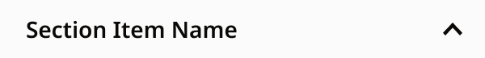 |
| `Default / default / Weather / no / no` | 300×60.87 | [456:5787](https://www.figma.com/design/b1iZxkFwtAYq9rElmnCAzd/?node-id=456-5787) | 14 | 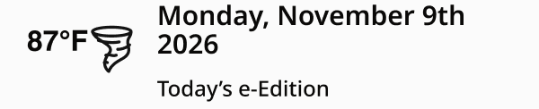 |
| `Default / default / main / no / no` | 300×36 | [456:5804](https://www.figma.com/design/b1iZxkFwtAYq9rElmnCAzd/?node-id=456-5804) | 28 |  |
| `Default / default / main / yes / no` | 300×36 | [456:5794](https://www.figma.com/design/b1iZxkFwtAYq9rElmnCAzd/?node-id=456-5794) | 17 |  |
| `Default / default / CTAButton / no / no` | 300×64 | [456:5782](https://www.figma.com/design/b1iZxkFwtAYq9rElmnCAzd/?node-id=456-5782) | 11 | 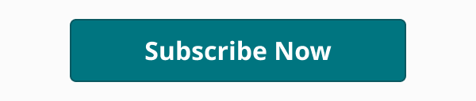 |
| `Default / default / subItem / no / no` | 300×36 | [456:5816](https://www.figma.com/design/b1iZxkFwtAYq9rElmnCAzd/?node-id=456-5816) | 822 |  |
| `Default / default / CTAMessage / no / no` | 300×151 | [456:5828](https://www.figma.com/design/b1iZxkFwtAYq9rElmnCAzd/?node-id=456-5828) | 17 | 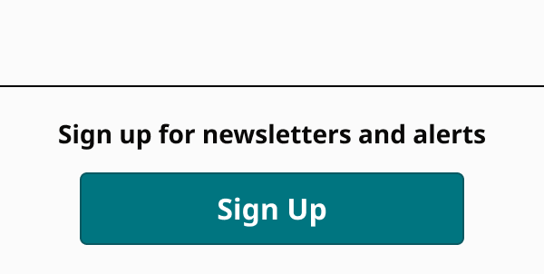 |
| `Default / closed / main / no / yes` | 300×36 | [456:5810](https://www.figma.com/design/b1iZxkFwtAYq9rElmnCAzd/?node-id=456-5810) | 139 |  |
| `Default / closed / main / yes / yes` | 300×36 | [456:5798](https://www.figma.com/design/b1iZxkFwtAYq9rElmnCAzd/?node-id=456-5798) | 0 | 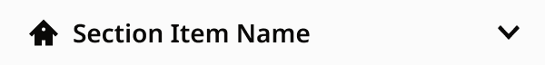 |
| `Hover / open / main / no / yes` | 300×36 | [3740:28988](https://www.figma.com/design/b1iZxkFwtAYq9rElmnCAzd/?node-id=3740-28988) | 0 | 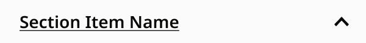 |
| `Hover / default / main / no / no` | 300×36 | [3740:28959](https://www.figma.com/design/b1iZxkFwtAYq9rElmnCAzd/?node-id=3740-28959) | 0 |  |
| `Hover / default / main / yes / no` | 300×36 | [3740:28967](https://www.figma.com/design/b1iZxkFwtAYq9rElmnCAzd/?node-id=3740-28967) | 0 | 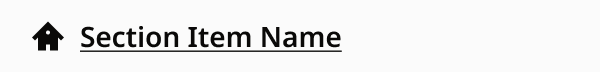 |
| `Hover / default / subItem / no / no` | 300×36 | [3740:28996](https://www.figma.com/design/b1iZxkFwtAYq9rElmnCAzd/?node-id=3740-28996) | 0 |  |
| `Hover / closed / main / no / yes` | 300×36 | [3740:28972](https://www.figma.com/design/b1iZxkFwtAYq9rElmnCAzd/?node-id=3740-28972) | 0 |  |
| `Hover / closed / main / yes / yes` | 300×36 | [3740:28980](https://www.figma.com/design/b1iZxkFwtAYq9rElmnCAzd/?node-id=3740-28980) | 0 | 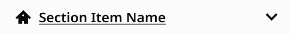 |
| `Pressed / open / main / no / yes` | 300×36 | [3748:45143](https://www.figma.com/design/b1iZxkFwtAYq9rElmnCAzd/?node-id=3748-45143) | 0 | 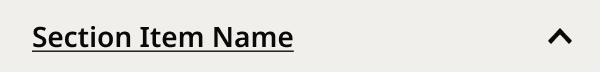 |
| `Pressed / default / main / no / no` | 300×36 | [3748:45122](https://www.figma.com/design/b1iZxkFwtAYq9rElmnCAzd/?node-id=3748-45122) | 0 | 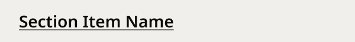 |
| `Pressed / default / main / yes / no` | 300×36 | [3748:45130](https://www.figma.com/design/b1iZxkFwtAYq9rElmnCAzd/?node-id=3748-45130) | 0 | 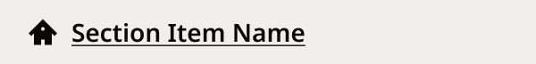 |
| `Pressed / default / subItem / no / no` | 300×36 | [3748:45159](https://www.figma.com/design/b1iZxkFwtAYq9rElmnCAzd/?node-id=3748-45159) | 0 | 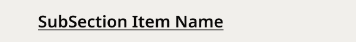 |
| `Pressed / closed / main / no / yes` | 300×36 | [3748:45135](https://www.figma.com/design/b1iZxkFwtAYq9rElmnCAzd/?node-id=3748-45135) | 0 | 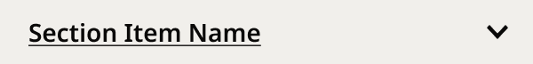 |
| `Pressed / closed / main / yes / yes` | 300×36 | [3748:45151](https://www.figma.com/design/b1iZxkFwtAYq9rElmnCAzd/?node-id=3748-45151) | 0 | 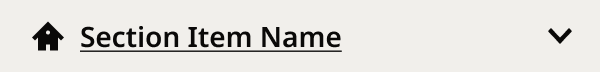 |
| `InFocus / open / main / no / yes` | 300×36 | [3740:29029](https://www.figma.com/design/b1iZxkFwtAYq9rElmnCAzd/?node-id=3740-29029) | 0 |  |
| `InFocus / default / main / no / no` | 300×36 | [3740:29003](https://www.figma.com/design/b1iZxkFwtAYq9rElmnCAzd/?node-id=3740-29003) | 0 |  |
| `InFocus / default / main / yes / no` | 300×36 | [3740:29010](https://www.figma.com/design/b1iZxkFwtAYq9rElmnCAzd/?node-id=3740-29010) | 0 |  |
| `InFocus / default / subItem / no / no` | 300×36 | [3740:29036](https://www.figma.com/design/b1iZxkFwtAYq9rElmnCAzd/?node-id=3740-29036) | 0 |  |
| `InFocus / closed / main / no / yes` | 300×36 | [3740:29015](https://www.figma.com/design/b1iZxkFwtAYq9rElmnCAzd/?node-id=3740-29015) | 0 |  |
| `InFocus / closed / main / yes / yes` | 300×36 | [3740:29022](https://www.figma.com/design/b1iZxkFwtAYq9rElmnCAzd/?node-id=3740-29022) | 0 |  |

## Anatomy

Default variant `Default / open / main / no / yes` (hidden layers marked):

- **leftIcon=no, withSubItems=yes, View=open, kind=main, State=Default** `COMPONENT`: 300×36, vertical, gap 8, padding 0/0/0/0, fixed×fixed
  - **Container** `FRAME`: 300×36, horizontal, gap 8, padding 0/0/0/16, fill×fill
    - **Icons** `INSTANCE`: 16×16, horizontal, gap 8, padding 0/0/0/0, fixed×fixed, instance of Icons (Name=home3), **hidden**
    - **Item Name** `TEXT`: 236×19, fill×hug, "Section Item Name", Noto Sans SemiBold 14px
    - **Submenu** `FRAME`: 40×36, vertical, gap 8, padding 0/2/0/2, fixed×fill
      - **Icons** `INSTANCE`: 16×16, vertical, gap 8, padding 3/2/3/2, fixed×fixed, instance of Icons (Name=arrow-upSmall)

InFocus variant `InFocus / open / main / no / yes`:

- **leftIcon=no, withSubItems=yes, View=open, kind=main, State=InFocus** `COMPONENT`: 300×36, vertical, gap 8, padding 0/0/0/0, fixed×fixed
  - **Container** `FRAME`: 300×36, horizontal, gap 8, padding 0/0/0/16, fill×fill
    - **Icons** `INSTANCE`: 16×16, horizontal, gap 8, padding 0/0/0/0, fixed×fixed, instance of Icons (Name=home3), **hidden**
    - **Item Name** `TEXT`: 236×19, fill×hug, "Section Item Name", Noto Sans SemiBold 14px
    - **Submenu** `FRAME`: 40×36, vertical, gap 8, padding 0/2/0/2, fixed×fill
      - **Icons** `INSTANCE`: 16×16, vertical, gap 8, padding 3/2/3/2, fixed×fixed, instance of Icons (Name=arrow-upSmall)
  - **Focus Ring** `FRAME`: 300×36, fixed×fixed, absolute

## Component tokens

From `section-menu-item.tokens.json`. References point at system tokens (`tokens/core/`, `tokens/themes/`); the CSS variable is `--mng-` + the token path. A literal value means the Figma layer isn't bound to a token.

| Token | Value |
|---|---|
| `section-menu-item.kind-main.container.gap` | `{spacing.100}` |
| `section-menu-item.kind-main.container.padding-left` | `{spacing.200}` |
| `section-menu-item.kind-main.container.item-name.color` | `{color.theme.nav-text}` |
| `section-menu-item.kind-main.container.item-name.font-family` | `{font.family.noto-sans}` |
| `section-menu-item.kind-main.container.item-name.font-size` | `{font.size.14}` |
| `section-menu-item.kind-main.container.item-name.font-weight` | `{font.weight.semibold}` |
| `section-menu-item.kind-ctamessage.container.gap` | `{spacing.150}` |
| `section-menu-item.kind-ctamessage.container.padding-bottom` | `{spacing.200}` |
| `section-menu-item.kind-ctamessage.container.padding-top` | `{spacing.200}` |
| `section-menu-item.kind-ctamessage.container.button-container.padding-left` | `{spacing.450}` |
| `section-menu-item.kind-ctamessage.container.button-container.padding-right` | `{spacing.450}` |
| `section-menu-item.kind-ctamessage.container.button-container.button-primary.height` | 40px |
| `section-menu-item.kind-ctamessage.container.button-container.button-primary.width` | 228px |
| `section-menu-item.kind-ctamessage.container.cta-text.color` | `{color.theme.nav-text}` |
| `section-menu-item.kind-ctamessage.container.cta-text.font-family` | `{font.family.noto-sans}` |
| `section-menu-item.kind-ctamessage.container.cta-text.font-size` | `{font.size.14}` |
| `section-menu-item.kind-ctamessage.container.cta-text.font-weight` | `{font.weight.bold}` |
| `section-menu-item.kind-ctamessage.divider.border-color` | `{color.gray.black}` |
| `section-menu-item.kind-ctamessage.divider.border-style` | solid |
| `section-menu-item.kind-ctamessage.divider.border-width` | 1px |
| `section-menu-item.kind-ctamessage.divider.height` | 0px |
| `section-menu-item.kind-ctamessage.root.padding-top` | `{spacing.600}` |
| `section-menu-item.kind-ctabutton.container.padding-bottom` | `{spacing.150}` |
| `section-menu-item.kind-ctabutton.container.padding-left` | `{spacing.450}` |
| `section-menu-item.kind-ctabutton.container.padding-right` | `{spacing.450}` |
| `section-menu-item.kind-ctabutton.container.padding-top` | `{spacing.150}` |
| `section-menu-item.kind-ctabutton.container.button-primary.height` | 40px |
| `section-menu-item.kind-ctabutton.container.button-primary.width` | 228px |
| `section-menu-item.lefticon-yes.container.icons.height` | 16px |
| `section-menu-item.lefticon-yes.container.icons.icon-color` | `{color.theme.nav-text}` |
| `section-menu-item.lefticon-yes.container.icons.width` | 16px |
| `section-menu-item.state-default.container.submenu.background` | `{color.surface.nav-panel}` |
| `section-menu-item.state-default.root.background` | `{color.surface.nav-panel}` |
| `section-menu-item.state-hover.container.submenu.background` | `{color.surface.nav-panel}` |
| `section-menu-item.state-hover.root.background` | `{color.surface.nav-panel}` |
| `section-menu-item.state-pressed.container.submenu.background` | `{color.gray.600}` |
| `section-menu-item.state-pressed.root.background` | `{color.gray.600}` |
| `section-menu-item.state-infocus.container.submenu.background` | `{color.surface.nav-panel}` |
| `section-menu-item.state-infocus.focus-ring.border-color` | `{color.gray.black}` |
| `section-menu-item.state-infocus.focus-ring.border-style` | solid |
| `section-menu-item.state-infocus.focus-ring.border-width` | 2px |
| `section-menu-item.state-infocus.root.background` | `{color.surface.nav-panel}` |
| `section-menu-item.withsubitems-yes.container.submenu.padding-left` | 2px |
| `section-menu-item.withsubitems-yes.container.submenu.padding-right` | 2px |
| `section-menu-item.withsubitems-yes.container.submenu.width` | 40px |
| `section-menu-item.withsubitems-yes.container.submenu.icons.height` | 16px |
| `section-menu-item.withsubitems-yes.container.submenu.icons.icon-color` | `{color.theme.nav-text}` |
| `section-menu-item.withsubitems-yes.container.submenu.icons.width` | 16px |
| `section-menu-item.base.root.height` | 36px |
| `section-menu-item.base.root.width` | 300px |
| `section-menu-item.kind-subitem.root.padding-left` | `{spacing.400}` |
| `section-menu-item.kind-subitem.subitem-name.color` | `{color.theme.nav-text}` |
| `section-menu-item.kind-subitem.subitem-name.font-family` | `{font.family.noto-sans}` |
| `section-menu-item.kind-subitem.subitem-name.font-size` | `{font.size.14}` |
| `section-menu-item.kind-subitem.subitem-name.font-weight` | `{font.weight.semibold}` |
| `section-menu-item.kind-weather.weather-bug.height` | 60.87px |
| `section-menu-item.kind-weather.weather-bug.icon-color` | `{color.theme.nav-text}` |
| `section-menu-item.kind-weather.weather-bug.width` | 300px |

## Behavior and breakpoints

No Breakpoint property: one size at every width.

- Used inside SectionMenu and SectionMenuGroup.
- **Rows:** 36px tall, Noto Sans SemiBold 14 (`font/size/14`, `font/style/semibold`), Title Case, text `color/theme/nav-text` on `color/surface/nav-panel`; 16px left padding (`spacing/200`) with the Home icon aligned; sub-items at 32px (`spacing/400`).
- **States:** Hover underlines the label; Pressed underlines it on `color/gray/600`; InFocus draws a 2px `color/gray/black` ring inside the row (the drawer clips outside it).
- **CTAButton:** Button Primary (40px, its own 8px padding) with 12px above and below (`spacing/150`) and 36px sides (`spacing/450`). **CTAMessage:** 48px space (`spacing/600`), a 1px `color/gray/black` divider, the prompt (Noto Sans Bold 14, centered, full width) 16px below it, 12px to the Sign Up button (36px sides), 16px below.
- Rows with sub-items are disclosure buttons (aria-expanded, aria-controls).

## Accessibility

- Keyboard focus: the `InFocus` variant shows the focus ring (see Behavior). Never remove the focus indicator.
- Text color on its background must meet WCAG AA contrast (4.5:1 for text under 18px) in every theme; theme colors change per site.
- Icons inside a labelled control are decorative (`aria-hidden`); an icon-only control needs an accessible name (`aria-label`).

## Where it is used

Scope: instances in the Figma file **WordPress Elements** only (other files that use the library are not counted). Total: **1064**.

Inside components: SectionMenu ×914, SectionMenuGroup ×14.
Placed on pages: Menus and Parts ×1.
135 instances are nested inside other instances.

**Built from:** Icons ×20, Button Primary ×2, Weather Bug ×1
Icon variants: `home3` ×8, `arrow-downSMALL` ×8, `arrow-upSmall` ×4.

## Production

Production `#pushnav` rows (all 6 review sites, 2026-11-06; widths on Denver Post 2026-11-09). Differences: design-vs-production 10.4–10.8.

## Known issues

1. No documentation container yet.
2. The Weather row's Weather Bug is exposed so its Evening e-Edition option can be set from any drawer.
3. **Values not bound to a token** (literal in the component tokens): `withsubitems-yes` container.submenu padding-left = 2px; `withsubitems-yes` container.submenu padding-right = 2px.

## Files

- `section-menu-item.tokens.json`: component tokens (DTCG 2025.10).
- `section-menu-item.html`: HTML/CSS skeleton of every variant, using the `dist/` CSS variables (open it in a browser).
- `previews/`: PNG of every variant @2x.

*Generated 2026-11-09 by `scripts/component-export/export.py` (EXPORT-STANDARD.md section 7). Edit the text in `scripts/component-export/registry.json`, not here.*
