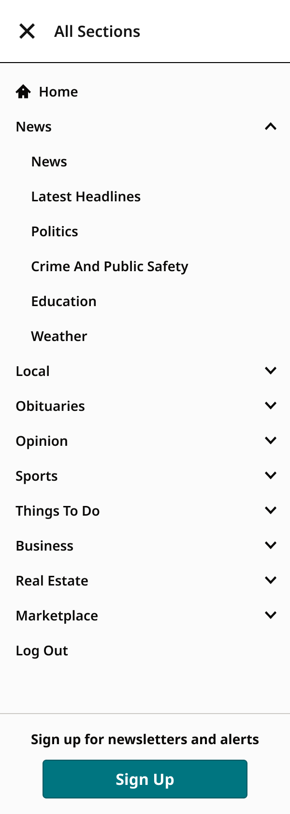
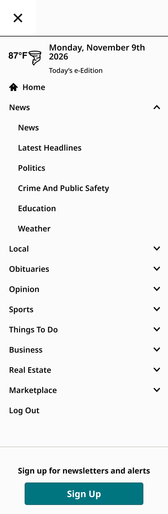
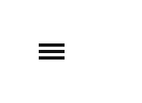

# SectionMenu

> The section menu drawer ("All Sections" at 1040px and up, the hamburger below) and its closed toggle. View = Closed / Open; Device = the 5 Masthead widths; UserType = all (Closed), subscriber, nonSub, loggedOut changes the calls to action and account rows.

## Figma

- File: **WordPress Elements** (`b1iZxkFwtAYq9rElmnCAzd`), page **Menus and Parts**
- Component set: [`SectionMenu` · 456:5837](https://www.figma.com/design/b1iZxkFwtAYq9rElmnCAzd/?node-id=456-5837) · key `c8e491010e441c0201b947dfc91b0af3a1d466f9`
- Documentation frame: [SectionMenu Documented](https://www.figma.com/design/b1iZxkFwtAYq9rElmnCAzd/?node-id=3349-66621) · overview: [previews/section-menu--documentation.png](previews/section-menu--documentation.png)

## Properties

| Property | Default | Options |
|---|---|---|
| Device | XS-Fold | XL-Desktop, MD-TabletV, SM-Mobile, XS-Fold, LG-TabletH |
| UserType | all | all, subscriber, nonSub, loggedOut |
| View | Closed | Closed, Open |

## Variants

| Variant | Size | Node | Instances | Preview |
|---|---|---|---|---|
| `XL-Desktop / all / Closed` | 300×64 | [456:5838](https://www.figma.com/design/b1iZxkFwtAYq9rElmnCAzd/?node-id=456-5838) | 86 |  |
| `XL-Desktop / subscriber / Open` | 300×839 | [456:5844](https://www.figma.com/design/b1iZxkFwtAYq9rElmnCAzd/?node-id=456-5844) | 0 |  |
| `XL-Desktop / nonSub / Open` | 300×939 | [456:5859](https://www.figma.com/design/b1iZxkFwtAYq9rElmnCAzd/?node-id=456-5859) | 0 |  |
| `XL-Desktop / loggedOut / Open` | 300×939 | [3740:34054](https://www.figma.com/design/b1iZxkFwtAYq9rElmnCAzd/?node-id=3740-34054) | 0 |  |
| `MD-TabletV / all / Closed` | 88×64 | [456:5840](https://www.figma.com/design/b1iZxkFwtAYq9rElmnCAzd/?node-id=456-5840) | 41 |  |
| `MD-TabletV / subscriber / Open` | 300×915.87 | [3344:64973](https://www.figma.com/design/b1iZxkFwtAYq9rElmnCAzd/?node-id=3344-64973) | 0 |  |
| `MD-TabletV / nonSub / Open` | 300×1015.87 | [3344:64989](https://www.figma.com/design/b1iZxkFwtAYq9rElmnCAzd/?node-id=3344-64989) | 0 |  |
| `MD-TabletV / loggedOut / Open` | 300×1015.87 | [3740:36200](https://www.figma.com/design/b1iZxkFwtAYq9rElmnCAzd/?node-id=3740-36200) | 0 |  |
| `SM-Mobile / all / Closed` | 64×64 | [456:5842](https://www.figma.com/design/b1iZxkFwtAYq9rElmnCAzd/?node-id=456-5842) | 110 |  |
| `SM-Mobile / subscriber / Open` | 300×915.87 | [456:5875](https://www.figma.com/design/b1iZxkFwtAYq9rElmnCAzd/?node-id=456-5875) | 0 |  |
| `SM-Mobile / nonSub / Open` | 300×1015.87 | [456:5891](https://www.figma.com/design/b1iZxkFwtAYq9rElmnCAzd/?node-id=456-5891) | 0 |  |
| `SM-Mobile / loggedOut / Open` | 300×1015.87 | [3740:34583](https://www.figma.com/design/b1iZxkFwtAYq9rElmnCAzd/?node-id=3740-34583) | 0 |  |
| `XS-Fold / all / Closed` | 64×64 | [3344:64074](https://www.figma.com/design/b1iZxkFwtAYq9rElmnCAzd/?node-id=3344-64074) | 0 |  |
| `XS-Fold / subscriber / Open` | 300×915.87 | [3344:64078](https://www.figma.com/design/b1iZxkFwtAYq9rElmnCAzd/?node-id=3344-64078) | 0 |  |
| `XS-Fold / nonSub / Open` | 300×1015.87 | [3344:64109](https://www.figma.com/design/b1iZxkFwtAYq9rElmnCAzd/?node-id=3344-64109) | 0 |  |
| `XS-Fold / loggedOut / Open` | 300×1015.87 | [3740:35127](https://www.figma.com/design/b1iZxkFwtAYq9rElmnCAzd/?node-id=3740-35127) | 0 |  |
| `LG-TabletH / all / Closed` | 88×64 | [3344:64076](https://www.figma.com/design/b1iZxkFwtAYq9rElmnCAzd/?node-id=3344-64076) | 0 |  |
| `LG-TabletH / subscriber / Open` | 300×915.87 | [3344:64094](https://www.figma.com/design/b1iZxkFwtAYq9rElmnCAzd/?node-id=3344-64094) | 0 |  |
| `LG-TabletH / nonSub / Open` | 300×1015.87 | [3344:64126](https://www.figma.com/design/b1iZxkFwtAYq9rElmnCAzd/?node-id=3344-64126) | 0 |  |
| `LG-TabletH / loggedOut / Open` | 300×1015.87 | [3740:35671](https://www.figma.com/design/b1iZxkFwtAYq9rElmnCAzd/?node-id=3740-35671) | 0 |  |

## Anatomy

Default variant `XL-Desktop / all / Closed` (hidden layers marked):

- **View=Closed, Device=XL-Desktop, UserType=all** `COMPONENT`: 300×64, vertical, gap 0, padding 0/0/0/0, hug×hug
  - **SectionMenuHeader** `INSTANCE`: 300×64, vertical, gap 0, padding 0/0/0/0, fixed×fixed, instance of SectionMenuHeader (View=Closed, Device=Desktop)

## Component tokens

From `section-menu.tokens.json`. References point at system tokens (`tokens/core/`, `tokens/themes/`); the CSS variable is `--mng-` + the token path. A literal value means the Figma layer isn't bound to a token.

| Token | Value |
|---|---|
| `section-menu.view-open.container.background` | `{color.surface.nav-panel}` |
| `section-menu.view-open.container.border-color` | `{color.gray.black}` |
| `section-menu.view-open.container.border-style` | solid |
| `section-menu.view-open.container.border-top-width` | 1px |
| `section-menu.view-open.container.padding-top` | `{spacing.150}` |
| `section-menu.view-open.container.sectionmenugroup-business.height` | 36px |
| `section-menu.view-open.container.sectionmenugroup-business.icon-color` | `{color.surface.nav-panel}` |
| `section-menu.view-open.container.sectionmenugroup-business.width` | 300px |
| `section-menu.view-open.container.sectionmenugroup-local.height` | 36px |
| `section-menu.view-open.container.sectionmenugroup-local.icon-color` | `{color.surface.nav-panel}` |
| `section-menu.view-open.container.sectionmenugroup-local.width` | 300px |
| `section-menu.view-open.container.sectionmenugroup-marketplace.height` | 36px |
| `section-menu.view-open.container.sectionmenugroup-marketplace.icon-color` | `{color.surface.nav-panel}` |
| `section-menu.view-open.container.sectionmenugroup-marketplace.width` | 300px |
| `section-menu.view-open.container.sectionmenugroup-news.height` | 252px |
| `section-menu.view-open.container.sectionmenugroup-news.icon-color` | `{color.surface.nav-panel}` |
| `section-menu.view-open.container.sectionmenugroup-news.width` | 300px |
| `section-menu.view-open.container.sectionmenugroup-obituaries.height` | 36px |
| `section-menu.view-open.container.sectionmenugroup-obituaries.icon-color` | `{color.surface.nav-panel}` |
| `section-menu.view-open.container.sectionmenugroup-obituaries.width` | 300px |
| `section-menu.view-open.container.sectionmenugroup-opinion.height` | 36px |
| `section-menu.view-open.container.sectionmenugroup-opinion.icon-color` | `{color.surface.nav-panel}` |
| `section-menu.view-open.container.sectionmenugroup-opinion.width` | 300px |
| `section-menu.view-open.container.sectionmenugroup-real-estate.height` | 36px |
| `section-menu.view-open.container.sectionmenugroup-real-estate.icon-color` | `{color.surface.nav-panel}` |
| `section-menu.view-open.container.sectionmenugroup-real-estate.width` | 300px |
| `section-menu.view-open.container.sectionmenugroup-sports.height` | 36px |
| `section-menu.view-open.container.sectionmenugroup-sports.icon-color` | `{color.surface.nav-panel}` |
| `section-menu.view-open.container.sectionmenugroup-sports.width` | 300px |
| `section-menu.view-open.container.sectionmenugroup-things-to-do.height` | 36px |
| `section-menu.view-open.container.sectionmenugroup-things-to-do.icon-color` | `{color.surface.nav-panel}` |
| `section-menu.view-open.container.sectionmenugroup-things-to-do.width` | 300px |
| `section-menu.view-open.container.sectionmenuitem.icon-color` | `{color.theme.nav-text}` |
| `section-menu.view-open.container.sectionmenuitem.width` | 300px |
| `section-menu.view-open.root.background` | `{color.surface.nav-panel}` |
| `section-menu.device-xl-desktop.container.sectionmenuitem.height` | 151px |
| `section-menu.device-md-tabletv.container.sectionmenuitem.height` | 167px |
| `section-menu.device-sm-mobile.container.sectionmenuitem.height` | 167px |
| `section-menu.device-xs-fold.container.sectionmenuitem.height` | 167px |
| `section-menu.device-lg-tableth.container.sectionmenuitem.height` | 167px |
| `section-menu.usertype-loggedout.container.sectionmenuitem-log-in.height` | 36px |
| `section-menu.usertype-loggedout.container.sectionmenuitem-log-in.icon-color` | `{color.surface.nav-panel}` |
| `section-menu.usertype-loggedout.container.sectionmenuitem-log-in.width` | 300px |
| `section-menu.base.container.sectionmenuitem-subscribe.height` | 36px |
| `section-menu.base.container.sectionmenuitem-subscribe.icon-color` | `{color.surface.nav-panel}` |
| `section-menu.base.container.sectionmenuitem-subscribe.width` | 300px |
| `section-menu.base.root.width` | 88px |
| `section-menu.base.sectionmenuheader.height` | 64px |
| `section-menu.device-xl-desktop.usertype-all.sectionmenuheader.width` | 300px |
| `section-menu.device-xl-desktop.usertype-subscriber.sectionmenuheader.width` | 300px |
| `section-menu.device-xl-desktop.usertype-nonsub.sectionmenuheader.width` | 300px |
| `section-menu.device-xl-desktop.usertype-loggedout.sectionmenuheader.width` | 300px |
| `section-menu.device-md-tabletv.usertype-all.sectionmenuheader.width` | 88px |
| `section-menu.device-md-tabletv.usertype-subscriber.sectionmenuheader.width` | 64px |
| `section-menu.device-md-tabletv.usertype-nonsub.sectionmenuheader.width` | 64px |
| `section-menu.device-md-tabletv.usertype-loggedout.sectionmenuheader.width` | 64px |
| `section-menu.device-sm-mobile.usertype-all.sectionmenuheader.width` | 64px |
| `section-menu.device-sm-mobile.usertype-subscriber.sectionmenuheader.width` | 64px |
| `section-menu.device-sm-mobile.usertype-nonsub.sectionmenuheader.width` | 64px |
| `section-menu.device-sm-mobile.usertype-loggedout.sectionmenuheader.width` | 64px |
| `section-menu.device-xs-fold.usertype-all.sectionmenuheader.width` | 64px |
| `section-menu.device-xs-fold.usertype-subscriber.sectionmenuheader.width` | 64px |
| `section-menu.device-xs-fold.usertype-nonsub.sectionmenuheader.width` | 64px |
| `section-menu.device-xs-fold.usertype-loggedout.sectionmenuheader.width` | 64px |
| `section-menu.device-lg-tableth.usertype-all.sectionmenuheader.width` | 88px |
| `section-menu.device-lg-tableth.usertype-subscriber.sectionmenuheader.width` | 64px |
| `section-menu.device-lg-tableth.usertype-nonsub.sectionmenuheader.width` | 64px |
| `section-menu.device-lg-tableth.usertype-loggedout.sectionmenuheader.width` | 64px |

## Behavior and breakpoints

| Device | Viewport | Built at | Toggle | Weather row | Newsletter: divider to prompt |
|---|---|---|---|---|---|
| XS-Fold | below 640px | 340px | hamburger / × only | shown | 32px |
| SM-Mobile | below 640px | 360px | hamburger / × only | shown | 32px |
| MD-TabletV | 640–799px | 768px | hamburger / × only | shown | 32px |
| LG-TabletH | 800–1039px | 1024px | hamburger / × only | shown | 32px |
| XL-Desktop | 1040px and up | 1280px | icon + "All Sections" | hidden (it's in the masthead) | 16px |

Production switches at 1040px (`max-width: 64.9375em`), checked on Denver Post at 1728, 1280, 1024, 768, 360 and 340px (2026-11-09). The drawer is 300px at every width.

- **Closed:** the SectionMenuHeader toggle in the masthead's 64px row: hamburger and "All Sections" (16px SemiBold) on XL-Desktop, hamburger only below.
- **Open:** a 300px drawer under the 64px header on `color/surface/nav-panel`, with a 1px `color/gray/black` top border and 12px top padding (`spacing/150`). The toggle keeps its place and only swaps the hamburger for the × (same as production).
- **Order:** Subscribe Now (nonSub, loggedOut; Button Primary 40px, 12px above and below, 36px sides `spacing/450`) → Weather Bug (below 1040px) → Home (home3 icon) → sections (SectionMenuGroup; one open at a time, two levels) → account rows (subscriber: Log Out; nonSub: Subscribe, Log Out; loggedOut: Subscribe, Log In) → 48px (`spacing/600`) → 1px `color/gray/black` divider → newsletter sign-up.
- **Rows:** 36px, Noto Sans SemiBold 14, Title Case, text and Home icon 16px from the left (`spacing/200`), sub-items at 32px (`spacing/400`).
- **Accessibility:** the toggle is a button with aria-expanded and aria-controls pointing at the drawer; Esc closes it and returns focus to the toggle. Each section row is a button (aria-expanded, aria-controls); its first sub-item is the section's own page.
- Labels in the drawer are placeholders: each site's menu comes from its CMS (sections, sub-sections and the e-Edition labels vary by market).

## Accessibility

- No InFocus state in Figma.
- Text color on its background must meet WCAG AA contrast (4.5:1 for text under 18px) in every theme; theme colors change per site.
- Icons inside a labelled control are decorative (`aria-hidden`); an icon-only control needs an accessible name (`aria-label`).

## Where it is used

Scope: instances in the Figma file **WordPress Elements** only (other files that use the library are not counted). Total: **237**.

Inside components: Masthead ×101, ObitMastHead ×41, AccountMenu ×5.
Placed on pages: Menus and Parts ×78, Homepage ×6, Article Page ×4, Section Front ×2.

**Built from:** SectionMenuGroup ×135, SectionMenuItem ×77, SectionMenuHeader ×20

## Production

Production section menu (`.wrapper-nav.pushnav`, `ul#pushnav`): six-site audit 2026-11-06 and five-width check on Denver Post 2026-11-09 (components/navigation.md §3).

## Known issues

1. Variant descriptions are empty; the set description documents the grid.
2. Production differs: chevrons, section rows as links, row height and padding, toggle spacing, colors, hover / pressed / focus (design-vs-production 10.4–10.8).

## Files

- `section-menu.tokens.json`: component tokens (DTCG 2025.10).
- `section-menu.html`: HTML/CSS skeleton of every variant, using the `dist/` CSS variables (open it in a browser).
- `previews/`: PNG of every variant @2x and the documentation frame.

*Generated 2026-11-09 by `scripts/component-export/export.py` (EXPORT-STANDARD.md section 7). Edit the text in `scripts/component-export/registry.json`, not here.*
