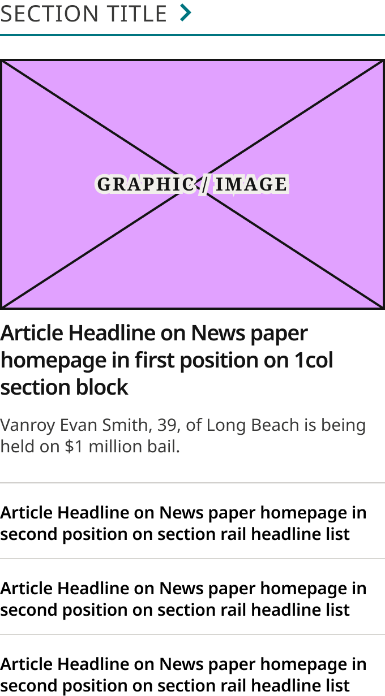
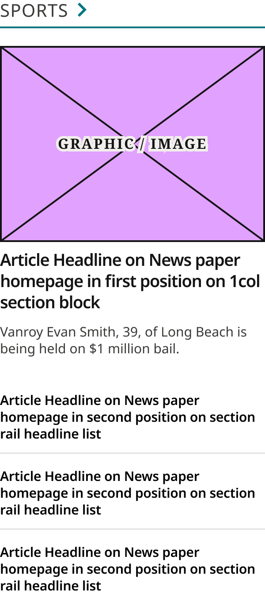

# Section Rail Card Narrow

> A narrow section rail (production `.landing-four-up .section-highlight`): Section Title / Eyebrow, the 1Col Article Card lead and three Headline List Items. Split from Section Rail Card (Layout = Narrow) 2026-11-02 (Karl). Device values are production's breakpoint.

## Figma

- File: **WordPress Elements** (`b1iZxkFwtAYq9rElmnCAzd`), page **Homepage**
- Component set: [`Section Rail Card Narrow` · 3352:22067](https://www.figma.com/design/b1iZxkFwtAYq9rElmnCAzd/?node-id=3352-22067) · key `a190cd2a7299d5dfbfd24bae57f8bf986bf7add6`
- Documentation frame: [Section Rail Card Narrow Container](https://www.figma.com/design/b1iZxkFwtAYq9rElmnCAzd/?node-id=3484-67667) · overview: [previews/section-rail-card-narrow--documentation.png](previews/section-rail-card-narrow--documentation.png)

## Properties

| Property | Default | Options |
|---|---|---|
| Device | (≤799px) | (≤799px), (≥800px) |

## Variants

| Variant | Size | Node | Instances | Preview |
|---|---|---|---|---|
| `(≤799px)` | 340×615.5 | [3352:22066](https://www.figma.com/design/b1iZxkFwtAYq9rElmnCAzd/?node-id=3352-22066) | 21 |  |
| `(≥800px)` | 300×672.5 | [3352:22065](https://www.figma.com/design/b1iZxkFwtAYq9rElmnCAzd/?node-id=3352-22065) | 9 |  |

## Anatomy

Default variant `(≤799px)` (hidden layers marked):

- **Device=(≤799px)** `COMPONENT`: 340×615.5, vertical, gap 0, padding 0/0/0/0, fixed×hug
  - **Header** `FRAME`: 340×52, vertical, gap 4, padding 0/0/20/0, fill×hug
    - **Section Title / Eyebrow** `INSTANCE`: 340×32, vertical, gap 8, padding 0/0/0/0, fill×hug, instance of Section Title / Eyebrow (Style=Underline)
  - **1Col Article Card** `INSTANCE`: 340×391.5, vertical, gap 8, padding 0/0/16/0, fill×hug, instance of 1Col Article Card (Style=Standard)
  - **Headline List** `FRAME`: 340×172, vertical, gap 16, padding 0/0/0/0, fill×hug
    - **Headline List Item** `INSTANCE`: 340×51, vertical, gap 0, padding 0/0/12/0, fill×hug, instance of Headline List Item (Rule=Default)
    - **Headline List Item** `INSTANCE`: 340×51, vertical, gap 0, padding 0/0/12/0, fill×hug, instance of Headline List Item (Rule=Default)
    - **Headline List Item** `INSTANCE`: 340×38, vertical, gap 0, padding 0/0/0/0, fill×hug, instance of Headline List Item (Rule=None)

## Component tokens

From `section-rail-card-narrow.tokens.json`. References point at system tokens (`tokens/core/`, `tokens/themes/`); the CSS variable is `--mng-` + the token path. A literal value means the Figma layer isn't bound to a token.

| Token | Value |
|---|---|
| `section-rail-card-narrow.base.1col-article-card.height` | 391.5px |
| `section-rail-card-narrow.base.1col-article-card.icon-color` | #e1a1ff |
| `section-rail-card-narrow.base.header.background` | `{color.gray.max}` |
| `section-rail-card-narrow.base.header.padding-bottom` | `{spacing.250}` |
| `section-rail-card-narrow.base.header.section-title-eyebrow.height` | 32px |
| `section-rail-card-narrow.base.header.section-title-eyebrow.icon-color` | `{color.gray.100}` |
| `section-rail-card-narrow.base.headline-list.gap` | `{spacing.200}` |
| `section-rail-card-narrow.base.headline-list.headline-list-item.icon-color` | `{color.gray.black}` |
| `section-rail-card-narrow.base.root.background` | `{color.gray.max}` |
| `section-rail-card-narrow.device-799px.1col-article-card.width` | 340px |
| `section-rail-card-narrow.device-799px.header.section-title-eyebrow.width` | 340px |
| `section-rail-card-narrow.device-799px.headline-list.headline-list-item.height` | 38px |
| `section-rail-card-narrow.device-799px.headline-list.headline-list-item.width` | 340px |
| `section-rail-card-narrow.device-799px.root.width` | 340px |
| `section-rail-card-narrow.device-800px.1col-article-card.width` | 300px |
| `section-rail-card-narrow.device-800px.header.section-title-eyebrow.width` | 300px |
| `section-rail-card-narrow.device-800px.headline-list.headline-list-item.height` | 57px |
| `section-rail-card-narrow.device-800px.headline-list.headline-list-item.width` | 300px |
| `section-rail-card-narrow.device-800px.root.width` | 300px |

## Behavior and breakpoints

| Device (production range) | Grid token | Production layout | Built at | Future MNG Device breakpoint (not adopted yet) |
|---|---|---|---|---|
| (≤799px) | `wordpress-grid.xs`, `.s` | 100% below 640px, 50% at 640–799; rule under the lead | 340px | Mobile |
| (≥800px) | `wordpress-grid.m`, `.l`, `.xl` | 50% at 800–1039, 25% from 1040; no rule under the lead | 300px | Tablet, Tablet landscape, Desktop |

- **Built raw, as production renders it** (Karl, 2026-11-02, for the Section Rail Cards and Horizontal Feature Card only): the Figma values match production (CSS `.section-highlight`, identical on all 6 review sites; measured on ocregister.com at 1280, 1100, 900 and 700px, fonts checked on chicagotribune.com and mcall.com). Where no token matches a production value, the value stays raw (not rounded to the 4 / 8 grid).
- **Breakpoint is production's:** `(≤799px)` (built 340): the lead has a 1px rule under it; `(≥800px)` (built 300): no rule. Otherwise only the width changes: the card fills its column, 100% below 640px, 50% from 640 to 1039px and 25% from 1040px (production: 340 at 360, 330 at 700, 430 at 900, 255 at 1100, 300 at 1280). The Tablet, 1024 and 1100 variants of the old Section Rail Card were swapped to these and removed.
- **Title:** Section Title / Eyebrow (Style = Underline, with the chevron), 20px (`spacing/250`, the Header's bottom padding) to the lead (production title margin-bottom: 1em of Bold Coastal's 20px eyebrow).
- **Lead:** 1Col Article Card (Style = Standard) with overrides inside this card only (Karl, 2026-11-02: the 1Col card is shared, so it isn't changed): 12px from headline to excerpt (Headline Container padding 4px); below the excerpt, Excerpt Container padding 15.5px at `(≤799px)`, then the rule (23.5px from the excerpt), and 23.5px at `(≥800px)`, where the rule is hidden; then the card's 16px (`spacing/200`) to the list. As production: 16px from the rule to the list below 800px, 39.5px from the excerpt to the list from 800px (fixed 2026-11-02: the card had 20px more before the list).
- **List:** three Headline List Items 16px (`spacing/200`) apart, the last with Rule = None.

## Accessibility

- No InFocus state in Figma.
- Text color on its background must meet WCAG AA contrast (4.5:1 for text under 18px) in every theme; theme colors change per site.
- Icons inside a labelled control are decorative (`aria-hidden`); an icon-only control needs an accessible name (`aria-label`).

## Where it is used

Scope: instances in the Figma file **WordPress Elements** only (other files that use the library are not counted). Total: **30**.

Placed on pages: Homepage ×30.

**Built from:** Headline List Item ×6, Section Title / Eyebrow ×2, 1Col Article Card ×2

## Production

Production `.landing-four-up .section-highlight` (homepage section rails, four up). Measured live on ocregister.com at 1280, 1100, 900 and 700px (Karl resized the window) and the CSS checked on all 6 review sites, 2026-11-02.

## Known issues

1. The title-to-lead gap is 1em of the theme's eyebrow size in production (20 / 17 / 21px); Figma draws Bold Coastal's 20.
2. The lead's rule is the 1Col card's `color/gray/500` (#CCCAC7); production's `.section-feature` rule is #D7D6D2 on Bold Coastal, other grays on the other themes (design-vs-production 16.7).
3. Raw values: 15.5 / 23.5px under the lead's excerpt (production's 7.5px excerpt margin plus 16px padding).
4. **Values not bound to a token** (literal in the component tokens): `base` 1col-article-card icon-color = #e1a1ff.

## Files

- `section-rail-card-narrow.tokens.json`: component tokens (DTCG 2025.10).
- `section-rail-card-narrow.html`: HTML/CSS skeleton of every variant, using the `dist/` CSS variables (open it in a browser).
- `previews/`: PNG of every variant @2x and the documentation frame.

*Generated 2026-11-02 by `scripts/component-export/export.py` (EXPORT-STANDARD.md section 7). Edit the text in `scripts/component-export/registry.json`, not here.*
