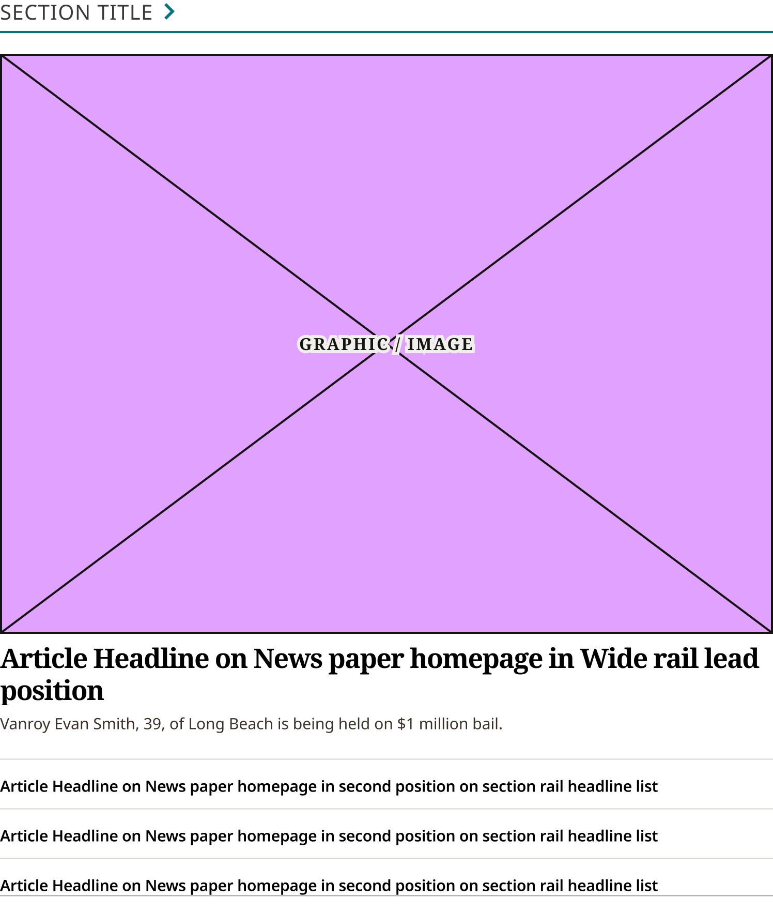
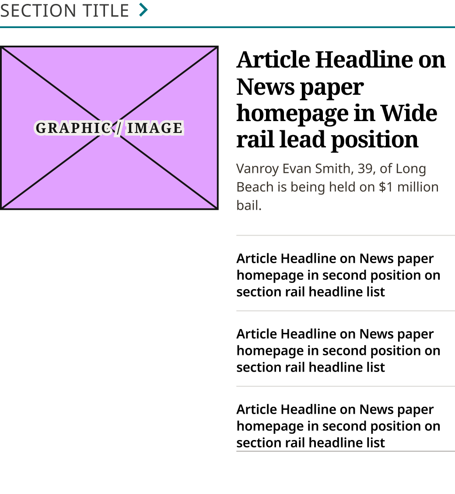
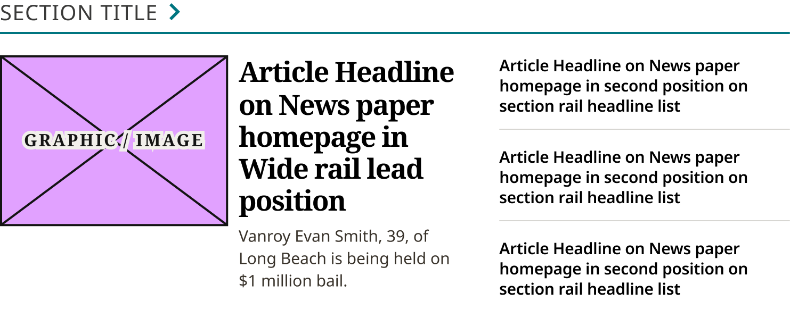
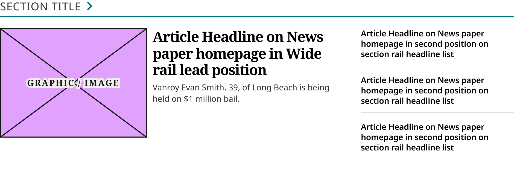

# Section Rail Card Wide

> A wide section rail (production `.landing-three-one .section-highlight`): Section Title / Eyebrow and Feature + List Content Block. Split from Section Rail Card (Layout = Wide) 2026-11-02 (Karl). Device values are production's breakpoints.

## Figma

- File: **WordPress Elements** (`b1iZxkFwtAYq9rElmnCAzd`), page **Homepage**
- Component set: [`Section Rail Card Wide` · 3709:43975](https://www.figma.com/design/b1iZxkFwtAYq9rElmnCAzd/?node-id=3709-43975) · key `2b968c2bc17a88146e8c8d8ef37db3dad272e064`
- Documentation frame: [Section Rail Card Wide Container](https://www.figma.com/design/b1iZxkFwtAYq9rElmnCAzd/?node-id=3709-43976) · overview: [previews/section-rail-card-wide--documentation.png](previews/section-rail-card-wide--documentation.png)

## Properties

| Property | Default | Options |
|---|---|---|
| Device | (≤799px) | (≤799px), M (800–1039px), L (1040–1279px), XL (≥1280px) |

## Variants

| Variant | Size | Node | Instances | Preview |
|---|---|---|---|---|
| `(≤799px)` | 748×882.75 | [3383:46746](https://www.figma.com/design/b1iZxkFwtAYq9rElmnCAzd/?node-id=3383-46746) | 6 |  |
| `M (800–1039px)` | 520×562.75 | [3476:60465](https://www.figma.com/design/b1iZxkFwtAYq9rElmnCAzd/?node-id=3476-60465) | 6 |  |
| `L (1040–1279px)` | 741.4×313.75 | [3476:60484](https://www.figma.com/design/b1iZxkFwtAYq9rElmnCAzd/?node-id=3476-60484) | 6 |  |
| `XL (≥1280px)` | 940×313 | [3478:63072](https://www.figma.com/design/b1iZxkFwtAYq9rElmnCAzd/?node-id=3478-63072) | 6 |  |

## Anatomy

Default variant `(≤799px)` (hidden layers marked):

- **Device=(≤799px)** `COMPONENT`: 748×882.75, vertical, gap 20, padding 0/0/0/0, fixed×hug
  - **Header** `FRAME`: 748×32, vertical, gap 4, padding 0/0/0/0, fill×hug
    - **Section Title / Eyebrow** `INSTANCE`: 748×32, vertical, gap 8, padding 0/0/0/0, fill×hug, instance of Section Title / Eyebrow (Style=Underline)
  - **Feature + List Content Block** `INSTANCE`: 748×830.75, vertical, gap 16, padding 0/0/0/0, fill×hug, instance of Feature + List Content Block (Device=(≤799px))

## Component tokens

From `section-rail-card-wide.tokens.json`. References point at system tokens (`tokens/core/`, `tokens/themes/`); the CSS variable is `--mng-` + the token path. A literal value means the Figma layer isn't bound to a token.

| Token | Value |
|---|---|
| `section-rail-card-wide.device-799px.feature-list-content-block.height` | 830.75px |
| `section-rail-card-wide.device-799px.feature-list-content-block.width` | 748px |
| `section-rail-card-wide.device-799px.header.section-title-eyebrow.width` | 748px |
| `section-rail-card-wide.device-799px.root.width` | 748px |
| `section-rail-card-wide.device-m-800-1039px.feature-list-content-block.height` | 478.75px |
| `section-rail-card-wide.device-m-800-1039px.feature-list-content-block.width` | 520px |
| `section-rail-card-wide.device-m-800-1039px.header.section-title-eyebrow.width` | 520px |
| `section-rail-card-wide.device-m-800-1039px.root.width` | 520px |
| `section-rail-card-wide.device-l-1040-1279px.feature-list-content-block.height` | 229.75px |
| `section-rail-card-wide.device-l-1040-1279px.feature-list-content-block.width` | 741.4px |
| `section-rail-card-wide.device-l-1040-1279px.header.section-title-eyebrow.width` | 741.4px |
| `section-rail-card-wide.device-l-1040-1279px.root.width` | 741.4px |
| `section-rail-card-wide.device-xl-1280px.feature-list-content-block.height` | 229px |
| `section-rail-card-wide.device-xl-1280px.feature-list-content-block.width` | 940px |
| `section-rail-card-wide.device-xl-1280px.header.section-title-eyebrow.width` | 940px |
| `section-rail-card-wide.device-xl-1280px.root.width` | 940px |
| `section-rail-card-wide.base.feature-list-content-block.icon-color` | #e1a1ff |
| `section-rail-card-wide.base.header.background` | `{color.gray.max}` |
| `section-rail-card-wide.base.header.section-title-eyebrow.height` | 32px |
| `section-rail-card-wide.base.header.section-title-eyebrow.icon-color` | `{color.gray.100}` |
| `section-rail-card-wide.base.root.background` | `{color.gray.max}` |
| `section-rail-card-wide.base.root.gap` | `{spacing.250}` |
| `section-rail-card-wide.base.root.padding-bottom` | `{spacing.400}` |

## Behavior and breakpoints

| Device (production range) | Grid token | Production layout | Built at | Future MNG Device breakpoint (not adopted yet) |
|---|---|---|---|---|
| (≤799px) | `wordpress-grid.xs`, `.s` | Full width, stacked | 748px | Mobile |
| M (800–1039px) | `wordpress-grid.m` | 60% − 8px | 520px | Tablet |
| L (1040–1279px) | `wordpress-grid.l` | 69.2% − 6px | 741.4px | Tablet landscape |
| XL (≥1280px) | `wordpress-grid.xl` | 75% − 5px | 940px | Desktop |

- **Built raw, as production renders it** (Karl, 2026-11-02, for the Section Rail Cards and Horizontal Feature Card only): the Figma values match production (CSS `.section-highlight`, identical on all 6 review sites; measured on ocregister.com at 1280, 1100, 900 and 700px, fonts checked on chicagotribune.com and mcall.com). Where no token matches a production value, the value stays raw (not rounded to the 4 / 8 grid).
- **Breakpoints are production's:** `(≤799px)` stacked (built 748; 680 at a 700px window), `M (800–1039px)` (built 520: 60% of the row less 8px), `L (1040–1279px)` (built 741.4: 69.2% less 6px), `XL (≥1280px)` (built 940: 75% less 5px). The card fills its column.
- **Title:** Section Title / Eyebrow (Style = Underline, with the chevron), 20px (`spacing/250`) to the content.
- **Bottom space:** from 800px the rail has 32px (`spacing/400`) padding below it (production `padding-bottom: 2em`; the last rail has none); below 800px none (production uses a 32px margin outside).
- **Content:** Feature + List Content Block with the same Device.

## Accessibility

- No InFocus state in Figma.
- Text color on its background must meet WCAG AA contrast (4.5:1 for text under 18px) in every theme; theme colors change per site.
- Icons inside a labelled control are decorative (`aria-hidden`); an icon-only control needs an accessible name (`aria-label`).

## Where it is used

Scope: instances in the Figma file **WordPress Elements** only (other files that use the library are not counted). Total: **24**.

Placed on pages: Homepage ×24.

**Built from:** Section Title / Eyebrow ×4, Feature + List Content Block ×4

## Production

Production `.landing-three-one .section-highlight` (homepage section rail beside the Blueconic Block). Measured live on ocregister.com at 1280, 1100, 900 and 700px (Karl resized the window) and the CSS checked on all 6 review sites, 2026-11-02.

## Known issues

1. The title-to-content gap is 1em of the theme's eyebrow size in production (20 / 17 / 21px); Figma draws Bold Coastal's 20.
2. Per theme in production: the rule colors differ (design-vs-production 16.7).
3. **Values not bound to a token** (literal in the component tokens): `base` feature-list-content-block icon-color = #e1a1ff.

## Files

- `section-rail-card-wide.tokens.json`: component tokens (DTCG 2025.10).
- `section-rail-card-wide.html`: HTML/CSS skeleton of every variant, using the `dist/` CSS variables (open it in a browser).
- `previews/`: PNG of every variant @2x and the documentation frame.

*Generated 2026-11-02 by `scripts/component-export/export.py` (EXPORT-STANDARD.md section 7). Edit the text in `scripts/component-export/registry.json`, not here.*
