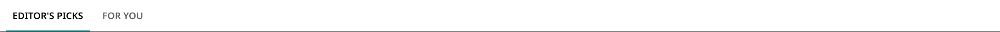
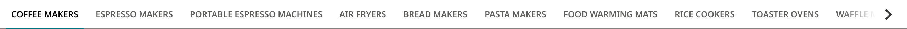
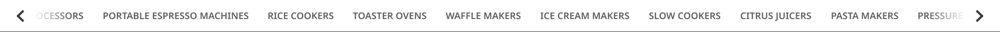
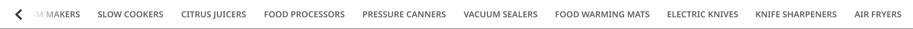
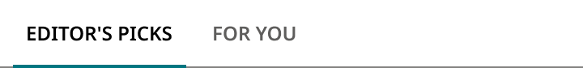
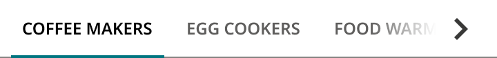
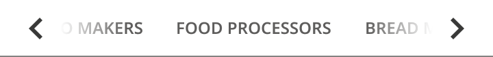
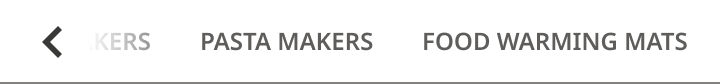

# Tab Nav

> The tab nav bar built from Tab Nav Item. Breakpoint = Desktop, Mobile × Overflow = None, Start, Middle, End (option C1, with Tab Nav Chevron). Named Homepage Tabs until 2026-11-16.

## Figma

- File: **WordPress Elements** (`b1iZxkFwtAYq9rElmnCAzd`), page **Menus and Parts**
- Component set: [`Tab Nav` · 3629:44974](https://www.figma.com/design/b1iZxkFwtAYq9rElmnCAzd/?node-id=3629-44974) · key `f6f0992bc1126f8cfc17158b13600b3a8318213e`
- Documentation frame: [Tab Nav Container](https://www.figma.com/design/b1iZxkFwtAYq9rElmnCAzd/?node-id=3629-44928) · overview: [previews/tab-nav--documentation.png](previews/tab-nav--documentation.png)

## Properties

| Property | Default | Options |
|---|---|---|
| Breakpoint | Desktop | Desktop, Mobile |
| Overflow | None | None, Start, Middle, End |

## Variants

| Variant | Size | Node | Instances | Preview |
|---|---|---|---|---|
| `Desktop / None` | 1280×42 | [3629:44950](https://www.figma.com/design/b1iZxkFwtAYq9rElmnCAzd/?node-id=3629-44950) | 0 |  |
| `Desktop / Start` | 1280×42 | [3892:44888](https://www.figma.com/design/b1iZxkFwtAYq9rElmnCAzd/?node-id=3892-44888) | 0 |  |
| `Desktop / Middle` | 1280×42 | [3892:44978](https://www.figma.com/design/b1iZxkFwtAYq9rElmnCAzd/?node-id=3892-44978) | 0 |  |
| `Desktop / End` | 1280×42 | [3892:45074](https://www.figma.com/design/b1iZxkFwtAYq9rElmnCAzd/?node-id=3892-45074) | 0 |  |
| `Mobile / None` | 360×42 | [3629:44962](https://www.figma.com/design/b1iZxkFwtAYq9rElmnCAzd/?node-id=3629-44962) | 0 |  |
| `Mobile / Start` | 360×42 | [3892:45164](https://www.figma.com/design/b1iZxkFwtAYq9rElmnCAzd/?node-id=3892-45164) | 1 |  |
| `Mobile / Middle` | 360×42 | [3892:45202](https://www.figma.com/design/b1iZxkFwtAYq9rElmnCAzd/?node-id=3892-45202) | 0 |  |
| `Mobile / End` | 360×42 | [3892:45246](https://www.figma.com/design/b1iZxkFwtAYq9rElmnCAzd/?node-id=3892-45246) | 0 |  |

## Anatomy

Default variant `Desktop / None` (hidden layers marked):

- **Breakpoint=Desktop, Overflow=None** `COMPONENT`: 1280×42, vertical, gap 0, padding 0/0/0/0, fixed×hug
  - **Bottom Border** `RECTANGLE`: 1280×1, fixed×fixed, absolute
  - **Nav** `FRAME`: 1280×42, horizontal, gap 0, padding 0/8/0/8, fixed×hug
    - **Tab List** `FRAME`: 184×42, horizontal, gap 8, padding 0/0/0/0, hug×hug
      - **Tab** `INSTANCE`: 107×42, vertical, gap 0, padding 0/0/0/0, hug×hug, instance of Tab Nav Item (State=Active)
      - **Tab** `INSTANCE`: 69×42, vertical, gap 0, padding 0/0/0/0, hug×hug, instance of Tab Nav Item (State=Default)

## Component tokens

From `tab-nav.tokens.json`. References point at system tokens (`tokens/core/`, `tokens/themes/`); the CSS variable is `--mng-` + the token path. A literal value means the Figma layer isn't bound to a token.

| Token | Value |
|---|---|
| `tab-nav.base.bottom-border.background` | `{color.gray.300}` |
| `tab-nav.base.nav.padding-left` | `{spacing.100}` |
| `tab-nav.base.nav.padding-right` | `{spacing.100}` |
| `tab-nav.base.nav.overflow-left-fade-chevron.chevron-slot.background` | `{color.gray.max}` |
| `tab-nav.base.nav.overflow-left-fade-chevron.chevron-slot.height` | 41px |
| `tab-nav.base.nav.overflow-left-fade-chevron.chevron-slot.width` | 36px |
| `tab-nav.base.nav.overflow-left-fade-chevron.chevron-slot.tab-nav-chevron.height` | 42px |
| `tab-nav.base.nav.overflow-left-fade-chevron.chevron-slot.tab-nav-chevron.width` | 36px |
| `tab-nav.base.nav.overflow-left-fade-chevron.fade-48px.height` | 41px |
| `tab-nav.base.nav.overflow-left-fade-chevron.fade-48px.width` | 48px |
| `tab-nav.base.nav.overflow-left-fade-chevron.padding-strip.background` | `{color.gray.max}` |
| `tab-nav.base.nav.overflow-left-fade-chevron.padding-strip.height` | 41px |
| `tab-nav.base.nav.overflow-left-fade-chevron.padding-strip.width` | 8px |
| `tab-nav.base.nav.overflow-right-fade-chevron.chevron-slot.background` | `{color.gray.max}` |
| `tab-nav.base.nav.overflow-right-fade-chevron.chevron-slot.height` | 41px |
| `tab-nav.base.nav.overflow-right-fade-chevron.chevron-slot.width` | 36px |
| `tab-nav.base.nav.overflow-right-fade-chevron.chevron-slot.tab-nav-chevron.height` | 42px |
| `tab-nav.base.nav.overflow-right-fade-chevron.chevron-slot.tab-nav-chevron.width` | 36px |
| `tab-nav.base.nav.overflow-right-fade-chevron.fade-48px.height` | 41px |
| `tab-nav.base.nav.overflow-right-fade-chevron.fade-48px.width` | 48px |
| `tab-nav.base.nav.overflow-right-fade-chevron.padding-strip.background` | `{color.gray.max}` |
| `tab-nav.base.nav.overflow-right-fade-chevron.padding-strip.height` | 41px |
| `tab-nav.base.nav.overflow-right-fade-chevron.padding-strip.width` | 8px |
| `tab-nav.base.nav.tab-list.gap` | `{spacing.100}` |
| `tab-nav.base.nav.tab-list.width` | 216px |
| `tab-nav.base.nav.tab-list.tab.height` | 42px |
| `tab-nav.base.nav.tab-list.tab.icon-color` | `{color.gray.200}` |
| `tab-nav.base.root.background` | `{color.gray.max}` |
| `tab-nav.breakpoint-desktop.nav.width` | 1280px |
| `tab-nav.breakpoint-desktop.root.width` | 1280px |
| `tab-nav.breakpoint-desktop.overflow-none.nav.tab-list.tab.width` | 69px |
| `tab-nav.breakpoint-desktop.overflow-start.nav.tab-list.tab.width` | 102px |
| `tab-nav.breakpoint-desktop.overflow-middle.nav.tab-list.tab.width` | 102px |
| `tab-nav.breakpoint-desktop.overflow-end.nav.tab-list.tab.width` | 82px |
| `tab-nav.breakpoint-mobile.overflow-none.nav.tab-list.tab.width` | 69px |
| `tab-nav.breakpoint-mobile.overflow-start.nav.tab-list.tab.width` | 125px |
| `tab-nav.breakpoint-mobile.overflow-middle.nav.tab-list.tab.width` | 149px |
| `tab-nav.breakpoint-mobile.overflow-end.nav.tab-list.tab.width` | 149px |
| `tab-nav.breakpoint-mobile.root.width` | 360px |

## Behavior and breakpoints

| Device | Viewport | Layout |
|---|---|---|
| Mobile | below 640px | Nav 8px side padding |
| Desktop | 640px and up | Nav 1280px max, 8px side padding |

- **Bar:** full width, `color/gray/max`, with a 1px `color/gray/300` rule along the bottom; the active underline sits over it.
- **Nav:** max width 1280px, centered, 8px (`spacing/100`) side padding at every width, so the first tab lines up with the page content's left edge (Karl, 2026-11-03; was 1200px with 24px (`spacing/300`) sides at 640px and up and no side padding below).
- **Tabs:** left-aligned, 8px (`spacing/100`) apart (Karl, 2026-11-24; was 24px); they scroll sideways (scrollbar hidden) if they don't fit.
- **More tabs than fit** (option C1, Karl, 2026-11-24; replaces the 2026-11-23 cut-in-half rule): the bar stays full width and the tabs stay 8px apart, so the tab at the edge shows partly (the gap doesn't change). The side with more tabs fades over 48px, and a chevron button (Tab Nav Chevron: 36px wide, the tab row's height, 16px arrow-left / arrow-right icon in `color/gray/100` (11.7:1 on white; Karl, 2026-11-24, one step lighter than `color/gray/min`), no fill or shadow; hover `color/theme/primary`) sits on that side; the fade ends just inside the chevron, so the cut tab still shows. A chevron scrolls about 80% of the visible width, sliding in 250ms ease-in-out, the same as the section menu drawer (Push Nav, `transform 0.25s ease-in-out`; Karl, 2026-11-24: the browser's smooth scroll was too abrupt); instant with reduced motion. Chevrons are pointer aids: aria-hidden and out of the Tab order, since keyboard and screen-reader users move with the tablist's arrow keys, which scroll the focused tab into view. Measured again on resize, on scroll and when fonts load. Labels never get an ellipsis. Variants: Overflow = None (all tabs fit), Start (right side only), Middle (both sides), End (left side only); sample labels are BestReviews kitchen sub-subcategories.
- **Accessibility:** `ul role=tablist`, each `li role=presentation`; panels have matching ids and `role=tabpanel`.
- **Keyboard** (WAI-ARIA Tabs pattern, manual activation; Karl, 2026-11-04): only the selected tab is in the Tab order (`tabindex` 0, the others −1); Left / Right move focus between tabs and wrap, Home / End go to the first / last; Enter or Space selects. Manual, not automatic, activation because choosing For You can open the Welcome modal. Developer notes: `components/for-you-interaction-and-accessibility.md`.

## Accessibility

- No InFocus state in Figma.
- Text color on its background must meet WCAG AA contrast (4.5:1 for text under 18px) in every theme; theme colors change per site.
- Icons inside a labelled control are decorative (`aria-hidden`); an icon-only control needs an accessible name (`aria-label`).

## Where it is used

Scope: instances in the Figma file **WordPress Elements** only (other files that use the library are not counted). Total: **1**.

**Built from:** Tab Nav Item ×85, Tab Nav Chevron ×8

## Production

Production World Cup tabs (`ul.sr-nav-tabs > button.tab-btn`, staging.dailylocal.com/world-cup/); differences are design-vs-production entry 12.

## Known issues

1. **Values not bound to a token** (literal in the component tokens): `base` nav.overflow-left-fade-chevron.padding-strip height = 41px; `base` nav.overflow-left-fade-chevron.padding-strip width = 8px; `base` nav.overflow-right-fade-chevron.padding-strip height = 41px; `base` nav.overflow-right-fade-chevron.padding-strip width = 8px.

## Files

- `tab-nav.tokens.json`: component tokens (DTCG 2025.10).
- `tab-nav.html`: HTML/CSS skeleton of every variant, using the `dist/` CSS variables (open it in a browser).
- `previews/`: PNG of every variant @2x and the documentation frame.

*Generated 2026-11-24 by `scripts/component-export/export.py` (EXPORT-STANDARD.md section 7). Edit the text in `scripts/component-export/registry.json`, not here.*
