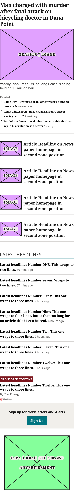
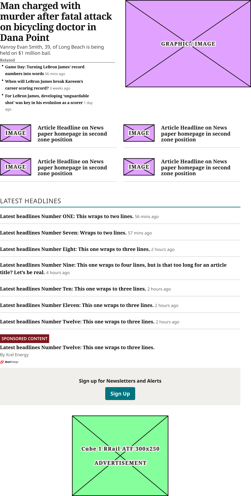
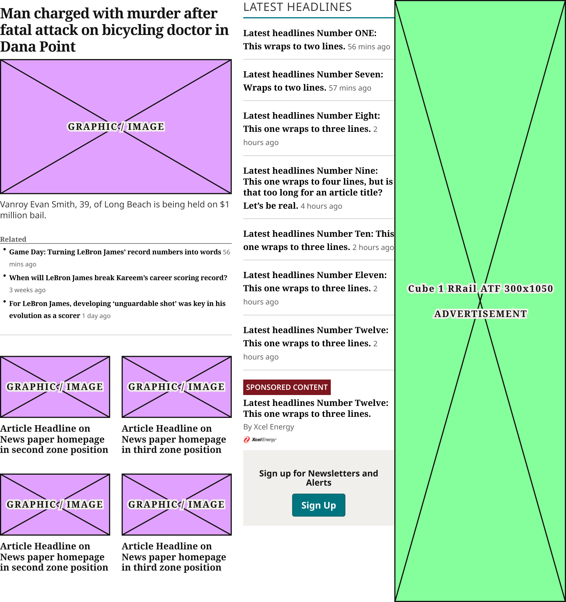
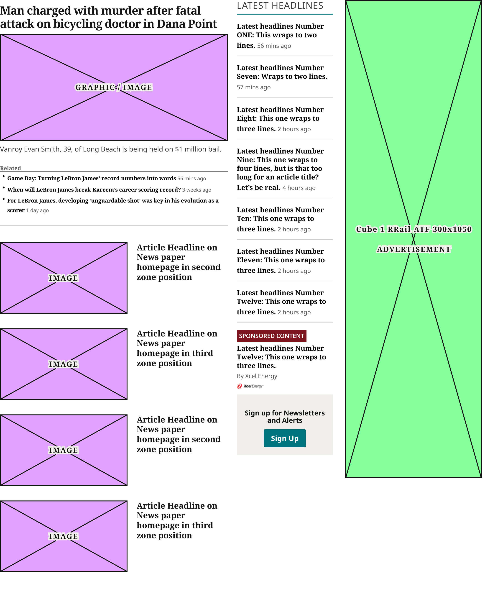
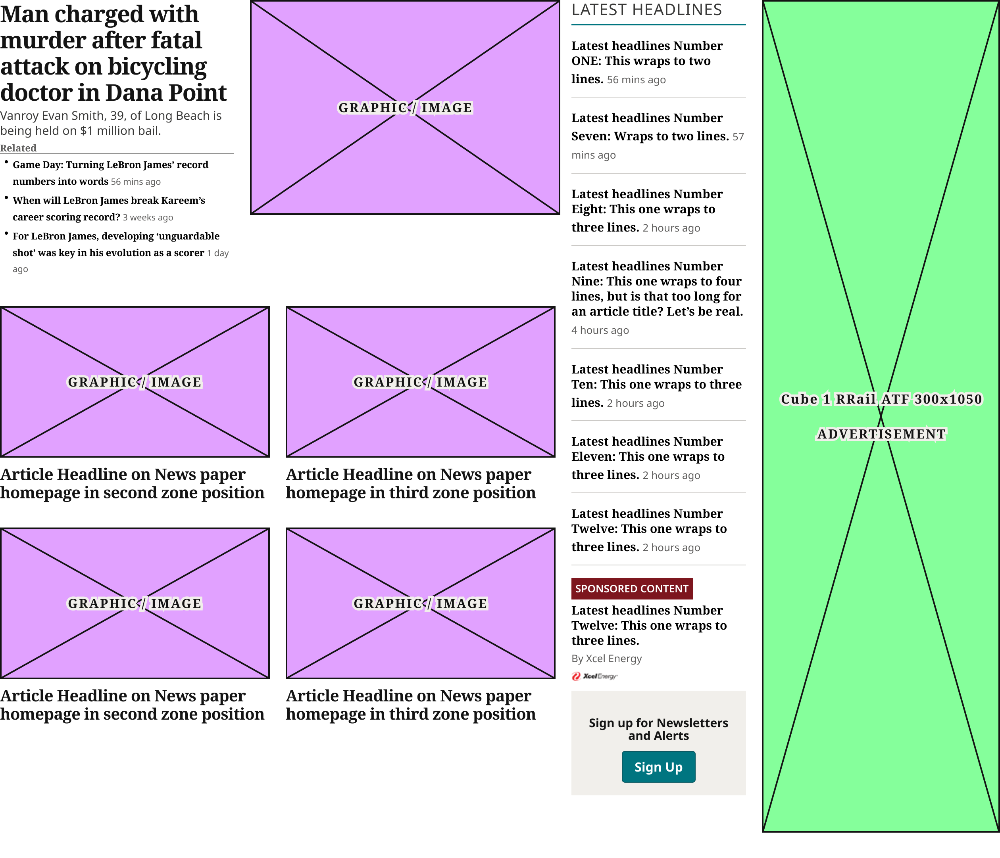

# TOP ZONE Block

> The homepage Zone 1 (production `section.feature-primary.busy`): the Lead Column (Zone 1 Lead Article Card and 4 TopZone Article Cards), Latest Headlines and the right-rail Cube ad. Device values are production's breakpoints.

## Figma

- File: **WordPress Elements** (`b1iZxkFwtAYq9rElmnCAzd`), page **Homepage**
- Component set: [`TOP ZONE Block` · 3352:19482](https://www.figma.com/design/b1iZxkFwtAYq9rElmnCAzd/?node-id=3352-19482) · key `7a4ff4e26dbe4cde51851d2fa71c64f0c4f6ddd1`
- Documentation frame: [TOP ZONE Block Container](https://www.figma.com/design/b1iZxkFwtAYq9rElmnCAzd/?node-id=3484-67592) · overview: [previews/top-zone-block--documentation.png](previews/top-zone-block--documentation.png)

## Properties

| Property | Default | Options |
|---|---|---|
| Device | XS (≤639px) | XS (≤639px), S (640–799px), M (800–1039px), L (1040–1279px), XL (≥1280px) |

## Variants

| Variant | Size | Node | Instances | Preview |
|---|---|---|---|---|
| `XS (≤639px)` | 340×2248.66 | [3352:19481](https://www.figma.com/design/b1iZxkFwtAYq9rElmnCAzd/?node-id=3352-19481) | 2 |  |
| `S (640–799px)` | 748×1540 | [3383:46168](https://www.figma.com/design/b1iZxkFwtAYq9rElmnCAzd/?node-id=3383-46168) | 1 |  |
| `M (800–1039px)` | 989×1050 | [3553:32881](https://www.figma.com/design/b1iZxkFwtAYq9rElmnCAzd/?node-id=3553-32881) | 1 |  |
| `L (1040–1279px)` | 1065×1303.66 | [3553:33340](https://www.figma.com/design/b1iZxkFwtAYq9rElmnCAzd/?node-id=3553-33340) | 1 |  |
| `XL (≥1280px)` | 1260×1082 | [3352:19480](https://www.figma.com/design/b1iZxkFwtAYq9rElmnCAzd/?node-id=3352-19480) | 1 |  |

## Anatomy

Default variant `XS (≤639px)` (hidden layers marked):

- **Device=XS (≤639px)** `COMPONENT`: 340×2248.66, vertical, gap 32, padding 0/0/0/0, fixed×hug
  - **Lead Column** `FRAME`: 340×1124.66, vertical, gap 20, padding 0/0/0/0, fill×hug
    - **Zone 1 Lead Article Card** `INSTANCE`: 340×628.66, vertical, gap 8, padding 0/0/16/0, fill×hug, instance of Zone 1 Lead Article Card (Style=Standard, Device=Mobile, Gallery=Image)
    - **Secondary Stories** `FRAME`: 340×476, vertical, gap 16, padding 0/0/0/0, fill×hug
      - **TopZone Article Card** `INSTANCE`: 340×107, vertical, gap 16, padding 0/0/16/0, fill×hug, instance of TopZone Article Card (Device=XS (≤639px))
      - **TopZone Article Card** `INSTANCE`: 340×107, vertical, gap 16, padding 0/0/16/0, fill×hug, instance of TopZone Article Card (Device=XS (≤639px))
      - **TopZone Article Card** `INSTANCE`: 340×107, vertical, gap 16, padding 0/0/16/0, fill×hug, instance of TopZone Article Card (Device=XS (≤639px))
      - **TopZone Article Card** `INSTANCE`: 340×107, vertical, gap 16, padding 0/0/16/0, fill×hug, instance of TopZone Article Card (Device=XS (≤639px))
  - **Latest Headlines** `INSTANCE`: 340×810, vertical, gap 0, padding 0/0/0/0, fill×hug, instance of Latest Headlines (Device=XS (≤639px))
  - **Ad Block Container** `FRAME`: 340×250, vertical, gap 16, padding 0/0/0/0, fill×hug
    - **Ad Blocks** `INSTANCE`: 300×250, vertical, gap 8, padding 0/0/0/0, fixed×fixed, instance of Ad Blocks (Device=All, Name=Cube 1 RRail ATF 300x250)

## Component tokens

From `top-zone-block.tokens.json`. References point at system tokens (`tokens/core/`, `tokens/themes/`); the CSS variable is `--mng-` + the token path. A literal value means the Figma layer isn't bound to a token.

| Token | Value |
|---|---|
| `top-zone-block.base.ad-block-container.ad-blocks.height` | 250px |
| `top-zone-block.base.ad-block-container.ad-blocks.icon-color` | `{color.gray.min}` |
| `top-zone-block.base.ad-block-container.ad-blocks.width` | 300px |
| `top-zone-block.base.feature-wrapper.gap` | `{spacing.250}` |
| `top-zone-block.base.feature-wrapper.lead-column.gap` | `{spacing.250}` |
| `top-zone-block.base.feature-wrapper.lead-column.secondary-stories.gap` | `{spacing.200}` |
| `top-zone-block.base.feature-wrapper.lead-column.secondary-stories.row-1.gap` | `{spacing.250}` |
| `top-zone-block.base.feature-wrapper.lead-column.secondary-stories.row-1.topzone-article-card.icon-color` | #e1a1ff |
| `top-zone-block.base.feature-wrapper.lead-column.secondary-stories.row-2.gap` | `{spacing.250}` |
| `top-zone-block.base.feature-wrapper.lead-column.secondary-stories.row-2.topzone-article-card.icon-color` | #e1a1ff |
| `top-zone-block.base.feature-wrapper.lead-column.zone-1-lead-article-card.icon-color` | `{color.gray.min}` |
| `top-zone-block.base.lead-column.gap` | `{spacing.250}` |
| `top-zone-block.base.lead-column.secondary-stories.gap` | `{spacing.200}` |
| `top-zone-block.base.lead-column.zone-1-lead-article-card.icon-color` | `{color.gray.min}` |
| `top-zone-block.base.right-rail.ad-blocks.height` | 1050px |
| `top-zone-block.base.right-rail.ad-blocks.icon-color` | `{color.gray.min}` |
| `top-zone-block.base.right-rail.ad-blocks.width` | 300px |
| `top-zone-block.base.root.background` | `{color.gray.max}` |
| `top-zone-block.base.root.padding-bottom` | `{spacing.400}` |
| `top-zone-block.device-m-800-1039px.feature-wrapper.width` | 689px |
| `top-zone-block.device-m-800-1039px.feature-wrapper.latest-headlines.height` | 917px |
| `top-zone-block.device-m-800-1039px.feature-wrapper.latest-headlines.width` | 264px |
| `top-zone-block.device-m-800-1039px.feature-wrapper.lead-column.width` | 405px |
| `top-zone-block.device-m-800-1039px.feature-wrapper.lead-column.secondary-stories.row-1.topzone-article-card.height` | 189.28px |
| `top-zone-block.device-m-800-1039px.feature-wrapper.lead-column.secondary-stories.row-1.topzone-article-card.width` | 192.5px |
| `top-zone-block.device-m-800-1039px.feature-wrapper.lead-column.secondary-stories.row-2.topzone-article-card.height` | 189.28px |
| `top-zone-block.device-m-800-1039px.feature-wrapper.lead-column.secondary-stories.row-2.topzone-article-card.width` | 192.5px |
| `top-zone-block.device-m-800-1039px.feature-wrapper.lead-column.zone-1-lead-article-card.height` | 600.66px |
| `top-zone-block.device-m-800-1039px.feature-wrapper.lead-column.zone-1-lead-article-card.width` | 405px |
| `top-zone-block.device-m-800-1039px.right-rail.width` | 300px |
| `top-zone-block.device-m-800-1039px.root.width` | 989px |
| `top-zone-block.device-l-1040-1279px.feature-wrapper.width` | 731px |
| `top-zone-block.device-l-1040-1279px.feature-wrapper.latest-headlines.height` | 998px |
| `top-zone-block.device-l-1040-1279px.feature-wrapper.latest-headlines.width` | 211px |
| `top-zone-block.device-l-1040-1279px.feature-wrapper.lead-column.width` | 500px |
| `top-zone-block.device-l-1040-1279px.feature-wrapper.lead-column.secondary-stories.topzone-article-card.height` | 173px |
| `top-zone-block.device-l-1040-1279px.feature-wrapper.lead-column.secondary-stories.topzone-article-card.icon-color` | #e1a1ff |
| `top-zone-block.device-l-1040-1279px.feature-wrapper.lead-column.secondary-stories.topzone-article-card.width` | 500px |
| `top-zone-block.device-l-1040-1279px.feature-wrapper.lead-column.zone-1-lead-article-card.height` | 511.66px |
| `top-zone-block.device-l-1040-1279px.feature-wrapper.lead-column.zone-1-lead-article-card.width` | 500px |
| `top-zone-block.device-l-1040-1279px.right-rail.width` | 314px |
| `top-zone-block.device-l-1040-1279px.root.gap` | `{spacing.250}` |
| `top-zone-block.device-l-1040-1279px.root.width` | 1065px |
| `top-zone-block.device-xl-1280px.feature-wrapper.width` | 940px |
| `top-zone-block.device-xl-1280px.feature-wrapper.latest-headlines.height` | 1003px |
| `top-zone-block.device-xl-1280px.feature-wrapper.latest-headlines.width` | 220px |
| `top-zone-block.device-xl-1280px.feature-wrapper.lead-column.width` | 700px |
| `top-zone-block.device-xl-1280px.feature-wrapper.lead-column.secondary-stories.row-1.topzone-article-card.height` | 263.25px |
| `top-zone-block.device-xl-1280px.feature-wrapper.lead-column.secondary-stories.row-1.topzone-article-card.width` | 340px |
| `top-zone-block.device-xl-1280px.feature-wrapper.lead-column.secondary-stories.row-2.topzone-article-card.height` | 263.25px |
| `top-zone-block.device-xl-1280px.feature-wrapper.lead-column.secondary-stories.row-2.topzone-article-card.width` | 340px |
| `top-zone-block.device-xl-1280px.feature-wrapper.lead-column.zone-1-lead-article-card.height` | 366px |
| `top-zone-block.device-xl-1280px.feature-wrapper.lead-column.zone-1-lead-article-card.width` | 700px |
| `top-zone-block.device-xl-1280px.right-rail.width` | 300px |
| `top-zone-block.device-xl-1280px.root.gap` | `{spacing.250}` |
| `top-zone-block.device-xl-1280px.root.width` | 1260px |
| `top-zone-block.device-xs-639px.latest-headlines.height` | 810px |
| `top-zone-block.device-xs-639px.latest-headlines.width` | 340px |
| `top-zone-block.device-xs-639px.lead-column.secondary-stories.topzone-article-card.height` | 107px |
| `top-zone-block.device-xs-639px.lead-column.secondary-stories.topzone-article-card.icon-color` | #e1a1ff |
| `top-zone-block.device-xs-639px.lead-column.secondary-stories.topzone-article-card.width` | 340px |
| `top-zone-block.device-xs-639px.lead-column.zone-1-lead-article-card.height` | 628.66px |
| `top-zone-block.device-xs-639px.lead-column.zone-1-lead-article-card.width` | 340px |
| `top-zone-block.device-xs-639px.root.gap` | `{spacing.400}` |
| `top-zone-block.device-xs-639px.root.width` | 340px |
| `top-zone-block.device-s-640-799px.latest-headlines.height` | 646px |
| `top-zone-block.device-s-640-799px.latest-headlines.width` | 748px |
| `top-zone-block.device-s-640-799px.lead-column.secondary-stories.row-1.gap` | `{spacing.250}` |
| `top-zone-block.device-s-640-799px.lead-column.secondary-stories.row-1.topzone-article-card.height` | 89px |
| `top-zone-block.device-s-640-799px.lead-column.secondary-stories.row-1.topzone-article-card.icon-color` | #e1a1ff |
| `top-zone-block.device-s-640-799px.lead-column.secondary-stories.row-1.topzone-article-card.width` | 364px |
| `top-zone-block.device-s-640-799px.lead-column.secondary-stories.row-2.gap` | `{spacing.250}` |
| `top-zone-block.device-s-640-799px.lead-column.secondary-stories.row-2.topzone-article-card.height` | 89px |
| `top-zone-block.device-s-640-799px.lead-column.secondary-stories.row-2.topzone-article-card.icon-color` | #e1a1ff |
| `top-zone-block.device-s-640-799px.lead-column.secondary-stories.row-2.topzone-article-card.width` | 364px |
| `top-zone-block.device-s-640-799px.lead-column.zone-1-lead-article-card.height` | 366px |
| `top-zone-block.device-s-640-799px.lead-column.zone-1-lead-article-card.width` | 748px |
| `top-zone-block.device-s-640-799px.root.gap` | `{spacing.400}` |
| `top-zone-block.device-s-640-799px.root.width` | 748px |

## Behavior and breakpoints

| Device (production range) | Grid token | Production layout | Built at | Future MNG Device breakpoint (not adopted yet) |
|---|---|---|---|---|
| XS (≤639px) | `wordpress-grid.xs` | Stacked; story cards one column; Latest Headlines max 540px, centered | 340px | Mobile |
| S (640–799px) | `wordpress-grid.s` | Stacked; story cards 2 per row | 748px | Mobile |
| M (800–1039px) | `wordpress-grid.m` | Feature Wrapper (60% / 40%) beside the 300px ad, no gap | 989px | Tablet |
| L (1040–1279px) | `wordpress-grid.l` | Wrapper 69.2% (69.2% / 30.8%), ad column 30.8% | 1065px | Tablet landscape |
| XL (≥1280px) | `wordpress-grid.xl` | Wrapper 75% (75% / 25%), ad column 25% | 1260px | Desktop |

- **Matches production on the 4 / 8 grid** (CLAUDE.md, Design vs. production): the Zone 1 CSS (`.busy`, `.feature-wrapper`, `.feature-left`, `.feature-top`, `.feature-bottom`, `.headline-list`, `.sidebar-ad-container`) is identical on all 6 review sites; measured 2026-11-02 at 360, 778, 900, 1100, 1280 and 1728px. Production's 20.16px column gaps are 20 (`spacing/250`).
- **Breakpoints are production's:** `XS (≤639px)` stacked (built 340), `S (640–799px)` stacked, story cards 2 per row (built 748), `M (800–1039px)` Feature Wrapper beside the ad column (built 989), `L (1040–1279px)` (built 1065), `XL (≥1280px)` (built 1260). The block fills its row.
- **Lead Column:** Zone 1 Lead Article Card (Device = Mobile in XS, M and L; Tablet in S; Desktop in XL), 20px (`spacing/250`) to the Secondary Stories: 4 TopZone Article Cards with the block's Device, 16px (`spacing/200`) between rows; 2 per row, 20px (`spacing/250`) apart, in S, M and XL; one column in XS and L.
- **XS and S:** Lead Column, Latest Headlines (Device = XS / S) and the Cube ad (300×250, centered), 32px (`spacing/400`) apart (production `margin-bottom: 2em` and the ad's `margin-top: 2em`).
- **M, L, XL:** the Feature Wrapper (Lead Column, 20px (`spacing/250`), Latest Headlines (Device = (≥800px))) beside the ad column (Cube 300×1050). Widths as production's percentages: M wrapper 689 = row less the 300px ad (Lead Column 60% − 8 = 405, Latest Headlines 40% − 12 = 264) and **no gap before the ad** (production: `flex-wrap: nowrap` lets the 300px ad push the wrapper; see knownIssues); L wrapper 69.2% − 6 = 731 (500 / 211), 20px, ad column 30.8% − 14 = 314; XL wrapper 75% − 5 = 940 (700 / 220), 20px, ad column 25% − 15 = 300.
- **Bottom space:** L and XL 32px (`spacing/400`) below (production `.busy .feature-wrapper { margin-bottom: 2em }` from 1040px); XS, S and M none inside the block (the page's 32px between blocks is outside).

## Accessibility

- No InFocus state in Figma.
- Text color on its background must meet WCAG AA contrast (4.5:1 for text under 18px) in every theme; theme colors change per site.
- Icons inside a labelled control are decorative (`aria-hidden`); an icon-only control needs an accessible name (`aria-label`).

## Where it is used

Scope: instances in the Figma file **WordPress Elements** only (other files that use the library are not counted). Total: **6**.

Placed on pages: Homepage ×6.

**Built from:** TopZone Article Card ×20, Zone 1 Lead Article Card ×5, Latest Headlines ×5, Ad Blocks ×5

## Production

Production `section.feature-primary.busy` (homepage Zone 1). CSS read on all 6 review sites at 1728px (identical); layout measured on mcall.com at 360, 778, 900, 1100 and 1280px (fixed-width same-site frames inside the page, so the window wasn't resized) and at 1728px, 2026-11-02.

## Known issues

1. At 800–1039px production leaves no space between Latest Headlines and the ad (the 40% ad column is narrower than the 300px ad, so the ad fills it and pushes the wrapper). The design keeps production's 0; design-vs-production 16.9 asks whether it should be 20px.
2. Production can show more in Zone 1 under the story cards (on mcall.com a video player and a promotion widget); they aren't part of this block.
3. The Zone 1 Lead Article Card and Latest Headlines keep their own values and variants (Lead: Device = Desktop / Tablet / Mobile, not renamed yet).
4. **Values not bound to a token** (literal in the component tokens): `base` feature-wrapper.lead-column.secondary-stories.row-1.topzone-article-card icon-color = #e1a1ff; `base` feature-wrapper.lead-column.secondary-stories.row-2.topzone-article-card icon-color = #e1a1ff; `device-l-1040-1279px` feature-wrapper.lead-column.secondary-stories.topzone-article-card icon-color = #e1a1ff; `device-s-640-799px` lead-column.secondary-stories.row-1.topzone-article-card icon-color = #e1a1ff; `device-s-640-799px` lead-column.secondary-stories.row-2.topzone-article-card icon-color = #e1a1ff; `device-xs-639px` lead-column.secondary-stories.topzone-article-card icon-color = #e1a1ff.

## Files

- `top-zone-block.tokens.json`: component tokens (DTCG 2025.10).
- `top-zone-block.html`: HTML/CSS skeleton of every variant, using the `dist/` CSS variables (open it in a browser).
- `previews/`: PNG of every variant @2x and the documentation frame.

*Generated 2026-11-02 by `scripts/component-export/export.py` (EXPORT-STANDARD.md section 7). Edit the text in `scripts/component-export/registry.json`, not here.*
