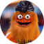

# UserImage

> The reader's avatar art, a circle. Size = small (30px) / medium (40px) / large (64px); Graphic = unknown, monogram, monogramPP, social, socialPhillip. The photo and the monogram color change by reader; the sample readers are Gritty McGee and Phillie Phanatic (mockups only).

## Figma

- File: **WordPress Elements** (`b1iZxkFwtAYq9rElmnCAzd`), page **Menus and Parts**
- Component set: [`UserImage` · 456:5708](https://www.figma.com/design/b1iZxkFwtAYq9rElmnCAzd/?node-id=456-5708) · key `72a3f7d5c88a366288aae1b0835999779027f8ea`
- Documentation frame: [UserImage Container](https://www.figma.com/design/b1iZxkFwtAYq9rElmnCAzd/?node-id=3812-50016) · overview: [previews/user-image--documentation.png](previews/user-image--documentation.png)

## Properties

| Property | Default | Options |
|---|---|---|
| Graphic | unknown | unknown, monogram, monogramPP, social, socialPhillip |
| Size | small | small, large, medium |

## Variants

| Variant | Size | Node | Instances | Preview |
|---|---|---|---|---|
| `unknown / small` | 30×30 | [456:5715](https://www.figma.com/design/b1iZxkFwtAYq9rElmnCAzd/?node-id=456-5715) | 62 |  |
| `unknown / large` | 64×64 | [712:1495](https://www.figma.com/design/b1iZxkFwtAYq9rElmnCAzd/?node-id=712-1495) | 0 |  |
| `unknown / medium` | 40×40 | [712:6283](https://www.figma.com/design/b1iZxkFwtAYq9rElmnCAzd/?node-id=712-6283) | 0 |  |
| `monogram / small` | 30×30 | [456:5718](https://www.figma.com/design/b1iZxkFwtAYq9rElmnCAzd/?node-id=456-5718) | 0 |  |
| `monogram / large` | 64×64 | [456:5720](https://www.figma.com/design/b1iZxkFwtAYq9rElmnCAzd/?node-id=456-5720) | 0 |  |
| `monogram / medium` | 40×40 | [712:6286](https://www.figma.com/design/b1iZxkFwtAYq9rElmnCAzd/?node-id=712-6286) | 0 |  |
| `monogramPP / large` | 64×64 | [456:5722](https://www.figma.com/design/b1iZxkFwtAYq9rElmnCAzd/?node-id=456-5722) | 0 |  |
| `social / small` | 30×30 | [456:5709](https://www.figma.com/design/b1iZxkFwtAYq9rElmnCAzd/?node-id=456-5709) | 198 |  |
| `social / large` | 64×64 | [456:5711](https://www.figma.com/design/b1iZxkFwtAYq9rElmnCAzd/?node-id=456-5711) | 3 |  |
| `social / medium` | 40×40 | [712:6288](https://www.figma.com/design/b1iZxkFwtAYq9rElmnCAzd/?node-id=712-6288) | 2 |  |
| `socialPhillip / large` | 64×64 | [456:5713](https://www.figma.com/design/b1iZxkFwtAYq9rElmnCAzd/?node-id=456-5713) | 0 |  |
| `socialPhillip / medium` | 40×40 | [712:6290](https://www.figma.com/design/b1iZxkFwtAYq9rElmnCAzd/?node-id=712-6290) | 0 |  |

## Anatomy

Default variant `unknown / small` (hidden layers marked):

- **Size=small, Graphic=unknown** `COMPONENT`: 30×30, horizontal, gap 0, padding 0/0/0/0, fixed×fixed
  - **Icons** `INSTANCE`: 16×16, horizontal, gap 8, padding 0/0/0/0, fixed×fixed, instance of Icons (Name=user)

## Component tokens

From `user-image.tokens.json`. References point at system tokens (`tokens/core/`, `tokens/themes/`); the CSS variable is `--mng-` + the token path. A literal value means the Figma layer isn't bound to a token.

| Token | Value |
|---|---|
| `user-image.size-small.icons.height` | 16px |
| `user-image.size-small.icons.width` | 16px |
| `user-image.size-small.initials.font-size` | `{font.size.12}` |
| `user-image.size-small.photo.height` | 30px |
| `user-image.size-small.root.height` | 30px |
| `user-image.size-small.root.width` | 30px |
| `user-image.size-large.icons.height` | 24px |
| `user-image.size-large.icons.width` | 24px |
| `user-image.size-large.initials.font-size` | `{font.size.26}` |
| `user-image.size-large.root.height` | 64px |
| `user-image.size-large.root.width` | 64px |
| `user-image.size-medium.icons.height` | 24px |
| `user-image.size-medium.icons.width` | 24px |
| `user-image.size-medium.initials.font-size` | `{font.size.16}` |
| `user-image.size-medium.photo.height` | 40px |
| `user-image.size-medium.root.height` | 40px |
| `user-image.size-medium.root.width` | 40px |
| `user-image.graphic-unknown.icons.icon-color` | `{color.gray.min}` |
| `user-image.graphic-unknown.root.background` | `{color.gray.max}` |
| `user-image.graphic-monogram.initials.color` | `{color.gray.min}` |
| `user-image.graphic-monogram.root.background` | #ff702c |
| `user-image.graphic-monogrampp.initials.color` | `{color.gray.max}` |
| `user-image.graphic-monogrampp.root.background` | `{color.feedback.low-success}` |
| `user-image.base.initials.font-family` | `{font.family.noto-sans}` |
| `user-image.base.initials.font-weight` | `{font.weight.regular}` |
| `user-image.base.root.border-radius` | 80px |

## Behavior and breakpoints

No Breakpoint property: one size at every width.

- Used inside UserPic.
- **Sizes:** small 30px (masthead; production's size, kept off the 4 / 8 grid, Karl 2026-11-13), medium 40px, large 64px. A full circle.
- **unknown:** the user icon in `color/gray/min` on `color/gray/max`, 16px (small) or 24px.
- **monogram:** initials, Noto Sans Regular 12 / 16 / 26 (`font/size/12`, `/16`, `/26`; about 40% of the circle; were 12 / 22 / 27 until 2026-11-13), centered. The background is avatar art and changes by reader (production draws the picture on its server, in many colors; Karl, 2026-11-13). Samples: #FF702C with `color/gray/min` initials (6.7:1); monogramPP `color/feedback/low-success` with `color/gray/max` initials (5.0:1; was gray/min, 3.7:1).
- **social:** the reader's profile photo cropped to the circle (production loads it from the reader's Google account).
- Give the avatar an accessible name (production: alt "Profile image").

## Accessibility

- No InFocus state in Figma.
- Text color on its background must meet WCAG AA contrast (4.5:1 for text under 18px) in every theme; theme colors change per site.
- Icons inside a labelled control are decorative (`aria-hidden`); an icon-only control needs an accessible name (`aria-label`).

## Where it is used

Scope: instances in the Figma file **WordPress Elements** only (other files that use the library are not counted). Total: **265**.

Inside components: UserPic ×6.
259 instances are nested inside other instances.

**Built from:** Icons ×3
Icon variants: `user` ×3.

## Production

Production `#anchorProfileDropDown img.rounded-circle`: the reader's photo or a server-made initials picture, 30 × 30 (all 6 review sites, logged in, 2026-11-13).

## Known issues

1. Raw values: the 80px corner radius (a full circle) and the #FF702C sample monogram background (avatar art, not a token).
2. Production's avatar is 30px with `border-radius: 60%` (design-vs-production 10.9).
3. **Values not bound to a token** (literal in the component tokens): `graphic-monogram` root background = #ff702c; `base` root border-radius = 80px.

## Files

- `user-image.tokens.json`: component tokens (DTCG 2025.10).
- `user-image.html`: HTML/CSS skeleton of every variant, using the `dist/` CSS variables (open it in a browser).
- `previews/`: PNG of every variant @2x and the documentation frame.

*Generated 2026-11-13 by `scripts/component-export/export.py` (EXPORT-STANDARD.md section 7). Edit the text in `scripts/component-export/registry.json`, not here.*
