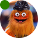
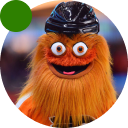
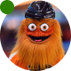

# UserPic

> The avatar button: UserImage with two AlertLevel dots (Karl, 2026-11-13). Size = Small (32px) / Medium (40px) / Large (64px); Status = Default / Active (Active = the reader is active: green dot top left). The bottom-right Alert Dot shows an alert or message (set its Level).

## Figma

- File: **WordPress Elements** (`b1iZxkFwtAYq9rElmnCAzd`), page **Menus and Parts**
- Component set: [`UserPic` · 456:5674](https://www.figma.com/design/b1iZxkFwtAYq9rElmnCAzd/?node-id=456-5674) · key `b0a98e06e6e220ea1c7d4a247494ff5525fe0dd7`
- Documentation frame: [UserPic Container](https://www.figma.com/design/b1iZxkFwtAYq9rElmnCAzd/?node-id=3812-50085) · overview: [previews/user-pic--documentation.png](previews/user-pic--documentation.png)

## Properties

| Property | Default | Options |
|---|---|---|
| Size | Small | Small, Large, Medium |
| Status | Default | Default, Active |

## Variants

| Variant | Size | Node | Instances | Preview |
|---|---|---|---|---|
| `Small / Default` | 32×32 | [456:5675](https://www.figma.com/design/b1iZxkFwtAYq9rElmnCAzd/?node-id=456-5675) | 240 |  |
| `Small / Active` | 32×32 | [712:6222](https://www.figma.com/design/b1iZxkFwtAYq9rElmnCAzd/?node-id=712-6222) | 1 |  |
| `Large / Default` | 64×64 | [712:6226](https://www.figma.com/design/b1iZxkFwtAYq9rElmnCAzd/?node-id=712-6226) | 0 |  |
| `Large / Active` | 64×64 | [712:6295](https://www.figma.com/design/b1iZxkFwtAYq9rElmnCAzd/?node-id=712-6295) | 1 |  |
| `Medium / Default` | 40×40 | [456:5678](https://www.figma.com/design/b1iZxkFwtAYq9rElmnCAzd/?node-id=456-5678) | 0 |  |
| `Medium / Active` | 40×40 | [712:6292](https://www.figma.com/design/b1iZxkFwtAYq9rElmnCAzd/?node-id=712-6292) | 0 |  |

## Anatomy

Default variant `Small / Default` (hidden layers marked):

- **Size=Small, Status=Default** `COMPONENT`: 32×32, horizontal, gap 8, padding 0/0/0/0, fixed×fixed
  - **UserImage** `INSTANCE`: 32×32, horizontal, gap 0, padding 0/0/0/0, fixed×fixed, instance of UserImage (Size=small, Graphic=social)
  - **Alert Dot** `INSTANCE`: 8×8, fixed×fixed, absolute, instance of AlertLevel (Level=none, Size=Small)
  - **Active Dot** `INSTANCE`: 8×8, fixed×fixed, absolute, instance of AlertLevel (Level=none, Size=Small)

## Component tokens

From `user-pic.tokens.json`. References point at system tokens (`tokens/core/`, `tokens/themes/`); the CSS variable is `--mng-` + the token path. A literal value means the Figma layer isn't bound to a token.

| Token | Value |
|---|---|
| `user-pic.size-small.active-dot.height` | 8px |
| `user-pic.size-small.active-dot.width` | 8px |
| `user-pic.size-small.alert-dot.height` | 8px |
| `user-pic.size-small.alert-dot.width` | 8px |
| `user-pic.size-small.root.height` | 32px |
| `user-pic.size-small.root.width` | 32px |
| `user-pic.size-small.userimage.height` | 32px |
| `user-pic.size-small.userimage.width` | 32px |
| `user-pic.size-large.active-dot.height` | 16px |
| `user-pic.size-large.active-dot.width` | 16px |
| `user-pic.size-large.alert-dot.height` | 16px |
| `user-pic.size-large.alert-dot.width` | 16px |
| `user-pic.size-large.root.height` | 64px |
| `user-pic.size-large.root.width` | 64px |
| `user-pic.size-large.userimage.height` | 64px |
| `user-pic.size-large.userimage.width` | 64px |
| `user-pic.size-medium.active-dot.height` | 8px |
| `user-pic.size-medium.active-dot.width` | 8px |
| `user-pic.size-medium.alert-dot.height` | 8px |
| `user-pic.size-medium.alert-dot.width` | 8px |
| `user-pic.size-medium.root.height` | 40px |
| `user-pic.size-medium.root.width` | 40px |
| `user-pic.size-medium.userimage.height` | 40px |
| `user-pic.size-medium.userimage.width` | 40px |
| `user-pic.base.active-dot.icon-color` | `{color.feedback.low-success}` |
| `user-pic.base.alert-dot.icon-color` | `{color.feedback.low-success}` |

## Behavior and breakpoints

No Breakpoint property: one size at every width.

- UserImage inside; the chevron that opens the account menu belongs to AccountMenu.
- **Sizes:** Small 32px (masthead, Account Dropdown Menu), Medium 40px, Large 64px (Reader Dashboard profile).
- **Active Dot** (top left, flush with the corner): Status = Active shows AlertLevel low (green); Default shows none.
- **Alert Dot** (bottom right, flush with the corner): AlertLevel, Level none by default; set low, medium or high. 8px dots on Small and Medium, 16px on Large.
- Use the reader's name, and any active or alert state, in the button's accessible label (production: "Account menu dropdown").

## Accessibility

- No InFocus state in Figma.
- Text color on its background must meet WCAG AA contrast (4.5:1 for text under 18px) in every theme; theme colors change per site.
- Icons inside a labelled control are decorative (`aria-hidden`); an icon-only control needs an accessible name (`aria-label`).

## Where it is used

Scope: instances in the Figma file **WordPress Elements** only (other files that use the library are not counted). Total: **242**.

Inside components: UserStatus ×3.
Placed on pages: Menus and Parts ×1.
233 instances are nested inside other instances.

**Built from:** AlertLevel ×12, UserImage ×6

## Production

Production `#anchorProfileDropDown` (all 6 review sites, logged in, 2026-11-13; Denver Post also at 360, 700 and 1100px).

## Known issues

1. Production shows a 30px photo and a chevron with no dots and no focus style (`outline: none`) (design-vs-production 10.9).

## Files

- `user-pic.tokens.json`: component tokens (DTCG 2025.10).
- `user-pic.html`: HTML/CSS skeleton of every variant, using the `dist/` CSS variables (open it in a browser).
- `previews/`: PNG of every variant @2x and the documentation frame.

*Generated 2026-11-13 by `scripts/component-export/export.py` (EXPORT-STANDARD.md section 7). Edit the text in `scripts/component-export/registry.json`, not here.*
