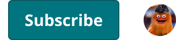
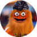

# UserStatus

> The account area of the masthead. status = none (logged out), nonSub, subscriber; Device = Desktop / mobile. Nested in AccountMenu; it decides buttons vs avatar in every Masthead variant.

## Figma

- File: **WordPress Elements** (`b1iZxkFwtAYq9rElmnCAzd`), page **Menus and Parts**
- Component set: [`UserStatus` · 456:5728](https://www.figma.com/design/b1iZxkFwtAYq9rElmnCAzd/?node-id=456-5728) · key `4c1b4132e858b8a7bef12375fa03f44cb6177947`
- Documentation frame: [UserStatus Container](https://www.figma.com/design/b1iZxkFwtAYq9rElmnCAzd/?node-id=3812-50150) · overview: [previews/user-status--documentation.png](previews/user-status--documentation.png)

## Properties

| Property | Default | Options |
|---|---|---|
| status | none | none, nonSub, subscriber |
| Device | Desktop | Desktop, mobile |

## Variants

| Variant | Size | Node | Instances | Preview |
|---|---|---|---|---|
| `none / Desktop` | 240×40 | [456:5729](https://www.figma.com/design/b1iZxkFwtAYq9rElmnCAzd/?node-id=456-5729) | 24 |  |
| `none / mobile` | 32×32 | [456:5740](https://www.figma.com/design/b1iZxkFwtAYq9rElmnCAzd/?node-id=456-5740) | 61 |  |
| `nonSub / Desktop` | 174×40 | [456:5734](https://www.figma.com/design/b1iZxkFwtAYq9rElmnCAzd/?node-id=456-5734) | 1 |  |
| `subscriber / Desktop` | 32×32 | [456:5738](https://www.figma.com/design/b1iZxkFwtAYq9rElmnCAzd/?node-id=456-5738) | 171 |  |

## Anatomy

Default variant `none / Desktop` (hidden layers marked):

- **Device=Desktop, status=none** `COMPONENT`: 240×40, horizontal, gap 16, padding 0/0/0/0, hug×hug
  - **Button Primary** `INSTANCE`: 126×40, vertical, gap 8, padding 0/8/0/8, hug×hug, instance of Button Primary (Icon=None, State=Default, Breakpoint=Desktop)
  - **Button Primary** `INSTANCE`: 98×40, vertical, gap 8, padding 0/8/0/8, hug×hug, instance of Button Primary (Icon=None, State=Default, Breakpoint=Desktop)

## Component tokens

From `user-status.tokens.json`. References point at system tokens (`tokens/core/`, `tokens/themes/`); the CSS variable is `--mng-` + the token path. A literal value means the Figma layer isn't bound to a token.

| Token | Value |
|---|---|
| `user-status.base.button-primary.height` | 40px |
| `user-status.base.root.gap` | `{spacing.200}` |
| `user-status.base.userpic.height` | 32px |
| `user-status.base.userpic.width` | 32px |
| `user-status.status-none.button-primary.width` | 98px |
| `user-status.status-nonsub.button-primary.width` | 126px |
| `user-status.device-mobile.userpic.icon-color` | `{color.gray.max}` |

## Behavior and breakpoints

No Breakpoint property: one size at every width.

- Logged out on Desktop: Subscribe and Log In (Button Primary); on mobile: the account icon (UserPic with UserImage unknown).
- nonSub: Subscribe, then the avatar (UserPic Small). subscriber: the avatar only.
- **Spacing:** 16px (`spacing/200`) between the parts (production 15px), centered vertically.
- AccountMenu adds the chevron next to the avatar.

## Accessibility

- No InFocus state in Figma.
- Text color on its background must meet WCAG AA contrast (4.5:1 for text under 18px) in every theme; theme colors change per site.
- Icons inside a labelled control are decorative (`aria-hidden`); an icon-only control needs an accessible name (`aria-label`).

## Where it is used

Scope: instances in the Figma file **WordPress Elements** only (other files that use the library are not counted). Total: **257**.

Inside components: Masthead ×82, ObitMastHead ×26, AccountMenu ×21.
Placed on pages: Menus and Parts ×98, Homepage ×4, Article Page ×2, Section Front ×1.
23 instances are nested inside other instances.

**Built from:** Button Primary ×3, UserPic ×3

## Production

Production `#dfm-digisubs-menu` (all 6 review sites, logged in, 2026-11-13).

## Known issues

1. Production's header Subscribe is `color/theme/primary-dark`, Noto Sans SemiBold 15 / 26px, padding 10 / 7px, 45px tall; the design keeps Button Primary (design-vs-production 10.10).
2. Logged-out production wasn't checked this time (Karl is logged in on the review sites).

## Files

- `user-status.tokens.json`: component tokens (DTCG 2025.10).
- `user-status.html`: HTML/CSS skeleton of every variant, using the `dist/` CSS variables (open it in a browser).
- `previews/`: PNG of every variant @2x and the documentation frame.

*Generated 2026-11-13 by `scripts/component-export/export.py` (EXPORT-STANDARD.md section 7). Edit the text in `scripts/component-export/registry.json`, not here.*
