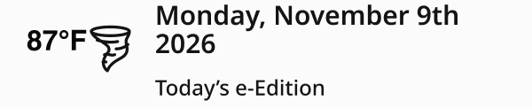
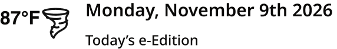
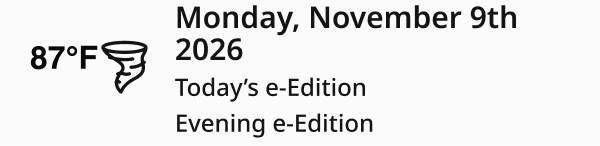
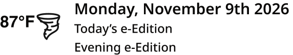

# Weather Bug

> Current temperature and weather icon with the date and the e-Edition link(s). Location = Masthead (1040px and up) or SectionMenu (the open drawer, below 1040px); Evening e-Edition = Off (one link) / On (two links: Today’s e-Edition, Evening e-Edition).

## Figma

- File: **WordPress Elements** (`b1iZxkFwtAYq9rElmnCAzd`), page **Menus and Parts**
- Component set: [`Weather Bug` · 654:10020](https://www.figma.com/design/b1iZxkFwtAYq9rElmnCAzd/?node-id=654-10020) · key `edece4e844bea8a8dd7526e6e39df1d00a56ad72`

## Properties

| Property | Default | Options |
|---|---|---|
| Evening e-Edition | Off | Off, On |
| Location | SectionMenu | SectionMenu, Masthead |

## Variants

| Variant | Size | Node | Instances | Preview |
|---|---|---|---|---|
| `Off / SectionMenu` | 300×60.87 | [654:10019](https://www.figma.com/design/b1iZxkFwtAYq9rElmnCAzd/?node-id=654-10019) | 15 |  |
| `Off / Masthead` | 285.78×40.73 | [653:5076](https://www.figma.com/design/b1iZxkFwtAYq9rElmnCAzd/?node-id=653-5076) | 45 |  |
| `On / SectionMenu` | 300×72.88 | [3758:28804](https://www.figma.com/design/b1iZxkFwtAYq9rElmnCAzd/?node-id=3758-28804) | 0 |  |
| `On / Masthead` | 285.78×52.66 | [3758:28821](https://www.figma.com/design/b1iZxkFwtAYq9rElmnCAzd/?node-id=3758-28821) | 0 |  |

## Anatomy

Default variant `Off / SectionMenu` (hidden layers marked):

- **Location=SectionMenu, Evening e-Edition=Off** `COMPONENT`: 300×60.87, horizontal, gap 12, padding 0/15/5/15, fixed×hug
  - **Weather** `FRAME`: 60.41×27.1, horizontal, gap 0, padding 0/0/0/0, hug×fixed
    - **87°F** `TEXT`: 34×16, hug×hug, "87°F", Helvetica Bold 16px
    - **tornado** `INSTANCE`: 26.41×26.41, fixed×fixed, instance of tornado ()
  - **Date and E-Edition** `FRAME`: 197.59×55.87, vertical, gap 10.87, padding 0/0/0/0, fill×hug
    - **Monday, November 9th 2026** `TEXT`: 197.59×32, fill×hug, "Monday, November 9th 2026", Noto Sans SemiBold 15px
    - **Today’s e-Edition** `TEXT`: 97×13, hug×hug, "Today’s e-Edition", Noto Sans Medium 12px

## Component tokens

From `weather-bug.tokens.json`. References point at system tokens (`tokens/core/`, `tokens/themes/`); the CSS variable is `--mng-` + the token path. A literal value means the Figma layer isn't bound to a token.

| Token | Value |
|---|---|
| `weather-bug.evening-e-edition-off.location-sectionmenu.date-and-e-edition.gap` | 10.87px |
| `weather-bug.evening-e-edition-off.location-masthead.date-and-e-edition.gap` | 11.73px |
| `weather-bug.evening-e-edition-on.location-sectionmenu.date-and-e-edition.gap` | 4.94px |
| `weather-bug.evening-e-edition-on.location-masthead.date-and-e-edition.gap` | 5.33px |
| `weather-bug.location-masthead.date-and-e-edition.width` | 213.37px |
| `weather-bug.location-masthead.date-and-e-edition.evening-e-edition.color` | `{color.theme.nav-text}` |
| `weather-bug.location-masthead.date-and-e-edition.monday-november-9th-2026.color` | `{color.theme.nav-text}` |
| `weather-bug.location-masthead.date-and-e-edition.today-s-e-edition.color` | `{color.theme.nav-text}` |
| `weather-bug.location-masthead.root.background` | `{color.gray.max}` |
| `weather-bug.location-sectionmenu.date-and-e-edition.evening-e-edition.color` | `{color.theme.nav-text}` |
| `weather-bug.location-sectionmenu.date-and-e-edition.monday-november-9th-2026.color` | `{color.theme.nav-text}` |
| `weather-bug.location-sectionmenu.date-and-e-edition.today-s-e-edition.color` | `{color.theme.nav-text}` |
| `weather-bug.location-sectionmenu.root.background` | `{color.surface.nav-panel}` |
| `weather-bug.location-sectionmenu.root.padding-bottom` | 5px |
| `weather-bug.location-sectionmenu.root.padding-left` | 15px |
| `weather-bug.location-sectionmenu.root.padding-right` | 15px |
| `weather-bug.location-sectionmenu.root.width` | 300px |
| `weather-bug.evening-e-edition-on.date-and-e-edition.evening-e-edition.font-family` | `{font.family.noto-sans}` |
| `weather-bug.evening-e-edition-on.date-and-e-edition.evening-e-edition.font-size` | 12px |
| `weather-bug.evening-e-edition-on.date-and-e-edition.evening-e-edition.font-weight` | 500 |
| `weather-bug.evening-e-edition-on.date-and-e-edition.evening-e-edition.line-height` | 12.8px |
| `weather-bug.base.date-and-e-edition.monday-november-9th-2026.font-family` | `{font.family.noto-sans}` |
| `weather-bug.base.date-and-e-edition.monday-november-9th-2026.font-size` | 15px |
| `weather-bug.base.date-and-e-edition.monday-november-9th-2026.font-weight` | 600 |
| `weather-bug.base.date-and-e-edition.monday-november-9th-2026.line-height` | 16px |
| `weather-bug.base.date-and-e-edition.today-s-e-edition.font-family` | `{font.family.noto-sans}` |
| `weather-bug.base.date-and-e-edition.today-s-e-edition.font-size` | 12px |
| `weather-bug.base.date-and-e-edition.today-s-e-edition.font-weight` | 500 |
| `weather-bug.base.date-and-e-edition.today-s-e-edition.line-height` | 12.8px |
| `weather-bug.base.root.gap` | `{spacing.150}` |
| `weather-bug.base.weather.height` | 27.1px |
| `weather-bug.base.weather.87-f.color` | `{color.theme.nav-text}` |
| `weather-bug.base.weather.87-f.font-family` | Helvetica |
| `weather-bug.base.weather.87-f.font-size` | 16px |
| `weather-bug.base.weather.87-f.font-weight` | 700 |
| `weather-bug.base.weather.87-f.line-height` | 16px |
| `weather-bug.base.weather.tornado.height` | 26.41px |
| `weather-bug.base.weather.tornado.icon-color` | `{color.gray.min}` |
| `weather-bug.base.weather.tornado.width` | 26.41px |

## Behavior and breakpoints

No Breakpoint property: one size at every width.

- **Matches production exactly** (AccuWeather widget, third-party; raw values allowed, Karl 2026-11-09): temperature Helvetica Bold 16 / 16px with a 26.41px icon, top-aligned, the pair centered on the date column; date Noto Sans SemiBold 15 / 16px, 12px after the icon; links Noto Sans Medium 12 / 12.8px, shown as typed; text `color/theme/nav-text`.
- **SectionMenu:** padding 0 15px 5px, `color/surface/nav-panel`; links 10.87px (one) / 4.94px (two) below the date (production `margin-top: 5.5%`). **Masthead:** no padding (the masthead places it), 213.37px date column, `color/gray/max`; links 11.73px / 5.33px apart.
- Several markets publish two editions (Evening e-Edition = On). The link labels change by market (for example "Digital Replica Edition", "Daily e-Edition", "e-Edition"); the labels in Figma are placeholders.

## Accessibility

- No InFocus state in Figma.
- Text color on its background must meet WCAG AA contrast (4.5:1 for text under 18px) in every theme; theme colors change per site.
- Icons inside a labelled control are decorative (`aria-hidden`); an icon-only control needs an accessible name (`aria-label`).

## Where it is used

Scope: instances in the Figma file **WordPress Elements** only (other files that use the library are not counted). Total: **60**.

Inside components: Masthead ×19, SectionMenuItem ×1.
Placed on pages: Menus and Parts ×21, Article Page ×2, Homepage ×2, Section Front ×1.
14 instances are nested inside other instances.

**Built from:** tornado ×4

## Production

Production `.accuweather-wrap`, measured on Denver Post (one link) and Morning Call (two links) 2026-11-09.

## Known issues

1. No documentation container yet.
2. **Values not bound to a token** (literal in the component tokens): `evening-e-edition-off.location-sectionmenu` date-and-e-edition gap = 10.87px; `evening-e-edition-off.location-masthead` date-and-e-edition gap = 11.73px; `evening-e-edition-on.location-sectionmenu` date-and-e-edition gap = 4.94px; `evening-e-edition-on.location-masthead` date-and-e-edition gap = 5.33px; `evening-e-edition-on` date-and-e-edition.evening-e-edition font-size = 12px; `evening-e-edition-on` date-and-e-edition.evening-e-edition font-weight = 500; `base` date-and-e-edition.monday-november-9th-2026 font-size = 15px; `base` date-and-e-edition.monday-november-9th-2026 font-weight = 600; `base` date-and-e-edition.today-s-e-edition font-size = 12px; `base` date-and-e-edition.today-s-e-edition font-weight = 500; `location-sectionmenu` root padding-bottom = 5px; `location-sectionmenu` root padding-left = 15px; and 4 more.
3. **Fonts outside Noto Sans / Noto Serif:** Helvetica.

## Files

- `weather-bug.tokens.json`: component tokens (DTCG 2025.10).
- `weather-bug.html`: HTML/CSS skeleton of every variant, using the `dist/` CSS variables (open it in a browser).
- `previews/`: PNG of every variant @2x.

*Generated 2026-11-09 by `scripts/component-export/export.py` (EXPORT-STANDARD.md section 7). Edit the text in `scripts/component-export/registry.json`, not here.*
